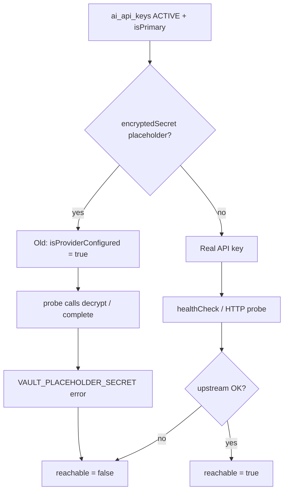

# AI Provider Health Report

**Date:** 2026-06-03  
**Service:** Prani Doctor API (`pranidoctor-backend`)  
**Scope:** LLM provider vault, health probes, endpoints, timeouts, DNS/network.

---

## Executive summary

**`reachable = 0`** in readiness and `/health/ai` almost always means one of:

1. **Seed/demo vault keys** — DB rows exist (`configured: true` in old logic) but ciphertext is `ENC:PLACEHOLDER:*` / `ENC:SEED:*` and cannot be decrypted or used for API calls.
2. **No real API keys** — `AI_VAULT_MASTER_KEY` set, but no active non-placeholder primary keys for any provider.
3. **Network/auth failures** — Real keys present but DNS, firewall, invalid key, or upstream 401/403/timeout.
4. **Probes not run yet** — `AI_HEALTH_PROBE_ENABLED=false` in dev; `getLatestProviderHealth()` returns stale zeros until first probe or `?live=1` on `/health/ai/providers`.

After this audit, **placeholder rows no longer count as configured**, probes **skip providers without usable keys**, and health checks **never fail application startup**.

---

## 1. Why `reachable = 0`

### Observed pattern (from `reports/live-llm-result.json`)

| Signal | Value | Meaning |
|--------|-------|---------|
| `openaiVaultConfigured` | true | ACTIVE primary row in `ai_api_keys` |
| `openai.reachable` | false | Probe failed |
| Error | `Seed placeholder cannot be decrypted` | Placeholder ciphertext, not a real key |
| `healthProbeEnabled` | false | Scheduled probes off in dev |
| `reachable` count in probes | 0/5 configured | All configured probes failed or were false positives |

### Root cause chain



### Fix applied

- `AiSecretService.refreshConfigurationCache()` — skips `ENC:PLACEHOLDER:*` and `ENC:SEED:*` rows.
- `resolveProviderSecret()` — returns `undefined` for placeholders (no decrypt throw).
- Health probe — **skips network** when `!isConfigured()`; uses `provider.healthCheck()` (15s timeout) instead of full chat completion for registry providers.

---

## 2. API key validation

| Check | Where | Behavior |
|-------|-------|----------|
| Vault master key | `EncryptionService.isMasterKeyConfigured()` | Required when `AI_LLM_REQUIRED=true` in production |
| Active primary key | `AiSecretService.refreshConfigurationCache()` | Only non-placeholder ACTIVE keys |
| Model env | `validateOpenAiProvider()` / `validateAnthropicProvider()` | `OPENAI_MODEL` / `ANTHROPIC_MODEL` when vault key usable |
| Env keys ignored | `validateAiSecrets()` | Warns if `OPENAI_API_KEY` / `ANTHROPIC_API_KEY` set — vault is source of truth |
| Admin key test | `testKey()` / `testProviderApiKey()` | Placeholder → `VAULT_PLACEHOLDER_SECRET` without network |
| Startup | `validateAiSecrets()` | Fails startup in **production** only if `AI_LLM_REQUIRED=true` and validation errors |

**Providers without keys:** `configured: false`, `skipped: true`, `errorCode: not_configured` — **no HTTP probe**.

**Providers with keys:** `configured: true`, live `healthCheck()` — DNS + HTTP exercised.

---

## 3. Provider endpoints (defaults)

Overrides via env per provider (see `src/modules/ai/providers/provider-config.ts`).

| Provider | Default base URL | Auth | Probe method |
|----------|------------------|------|----------------|
| openai | `https://api.openai.com/v1` | Bearer | `GET /models` or minimal chat |
| anthropic | `https://api.anthropic.com/v1` | x-api-key | `POST /messages` (max_tokens: 1) |
| gemini | `https://generativelanguage.googleapis.com/v1beta` | query `key` | `generateContent` |
| groq | `https://api.groq.com/openai/v1` | Bearer | OpenAI-compatible |
| grok | `https://api.x.ai/v1` | Bearer | OpenAI-compatible |
| deepseek | `https://api.deepseek.com/v1` | Bearer | OpenAI-compatible |
| openrouter | `https://openrouter.ai/api/v1` | Bearer + referer headers | OpenAI-compatible |
| self_hosted | `http://localhost:11434/v1` | Bearer | OpenAI-compatible (Ollama-style) |

Env overrides examples: `OPENAI_BASE_URL`, `ANTHROPIC_BASE_URL`, `GEMINI_BASE_URL`, `SELF_HOSTED_LLM_BASE_URL`.

---

## 4. Timeout settings

| Setting | Value | Location |
|---------|-------|----------|
| Health probe HTTP timeout | **15s** | `AI_HEALTH_PROBE_TIMEOUT_MS` — `provider-key-test.ts`, `healthCheck()` |
| Default provider fetch | **60s** | `providerFetch()` in `http.util.ts` (`timeoutMs` default) |
| Health probe scheduler interval | **300s** min 60s | `AI_HEALTH_PROBE_INTERVAL_SEC` |
| Probe at startup | Non-fatal | `bootstrapAiPlatform()` wrapped in try/catch |

---

## 5. DNS / network access

Diagnostics (`ai-provider-diagnostics.ts`) resolve provider hostnames via `dns.promises.lookup` before attributing failures to auth.

| Failure type | `errorCode` (typical) | Action |
|--------------|----------------------|--------|
| DNS failure | `NETWORK_ERROR` / probe message | Check corporate DNS, VPN, firewall |
| Connection refused | `provider_error` / ECONNREFUSED | Blocked egress or wrong `*_BASE_URL` |
| 401/403 | `auth` | Rotate vault key via admin API |
| 429 | `rate_limit` | Back off / quota |
| Placeholder key | `placeholder_secret` / skipped | Replace seed key in admin UI |

---

## 6. Health endpoints

| Endpoint | Purpose |
|----------|---------|
| `GET /health/ai` | Kill-switch, vault validation summary, latest probe snapshot |
| `GET /health/ai/providers` | Full diagnostics report (summary + per-provider DNS, endpoint, key status) |
| `GET /health/ai/providers?live=1` | Runs live probes then returns diagnostics |

**Startup:** Probe failures log warnings only; server continues (rules-based fallback).

---

## 7. Code map (touch points)

| File | Role |
|------|------|
| `src/modules/ai/vault/ai-secret.service.ts` | Vault cache; placeholder exclusion |
| `src/modules/ai/health/ai-health-probe.service.ts` | Scheduled probes; skip unconfigured |
| `src/modules/ai/health/ai-provider-diagnostics.ts` | DNS + report builder |
| `src/modules/ai/health/ai-health.constants.ts` | Probe/fetch timeout constants |
| `src/modules/ai/providers/provider-config.ts` | Endpoints and models |
| `src/modules/ai/providers/core/http.util.ts` | `providerFetch` + 60s default |
| `src/modules/ai/vault/provider-key-test.ts` | Admin “test key” HTTP probes |
| `src/modules/ai/bootstrap/ai-platform.bootstrap.ts` | Non-fatal probe init |
| `src/api/health/ai-providers-health.service.ts` | `/health/ai/providers` handler |

---

## 8. Recovery checklist

1. Set **`AI_VAULT_MASTER_KEY`** (32-byte base64 or passphrase) — stable across restarts.
2. Replace seed keys: Admin → AI secrets → paste real OpenAI/Anthropic keys (not `ENC:PLACEHOLDER`).
3. Confirm cache: `refreshConfigurationCache()` → `isProviderConfigured('openai')` === true.
4. Enable probes in staging: `AI_HEALTH_PROBE_ENABLED=true`.
5. Verify:
   ```bash
   curl -s "http://localhost:3000/health/ai/providers?live=1"
   ```
   Expect `summary.reachable` ≥ 1 when keys and network are valid.
6. Optional live script:
   ```bash
   npx tsx scripts/live-llm-connectivity-verify.ts
   ```

---

## 9. Environment reference

| Variable | Default (dev) | Notes |
|----------|---------------|-------|
| `AI_VAULT_MASTER_KEY` | — | Required to decrypt vault |
| `AI_LLM_REQUIRED` | false dev / true prod* | *prod default when `NODE_ENV=production` |
| `AI_HEALTH_PROBE_ENABLED` | false dev / true prod* | Scheduled background probes |
| `AI_HEALTH_PROBE_INTERVAL_SEC` | 300 | Min 60 |
| `OPENAI_MODEL` | gpt-4o-mini | When OpenAI configured |
| `ANTHROPIC_MODEL` | claude-3-5-haiku-20241022 | When Anthropic configured |

---

## 10. Tests

- `src/modules/ai/vault/ai-secret.service.test.ts` — placeholder excluded from configuration cache
- `src/modules/ai/providers/providers.test.ts` — health checks for configured providers
- `src/api/health/ai-health.service.test.ts` — aggregate AI health

Run:

```bash
npm test -- --testPathPattern="ai-secret.service|ai-health|providers.test"
```

---

*Generated from AI provider infrastructure audit — Prani Doctor backend.*
