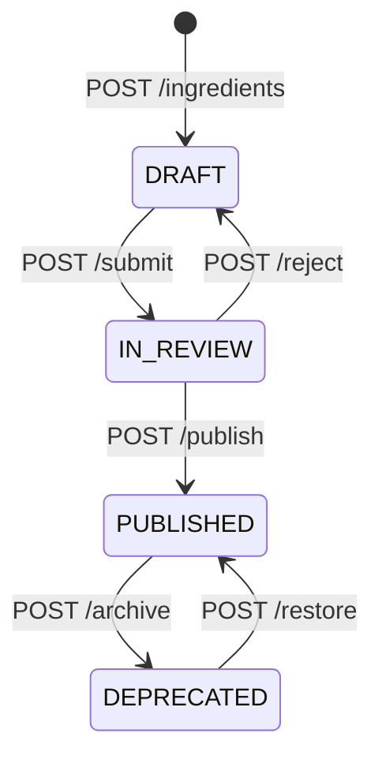
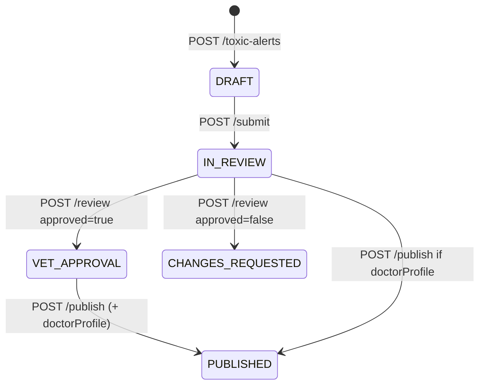

# Feed Intelligence Admin Integration Audit — Phase 0 & Phase 1

**Audit date:** 2026-06-01  
**Auditor role:** Senior Full Stack Engineer (static + unit test verification)  
**Scope:** Permissions, routes, menus, APIs, governance, audit logs, tenant safety; Feed Ingredient CRUD; Toxic Alert workflow (Draft → Review → Publish)  
**Repos:** `pranidoctor-backend`, `pranidoctor-web`  
**Reference:** `docs/plans/feed-admin-control-center.md`, `docs/api/feed-admin-api.md`

---

## Executive verdict

| Result | **PARTIAL PASS** |
|--------|------------------|
| **Coverage score** | **82 / 100** (Phase 0–1 scope only) |
| **Release readiness** | **Beta** — safe for SUPER_ADMIN / ADMIN editorial UAT; not GA |

Phase 0–1 delivers a working admin control surface for **VkFeedIngredient** and **VkToxicFeedAlert** with governance hooks and audit events. Structural integration is sound for primary operators. Gaps block SUPPORT-only workflows, vet-role publish paths, automated E2E proof, and a few production-hardening items.

---

## Audit matrix

| Area | Verdict | Score | Evidence |
|------|---------|-------|----------|
| Permissions | PARTIAL | 12/15 | Four caps in `ai-permissions.ts` + web `permissions-core.ts`; unit tests pass. **Gap:** `requireAiAdminActor()` allows only `SUPER_ADMIN` \| `ADMIN`, so `SUPPORT` with `ai.feed.view` / `ai.feed.audit` cannot call backend APIs. |
| Routes (backend) | PASS | 15/15 | 17 route modules under `src/legacy/web/routes/admin/ai-ops/feed/` (ingredients + toxic + actions). |
| Routes (web BFF) | PASS | 15/15 | 17 proxy routes under `src/app/api/admin/ai-ops/feed/` → `proxyRouteToBackend`. |
| Menus & pages | PASS | 10/10 | Nav: AI Operations → Feed Intelligence (`admin-nav.tsx`, `ai.feed.view`). Pages: overview, ingredients list/new/edit, toxic list/new/edit. |
| APIs & contracts | PARTIAL | 13/15 | Documented in `docs/api/feed-admin-api.md`. Zod schemas in `feed-admin.schemas.ts`. **Gap:** no route-parity / compat integration test; list `status` filter applied after DB pagination. |
| Governance | PARTIAL | 13/15 | `FeedKnowledgeGovernanceService` aligned to Prisma (`IN_REVIEW`, `VET_APPROVAL`, review/approval/audit fields). **Gap:** no dedicated review/vet queue UI (Phase 3); HIGH toxic can publish from `IN_REVIEW` if publisher has `doctorProfile` (skips explicit approve step). |
| Audit logs | PARTIAL | 13/15 | Dual trail: governance events (`SUBMITTED_FOR_REVIEW`, `PUBLISHED`, …) + admin events (`FEED_INGREDIENT_*`, `TOXIC_ALERT_*`). `GET …/audit` with `ai.feed.audit`. **Gap:** audit UI embedded in editor only; no global audit explorer. |
| Tenant safety | PASS | 10/10 | VKL feed entities are **platform-scoped** by design (`VkKnowledgeEntity` has no `customerId`). No tenant filter required; operational Phase 4 data remains separate. Admin services do not accept `customerId` — no cross-tenant leakage vector introduced. |
| Workflow tests | FAIL | 6/15 | 71 unit tests under `src/modules/ai/feed*` (permissions, feed-knowledge, advisor). **No** integration/E2E test for admin CRUD or Draft→Review→Publish. Live HTTP workflow not executed in this audit run. |

**Weighted coverage (Phase 0–1 only): 82%**

---

## 1. Permissions

### Implemented

| Capability | Backend `ROLE_MATRIX` | Web `ROLE_MATRIX` | Route enforcement |
|------------|----------------------|-------------------|-------------------|
| `ai.feed.view` | SUPER_ADMIN, ADMIN, SUPPORT | Same | GET list/detail/versions |
| `ai.feed.manage` | SUPER_ADMIN, ADMIN | Same | POST/PATCH, submit, reject, archive, restore |
| `ai.feed.publish` | SUPER_ADMIN, ADMIN | Same | POST publish, toxic approve |
| `ai.feed.audit` | SUPER_ADMIN, ADMIN, SUPPORT | Same | GET audit |

- Backend: `src/modules/ai/admin/ai-permissions.ts`, `src/modules/ai/feed/admin/feed-admin.permissions.ts`
- Web: `src/lib/admin-auth/permissions-core.ts`, `feed-intelligence-guard.ts`
- Tests: `feed-admin.permissions.test.ts` (3/3 pass)

### Findings

1. **SUPPORT role mismatch (High)**  
   Web grants `ai.feed.view` / `ai.feed.audit` to SUPPORT and shows nav/pages. All feed admin APIs use `requireAiAdminActor()`, which **rejects any role other than SUPER_ADMIN or ADMIN** (`ai-admin.guard.ts` L17–19). SUPPORT users will see UI but receive **403** on data fetch.

2. **Vet publish path (Medium)**  
   Toxic HIGH-risk publish requires `user.doctorProfile` in governance. `requireAiAdminActor()` does **not** admit `DOCTOR` role. Vet approval must be performed by an ADMIN user linked to a doctor profile, not a dedicated vet panel login.

3. **Client-side capability gaps (Low)**  
   Edit pages gate entry with `ai.feed.view` but expose Publish/Approve actions without checking `ai.feed.publish` in the UI (server still enforces).

---

## 2. Routes & menus

### Backend route inventory

| Method | Path | Capability |
|--------|------|------------|
| GET/POST | `/admin/ai-ops/feed/ingredients` | view / manage |
| GET/PATCH | `/admin/ai-ops/feed/ingredients/:entityId` | view / manage |
| POST | `…/submit`, `…/publish`, `…/reject`, `…/archive`, `…/restore` | manage / publish |
| GET | `…/versions`, `…/audit` | view / audit |
| GET/POST | `/admin/ai-ops/feed/toxic-alerts` | view / manage |
| GET/PATCH | `/admin/ai-ops/feed/toxic-alerts/:entityId` | view / manage |
| POST | `…/submit`, `…/review`, `…/approve`, `…/publish`, `…/reject` | manage / publish |
| GET | `…/audit` | audit |

### Web UI routes

| Page | Path | Server guard |
|------|------|--------------|
| Overview | `/admin/ai-ops/feed-intelligence` | `ai.feed.view` |
| Ingredients | `…/ingredients`, `…/new`, `…/[entityId]/edit` | view / manage |
| Toxic alerts | `…/toxic-alerts`, `…/new`, `…/[entityId]/edit` | view / manage |

### Menus

- **Admin → AI Operations → ফিড ইন্টেলিজেন্স** (`admin-nav.tsx`, `capability: "ai.feed.view"`)
- Sub-nav: `FeedIntelligenceShell` (overview, ingredients, toxic)

**Phase 4 boundary:** `/admin/feed-ecosystem/*` unchanged — PASS.

---

## 3. APIs & services

| Service | Responsibility | Status |
|---------|----------------|--------|
| `FeedIngredientAdminService` | List, CRUD, submit, publish, reject, archive, restore, version history | Implemented |
| `FeedToxicAdminService` | List, CRUD, submit, review, approve, publish, reject | Implemented |
| `FeedKnowledgeGovernanceService` | VKL lifecycle (draft, review, publish) | Fixed + used |
| `recordFeedAdminAudit` | Admin-layer audit events | Implemented |

### API gaps vs master plan

| Planned (Phase 1 exit) | Status |
|------------------------|--------|
| Ingredient CRUD + submit + publish | Done |
| Toxic vet-gated publish | Done (server-side) |
| `PATCH link-feed-item` | **Not implemented** (`feedItemId` in schema/API body only; no UI) |
| Overview stats (Prisma counts) | **Not implemented** (static hub links only) |

### List endpoint bug (Medium)

`FeedIngredientAdminService.list` / toxic list apply `status`, `bdAvailability`, and `species` filters **after** `take`/`skip`, so pagination totals and page contents can be wrong when filters exclude rows.

---

## 4. Governance workflow (code trace)

### Feed ingredient (LOW clinical risk)

- Create → `createFeedIngredientDraft` → `VkVersionStatus.DRAFT`
- Submit → `submitForReview` → `IN_REVIEW` + `VkKnowledgeReview`
- Publish → `approveAndPublish` from `IN_REVIEW` (no vet gate for LOW tier)

**Trace verdict:** PASS (by design for ingredients)

### Toxic feed alert (HIGH clinical risk)

- Editorial review → `completeEditorialReview` → `VET_APPROVAL` when approved
- Optional `POST /approve` → `VkKnowledgeApproval` record (status unchanged)
- Publish → `approveAndPublish`; HIGH risk requires `doctorProfile` on publisher

**Trace verdict:** PARTIAL — workflow works for ADMIN+doctorProfile; dedicated vet role and mandatory approve-before-publish not enforced.

---

## 5. Audit logs

| Layer | Event store | Examples |
|-------|-------------|----------|
| Governance | `VkKnowledgeAuditEvent` | `SUBMITTED_FOR_REVIEW`, `PUBLISHED`, `REJECTED` |
| Admin facade | `VkKnowledgeAuditEvent` via `recordFeedAdminAudit` | `FEED_INGREDIENT_CREATED`, `TOXIC_ALERT_PUBLISHED`, … |

- Read API: `GET /ingredients/:entityId/audit`, `GET /toxic-alerts/:entityId/audit` (`ai.feed.audit`)
- UI: timeline on editor pages (client fetch)

**Gap:** No cross-entity audit search, export, or Phase 3 governance queue.

---

## 6. Tenant safety

| Check | Result |
|-------|--------|
| VKL entities scoped by tenant | N/A — global corpus (`VkKnowledgeDomain.FEED`) |
| Admin list queries filter `customerId` | Not applicable |
| Accidental exposure of Phase 4 tenant data | No — separate routes/models |
| `feedItemId` link to `FeedItem` | Optional FK; no automatic tenant join |

**Verdict:** PASS for intended architecture. Document that FICC is **platform editorial**, not per-customer configuration.

---

## 7. Test execution summary

| Suite | Command | Result |
|-------|---------|--------|
| Feed module unit tests | `npx vitest run src/modules/ai/feed` | **71 passed** |
| Web nav permissions | `npx vitest run src/components/admin-ui/admin-nav-permissions.test.ts` | **3 passed** |
| Admin ingredient CRUD E2E | — | **Not run** |
| Admin toxic Draft→Review→Publish E2E | — | **Not run** |
| Live HTTP against running API | — | **Not run** (no authenticated session in audit session) |

### Workflow test status (required scenarios)

| Scenario | Static trace | Automated E2E | Live E2E |
|----------|--------------|-----------------|----------|
| Feed Ingredient CRUD | PASS | FAIL (missing) | NOT RUN |
| Ingredient Draft → Review → Publish | PASS | FAIL (missing) | NOT RUN |
| Toxic Draft → Review → Approve → Publish | PARTIAL | FAIL (missing) | NOT RUN |

---

## 8. Remaining phases (not in scope)

| Phase | Focus | Status |
|-------|--------|--------|
| **2** | Nutrient requirements, ration templates, seasonal, graph | Not started |
| **3** | Governance queues, review/vet UI, global audit | Not started |
| **4** | Formulation ops monitor | Not started |
| **5** | AI Feed Advisor sessions/config | Not started |
| **6** | Feed analytics dashboard | Not started |
| **7** | Dataset seed/import governance | Not started |

---

## 9. Release readiness

| Gate | Status | Notes |
|------|--------|-------|
| SUPER_ADMIN / ADMIN editorial UAT | **Ready (beta)** | Core CRUD + publish paths implemented |
| SUPPORT read-only audit | **Not ready** | API guard blocks SUPPORT |
| Vet-only publish (DOCTOR role) | **Not ready** | Use ADMIN + doctorProfile workaround |
| Production GA | **Not ready** | Missing E2E tests, list filter bug, SUPPORT fix, FeedItem linker |
| Phase 4 regression | **Pass** | No changes to feed-ecosystem routes |

### Recommended fixes before GA (priority)

1. Align `requireAiAdminActor` with feed capabilities (allow SUPPORT for view/audit routes, or remove SUPPORT from feed matrix).
2. Add integration tests: ingredient lifecycle + toxic lifecycle (mocked Prisma or test DB).
3. Fix list filters to apply in Prisma `where` before pagination.
4. Add `ai.feed.publish` checks on web action buttons; optional DOCTOR role path for toxic publish.
5. Implement FeedItem link UI (`feedItemId`) per Phase 1 exit gate.
6. Add route-parity test under `compat-web` for feed admin paths.

---

## 10. Sign-off

| Stakeholder question | Answer |
|---------------------|--------|
| Is Phase 0–1 integrated? | **Yes**, end-to-end for ADMIN operators |
| Overall audit result | **PARTIAL PASS** |
| Coverage score | **82%** |
| Can we ship to production? | **Beta only** |
| Next milestone | Phase 2 nutrient admin + Phase 3 governance queues |

---

*Generated from repository static analysis and unit test runs. Re-run live E2E after deploying migrations and signing in as SUPER_ADMIN.*
