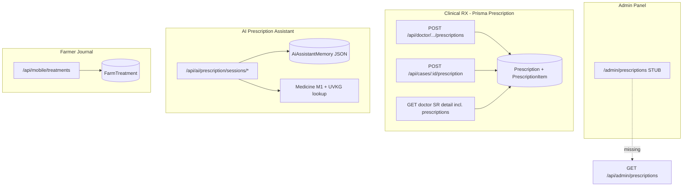

# Prescription Module — Full Gap Analysis

**Date:** 2026-06-01  
**Auditor:** Principal Platform Architect  
**Scope:** Clinical prescriptions, AI prescription assistant, medicine intelligence, UVKG, admin panel  
**Repos:** `pranidoctor-backend`, `pranidoctor-web`, `pranidoctor_user` (mobile)

**Admin symptom:** `/admin/prescriptions` shows `AdminModuleUnavailable` — **missingApi: `GET /api/admin/prescriptions`**

---

## Executive Summary

Prescription-related capability in Prani Doctor is **not a single module**. It spans **four separate domains**:

| Domain | Purpose | Admin panel? |
|--------|---------|--------------|
| **A. Clinical `Prescription` / `PrescriptionItem`** | Vet-written RX tied to `ServiceRequest` | ❌ No admin API/UI |
| **B. `TreatmentCase` + `TreatmentWorkflow`** | Consultation → diagnosis → RX workflow | ❌ No admin surface |
| **C. AI Prescription Assistant** | Farmer/vet AI sessions (`/api/ai/prescription/*`) | ❌ Generic AI ops only |
| **D. `FarmTreatment` (mobile)** | Farmer treatment journal (`prescription` text + `medicinesJson`) | ❌ Not clinical RX admin |
| **E. Medicine Commercial Intelligence (M1)** | BD brand/generic registry, contracts | ❌ Separate product (see medicine audit) |
| **F. UVKG + VKL `MEDICINE`** | Knowledge graph + RAG for drug lookup | ❌ Internal/AI ops only |

**Answer to core question:**

> **Clinical prescription data and write paths already exist in the backend, but the Admin Prescription module was never built or wired.**  
> This is **not** “flip a flag and connect” — there is **no** `GET /api/admin/prescriptions`, no admin service, and no list/detail UI.  
> **Do not rebuild** Prisma models or doctor POST flows; **add a thin admin read/write layer** on top of existing `Prescription` tables and reuse doctor DTOs/UI patterns.

**Estimated completion (Admin Prescription product):** **~12%**  
**Estimated completion (platform clinical RX overall):** **~58%**

---

## 1. Search inventory (backend)

### 1.1 Clinical prescription (Prisma)

| Model | Table / notes |
|-------|----------------|
| `Prescription` | `Prescription` — `serviceRequestId`, `doctorId`, `animalId`, `status`, `instructions`, `validUntil` |
| `PrescriptionItem` | Line items: `medicineName`, `dosage`, `duration`, `instruction`, `quantity` |
| `PrescriptionStatus` | `ACTIVE`, `VOIDED` |

**Relations:** `ServiceRequest`, `DoctorProfile`, `AnimalProfile`, `AiTechnicianProfile`.

### 1.2 Treatment / medical records (related, not identical)

| Model | Role |
|-------|------|
| `TreatmentCase` | Clinical case record (`@@map("TreatmentRecord")`) — diagnosis, symptoms, notes |
| `TreatmentWorkflow` | State machine per service request |
| `TreatmentConsultation`, `TreatmentFollowup`, `TreatmentNote` | Workflow substeps |
| `BillingRecord` | May link `treatmentCaseId`; `medicineCost` on bills |

### 1.3 Farmer treatment journal (separate)

| Model | Role |
|-------|------|
| `FarmTreatment` | Customer-owned journal: `prescription` (free text), `medicinesJson` — **not** `Prescription` rows |

### 1.4 Medicine intelligence (commercial, not clinical RX)

| Model | Role |
|-------|------|
| `MedicineGeneric`, `MedicineBrand`, `VetCompany`, contracts, `VkMedicineKnowledgeGraphEdge` | M1 commercial registry |
| `AiKnowledgeEntry` (`contentType: MEDICINE`) | VKL corpus for AI lookup |
| `VkKnowledgeLink` (`MEDICINE_GENERIC`, `MEDICINE_BRAND`) | UVKG |

### 1.5 AI prescription sessions (not SQL `Prescription` table)

| Storage | Role |
|---------|------|
| `AiAssistantMemory` (`CASE_CONTEXT`, key `prescription:session:{id}`) | In-memory JSON `AiPrescriptionSession` |
| Module | `src/modules/ai/ai-prescription/*` |

---

## 2. Existing services

| Service / module | Path | Clinical `Prescription` table? |
|------------------|------|--------------------------------|
| `createPrescriptionForDoctor` | `legacy/web/lib/doctor-service-requests/doctor-clinical-service.ts` | ✅ CREATE |
| `toDoctorPrescriptionSummaryDto` | same | ✅ Map |
| `TreatmentWorkflowService.createPrescription` | `modules/treatment-workflow/treatment-workflow.service.ts` | ✅ CREATE (workflow rules) |
| `mapPrescription` / aggregate read | `treatment-workflow/domain/treatment.mapper.ts` | ✅ READ (within case aggregate) |
| `AiPrescriptionOrchestratorService` | `modules/ai/ai-prescription/` | ❌ AI session only |
| `MedicineKnowledgeRetrievalService`, `prescription-integration` | `modules/ai/medicine/` | ❌ Enrichment for AI |
| `listTreatmentsForCustomer` | `legacy/web/lib/mobile-treatments/treatment-service.ts` | ❌ `FarmTreatment` only |
| `seedPrescriptionsForUser` | `modules/dev/seeds/prescription.seed.ts` | ✅ Dev seed |
| **Admin prescription service** | — | ❌ **Does not exist** |

---

## 3. Existing APIs

### 3.1 Clinical prescription HTTP

| Method | Path | Status | Notes |
|--------|------|--------|-------|
| **POST** | `/api/doctor/service-requests/:id/prescriptions` | ✅ Implemented | Legacy route; creates `Prescription` + items |
| **GET** | `/api/doctor/service-requests/:id/prescriptions` | ❌ **Not implemented** | OpenAPI lists GET; route file is **POST only** |
| **POST** | `/api/cases/:id/prescription` | ✅ Implemented | Express `TreatmentWorkflowModule` (`cases` metadata) |
| **GET** | `/api/cases/:id/treatment` | ✅ Implemented | Returns aggregate incl. `prescriptions[]` |
| **GET** | `/api/admin/prescriptions` | ❌ **Missing** | Required by admin UI |
| **GET/PATCH/POST** | `/api/admin/prescriptions/:id` | ❌ **Missing** | Edit/PDF not started |

### 3.2 Embedded reads (no standalone prescription list API)

| Surface | Includes prescriptions? |
|---------|-------------------------|
| `GET /api/doctor/service-requests/:id` | ✅ `prescriptions[]` via `doctor-detail-include.ts` |
| `GET /api/admin/service-requests/:id` | ❌ No `prescriptions` in admin service (verify when building admin) |
| Treatment workflow `getTreatment` | ✅ `prescriptions` in aggregate |

### 3.3 AI prescription (mobile / customer)

| Method | Path |
|--------|------|
| POST | `/api/ai/prescription/sessions` |
| GET | `/api/ai/prescription/sessions/:sessionId` |
| POST | `/api/ai/prescription/sessions/:id/analyze`, `/lookup`, `/interactions`, `/withdrawal`, `/escalate` |
| POST | `/api/ai/assistants/prescription` |

Auth: mobile customer + AI consent — **not** admin panel.

### 3.4 Medicine intelligence admin (not clinical RX list)

| Prefix | Purpose |
|--------|---------|
| `/api/admin/ai-ops/medicine/*` | Commercial registry (24 routes) — **no** `Prescription` CRUD |

### 3.5 Mobile farmer treatments

| Method | Path | Model |
|--------|------|-------|
| GET/POST | `/api/mobile/treatments` | `FarmTreatment` |
| GET/PATCH | `/api/mobile/treatments/:id` | `FarmTreatment` |

---

## 4. Frontend (admin) requirements vs reality

### 4.1 Admin page today

**File:** `pranidoctor-web/src/app/admin/(dashboard)/prescriptions/page.tsx`

```tsx
<AdminModuleUnavailable missingApi="GET /api/admin/prescriptions" />
```

**Nav:** `admin-nav.tsx` → `/admin/prescriptions` (visible; non-functional).

### 4.2 Required vs implemented

| Requirement | Backend | Web BFF | Admin UI |
|-------------|---------|---------|----------|
| `GET /api/admin/prescriptions` | ❌ | ❌ | ❌ |
| List + pagination | ❌ | ❌ | ❌ |
| Search / filters (doctor, animal, date, status) | ❌ | ❌ | ❌ |
| `GET /api/admin/prescriptions/:id` | ❌ | ❌ | ❌ |
| Create / edit form | Partial (doctor POST only) | Doctor proxy only | ❌ |
| PDF export | ❌ | ❌ | ❌ |

### 4.3 Reusable frontend (not admin prescriptions)

| Asset | Path | Reuse for admin |
|-------|------|-----------------|
| Doctor RX form UX | `components/doctor/DoctorCaseClinicalSection.tsx` | ✅ Line items, POST to doctor API |
| Doctor API proxy | `app/api/doctor/service-requests/[id]/prescriptions/route.ts` | Pattern for BFF proxy |
| Service request admin | `admin/service-requests/*` | ✅ Link RX to case |
| Reports partial | `admin/reports/ReportsAdminView` | Completed SR summary only |
| Billing `medicineCost` | `AdminBillingList` | Display only |

### 4.4 Mobile app (`pranidoctor_user`)

| Feature | Path |
|---------|------|
| Treatment journal | `features/treatment/presentation/treatment_prescription_page.dart` |
| Farm treatments API | Uses `/api/mobile/treatments` — **not** clinical `Prescription` |

---

## 5. Architecture diagram (current)



---

## 6. Gap classification

### 6.1 Implemented but not connected (admin)

| Capability | Exists? | Connected to admin? |
|------------|---------|---------------------|
| `Prescription` / `PrescriptionItem` schema | ✅ | ❌ |
| Create RX (doctor legacy POST) | ✅ | ❌ |
| Create RX (treatment workflow POST) | ✅ | ❌ |
| Read RX (doctor SR detail) | ✅ | ❌ |
| DTO mappers (`DoctorPrescriptionSummaryDto`) | ✅ | ❌ |
| Dev seed data | ✅ | ❌ |
| Doctor web UI create/list per case | ✅ | N/A (doctor panel) |

### 6.2 Missing (admin product)

| Capability | Status |
|------------|--------|
| `admin-prescription.service.ts` (list/filter/get) | ❌ |
| `GET /api/admin/prescriptions` | ❌ |
| `GET /api/admin/prescriptions/:id` | ❌ |
| Admin PATCH/void | ❌ |
| PDF generation endpoint | ❌ |
| BFF proxies under `app/api/admin/prescriptions` | ❌ |
| Admin list/detail/edit pages | ❌ |
| Permissions beyond `admin.panel` | ❌ (optional `admin.prescriptions.*`) |

### 6.3 Separate products (do not merge into clinical admin RX)

| Product | Do not conflate with `/admin/prescriptions` |
|---------|---------------------------------------------|
| AI Prescription Assistant sessions | Ops/debug under AI Center, not RX table |
| Medicine Intelligence (`/admin/ai-ops/medicine-intelligence` — planned) | Commercial catalog |
| `FarmTreatment` mobile journal | Customer app |
| UVKG sync | Graph ops |

### 6.4 Minor backend gaps (non-admin)

| Gap | Impact |
|-----|--------|
| OpenAPI documents GET on doctor prescriptions route; handler missing | Doctor clients cannot list RX without full SR detail |
| Two create paths (legacy doctor vs `/api/cases`) | Operators must understand dual workflow |
| No `VOIDED` admin/doctor API surfaced | Status enum exists; void flow unclear |

---

## 7. Feature matrix

| Feature | DB | Service | API | Admin UI | Status |
|---------|----|---------| ----|----------|--------|
| Clinical RX schema | ✅ | — | — | — | **Backend Only** |
| Create RX (doctor) | ✅ | ✅ | ✅ POST | ❌ | **Partial** |
| Create RX (workflow) | ✅ | ✅ | ✅ POST | ❌ | **Partial** |
| List RX (platform) | ✅ | ❌ dedicated | ❌ | ❌ | **Missing** |
| Read RX (doctor SR detail) | ✅ | ✅ | ✅ embedded | ❌ | **Partial** |
| Admin list/search/pagination | ✅ data | ❌ | ❌ | ❌ | **Missing** |
| Admin detail/edit | ✅ data | ❌ | ❌ | ❌ | **Missing** |
| Admin PDF | ❌ | ❌ | ❌ | ❌ | **Missing** |
| AI prescription assistant | ✅ memory | ✅ | ✅ `/api/ai/*` | ❌ | **Backend Only** (AI) |
| Medicine lookup for AI | ✅ VKL/M1 | ✅ | AI runtime | ❌ | **Backend Only** |
| UVKG medicine graph | ✅ | ✅ | internal | ❌ | **Backend Only** |
| Farmer treatment journal | ✅ | ✅ | ✅ mobile | ❌ | **Separate product** |
| Medicine commercial admin | ✅ | ✅ | ✅ `ai-ops/medicine` | ❌ planned | **Separate product** |

---

## 8. Completion estimates

| Layer | % | Notes |
|-------|---|-------|
| **Database models (clinical RX)** | **95%** | `Prescription` + items + relations complete |
| **Backend write (clinical)** | **70%** | Two create paths; no void/update/list admin |
| **Backend read (clinical)** | **45%** | Embedded in doctor detail + workflow aggregate only |
| **Admin API** | **0%** | No routes |
| **Admin UI** | **5%** | Stub page + nav only |
| **AI prescription assistant** | **85%** | Mobile/runtime complete; no admin ops console |
| **End-to-end Admin Prescription module** | **~12%** | |
| **Platform clinical prescription (all roles)** | **~58%** | |

---

## 9. Conclusion

| Question | Answer |
|----------|--------|
| Is prescription functionality already implemented? | **Yes, in silos** — clinical CREATE + embedded READ, AI assistant, farmer journal, medicine/UVKG for lookup. |
| Is it connected to the admin panel? | **No** — zero admin prescription routes or UI. |
| Is the module still missing? | **The Admin Prescription product is missing.** Core tables and doctor flows are **not** missing. |
| Rebuild or connect? | **Connect** — add admin list/detail (and optional void/edit) on existing `Prescription` model; reuse `toDoctorPrescriptionSummaryDto` patterns. |

---

## 10. Implementation plan (connect existing system — do not rebuild)

**Principle:** Thin admin layer over `prisma.prescription` + `prescriptionItem`; reuse doctor DTOs; keep AI and M1 separate.

### Phase 0 — Shared admin DTO (0.5 day)

- [ ] Extract or mirror `DoctorPrescriptionSummaryDto` → `AdminPrescriptionListItemDto` (+ `serviceRequest` summary, doctor name, animal tag)
- [ ] Zod query schema: `page`, `limit`, `search`, `status`, `doctorId`, `animalId`, `from`, `to`

### Phase 1 — Read APIs (1–2 days)

**Backend** (`src/legacy/web/lib/admin-prescriptions/` + routes):

| Method | Path | Behavior |
|--------|------|----------|
| GET | `/api/admin/prescriptions` | `findMany` + count; include items, SR, doctor, animal; filters |
| GET | `/api/admin/prescriptions/:id` | Detail + items + audit metadata |

**Web:**

- [ ] `app/api/admin/prescriptions/route.ts` + `[id]/route.ts` proxies
- [ ] Replace `AdminModuleUnavailable` with list page (table, filters, pagination)
- [ ] Detail drawer or `/admin/prescriptions/[id]` page

**Reuse:**

- `toDoctorPrescriptionSummaryDto` mapping logic (import or shared `prescription.mapper.ts`)
- Table patterns from `ServiceRequestsList`, `AdminBillingList`

### Phase 2 — Cross-links (0.5 day)

- [ ] Extend `adminGetServiceRequest` include `prescriptions` (same shape as doctor detail)
- [ ] Service request admin detail tab: “Prescriptions”
- [ ] Prescription list row → link to `/admin/service-requests/:id`

### Phase 3 — Write / void (optional, 1 day)

| Method | Path | Behavior |
|--------|------|----------|
| PATCH | `/api/admin/prescriptions/:id` | Update instructions, validUntil, void (`VOIDED`) |
| POST | `/api/admin/prescriptions` | **Optional** — prefer directing creates to doctor workflow; admin create only if product requires |

**Do not duplicate** `createPrescriptionForDoctor` logic — call shared function in `doctor-clinical-service.ts` or new `prescription-clinical.service.ts`.

### Phase 4 — PDF (optional, 1–2 days)

- [ ] `GET /api/admin/prescriptions/:id/pdf` — template render (new; no existing PDF service found in audit)
- Defer if not P0

### Phase 5 — AI / medicine boundaries (documentation only)

- [ ] Nav labels: “Clinical prescriptions” vs “Medicine Intelligence” vs “AI Prescription ops”
- [ ] Optional future: AI session list under `/admin/ai-ops/prescription-sessions` (reads `AiAssistantMemory`, not `Prescription` table)

### Phase 6 — Fix doctor GET gap (0.5 day, optional)

- [ ] Implement `GET /api/doctor/service-requests/:id/prescriptions` or document that clients must use SR detail

### Permissions

- Minimum: existing `requireAdminPanelApiAccess()`
- Optional: `admin.prescriptions.read` / `admin.prescriptions.manage` in `permissions-core.ts`

### Effort summary

| Phase | Days |
|-------|------|
| 0–1 (MVP list + detail) | 2–3 |
| 2 cross-links | 0.5 |
| 3 write/void | 1 |
| 4 PDF | 1–2 |
| **MVP (0–2)** | **~3 days** |

---

## 11. Risks

| Risk | Mitigation |
|------|------------|
| Conflating clinical RX with AI sessions or `FarmTreatment` | Clear nav + separate routes |
| Dual create paths (doctor vs cases) | Admin read-only first; document workflow |
| Medicine name free text vs `MedicineBrand` FK | Phase 2+ optional autocomplete via `ai-ops/medicine/search` |
| No PDF infrastructure | Defer Phase 4 |

---

**Audit completed:** 2026-06-01  
**Next step:** Execute Phase 0–1 when product approves (planning only in this document).
