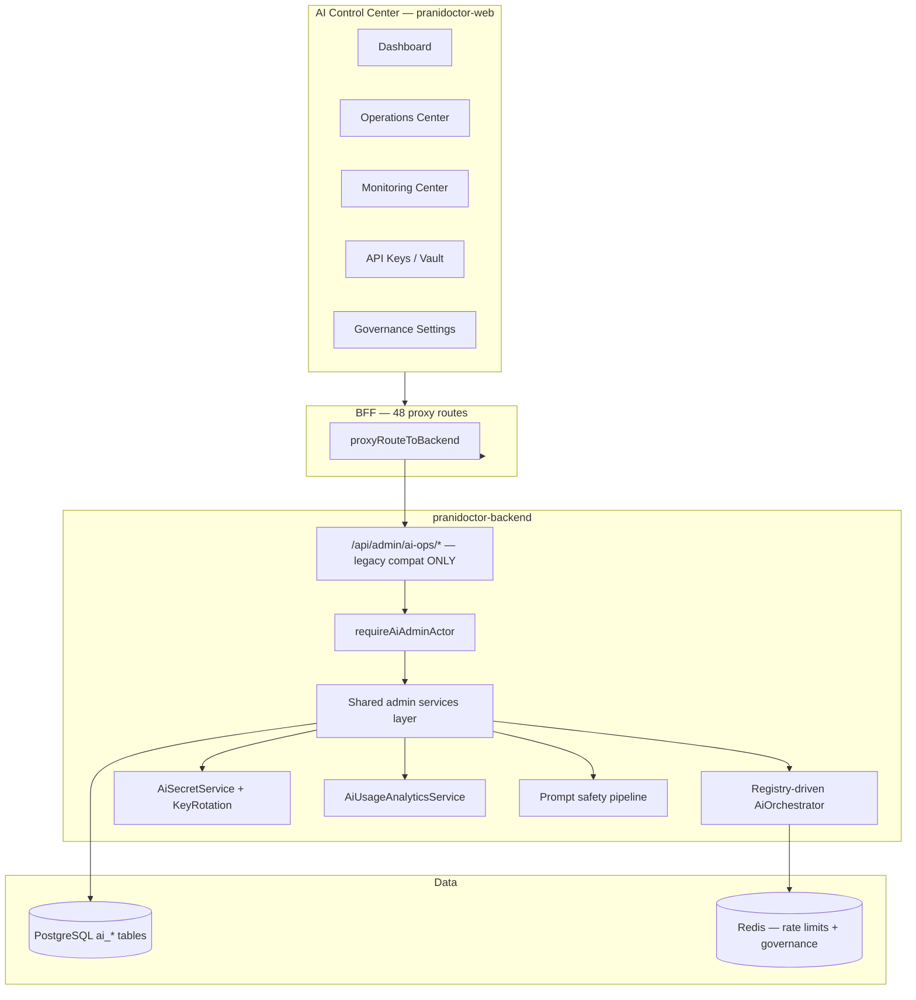
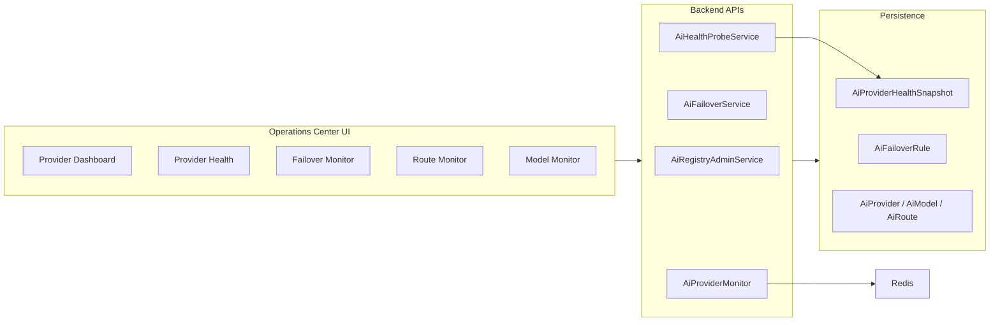
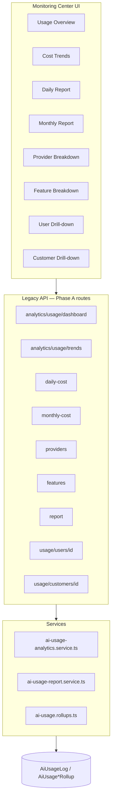
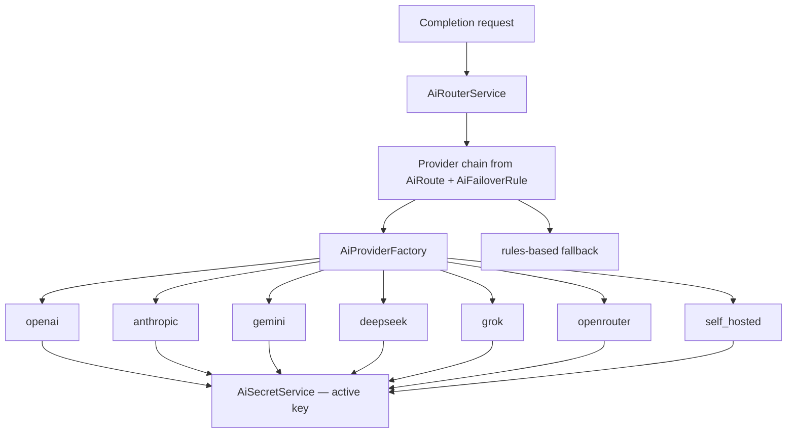
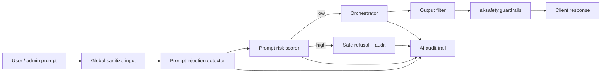
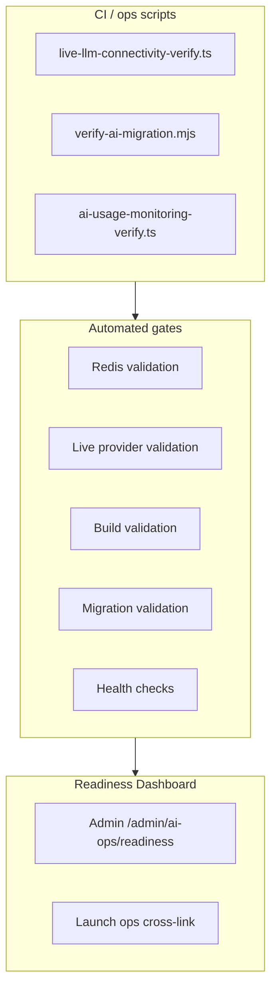
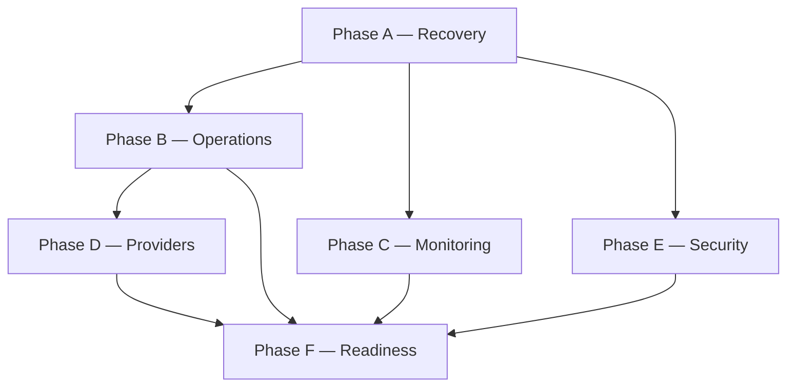

# AI Control Center Recovery — Master Plan

**Role:** Principal AI Platform Architect  
**Date:** 2026-05-30  
**Status:** Design / planning only — **no implementation**  
**Source audit:** `docs/reports/AI_SYSTEM_CURRENT_STATUS_REPORT.md`  
**Related plans:** `docs/plans/AI_PRODUCTION_COMPLETION_PLAN.md`, `docs/reports/AI_PRODUCTION_READINESS_REPORT.md`

**Repositories:**

| Repo | Role in this plan |
|------|-------------------|
| `pranidoctor-backend` | Legacy admin API, vault, orchestrator, analytics, security middleware |
| `pranidoctor-web` | AI Center UI, BFF proxies, readiness dashboard |
| `pranidoctor_user` | Minimal — mobile unaffected by Control Center; security/audit hooks only |

**Naming:** “AI Center” (web sidebar) = **AI Control Center**. Sub-areas: **Operations Center** (providers/routes/failover), **Monitoring Center** (usage/cost analytics).

---

## Executive summary

The audit found a **72% feature-complete** LLM platform with **58% production readiness**. The AI Control Center admin surface is visually complete (11 pages, 48 BFF routes) but **operationally broken** for secrets and **partially disconnected** for analytics, prompts, and audit due to a **20-route gap** between web BFF and backend legacy compat handlers.

**Root cause:** Two parallel admin API stacks:

1. **Production path:** Web BFF → `proxyRouteToBackend()` → legacy compat `/api/admin/ai-ops/*` (`src/legacy/web/routes/admin/ai-ops/`, 28 routes).
2. **Dormant path:** Express `AiAdminModule` → `configureAiAdminRoutes()` at `/api/admin-ai-ops/*` — **not mounted** (`src/modules/index.ts` L55); guarded by `INTERNAL_ADMIN_AI_OPS_TOKEN` (`ai-admin.middleware.ts`).

**Strategic decision (recommended):** **Consolidate on legacy compat routes** for all admin AI ops. Reuse existing services (`AiSecretService`, `AiAdminController` logic extracted to shared admin services). Retain Express `AiAdminModule` only as break-glass internal tooling OR remove after parity. Do **not** require BFF to send `x-internal-admin-token` for normal admin sessions.

**Phase sequence:**

| Phase | Focus | Unblocks |
|-------|-------|----------|
| **A** | Control Center Recovery | Secrets, route parity, key management UI |
| **B** | AI Operations Center | Provider/failover/route/model observability |
| **C** | AI Monitoring Center | Full analytics dashboards |
| **D** | Provider Expansion | Registry-driven orchestrator + 5 providers |
| **E** | Security Hardening | Prompt injection, audit trail |
| **F** | Production Readiness | GA gate ≥85/100 |

**Estimated duration:** A: 1–2 weeks · B: 1–2 weeks · C: 2 weeks · D: 2–3 weeks · E: 2 weeks · F: 1 week (parallel ops work in F throughout).

---

## Target architecture (post-recovery)



---

## Route parity inventory (Phase A driver)

Web BFF routes **without** legacy backend handlers (must add or remove BFF):

| BFF path (under `/api/admin/ai-ops/`) | Priority | Handler source |
|---------------------------------------|----------|----------------|
| `secrets` GET/POST | **P0** | `AiAdminController.listSecrets/addSecret` → extract to `AiVaultAdminService` |
| `secrets/[id]` PUT | **P0** | `updateSecret` |
| `secrets/[id]/test` POST | **P0** | `testSecret` + `provider-key-test.ts` |
| `secrets/[id]/disable` POST | **P0** | `disableSecret` |
| `secrets/[id]/rotate` POST | **P0** | `rotateSecret` + `key-rotation.service.ts` |
| `secrets/[id]/audit` GET | **P0** | `listSecretAudit` |
| `audit` GET | **P1** | `auditLog` |
| `analytics/usage/report` GET | **P1** | `usageReport` — powers Logs panel |
| `analytics/usage/trends` GET | **P1** | `usageCostTrends` |
| `analytics/usage/daily-cost` GET | **P1** | `usageDailyCost` |
| `analytics/usage/monthly-cost` GET | **P1** | `usageMonthlyCost` |
| `analytics/usage/providers` GET | **P1** | `usageProviderComparison` |
| `analytics/usage/features` GET | **P1** | `usageFeatureComparison` |
| `usage/users/[userId]` GET | **P2** | `userTokenUsage` |
| `usage/customers/[customerId]` GET | **P2** | `customerTokenUsage` |
| `prompts/[id]` GET/PUT/DELETE | **P1** | prompt management handlers |
| `prompts/[id]/publish` POST | **P1** | `publishPrompt` |
| `prompts/[id]/rollback` POST | **P1** | `rollbackPrompt` |
| `prompts/keys/[promptKey]/versions` GET | **P1** | `listPromptVersions` |
| `prompts/keys/[promptKey]/drafts` POST | **P1** | `createPromptDraftFromPublished` |
| `prompts/[id]/activate` POST | **P2** | exists — verify parity |

**Pattern for new legacy routes:** Mirror `src/legacy/web/routes/admin/ai-ops/providers/route.ts` — `requireAiAdminActor()` from `src/modules/ai/admin/ai-admin.guard.ts`, delegate to service, `jsonOk` / `jsonError`.

---

# Phase A — Control Center Recovery

## Objective

Restore **end-to-end admin operability** for the AI Control Center: secrets vault, full BFF↔backend route parity, API key lifecycle UI, and a single authenticated admin path (cookie session — no internal token for normal ops).

**Resolves audit blockers:** B1, B2, B4, B6 (partial), P0-1, P0-6, P1-7.

## Architecture

1. **Extract** admin handler logic from `AiAdminController` (`ai.controller.ts` L279+) into dedicated admin services under `src/modules/ai/admin/`:
   - `ai-vault-admin.service.ts` — secrets CRUD, test, rotate, audit
   - `ai-analytics-admin.service.ts` — usage report, trends, cost endpoints (thin wrapper over existing analytics services)
   - `ai-audit-admin.service.ts` — audit log queries
2. **Add** legacy compat route files under `src/legacy/web/routes/admin/ai-ops/` for every missing BFF path (see inventory above).
3. **Do not mount** `createAiAdminModule()` at `/api/admin/ai-ops` (path collision with compat router). Options:
   - **Option A (recommended):** Leave unmounted; document Express module as deprecated.
   - **Option B:** Mount at `/api/internal/admin-ai-ops` with `INTERNAL_ADMIN_AI_OPS_TOKEN` for automation/CI only.
4. **Auth flow (production):**
   ```
   Admin browser → Web session cookie → requireAdminPanelApiAccess (web BFF)
   → proxyRouteToBackend (forwards Cookie header)
   → requireAiAdminActor (backend legacy) → actor.id for audit
   ```
5. **Secrets mutations:** Enforce `SUPER_ADMIN` + capability `ai.secrets.manage` on backend (match `permissions-core.ts`); web already gates `ApiKeysPanel` via `canManageSecrets`.

## Database impact

| Change | Required? | Details |
|--------|-----------|---------|
| New tables | **No** | `AiApiKey`, `AiApiKeyAuditLog` exist |
| New migrations | **No** | Indexes present in `20260603120000`, `20260603140000` |
| Seed updates | **Optional** | Replace `ENC:SEED` placeholders after first real key via admin |
| Data backfill | **Optional** | Import env keys via `AI_VAULT_IMPORT_ENV_KEYS` bootstrap |

## Backend tasks

| ID | Task | Files / references |
|----|------|-------------------|
| A-B1 | Create `AiVaultAdminService` wrapping `getAiSecretService()`, `getKeyRotationService()` | New: `admin/ai-vault-admin.service.ts` |
| A-B2 | Add legacy routes: `secrets/route.ts`, `secrets/[id]/route.ts`, `secrets/[id]/test|disable|rotate|audit/route.ts` | `src/legacy/web/routes/admin/ai-ops/secrets/**` |
| A-B3 | Add legacy routes for audit, analytics/usage/*, extended prompts/* | Same tree |
| A-B4 | Add Zod request schemas for secret create/update (reuse patterns from `ai-admin.schemas.ts`) | `admin/ai-admin.schemas.ts` |
| A-B5 | Wire `requireAiAdminActor` + role check for secret mutations | Each new route file |
| A-B6 | Add route registry smoke test: assert every web BFF ai-ops path has legacy handler | New: `src/modules/compat-web/ai-ops-route-parity.test.ts` |
| A-B7 | Document deprecate `AiAdminModule` / update `ai-admin.middleware.ts` comment | `ai.module.ts`, docs |
| A-B8 | Add `INTERNAL_ADMIN_AI_OPS_TOKEN` to `.env.example` with break-glass note | `.env.example` |
| A-B9 | Extend `provider-key-test.ts` prefix validation for all factory provider keys | `vault/provider-key-test.ts`, `ai-secret.service.ts` |
| A-B10 | On key test/rotate: write `AiApiKeyAuditLog` entries (verify existing paths) | `ai-secret.service.ts`, `key-rotation.service.ts` |
| A-B11 | Remove or redirect dead `AiService` placeholder | `ai.service.ts` — delete or wire to orchestrator (cleanup) |

## Web admin tasks

| ID | Task | Files |
|----|------|-------|
| A-W1 | **Add API Key form** — create key (provider, name, plaintext, optional expiry) | New: `ApiKeyCreateDialog.tsx`; wire `POST /api/admin/ai-ops/secrets` |
| A-W2 | **Rotate key UI** — confirm dialog + `POST …/rotate` | Extend `ApiKeysPanel.tsx` |
| A-W3 | **Validation feedback** — show prefix errors, test latency, last test result | Extend `ApiKeysPanel.tsx` |
| A-W4 | **Key health column** — status badge from list payload (`status`, `lastUsedAt`) | `ApiKeysPanel.tsx`, `ai-admin-badges.tsx` |
| A-W5 | **Audit log drawer** — `GET …/secrets/[id]/audit` | New component or tab in ApiKeysPanel |
| A-W6 | Wire existing Zod schemas from `src/lib/admin-ai/schemas.ts` to forms | `schemas.ts` → dialogs |
| A-W7 | Add `ensureAiCenterAccess` to legacy pages: failover, governance, knowledge, risk | `ai-ops/failover/page.tsx`, etc. |
| A-W8 | Verify all 48 BFF routes return non-404 against local backend | Manual + optional e2e script |

## Mobile tasks

| ID | Task | Notes |
|----|------|-------|
| A-M1 | **None required** | Vault is admin-only |
| A-M2 | Verify mobile AI chat still works after vault keys configured | Smoke test only |

## Security impact

| Area | Impact |
|------|--------|
| **Positive** | Secrets manageable without SSH/env edits; audit trail visible in admin |
| **Risk** | New routes must never return plaintext secrets in GET responses (maintain hint-only) |
| **Risk** | Secret create/rotate limited to `SUPER_ADMIN` + backend role enforcement |
| **Mitigation** | Reuse `EncryptionService`; audit every mutation; rate-limit test endpoint |

## Testing strategy

| Layer | Tests |
|-------|-------|
| Unit | `ai-vault-admin.service.test.ts` — mock Prisma + encryption |
| Integration | Legacy route tests with `requireAiAdminActor` mocked |
| Existing | Extend `ai-secret.service.test.ts`, `key-rotation.service.test.ts` |
| E2E | Web: login as SUPER_ADMIN → list keys → add → test → rotate → disable |
| Parity | Automated diff: glob web BFF ai-ops routes vs legacy route files |
| Manual | `ApiKeysPanel` against staging with real vault master key |

**Exit criteria:** `GET /api/admin/ai-ops/secrets` returns 200 via BFF; all P0/P1 routes in parity inventory respond; key lifecycle UI complete.

## Rollback strategy

1. **Feature flag:** `AI_ADMIN_SECRETS_ENABLED=false` env — legacy routes return 503 with clear message.
2. **Route rollback:** Delete new legacy route files; BFF returns to prior 404 (known state).
3. **Key rollback:** Rotation keeps previous ciphertext version in audit log — document manual restore from `AiApiKeyAuditLog`.
4. **Deploy order:** Backend routes first → verify with curl → then web UI.

---

# Phase B — AI Operations Center

## Objective

Transform read-only/toggle panels into a **unified Operations Center** for live provider, model, route, and failover observability with actionable status, health scores, and circuit-breaker visibility.

**Resolves audit gaps:** Partial providers/models/routes/failover panels; health probe scope; P1-2 (CRUD partial).

## Architecture



1. **Consolidate nav:** Add “Operations” sub-group or enhance existing Providers/Health/Failover pages.
2. **Provider dashboard** — extend existing `GET providers/dashboard` (`providers/dashboard/route.ts`) with: enabled count, degraded count, last probe times, active circuit breakers.
3. **Unified status model** — DTO: `{ providerKey, enabled, healthScore, probeStatus, lastError, circuitState, keyCount, modelCount }`.
4. **Failover monitor** — enhance `FailoverPanel.tsx` with rule chain visualization (primary → fallback order from `AiFailoverRule`).
5. **Route monitor** — show taskType → provider chain resolution via `AiRouterService.resolveRoute()` (read-only preview).

## Database impact

| Change | Required? | Details |
|--------|-----------|---------|
| Schema changes | **Unlikely** | `AiProviderHealthSnapshot`, `AiFailoverRule`, `AiProvider.lastHealthCheckAt` exist |
| Optional migration | **Maybe** | Add `lastProbeErrorCode`, `lastProbeLatencyMs` to `AiProvider` if not on snapshot table — evaluate after reading schema |
| Indexes | **No** | Existing indexes on failover_rules, providers |

## Backend tasks

| ID | Task | Files |
|----|------|-------|
| B-B1 | `getOperationsDashboard()` aggregating providers, health snapshots, failover status | Extend `ai-registry-admin.service.ts` or new `ai-operations.service.ts` |
| B-B2 | Expose circuit breaker state from `ai-provider-monitor.ts`, `circuit-breaker.ts` | New admin endpoint `operations/circuit-breakers` or extend `failover/status` |
| B-B3 | `GET operations/routes/preview?taskType=` — resolved chain without executing LLM | `ai-router.service.ts`, new legacy route |
| B-B4 | `GET operations/models/summary` — counts by provider, enabled/disabled | Registry admin |
| B-B5 | Expand health probe scheduler to write `AiProviderHealthSnapshot` for **all enabled registry providers** (prep for Phase D) | `ai-health-probe.service.ts` |
| B-B6 | Provider CRUD legacy routes already exist — add validation integration tests | `providers/route.ts` POST, `providers/[id]/route.ts` PUT |
| B-B7 | Failover CRUD — verify `failover/route.ts`, `failover/[id]/route.ts` cover create/update | Existing legacy routes |
| B-B8 | Prometheus labels: `ai_provider_up`, `ai_circuit_breaker_open` — expose in admin health API | `failover/ai-health.service.ts` |

## Web admin tasks

| ID | Task | Files |
|----|------|-------|
| B-W1 | **Operations Dashboard page** or enhance `AiOpsOverview.tsx` with ops KPIs | `AiOpsOverview.tsx` or new `OperationsDashboard.tsx` |
| B-W2 | **ProviderPanel** — add create/edit drawer using `schemas.ts` | `ProviderPanel.tsx`, `ProviderForm.tsx` |
| B-W3 | **ModelPanel** — add create/edit, link to provider | `ModelPanel.tsx` |
| B-W4 | **RoutePanel** — add create/edit, show resolved chain preview | `RoutePanel.tsx` |
| B-W5 | **FailoverPanel** — upgrade to `AiOpsResourceBoundary`; rule create/edit; chain diagram | `FailoverPanel.tsx` |
| B-W6 | **HealthPanel** — provider-level drill-down, probe history from snapshots | `HealthPanel.tsx` |
| B-W7 | Status badges: `EnabledBadge`, `CircuitBadge` — extend for probe states | `ai-admin-badges.tsx` |
| B-W8 | Re-add Failover to sidebar under Operations or link from Dashboard | `admin-nav.tsx` |

## Mobile tasks

| ID | Task | Notes |
|----|------|-------|
| B-M1 | **None** | Ops center is admin-only |
| B-M2 | Optional: surface provider degradation banner on AI home if governance detects outage | Future — depends on governance scopes |

## Security impact

| Area | Impact |
|------|--------|
| Provider/route mutations | Restrict to `ai.manage` capability (ADMIN+); read to `ai.view` |
| Failover toggle | High impact — require confirmation + audit log entry |
| Route preview | Must not leak secrets or internal URLs with tokens |

## Testing strategy

| Layer | Tests |
|-------|-------|
| Unit | Operations dashboard aggregation; route preview resolver |
| Integration | Provider create → model create → route create → toggle failover |
| Existing | `ai-failover.test.ts`, `ai-registry-admin.test.ts` |
| E2E | Admin creates provider, adds model, defines route, verifies health panel updates |
| Load | Health probe scheduler under 10+ providers (Phase D prep) |

**Exit criteria:** Full CRUD for providers/models/routes/failover from admin; operations dashboard shows live health; failover status matches backend state.

## Rollback strategy

1. UI: feature-flag new forms — fall back to read+toggle-only panels.
2. Backend: new aggregation endpoints are additive — safe to disable via env `AI_OPS_DASHBOARD_ENABLED=false`.
3. Probe expansion: revert scheduler provider list to openai/anthropic only.

---

# Phase C — AI Monitoring Center

## Objective

Build a **Monitoring Center** that consumes all existing analytics backend endpoints (currently unused by UI) and delivers token, cost, provider, user, and customer analytics with daily/monthly reports and trends.

**Resolves audit gaps:** Partial analytics; unused BFF routes; P2-1.

## Architecture



1. **Nav:** Rename/enhance Analytics → “Monitoring” with sub-tabs.
2. **Reuse** `AiUsageAnalyticsService`, `AiUsageReportService` — handlers already on `AiAdminController`.
3. **Charts:** Client-side chart library (match existing admin patterns — recharts or similar if already in project).
4. **Export:** Use `ai.analytics.export` permission for CSV download from report endpoint.

## Database impact

| Change | Required? | Details |
|--------|-----------|---------|
| New tables | **No** | `AiUsageLog`, `AiUsageDailyRollup`, `AiUsageMonthlyRollup`, `AiUsageUserDailyRollup`, `AiUsageCustomerDailyRollup` |
| Optional migration | **Maybe** | Materialized view for heavy trend queries — only if perf testing fails |
| Retention policy | **Ops** | Document log retention; no schema change |

## Backend tasks

| ID | Task | Files |
|----|------|-------|
| C-B1 | Legacy routes for all analytics endpoints (Phase A inventory) | `analytics/usage/trends/route.ts`, etc. |
| C-B2 | Standardize query params: `sinceDays`, `from`, `to`, `tenantId`, `branchId` | Analytics services |
| C-B3 | Extend `estimateAiCostUsd` rates for Phase D providers | `ai-usage.cost.ts` |
| C-B4 | User/customer drill-down pagination | `usage/users/[userId]/route.ts` |
| C-B5 | Report endpoint CSV format | `ai-usage-report.service.ts` |
| C-B6 | Connect `AiUsageAlert` thresholds to monitoring API (read alerts) | `alerts/ai-usage-alert.service.ts` |
| C-B7 | Budget status endpoint for monitoring: daily/monthly spent vs cap | `budget/ai-budget.service.ts` |

## Web admin tasks

| ID | Task | Files |
|----|------|-------|
| C-W1 | Refactor `UsageAnalyticsPanel.tsx` → tabbed **MonitoringCenter** | New structure or extend existing |
| C-W2 | **Trends tab** — `GET analytics/usage/trends` line chart | `UsageTrendsChart.tsx` |
| C-W3 | **Daily cost tab** — `daily-cost` | `DailyCostPanel.tsx` |
| C-W4 | **Monthly cost tab** — `monthly-cost` | `MonthlyCostPanel.tsx` |
| C-W5 | **Provider tab** — `providers` comparison bar chart | `ProviderUsageChart.tsx` |
| C-W6 | **Feature tab** — `features` breakdown | `FeatureUsageChart.tsx` |
| C-W7 | **Reports tab** — enhance `AiLogsPanel.tsx` usage tab with `report` + date picker | `AiLogsPanel.tsx` |
| C-W8 | **User/Customer search** — drill-down pages at `/admin/ai-ops/monitoring/users/[id]` | New pages + BFF already exists |
| C-W9 | Budget gauge widgets (daily/monthly) on monitoring overview | Component + C-B7 |
| C-W10 | Export CSV button (SUPER_ADMIN/ADMIN with `ai.analytics.export`) | Monitoring toolbar |

## Mobile tasks

| ID | Task | Notes |
|----|------|-------|
| C-M1 | **None required** for Monitoring Center | Admin-only |
| C-M2 | Optional: admin-visible farm-risk ties to `AiRiskPanel` — keep separate from usage monitoring | Already at `/admin/ai-ops/risk` |

## Security impact

| Area | Impact |
|------|--------|
| PII | User/customer drill-down exposes usage — restrict to `ai.view` + audit access |
| Export | CSV may contain user IDs — gate with `ai.analytics.export` |
| Aggregation | Ensure tenant/branch scoping on all analytics queries |

## Testing strategy

| Layer | Tests |
|-------|-------|
| Unit | Analytics aggregation with fixture rollups |
| Existing | `ai-usage-analytics.test.ts`, `ai-usage-monitoring.verify.test.ts` |
| Integration | Seed usage records → verify dashboard numbers match |
| E2E | Admin opens Monitoring → each tab loads without 404 |
| Perf | Trends query with 90 days data — target <2s p95 |

**Exit criteria:** All 8 analytics BFF routes consumed by UI; daily/monthly reports accurate vs DB rollups; export works.

## Rollback strategy

1. Keep existing single-dashboard `UsageAnalyticsPanel` behind flag `AI_MONITORING_V2=false`.
2. Analytics routes are read-only — rollback UI only.
3. No migration rollback needed.

---

# Phase D — Provider Expansion

## Objective

Enable **Gemini, DeepSeek, Grok, OpenRouter, and Self-hosted** in the **production orchestrator path** by replacing the hardcoded provider array with a **registry-driven, route-aware failover chain**.

**Resolves audit gaps:** B3, P1-1, P2-2, P2-3; partial provider implementations.

**Out of scope for this phase:** Groq (not implemented — separate backlog P3-1).

## Architecture

**Current (hardcoded):**

```typescript
// ai-orchestrator.service.ts L31-32
this.providers = [new OpenAiProvider(), new AnthropicProvider(), new RulesBasedProvider()];
```

**Target:**



1. **Orchestrator refactor:** Inject `AiRouterService`, `AiProviderFactory`, `getAiProviderRegistry()`.
2. **Chain resolution order:** DB `AiRoute` → `AiFailoverRule` priorities → governance scope filter → circuit breaker skip.
3. **Bridge:** Use existing `providers/orchestrator-bridge.ts` to adapt factory providers to orchestrator adapter interface.
4. **Startup validation:** Extend `validateAllLlmProviders` / `bootstrapAiPlatform` to validate **enabled** registry providers only.
5. **Governance scopes:** Extend `AI_GOVERNANCE_PROVIDERS` in `ai-governance.scopes.ts` to include new provider keys.
6. **Cost rates:** Add rate cards in `ai-usage.cost.ts` per provider/model.
7. **Health probes:** Phase B scheduler covers all providers; key tests via `provider-key-test.ts` already support adapter types.

## Database impact

| Change | Required? | Details |
|--------|-----------|---------|
| Schema changes | **Unlikely** | `AiProvider.adapterType` supports marketplace types |
| Seed data | **Yes** | Register default providers in `ai_management_foundation.seed.ts` for gemini, deepseek, grok, openrouter, self_hosted |
| Migration | **Maybe** | If new adapter types needed — evaluate `marketplace.types.ts` `AI_ADAPTER_TYPES` |

## Backend tasks

| ID | Task | Files |
|----|------|-------|
| D-B1 | Refactor `AiOrchestratorService.resolveChain()` to use router + factory | `orchestrator/ai-orchestrator.service.ts` |
| D-B2 | Implement `OrchestratorProviderAdapter` wrapper for factory `IAIProvider` | `providers/orchestrator-bridge.ts` (extend) |
| D-B3 | Wire vault secrets into provider runtime config at execution time | `ai-secret.service.ts`, `provider-config.ts` |
| D-B4 | Extend startup validation for all enabled providers | `config/ai.config.ts`, `bootstrap/ai-platform.bootstrap.ts` |
| D-B5 | Extend governance provider enum + admin UI scopes | `ai-governance.scopes.ts` |
| D-B6 | Add cost estimation rates per provider | `ai-usage.cost.ts` |
| D-B7 | Update `ai-platform.production.test.ts` for multi-provider failover scenarios | tests |
| D-B8 | Feature flag: `AI_REGISTRY_ORCHESTRATOR_ENABLED` — fallback to hardcoded chain if false | config |
| D-B9 | OpenRouter: ensure marketplace catalog sync registers models | `openrouter-catalog.service.ts` |
| D-B10 | Self-hosted: document Ollama/vLLM base URL config via admin provider `baseUrl` | admin + docs |

## Web admin tasks

| ID | Task | Files |
|----|------|-------|
| D-W1 | Provider templates for Gemini/DeepSeek/Grok/OpenRouter/Self-hosted in create form | `ProviderForm.tsx` |
| D-W2 | Marketplace panel — wire extension install + external model POST | `MarketplacePanel.tsx` |
| D-W3 | Governance settings — multi-provider scope checkboxes | `AiGovernancePanel.tsx` |
| D-W4 | Operations health — show all 7 providers | Phase B HealthPanel |

## Mobile tasks

| ID | Task | Notes |
|----|------|-------|
| D-M1 | **No code changes required** | Mobile uses `/api/ai/*`; provider selection is server-side |
| D-M2 | Regression test AI chat/triage after orchestrator switch | `test/ai/ai_integration_test.dart` |

## Security impact

| Area | Impact |
|------|--------|
| Self-hosted | SSRF risk if admin sets arbitrary baseUrl — validate URL allowlist |
| OpenRouter | Single key routes to many models — enforce model allowlist in `AiModel` |
| Key isolation | Each provider uses vault key — no env fallback in production |

## Testing strategy

| Layer | Tests |
|-------|-------|
| Unit | Chain resolution with mocked factory; governance blocks |
| Integration | Each provider with mocked HTTP (existing `providers.test.ts`) |
| Live | `scripts/live-llm-connectivity-verify.ts` extended for each provider |
| Failover | OpenAI fail → DeepSeek success; all LLM fail → rules |
| Regression | Full `ai-platform.production.test.ts` + `ai-failover.test.ts` |

**Exit criteria:** Orchestrator uses DB route for chain; each of 5 providers can be enabled and invoked in staging; feature flag allows instant revert to 2-provider chain.

## Rollback strategy

1. **`AI_REGISTRY_ORCHESTRATOR_ENABLED=false`** — restores hardcoded OpenAI → Anthropic → rules.
2. Disable new providers via admin toggle without code deploy.
3. No DB rollback — provider rows remain inert when disabled.

---

# Phase E — Security Hardening

## Objective

Implement **defense-in-depth** for LLM abuse: prompt injection detection, jailbreak scoring, input/output filtering, and a unified **AI audit trail** for admin and runtime events.

**Resolves audit gaps:** Missing prompt injection (Security Audit); P1-3.

## Architecture



**New module:** `src/modules/ai/security/` (or `src/modules/ai-veterinary-core/safety/` extension)

| Component | Responsibility |
|-----------|----------------|
| `prompt-injection.detector.ts` | Pattern + heuristic detection (jailbreak phrases, role override, delimiter attacks) |
| `prompt-risk.scorer.ts` | 0–100 score; thresholds configurable via `AiSettings` |
| `input-filter.service.ts` | Truncate, strip control chars, enforce max tokens/length per feature |
| `output-filter.service.ts` | Extend `ai-safety.guardrails.ts` — PII patterns, diagnosis disclaimer enforcement |
| `ai-security-audit.service.ts` | Unified writes to `AiSafetyAuditLog` + admin audit API |

**Integration points:**

- Mobile chat/triage: `ai-veterinary-core` before orchestrator call
- Phase 8 endpoints: middleware in `ai.routes.ts`
- Admin prompt publish: scan prompt body on publish

## Database impact

| Change | Required? | Details |
|--------|-----------|---------|
| New tables | **Optional** | `AiSafetyAuditLog` exists — may extend with `riskScore`, `detectionType` columns |
| Migration | **Likely** | `ALTER ai_safety_audit_logs ADD COLUMN risk_score`, `injection_flags jsonb` |
| AiSettings | **No schema change** | Store thresholds as settings keys: `prompt_risk_block_threshold` |

## Backend tasks

| ID | Task | Files |
|----|------|-------|
| E-B1 | Create `prompt-injection.detector.ts` with test vectors | New module + `*.test.ts` |
| E-B2 | Create `prompt-risk.scorer.ts` — composable rules | New |
| E-B3 | Middleware `ai-prompt-security.middleware.ts` for `/api/ai/*` | Wire in `ai.routes.ts`, veterinary routes |
| E-B4 | Extend `ai-safety.guardrails.ts` for output filtering | Existing file |
| E-B5 | `ai-security-audit.service.ts` — log blocked attempts, scores | Write to `AiSafetyAuditLog` |
| E-B6 | Admin audit API: merge safety + vault + governance events | Extend Phase A `audit` route |
| E-B7 | Configurable thresholds via `AiSettings` + env defaults | `ai.config.ts` |
| E-B8 | Rate-limit escalation on repeated high-risk attempts per user | `rate-limit.service.ts` new preset |
| E-B9 | Scan admin prompt templates on publish | `ai-prompt-management.service.ts` hook |

## Web admin tasks

| ID | Task | Files |
|----|------|-------|
| E-W1 | Security section in Settings — risk thresholds (read/write for SUPER_ADMIN) | `AiSecuritySettingsPanel.tsx` |
| E-W2 | Audit log filters: injection blocks, high-risk, provider errors | Extend `AiLogsPanel.tsx` audit tab |
| E-W3 | Prompt publish warning when scanner flags issues | `PromptList.tsx` |

## Mobile tasks

| ID | Task | Notes |
|----|------|-------|
| E-M1 | Display user-safe message when prompt blocked (i18n) | `ai_chat_page.dart`, `en.json` / `bn.json` |
| E-M2 | No client-side injection logic — server authoritative | Principle |

## Security impact

| Area | Impact |
|------|--------|
| **False positives** | Risk blocking legitimate veterinary questions — tune thresholds; allowlist species/medical terms |
| **Latency** | Add <10ms budget for heuristic scan |
| **Logging** | Never log full blocked prompt in production — log hash + score |
| **Bypass** | Admin routes must use same scanner for consistency |

## Testing strategy

| Layer | Tests |
|-------|-------|
| Unit | Injection detector against OWASP LLM test vectors + custom veterinary cases |
| Integration | Chat with jailbreak string → 400 + audit entry |
| Regression | Ensure legitimate triage questions pass |
| Red team | Manual pen test checklist in docs |
| Existing | `ai-safety.guardrails.test.ts`, `ai-compliance.service.test.ts` |

**Exit criteria:** >95% known jailbreak fixtures blocked; <1% false positive on golden veterinary prompt set; audit trail queryable in admin.

## Rollback strategy

1. **`AI_PROMPT_SECURITY_ENABLED=false`** — bypass detector, log warning.
2. Threshold set to 100 (block nothing) for emergency.
3. Migration additive — rollback code only.

---

# Phase F — Production Readiness

## Objective

Achieve **GA gate ≥85/100** on the readiness scorecard (`AI_PRODUCTION_READINESS_REPORT.md` methodology) with automated validation for Redis, live providers, build, migrations, health, and an admin **Readiness Dashboard**.

**Resolves audit gaps:** B5, P0-2 through P0-5, P1-5; Production Readiness score 5/10.

## Architecture



## Database impact

| Change | Required? | Details |
|--------|-----------|---------|
| Readiness snapshots | **Optional** | Store last gate results in `AiSettings` or new `ai_readiness_checks` table |
| Migration | **Only if table added** | Prefer stateless — compute on demand |

## Backend tasks

| ID | Task | Files |
|----|------|-------|
| F-B1 | `AiReadinessService.checkAll()` — aggregate Redis, vault, migrations, providers, governance | New: `platform/ai-readiness.service.ts` |
| F-B2 | Redis gate: ping + rate-limit probe + governance key R/W | `infra/redis/redis.health.ts`, `startup-validation.ts` |
| F-B3 | Live provider gate: invoke `testProviderApiKey` for active keys | `provider-key-test.ts` |
| F-B4 | Migration gate: compare `_prisma_migrations` to expected AI migrations list | `scripts/db/verify-ai-migration.mjs` — expose via API |
| F-B5 | Build gate: CI artifact status endpoint or static `build-info.json` | CI pipeline |
| F-B6 | Extend `GET /health/ai` with readiness sub-checks | `api/health/ai-health.service.ts` |
| F-B7 | Legacy route `GET admin/ai-ops/readiness` | New legacy route |
| F-B8 | Wire `scripts/live-llm-connectivity-verify.ts` output to JSON report | Existing script |
| F-B9 | Startup validation: fail production boot if `AI_LLM_REQUIRED` and vault empty | `startup-validation.ts` (verify/enhance) |
| F-B10 | Worker parity: `bootstrapAiPlatform` in worker or document API-only | `worker.ts` vs `server.ts` |

## Web admin tasks

| ID | Task | Files |
|----|------|-------|
| F-W1 | **Readiness Dashboard** page `/admin/ai-ops/readiness` | `ReadinessDashboard.tsx` |
| F-W2 | Gate cards: pass/warn/fail with remediation links | Component |
| F-W3 | Link from Launch Ops (`launch-ops/page.tsx`) | Existing page |
| F-W4 | Sidebar entry under AI Center (SUPER_ADMIN only) | `admin-nav.tsx` |
| F-W5 | Display last live-llm-verify timestamp + summary | Dashboard |

## Mobile tasks

| ID | Task | Notes |
|----|------|-------|
| F-M1 | Pre-launch smoke: chat + triage on staging with readiness green | QA checklist |
| F-M2 | No app changes unless readiness fails — governance kill switch already affects mobile | Existing |

## Security impact

| Area | Impact |
|------|--------|
| Readiness API | Must not expose secrets, env values, or internal tokens |
| Live provider test | Uses vault keys — admin-only, rate-limited |
| Build info | No commit of credentials in build artifacts |

## Testing strategy

| Layer | Tests |
|-------|-------|
| CI | `npm run build` backend + web on every PR |
| CI | `vitest` AI suite (394+ tests per prior report) |
| CI | `verify-ai-migration.mjs` on deploy |
| Staging | Full readiness dashboard manual sign-off |
| Live | `live-llm-connectivity-verify.ts` nightly with staging keys |
| Scorecard | Re-run audit checklist — target ≥85/100 |

**Exit criteria:**

| Gate | Target |
|------|--------|
| Build | Pass backend + web |
| Redis | Enabled + rate limit functional |
| Vault | ≥1 active openai or anthropic key |
| Migrations | All 17 AI migrations applied |
| Live LLM | OpenAI + Anthropic probe OK |
| Readiness dashboard | All gates green on staging |
| Score | ≥85/100 production readiness |

## Rollback strategy

1. Readiness dashboard is read-only — no rollback needed.
2. Stricter startup validation behind `AI_STRICT_STARTUP=true` — disable to unblock deploy.
3. Document manual override procedure for incident response.

---

# Cross-phase dependencies



| Dependency | Reason |
|------------|--------|
| A before B, C, E | Route parity required for new admin APIs |
| B before D | Health probe infrastructure for all providers |
| A before F | Secrets required for live provider gate |
| D before F | Full provider validation in readiness |
| E before F | Security gates in readiness scorecard |

**Parallel work:** Phase C UI can start once Phase A analytics routes land. Phase E detector can prototype in parallel with Phase B.

---

# Implementation checklist (summary)

## Phase A — Control Center Recovery
- [ ] Legacy secrets routes (7 endpoints)
- [ ] Legacy audit + analytics + prompts routes (13+ endpoints)
- [ ] `AiVaultAdminService` extraction
- [ ] ApiKeysPanel: create, rotate, test, audit UI
- [ ] Route parity test
- [ ] Page guards on legacy URLs

## Phase B — AI Operations Center
- [ ] Operations dashboard API + UI
- [ ] Provider/Model/Route CRUD forms
- [ ] Failover monitor upgrade
- [ ] Health drill-down + circuit breaker display
- [ ] Expanded health probe writer

## Phase C — AI Monitoring Center
- [ ] Tabbed monitoring UI (8 analytics endpoints)
- [ ] Trends, daily/monthly, provider, feature charts
- [ ] User/customer drill-down
- [ ] CSV export
- [ ] Budget gauges

## Phase D — Provider Expansion
- [ ] Registry-driven orchestrator
- [ ] Gemini, DeepSeek, Grok, OpenRouter, Self-hosted in chain
- [ ] Governance scope extension
- [ ] Cost rates per provider
- [ ] Feature flag rollback

## Phase E — Security Hardening
- [ ] Prompt injection detector + scorer
- [ ] Input/output filters
- [ ] AI audit trail unification
- [ ] Admin security settings
- [ ] Mobile blocked-prompt UX

## Phase F — Production Readiness
- [ ] `AiReadinessService` + admin dashboard
- [ ] Redis / LLM / migration / build gates
- [ ] CI integration
- [ ] GA scorecard ≥85/100

---

# Success metrics

| Metric | Current (audit) | Target (post-plan) |
|--------|-----------------|-------------------|
| AI completion | 72% | ≥90% |
| Production readiness | 58% | ≥85% |
| BFF↔backend route parity | 28/48 (58%) | 48/48 (100%) |
| API key admin E2E | Broken | Working |
| Orchestrator providers | 2 LLM + rules | Registry-driven (7+) |
| Analytics endpoints in UI | 1/8 | 8/8 |
| Prompt injection module | Missing | Implemented |
| Settings System score | 5/10 | ≥8/10 |

---

# Document control

| Version | Date | Author | Notes |
|---------|------|--------|-------|
| 1.0 | 2026-05-30 | Principal AI Platform Architect | Initial plan from `AI_SYSTEM_CURRENT_STATUS_REPORT.md` |

**Next step:** Review Phase A scope with platform team → create Phase A execution ticket breakdown → implement (separate workstream).

*This document is planning-only. No code was modified.*
