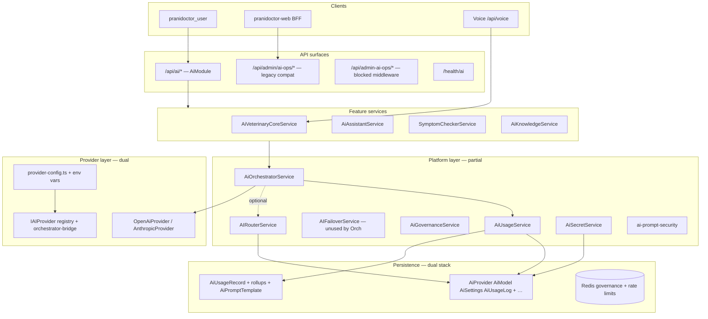
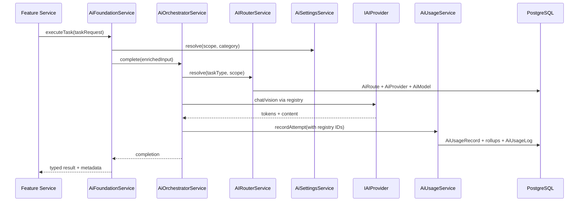
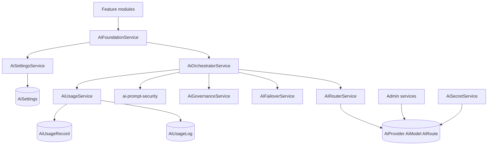
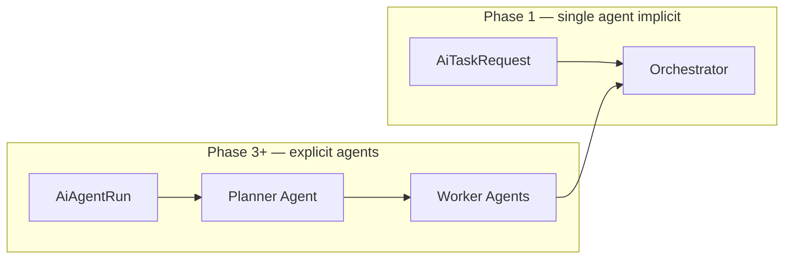
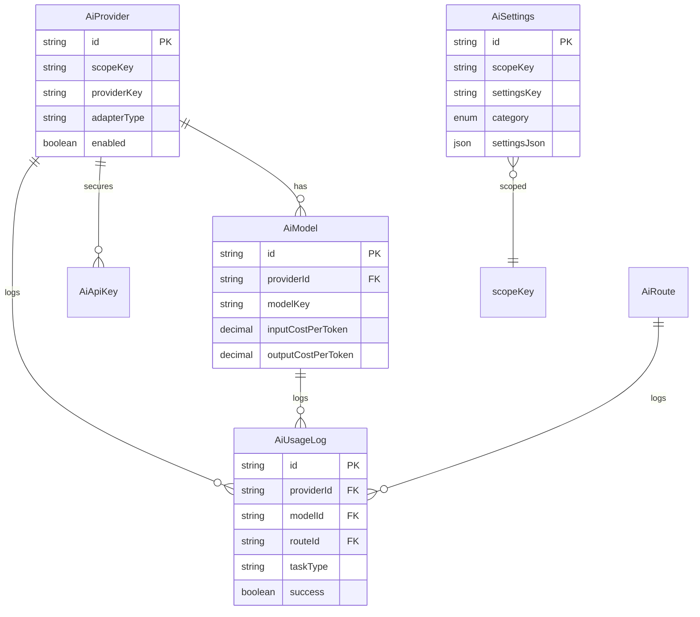

# AI Core Platform — Phase 1 Foundation

**Project:** Prani Doctor  
**Role:** Principal AI Platform Architect  
**Date:** 2026-05-31  
**Status:** Phase 1 implemented — 2026-05-31  
**Version:** 1.1.0

---

## Implementation progress

| Phase | Scope | Status | Notes |
|-------|-------|--------|-------|
| **1.0** | Baseline & gates | **Done** | Feature→taskType map, route parity test green, readiness gates extended |
| **1.1** | Foundation service | **Done** | `AiFoundationService`, DTOs, vet core + assistant wired |
| **1.2** | Settings & cost | **Done** | `AiSettingsService`, `AiCostRateService`, admin settings API, env import script |
| **1.3** | Registry orchestration | **Done** | Failover wired, FK enrichment on usage logs, DB provider chain |
| **1.4** | Provider unification | **Partial** | No hardcoded provider list in chain; env fallback via registry |
| **1.5** | Audit & admin polish | **Done** | `AiPlatformAuditService`, unified audit route, foundation status API |
| **1.6** | Prompt consolidation | **Pending** | Legacy `AiPromptTemplate` fallback retained |

### Delivered artifacts

**Schema & migration**

- `20260605120000_ai_core_platform_phase1` — `AiUsageLog.sessionId`, default-model partial unique index

**Module structure**

```
src/modules/ai/
├── foundation/          # AiFoundationService, DTOs, scope + feature map
├── settings/            # AiSettingsService, repository, cache
├── repositories/        # AiProviderRepository, AiModelRepository
├── usage/ai-cost-rate.service.ts
├── audit/ai-platform-audit.service.ts
└── admin/
    ├── ai-permissions.ts
    ├── ai-settings-admin.service.ts
    └── ai-foundation-admin.service.ts
```

**Admin API (legacy compat + BFF proxies)**

| Method | Path |
|--------|------|
| GET | `/api/admin/ai-ops/settings` |
| GET/PUT | `/api/admin/ai-ops/settings/[settingsKey]` |
| GET | `/api/admin/ai-ops/foundation/status` |
| POST | `/api/admin/ai-ops/foundation/sync-env` |

**Ops**

- `scripts/ops/import-env-keys-to-vault.mjs`

### Remaining (Phase 2+)

- Retire dual-write to `AiUsageRecord`
- Prompt migration job (Phase 1.6)
- Doctor LLM API, vector RAG, async workers, multi-agent schema

---

**Original plan status line:** Architecture & planning only — superseded by implementation above.


**Repositories in scope:**

| Repo | Role |
|------|------|
| `pranidoctor-backend` | AI platform core, orchestrator, AIMS schema, admin legacy compat API |
| `pranidoctor-web` | AI Control Center (BFF proxies to backend) |
| `pranidoctor_user` | Farmer mobile AI consumers (`/api/ai/*`, `/api/voice/*`) |

**Naming disambiguation:**

| Term | Meaning |
|------|---------|
| **LLM AI platform** | Subject of this plan — chat, triage, orchestration, usage |
| **AI Technician** | Human field staff for artificial insemination (`AiTechnicianProfile`) — **out of scope** |
| **AIMS** | AI Management System — registry tables (`ai_providers`, `ai_models`, …) |
| **Legacy runtime** | Pre-AIMS tables (`AiUsageRecord`, `AiPromptTemplate`, env-driven providers) |

**Related plans & reports:**

- `docs/plans/AI_PRODUCTION_COMPLETION_PLAN.md`
- `docs/plans/AI_CONTROL_CENTER_RECOVERY_MASTER_PLAN.md`
- `docs/reports/AI_SYSTEM_CURRENT_STATUS_REPORT.md`

---

## Executive summary

Prani Doctor already has a **working LLM stack** (orchestrator, governance, farmer-facing features, admin Control Center) and a **partially integrated AIMS database foundation** (`AiProvider`, `AiModel`, `AiSettings`, `AiUsageLog` plus routes, keys, prompts, failover rules). Phase 1 Foundation does **not** greenfield these entities — it **consolidates** them into a single authoritative platform layer.

**Strategic intent:** Make the database registry the **source of truth** for provider/model/settings/usage while preserving backward compatibility with env-based bootstrap and legacy analytics tables until Phase 2 cutover.

**Primary gaps today:**

1. **Dual runtime paths** — orchestrator still defaults to legacy OpenAI/Anthropic adapters and hard-coded cost rates; registry routing is opt-in (`AI_REGISTRY_ORCHESTRATOR_ENABLED`).
2. **Dual usage stores** — every attempt writes `AiUsageRecord` + rollups **and** `AiUsageLog`, but orchestrator does not populate FK IDs (`providerId`, `modelId`, `routeId`).
3. **Dual settings** — `AiSettings` rows are seeded but **no service reads them**; behavior comes from env (`ai.config.ts`) and Redis governance.
4. **Dual prompts** — `AiPromptTemplate` (legacy) vs `AiPrompt` (AIMS) with fallback resolution in `AiPromptService`.
5. **Failover split** — `AIFailoverService` (DB rules, retries, circuit monitor) exists but **`AiOrchestratorService` does not call it**.
6. **Admin API split** — production traffic uses legacy `/api/admin/ai-ops/*`; Express `AiAdminModule` at `/api/admin-ai-ops/*` is registered but middleware-blocked.

Phase 1 delivers the **foundation contract**: unified domain services, registry-first orchestration, settings resolution hierarchy, enriched usage logging, and admin API alignment — without multi-agent execution, vector RAG, or doctor LLM surfaces (Phase 2+).

---

## Design principles

| Principle | Phase 1 interpretation |
|-----------|-------------------------|
| **Registry-first** | `AiProvider` / `AiModel` / `AiRoute` drive runtime; env is bootstrap/fallback only |
| **Scope-aware** | `scopeKey` = `platform` → `tenant:{id}` → `tenant:{id}:branch:{id}` |
| **Fail-safe** | Rules-based fallback always available; governance kill switch fail-closed |
| **Dual-write tolerance** | Keep `AiUsageRecord` during Phase 1; enrich `AiUsageLog` as canonical AIMS audit |
| **No plaintext secrets** | Keys in `AiApiKey`; settings encryption via `AiSettings.encryptedSettings` |
| **Admin single path** | Legacy compat routes + shared admin services; deprecate duplicate Express mount |
| **Agent-ready interfaces** | Design task/run/message abstractions; no agent executor in Phase 1 |

---

## Current state (as-built)

### Layer inventory



### Module map (`src/modules/ai/`)

| Area | Key services | Maturity |
|------|--------------|----------|
| Orchestration | `AiOrchestratorService`, `AIRouterService`, `AIFailoverService` | Orch mature; failover unwired |
| Providers | `provider-registry`, `orchestrator-bridge`, 7 adapter implementations | Implemented; env-keyed |
| Usage & cost | `AiUsageService`, `ai-usage.cost.ts`, rollups, Prometheus | Dual-write; hard-coded rates |
| Governance | `AiGovernanceService`, scopes, kill switch, Redis sync | Production-ready |
| Vault | `AiSecretService`, `encryption.service`, key rotation | DB + env hybrid |
| Admin | `AiRegistryAdminService`, `AiVaultAdminService`, `AiOperationsService`, … | Legacy routes expanding |
| Security | `ai-prompt-security`, `prompt-injection.detector`, `AiSecurityAuditService` | On orchestrator path |
| Marketplace | `adapter-registry`, extensions, OpenRouter catalog | Schema + admin UI |
| Platform ops | `AiReadinessService`, `AiPlatformAdminService`, health probes | Operational |

### Database: entity status

| Entity (requested) | Prisma model | Table | Seeded | Runtime read | Admin CRUD |
|--------------------|--------------|-------|--------|--------------|------------|
| **AIProvider** | `AiProvider` | `ai_providers` | Yes | Router, vault | Yes |
| **AIModel** | `AiModel` | `ai_models` | Yes | Router, cost seed | Yes |
| **AISetting** | `AiSettings` | `ai_settings` | Yes | **No** | Partial (governance UI uses other paths) |
| **AIUsageLog** | `AiUsageLog` | `ai_usage_logs` | N/A (append) | Analytics | Read via report APIs |

**Companion entities (Phase 1 boundary):** `AiApiKey`, `AiRoute`, `AiFailoverRule`, `AiPrompt`, `AiApiKeyAuditLog`, `AiMarketplaceExtension`.

**Legacy entities (Phase 1 coexist, Phase 2 deprecate):** `AiUsageRecord`, `AiUsageDailyRollup`, `AiPromptTemplate`, `AiProviderHealthSnapshot`.

---

## Target architecture — Phase 1 Foundation

### Layer model

```
┌─────────────────────────────────────────────────────────────────────────┐
│ L4  Product features (chat, triage, symptom, knowledge, voice, …)      │
├─────────────────────────────────────────────────────────────────────────┤
│ L3  AI Foundation API — stable internal contract (complete/task/events)│
├─────────────────────────────────────────────────────────────────────────┤
│ L2  Platform services — orchestrate, route, failover, govern, meter    │
├─────────────────────────────────────────────────────────────────────────┤
│ L1  Provider adapters — IAIProvider implementations + marketplace       │
├─────────────────────────────────────────────────────────────────────────┤
│ L0  Data & config — AiProvider, AiModel, AiSettings, AiUsageLog, vault  │
└─────────────────────────────────────────────────────────────────────────┘
```

### Foundation data flow (target)



---

## Entity design

### AIProvider

**Purpose:** Canonical registry of LLM vendor connections per scope.

| Field group | Fields | Notes |
|-------------|--------|-------|
| Identity | `id`, `scopeKey`, `tenantId`, `branchId`, `providerKey` | Unique active `(scopeKey, providerKey)` |
| Runtime | `adapterType`, `baseUrl`, `capabilitiesJson`, `configJson` | Maps to `IAIProvider` / adapter registry |
| Ops | `enabled`, `priority`, `healthScore`, `lastHealthCheckAt`, `costTier` | Drives routing + dashboards |
| Lifecycle | `version`, soft delete, audit user ids | Optimistic concurrency via `version` |

**Invariants:**

- `providerKey` normalized: lowercase, `[a-z0-9_-]` (bridge accepts `_` / `-`).
- `rules-based` provider: `adapterType = internal_rules`, no API key required.
- At most one **default** chat model per provider per scope (via `AiModel.isDefault`).

**Relationships:** `models[]`, `apiKeys[]`, `primaryRoutes[]`, failover from/to.

---

### AIModel

**Purpose:** Model catalog with pricing, capabilities, and routing metadata.

| Field group | Fields | Notes |
|-------------|--------|-------|
| Identity | `id`, `providerId`, `modelKey`, `displayName`, `scopeKey` | Unique `(scopeKey, providerId, modelKey)` |
| Capability | `modelType`, `contextWindow`, `maxOutputTokens`, `capabilitiesJson`, `modelCategory`, `source` | `chat` / `vision` / `embedding` |
| Economics | `inputCostPerToken`, `outputCostPerToken` | **Authoritative** for cost after Phase 1.2 |
| Routing | `enabled`, `isDefault`, `externalModelId`, `extensionId` | Marketplace linkage |
| Lifecycle | `version`, soft delete | Cost changes bump `rateVersion` on new logs |

**Invariants:**

- Cost estimation reads DB first, falls back to `ai-usage.cost.ts` only when model row missing.
- Disabled model excluded from `AIRouterService` hops.

---

### AISetting (`AiSettings`)

**Purpose:** Scoped key-value platform configuration with optional encryption.

| Field group | Fields | Notes |
|-------------|--------|-------|
| Identity | `scopeKey`, `settingsKey`, `category` | Categories: `ROUTING`, `BUDGET`, `SECURITY`, `GOVERNANCE`, `FEATURE_FLAGS`, `ENCRYPTION` |
| Payload | `settingsJson`, `encryptedSettings`, `encryptionKeyId` | Sensitive values encrypted at rest |
| Lifecycle | `version`, soft delete | Unique active `(scopeKey, settingsKey)` |

**Seeded keys (platform scope):**

| settingsKey | category | Purpose |
|-------------|----------|---------|
| `routing.default` | ROUTING | `honorDbRoutes`, `preferredProvider`, `fallbackToRules` |
| `budget.global` | BUDGET | Daily/monthly caps, emergency bypass |
| `security.encryption` | ENCRYPTION | Algorithm defaults |
| `governance.features` | GOVERNANCE | `llmEnabled`, `requireAiConsent` mirror |

**Resolution hierarchy (target):**

1. Branch scope (`tenant:x:branch:y`)
2. Tenant scope (`tenant:x`)
3. Platform scope (`platform`)
4. Environment variables (bootstrap / emergency override)
5. Code defaults

---

### AIUsageLog

**Purpose:** Append-only, FK-rich per-request audit for AIMS analytics and future billing.

| Field group | Fields | Notes |
|-------------|--------|-------|
| Scope | `scopeKey`, `tenantId`, `branchId`, `organizationId` | Multi-tenant reporting |
| Actor | `userId`, `customerId` | Farmer dimensions |
| Registry FKs | `providerId`, `modelId`, `routeId`, `promptId`, `failoverRuleId` | **Must be populated in Phase 1.3** |
| Denormalized | `providerKey`, `modelKey`, `taskType`, `feature` | Fast filters if FK nulled |
| Metering | tokens, `costUsd`, `rateVersion`, `billable`, `latencyMs` | |
| Outcome | `success`, `errorCode`, `isFallback`, `fromProviderKey` | Failover trace |
| Trace | `requestId`, `correlationId`, `metadataJson` | Agent-ready correlation |

**Relationship to `AiUsageRecord`:**

| Aspect | AiUsageRecord (legacy) | AiUsageLog (AIMS) |
|--------|------------------------|-------------------|
| FK to registry | No | Yes |
| Rollups | Drives daily/monthly rollups | Queried for detailed reports |
| Phase 1 | Keep writing | Enrich + treat as source for admin drill-down |
| Phase 2 | Read-only / archive | Primary; rollups rebuilt from logs |

---

## AI foundation layer

### AiFoundationService (new — Phase 1.1)

Single entry point for all LLM execution from product code.

**Responsibilities:**

- Normalize `taskType` / `feature` via `ai-task.types.ts`
- Resolve scope from request context (`organizationId`, tenant env)
- Load settings snapshot (cached, TTL 60s)
- Delegate to orchestrator or failover executor
- Attach `requestId` / `correlationId` from request context
- Return stable DTO: `{ content, confidence, provider, model, usage, trace }`

**Non-goals (Phase 1):** Streaming SSE, batch jobs, tool calling loops.

### Configuration bootstrap

| Source | When used |
|--------|-----------|
| `seedAiManagementFoundation()` | Dev/staging first boot |
| Env vars (`OPENAI_API_KEY`, …) | Bootstrap keys into vault OR direct adapter config |
| Admin Control Center | Production changes |
| `AiSettingsService` | Runtime policy |

**Env contract (unchanged, documented in Phase 1.5):**

- `AI_REGISTRY_ORCHESTRATOR_ENABLED` — default `true` in prod after Phase 1.3
- `AI_VAULT_MASTER_KEY` — required for DB-stored keys
- `AI_LLM_REQUIRED` — readiness gate
- Provider keys: `OPENAI_API_KEY`, `ANTHROPIC_API_KEY`, …

---

## AI module architecture

### Package structure (target)

```
src/modules/ai/
├── foundation/           # NEW — AiFoundationService, task DTOs, scope resolver
├── platform/             # readiness, admin dashboards (existing)
├── orchestrator/         # completion pipeline (existing)
├── routing/              # AIRouterService, route/model resolution (existing)
├── failover/             # wire to orchestrator (Phase 1.3)
├── providers/            # IAIProvider + registry (existing)
├── vault/                # secrets (existing)
├── usage/                # metering (existing)
├── settings/             # NEW — AiSettingsService
├── governance/           # kill switch, scopes (existing)
├── security/             # prompt safety (existing)
├── audit/                # safety audit (existing) + platform audit facade
├── admin/                # admin domain services (existing)
├── prompts/              # dual-table resolution until Phase 2
├── marketplace/          # extensions (existing)
└── ai.module.ts          # register new services
```

### Dependency rules



**Rule:** Feature modules **must not** import provider adapters directly after Phase 1.4.

### Module registration

| Module | Mount | Phase 1 action |
|--------|-------|----------------|
| `AiModule` | `/api/ai` | Inject foundation; no breaking route changes |
| `AiAdminModule` | `/api/admin-ai-ops` | Keep blocked; document break-glass only |
| Legacy compat | `/api/admin/ai-ops` | **Production admin path** — complete parity |

---

## Multi-provider architecture

### Adapter taxonomy

| adapterType | Implementation | Status |
|-------------|----------------|--------|
| `openai_native` | `openai.provider.ts` | Live |
| `anthropic_native` | `anthropic.provider.ts` | Live |
| `openai_compatible` | `openai-compatible.provider.ts` | DeepSeek, Grok |
| `gemini_native` | Gemini adapter | Registered; often disabled |
| `openrouter_gateway` | OpenRouter + catalog sync | Admin + seed |
| `self_hosted_openai` | Ollama-compatible | Config present |
| `internal_rules` | `rules.provider.ts` | Always available |

### Provider resolution pipeline

1. **Governance filter** — kill switch, per-provider blocks (`ai-governance.scopes.ts`)
2. **Route lookup** — `AIRouterService.resolve({ taskType, tenantId, branchId })`
3. **Model selection** — `ModelSelector` honors route primary + chain entries + modality
4. **Secret resolution** — `AiSecretService.resolveActiveKey(providerId)` → env fallback
5. **Adapter materialization** — `createOrchestratorAdapterFromKey(providerKey)`
6. **Execution** — `IAIProvider.chat` / `vision` / `embed`
7. **Failover** — `AIFailoverService.execute` with DB rules (Phase 1.3)
8. **Fallback** — rules-based provider terminal hop

### Secret resolution (target)

```
AiApiKey (ACTIVE, scope match) → decrypt → adapter auth header
        ↓ miss
process.env.{PROVIDER}_API_KEY → adapter
        ↓ miss
provider.isConfigured() === false → skip hop
```

### Health & circuit breaking

| Component | Current | Phase 1 target |
|-----------|---------|----------------|
| `AiHealthProbeService` | Env providers + snapshots | Join with `AiProvider.id`, update `healthScore` |
| `AIProviderMonitor` | In-memory | Persist degradation to `AiProviderHealthSnapshot` or provider row |
| Admin dashboard | `/providers/dashboard` | Show registry + probe + usage metrics unified |

---

## Future multi-agent compatibility

Phase 1 **does not implement agents**. It lays structural hooks so Phase 3+ avoids schema rework.

### Conceptual model (forward-compatible)



### Phase 1 hooks (design only)

| Hook | Location | Future use |
|------|----------|------------|
| `taskType` on routes/logs | `AiRoute.taskType`, `AiUsageLog.taskType` | Agent role / step identifier |
| `correlationId` / `requestId` | `AiUsageLog`, request context | Multi-step trace across agents |
| `metadataJson` on usage log | extensible | Tool calls, sub-agent delegations |
| `AiFoundationService.executeTask` | stable API | Orchestrator for agent executor |
| `AiRoute.asyncRequired` | schema field | Queue-backed agent runs |
| `AiSettings` FEATURE_FLAGS | `agent.enabled`, `maxDepth` | Governance |

### Reserved schema (Phase 3 — not migrated in Phase 1)

Proposed tables (document only):

- `AiAgentDefinition` — role, tools, model route binding
- `AiAgentRun` — status, parent run, correlationId
- `AiAgentStep` — prompt, tool I/O, usage log FK

**Constraint:** Phase 1 code must not assume single-turn only in DTO shapes — use `messages[]` internally in `IAIProvider` (already supported).

---

## Database design

### Schema status

Migrations already applied:

| Migration | Content |
|-----------|---------|
| `20260603120000_ai_management_foundation` | Core AIMS tables |
| `20260603140000_ai_vault_audit_log` | `AiApiKeyAuditLog` |
| `20260604120000_ai_marketplace_extensions` | Extensions + model source fields |
| `20260530120000_ai_usage_monitoring` | Legacy usage rollups |
| `20260530140000_ai_token_tracking` | `AiUsageRecord` enhancements |

### Phase 1 schema deltas (planned)

| Change | Priority | Rationale |
|--------|----------|-----------|
| Unique partial index on `AiModel (scopeKey, providerId) WHERE isDefault AND deletedAt IS NULL` | P2 | Prevent multiple defaults |
| `AiUsageLog.sessionId` nullable FK | P3 | Agent session linkage |
| `AiSettings` composite unique already exists | — | No change |
| Materialized view `ai_usage_daily_from_logs` | P3 | Optional analytics acceleration |

**No destructive drops in Phase 1.**

### Index & retention policy

| Table | Retention | Notes |
|-------|-----------|-------|
| `ai_usage_logs` | 18 months hot, archive after | Partition by `createdAt` month (Phase 2) |
| `AiUsageRecord` | Mirror legacy policy | Until rollup cutover |
| `ai_api_key_audit_logs` | 7 years | Compliance |
| `AiSafetyAuditLog` | 2 years | Security review |

### Seed & migration data

| Action | Script | When |
|--------|--------|------|
| Platform providers/models/routes/settings | `prisma/seeds/ai_management_foundation.seed.ts` | Every fresh env |
| Marketplace extensions | `prisma/seeds/ai_marketplace.seed.ts` | Optional |
| Env → vault import | New script `scripts/ops/import-env-keys-to-vault.mjs` | Phase 1.2 |
| Legacy prompt → AIMS | One-time migration job | Phase 1.6 |

---

## API design

### Public API (`/api/ai/*`) — no breaking changes

Existing mobile contract preserved (`pranidoctor_user/lib/features/ai/data/*`).

| Endpoint group | Foundation change |
|----------------|-------------------|
| Chat / triage / farm-query | Internal: call `AiFoundationService` |
| Symptom / knowledge | Unchanged (mostly non-LLM or optional LLM) |
| Headers | Propagate `X-Request-Id` → `correlationId` in logs |

### Admin API (`/api/admin/ai-ops/*`) — extend, don't fork

**Auth:** Admin session cookie via BFF → `requireAiAdminActor()`.

#### Core entity endpoints (existing + required)

| Resource | Methods | Path pattern | Service |
|----------|---------|--------------|---------|
| AIProvider | CRUD, toggle, dashboard | `/providers`, `/providers/[id]` | `AiRegistryAdminService` |
| AIModel | CRUD, toggle | `/models`, `/models/[id]` | `AiRegistryAdminService` |
| AISettings | **GET, PUT** (new) | `/settings`, `/settings/[key]` | `AiSettingsAdminService` (new) |
| AIUsageLog | Read-only analytics | `/analytics/usage/report`, `/operations/dashboard` | `AiUsageAnalyticsService` |

#### New Phase 1 admin endpoints

| Method | Path | Purpose |
|--------|------|---------|
| GET | `/settings` | List settings for scope (query: `scopeKey`) |
| GET | `/settings/[settingsKey]` | Single setting with category |
| PUT | `/settings/[settingsKey]` | Upsert JSON; encrypt sensitive fields |
| GET | `/foundation/status` | Registry vs env mode, dual-write flags |
| POST | `/foundation/sync-env` | Idempotent env → vault import (SUPER_ADMIN) |

#### BFF parity

All new backend routes require matching `pranidoctor-web/src/app/api/admin/ai-ops/**/route.ts` proxies. Enforce via `ai-ops-route-parity.test.ts`.

### Internal foundation API (in-process only)

```typescript
// Design contract — not exported over HTTP in Phase 1
interface AiTaskRequest {
  taskType: string;           // maps to AiRoute.taskType
  feature: string;            // product feature key for billing
  locale: 'bn' | 'en';
  systemPrompt: string;
  userMessage: string;
  userId?: string;
  customerId?: string;
  scope?: { tenantId?: string; branchId?: string };
  maxTokens?: number;
  temperature?: number;
}

interface AiTaskResult {
  content: string;
  confidence: number;
  provider: string;
  model: string;
  usage: { inputTokens: number; outputTokens: number; costUsd: number; latencyMs: number };
  trace: { requestId: string; routeId?: string; providerId?: string; modelId?: string; isFallback: boolean };
}
```

---

## Service design

### New services

| Service | Responsibility | Depends on |
|---------|----------------|------------|
| **AiFoundationService** | Product-facing execution facade | Orch, Settings, context |
| **AiSettingsService** | Scope hierarchy read/write, cache | Prisma `AiSettings`, encryption |
| **AiSettingsAdminService** | Admin mutations + audit | Settings, shared audit |
| **AiCostRateService** | DB model rates → `estimateAiCostUsd` | `AiModel`, legacy fallback |
| **AiPlatformAuditService** | Unified admin audit queries | Usage log, key audit, safety audit |

### Refactor targets

| Service | Change |
|---------|--------|
| `AiOrchestratorService` | Use `AIFailoverService` when registry enabled; pass registry IDs to usage |
| `AiUsageService` | Accept optional `providerId`, `modelId`, `routeId`; use `AiCostRateService` |
| `AiUsageService.persistAttempt` | Single code path for FK enrichment |
| `ai-usage.cost.ts` | Thin wrapper over DB rates |
| `AiPromptService` | Prefer AIMS; log when legacy template used |
| `AiPlatformAdminService.getProvidersDashboard` | Merge registry + env validation |

### Caching strategy

| Cache | Key | TTL | Invalidation |
|-------|-----|-----|--------------|
| Settings snapshot | `ai:settings:{scopeKey}` | 60s | Admin PUT settings |
| Route resolution | `ai:route:{scope}:{taskType}` | 30s | Route/provider/model CRUD |
| Provider health | `ai:health:{providerId}` | probe interval | Probe job |

Redis optional in dev; in-memory LRU fallback with warn gate in readiness.

---

## Security design

### Threat model (Phase 1)

| Threat | Control | Location |
|--------|---------|----------|
| Prompt injection | Risk scorer + block | `ai-prompt-security.service.ts` |
| Secret leakage | Encryption at rest, hint-only UI | `AiSecretService`, `AiSettings.encryptedSettings` |
| Unauthorized admin | `requireAiAdminActor`, capability gates | `ai-admin.guard.ts` |
| LLM abuse | Rate limits, daily quota, budget | Redis + `AiBudgetService` |
| Provider MITM | TLS only, baseUrl allowlist (Phase 1.5) | Admin validation on provider create |
| Kill switch bypass | Fail-closed governance | `ai-governance.enforcement.ts` |

### AISetting security keys

| settingsKey | Sensitive fields | Storage |
|-------------|------------------|---------|
| `security.encryption` | none | JSON |
| `security.webhook` (future) | `secret` | `encryptedSettings` |
| `governance.features` | none | JSON |

### Capability matrix (admin)

| Action | Role / capability |
|--------|-------------------|
| View providers/models | `ai.ops.view` |
| Mutate registry | `ai.registry.manage` |
| Manage secrets | `SUPER_ADMIN` + `ai.secrets.manage` |
| Mutate settings | `ai.settings.manage` |
| View usage logs | `ai.analytics.view` |

---

## Audit design

### Audit streams (three lanes — consolidate queries in Phase 1.5)

| Lane | Store | Events |
|------|-------|--------|
| **Platform admin** | `AiApiKeyAuditLog` | Key CRUD, rotate, test |
| **Safety** | `AiSafetyAuditLog` | Prompt blocked, escalations |
| **Usage / execution** | `AiUsageLog` | Every LLM attempt with outcome |

### Target: AiPlatformAuditService

Unified read model for `/admin/ai-ops/audit`:

```typescript
interface AiAuditEvent {
  id: string;
  stream: 'admin' | 'safety' | 'usage';
  action: string;
  actorUserId?: string;
  targetType?: string;
  targetId?: string;
  severity: 'info' | 'warning' | 'critical';
  createdAt: string;
  detail: Record<string, unknown>;
}
```

**Write path:** Continue append-only. No updates/deletes on audit tables.

### Correlation

- HTTP `X-Request-Id` → `AiUsageLog.requestId`
- Workflow trace (`traceWorkflow`) → `metadataJson.workflowStep` (optional)
- Shared platform audit (`audit.service.ts`) for settings/secret mutations with `action: AI_SETTINGS_UPDATE`, `AI_SECRET_ROTATE` (extend `AuditAction` enum)

---

## Conflicts with existing code

| ID | Conflict | Impact | Resolution |
|----|----------|--------|------------|
| C1 | **Dual orchestration** — legacy chain vs registry | Unpredictable provider in prod if env flag off | Default registry on in prod; legacy chain = emergency fallback only |
| C2 | **Dual usage tables** — `AiUsageRecord` vs `AiUsageLog` | Incomplete FK on AIMS log; split analytics | Enrich log writes; dashboard merges both until Phase 2 |
| C3 | **Dual cost rates** — hard-coded vs `AiModel` | Cost drift vs admin catalog | `AiCostRateService` reads DB first |
| C4 | **Dual settings** — env vs `AiSettings` | Admin changes to settings table have no effect | `AiSettingsService` + hierarchy |
| C5 | **Dual prompts** — `AiPromptTemplate` vs `AiPrompt` | Version skew | AIMS primary; migration job for legacy |
| C6 | **Failover unwired** — `AIFailoverService` unused by orchestrator | DB failover rules ignored at runtime | Phase 1.3 integration |
| C7 | **Dual admin API** — legacy compat vs Express `AiAdminModule` | Duplicate handlers, confusion | Legacy only; Express break-glass |
| C8 | **Dual provider config** — `provider-config.ts` env vs registry `baseUrl` | Registry URL ignored by env adapters | Adapter factory reads registry overlay |
| C9 | **Vault vs env keys** — `AiSecretService` + env both active | Ambiguous key source | Document precedence; import script |
| C10 | **Feature vs taskType** — camelCase features vs `UPPER_SNAKE` task types | Router misses routes | Central normalize map in foundation |
| C11 | **AiTechnician naming** | Accidental coupling in docs/code search | Strict module boundaries |
| C12 | **BFF/backend parity gaps** | 404 in admin UI | Parity test must pass CI |

---

## Reusable components

| Component | Path | Reuse in Phase 1 |
|-----------|------|------------------|
| AIMS schema + seeds | `prisma/schema.prisma`, `ai_management_foundation.seed.ts` | **Primary** — extend, don't replace |
| Provider registry | `providers/provider-registry.ts`, `orchestrator-bridge.ts` | Wire as default execution |
| Router | `routing/ai-router.service.ts`, `route-resolver.ts`, `model-selector.ts` | Registry resolution |
| Failover engine | `failover/ai-failover.service.ts` | Integrate with orchestrator |
| Vault | `vault/ai-secret.service.ts`, `encryption.service.ts` | Secret resolution chain |
| Usage pipeline | `usage/ai-usage.service.ts`, metrics, rollups | Extend with FK fields |
| AIMS log writer | `analytics/usage/ai-usage-log.writer.ts` | Enrich parameters |
| Admin registry CRUD | `admin/ai-registry-admin.service.ts` | Provider/model/route admin |
| Admin vault | `admin/ai-vault-admin.service.ts` | Keys panel |
| Admin operations | `admin/ai-operations.service.ts` | Operations Center |
| Readiness gates | `platform/ai-readiness.service.ts` | Add settings + registry gates |
| Security pipeline | `security/*` | Keep on foundation path |
| Governance | `governance/*` | Unchanged |
| Route parity test | `compat-web/ai-ops-route-parity.test.ts` | CI gate |
| Web panels | `OperationsCenterPanel`, `ReadinessDashboardPanel`, … | Settings panel addition |
| Marketplace | `marketplace/*` | Model source = MARKETPLACE |

---

## Migration requirements

### M1 — Runtime flag rollout

| Step | Action |
|------|--------|
| M1.1 | Staging: `AI_REGISTRY_ORCHESTRATOR_ENABLED=true` |
| M1.2 | Verify routes resolve for all mobile `feature` keys |
| M1.3 | Production canary: 10% traffic via feature flag (optional env per pod) |
| M1.4 | Full prod default true |

### M2 — Env keys to vault

| Step | Action |
|------|--------|
| M2.1 | Run import script with `AI_VAULT_MASTER_KEY` set |
| M2.2 | Mark env keys as fallback-only in docs |
| M2.3 | Admin verifies `/secrets` test endpoints |

### M3 — Settings activation

| Step | Action |
|------|--------|
| M3.1 | Deploy `AiSettingsService` reading seeded rows |
| M3.2 | Map `budget.global` → `AiBudgetService` |
| M3.3 | Map `routing.default` → orchestrator behavior |
| M3.4 | Deprecate duplicate env vars (warn in logs) |

### M4 — Usage FK enrichment

| Step | Action |
|------|--------|
| M4.1 | Orchestrator passes resolved route/provider/model IDs to usage |
| M4.2 | Backfill **not required** — forward-only |
| M4.3 | Analytics queries prefer `AiUsageLog` for drill-down |

### M5 — Prompt consolidation

| Step | Action |
|------|--------|
| M5.1 | Copy active `AiPromptTemplate` rows → `AiPrompt` v1 PUBLISHED |
| M5.2 | Switch `AiPromptService` to AIMS-only (legacy read fallback 30 days) |
| M5.3 | Archive template table (Phase 2) |

### M6 — Cost rate sync

| Step | Action |
|------|--------|
| M6.1 | Register `registerModelRates` from DB on boot |
| M6.2 | Admin model price edit → invalidate rate cache |
| M6.3 | Bump `AI_RATE_VERSION` constant on deploy when seed rates change |

---

## API requirements summary

| Consumer | Requirement |
|----------|-------------|
| Mobile app | Zero contract change on `/api/ai/*` |
| Admin web | Full BFF parity; new `/settings` routes |
| Internal automation | Optional `/api/internal/admin-ai-ops` with token (break-glass) |
| Observability | Prometheus metrics unchanged; add `ai_foundation_registry_mode` gauge |
| Readiness | `/admin/ai-ops/readiness` includes settings + registry gates |

---

## Implementation roadmap

### Phase 1.0 — Baseline & gates (Week 1)

| Task | Owner | Deliverable |
|------|-------|-------------|
| Document env contract in `.env.example` | Platform | Updated example vars |
| CI: route parity test green | Platform | Passing `ai-ops-route-parity.test.ts` |
| Readiness report baseline score | Platform | Snapshot in `docs/reports/` |
| Feature → taskType mapping table | Platform | `ai-task.types.ts` completion |

**Exit gate:** All admin BFF routes return 200 on staging; parity test passes.

---

### Phase 1.1 — Foundation service (Week 2)

| Task | Deliverable |
|------|-------------|
| Create `AiFoundationService` + DTOs | Internal API |
| Refactor `AiAssistantService`, veterinary core to use foundation | No HTTP change |
| Propagate `requestId` / `correlationId` | Request context wiring |

**Exit gate:** All LLM calls flow through foundation in integration tests.

---

### Phase 1.2 — Settings & cost (Week 3)

| Task | Deliverable |
|------|-------------|
| `AiSettingsService` with scope hierarchy | Runtime reads seeded settings |
| `AiCostRateService` | DB-first cost estimation |
| Admin `GET/PUT /settings` + BFF | Settings UI panel (web) |
| Env → vault import script | Ops runbook |

**Exit gate:** Changing `budget.global` in admin affects budget service within 60s.

---

### Phase 1.3 — Registry orchestration (Week 4)

| Task | Deliverable |
|------|-------------|
| Wire `AIFailoverService` into orchestrator | DB failover rules active |
| Registry overlay on adapter factory (`baseUrl`, models) | Provider row drives runtime |
| Usage FK enrichment | `AiUsageLog` populated with IDs |
| Default `AI_REGISTRY_ORCHESTRATOR_ENABLED=true` prod | Config change |

**Exit gate:** Disable OpenAI in admin → traffic fails over per route rules; logs show `routeId`.

---

### Phase 1.4 — Provider unification (Week 5)

| Task | Deliverable |
|------|-------------|
| Deprecate direct `OpenAiProvider` in orchestrator chain | Registry-only path |
| Health probe updates `AiProvider.healthScore` | Operations dashboard accuracy |
| Secret precedence implementation | Vault > env documented behavior |

**Exit gate:** No hard-coded provider list in `AiOrchestratorService` except rules fallback.

---

### Phase 1.5 — Audit & admin polish (Week 6)

| Task | Deliverable |
|------|-------------|
| `AiPlatformAuditService` unified query | `/audit` panel complete |
| Extend shared `AuditAction` for settings mutations | Cross-platform audit |
| `GET /foundation/status` | Admin visibility of dual-write mode |
| Readiness gates for settings + registry | Score ≥ 85 |

**Exit gate:** AI Control Center readiness ≥ 85/100; audit panel shows admin + safety + usage samples.

---

### Phase 1.6 — Prompt & legacy coexistence (Week 7)

| Task | Deliverable |
|------|-------------|
| Prompt migration job | AIMS prompts for all active templates |
| Legacy template usage metrics | Log when fallback used |
| Documentation update | Operator runbook |

**Exit gate:** < 1% prompt resolves hit legacy table in staging.

---

### Phase 2 preview (out of Phase 1 scope)

- Retire dual-write to `AiUsageRecord` (read replicas / archive)
- Doctor LLM API (`/api/doctor/ai/*`)
- Vector RAG pipeline
- Queue workers for `AiRoute.asyncRequired`
- Explicit multi-agent runs (`AiAgentRun` schema)
- Streaming responses

---

## Success criteria

| Metric | Target |
|--------|--------|
| Registry orchestration | 100% prod LLM requests via DB routes |
| Usage log FK completeness | ≥ 95% rows with `providerId` + `modelId` |
| Settings runtime | 100% budget/routing flags from `AiSettings` |
| Admin route parity | 0 missing BFF/backend pairs |
| Readiness score | ≥ 85/100 |
| Mobile regression | 0 breaking changes on `/api/ai/*` |
| Cost accuracy | Admin model rate change reflected in next hour's logs |

---

## Risk register

| Risk | Likelihood | Mitigation |
|------|------------|------------|
| Registry misconfiguration blocks LLM | Medium | Legacy env chain fallback; readiness alerts |
| Dual-write performance | Low | Async log write (existing pattern) |
| Vault master key loss | Low | Key backup runbook; env break-glass |
| Cost rate drift | Medium | `rateVersion` + admin sync job (Phase 2) |
| ScopeKey bugs in multi-tenant | Medium | Integration tests per scope hierarchy |

---

## Appendix A — Feature → taskType mapping (required)

| Product feature key | AiRoute.taskType | Route seed key |
|--------------------|------------------|----------------|
| `farmer_chat` | `GENERAL_CHAT` | `general-chat` |
| `symptom_checker` | `SYMPTOM_ANALYSIS` | `symptom-analysis` |
| `farm_assistant` | `GENERAL_CHAT` | `farm-briefing` |
| `emergency_triage` | `EMERGENCY_TRIAGE` | `emergency-triage` |
| `voice_assistant` | `VOICE_CHAT` | `voice-chat` |

*Exact seed keys verified in `ai_management_foundation.seed.ts` during Phase 1.0.*

---

## Appendix B — Entity ER (core four)



---

## Appendix C — File reference index

| Concern | Primary files |
|---------|---------------|
| Schema | `prisma/schema.prisma` (L4044–4355) |
| Seeds | `prisma/seeds/ai_management_foundation.seed.ts` |
| Orchestrator | `src/modules/ai/orchestrator/ai-orchestrator.service.ts` |
| Router | `src/modules/ai/routing/ai-router.service.ts` |
| Failover | `src/modules/ai/failover/ai-failover.service.ts` |
| Usage | `src/modules/ai/usage/ai-usage.service.ts` |
| AIMS log | `src/modules/ai/analytics/usage/ai-usage-log.writer.ts` |
| Cost (legacy) | `src/modules/ai/usage/ai-usage.cost.ts` |
| Registry admin | `src/modules/ai/admin/ai-registry-admin.service.ts` |
| Vault | `src/modules/ai/vault/ai-secret.service.ts` |
| Config | `src/modules/ai/config/ai.config.ts` |
| Admin routes | `src/legacy/web/routes/admin/ai-ops/**` |
| Parity test | `src/modules/compat-web/ai-ops-route-parity.test.ts` |

---

*End of plan — implementation to follow phased roadmap above.*
