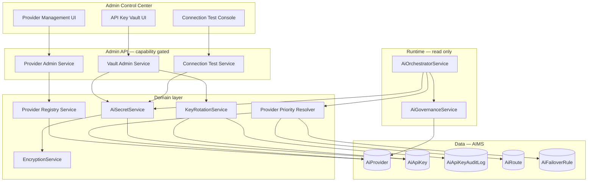
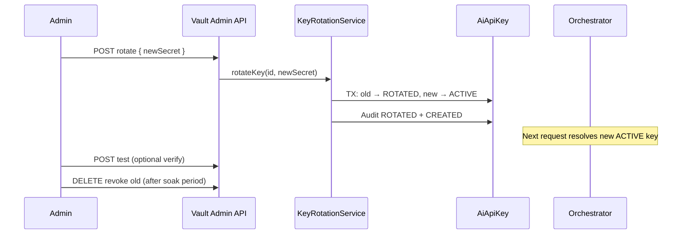

# AI Core Platform — Phase 2 Provider Management

**Project:** Prani Doctor  
**Role:** Principal AI Security Architect  
**Date:** 2026-05-31  
**Status:** Architecture & planning only — no implementation  
**Version:** 1.0.0  
**Depends on:** `docs/plans/ai-core-platform-phase-1-foundation.md` (Phase 1 implemented)

---

## Repositories in scope

| Repo | Role |
|------|------|
| `pranidoctor-backend` | Provider registry, vault, orchestrator secret resolution, admin API |
| `pranidoctor-web` | AI Control Center — Provider & API Key admin UI (BFF proxies) |
| `pranidoctor_user` | Consumer only — **no** direct provider/key management |

**Related documents:**

- `docs/plans/ai-core-platform-phase-1-foundation.md`
- `docs/reports/ai-foundation-verification.md`
- `docs/plans/AI_CONTROL_CENTER_RECOVERY_MASTER_PLAN.md`

---

## Executive summary

Phase 1 established the **AIMS registry** (`AiProvider`, `AiModel`, `AiApiKey`, `AiRoute`, `AiFailoverRule`) and a working **vault layer** (AES-256-GCM encryption, rotation service, connection probes, admin APIs). Secrets can still enter the system via **environment variables** and a one-shot `sync-env` import — acceptable for bootstrap, unacceptable as the long-term security posture.

**Phase 2 Provider Management** makes the platform **secure by default and admin-controlled**:

1. **Vault-first credentials** — runtime resolves secrets from `AiApiKey` only; env keys become break-glass bootstrap, not primary.
2. **Unified provider lifecycle** — register, configure, enable/disable, prioritize, test, and audit six first-class cloud providers plus extensibility hooks.
3. **Operational security** — rotation without downtime, connection testing before activation, immutable audit trail, least-privilege admin capabilities.
4. **Priority-driven routing** — provider `priority`, route chains, and failover rules form a single coherent precedence model.

This plan defines **what** to build and **how** it must behave. It does **not** include implementation code.

---

## Security design principles

| Principle | Phase 2 interpretation |
|-----------|------------------------|
| **Secure by default** | No provider hop without validated secret; disabled providers never receive traffic; new keys start in `PENDING_TEST` until probe passes (see lifecycle) |
| **Admin controlled** | All credential mutations require authenticated admin session + capability matrix; SUPER_ADMIN for destructive vault ops |
| **Zero plaintext persistence** | API keys encrypted at rest; request/response bodies never echo full secrets; logs redact `sk-*`, `AIza*`, etc. |
| **Least privilege** | `ai.secrets.manage` isolated from `ai.registry.manage`; runtime services decrypt only at call time |
| **Defense in depth** | Governance kill switch → route priority → provider enabled → secret active → adapter probe |
| **Future provider support** | Adapter registry + DB `adapterType` + manifest — no hardcoded provider enum in orchestrator chain |
| **Audit everything** | Append-only `AiApiKeyAuditLog` + platform audit for provider enable/disable |
| **Fail closed** | Missing vault master key blocks secret write in production; missing active key skips provider hop |

---

## Current state (Phase 1 baseline)

### What exists today

| Area | Artifact | Maturity |
|------|----------|----------|
| Provider registry | `AiProvider` — `providerKey`, `enabled`, `priority`, `adapterType`, `baseUrl`, `healthScore` | Schema + admin CRUD |
| Model catalog | `AiModel` — cost rates, `isDefault`, capabilities | Schema + admin CRUD |
| Secret storage | `AiApiKey` — `encryptedSecret`, `encryptionKeyId`, `secretHint`, status enum | Production-ready vault |
| Encryption | `EncryptionService` — AES-256-GCM, `AI_VAULT_MASTER_KEY` | Implemented + tested |
| Key rotation | `KeyRotationService` — transactional rotate, audit, cache refresh | Implemented |
| Connection test | `testProviderApiKey()` — OpenAI-compatible, Anthropic, Gemini probes | Partial (no Groq) |
| Admin API | `/api/admin/ai-ops/secrets/*`, `/providers/*` | Backend + partial BFF |
| Admin UI | `ApiKeysPanel.tsx` | Basic CRUD; no rotation wizard |
| Runtime resolution | `AiSecretService.resolveProviderSecret()` | Vault-first with env fallback |
| Priority fields | `AiProvider.priority`, `AiRoute.priority`, `AiFailoverRule.priority` | Stored; not fully unified in UX |
| Env bootstrap | `OPENAI_API_KEY`, … + `import-env-keys-to-vault.mjs` | Still used in many envs |

### Known gaps (Phase 2 must close)

| ID | Gap | Risk |
|----|-----|------|
| G1 | **Groq not implemented** — zero runtime adapter / config entry | Product gap; admins cannot configure Groq |
| G2 | **Dual secret sources** — env vars and vault both authoritative | Drift, audit blind spot, prod misconfig |
| G3 | **No mandatory test-before-active** — keys become `ACTIVE` immediately on create | Bad keys reach production traffic |
| G4 | **Provider enable/disable split** — registry `enabled`, governance scopes, route chains not unified | Admin confusion; partial disable |
| G5 | **Priority model undocumented** — three priority fields, no single resolution spec | Unpredictable failover ordering |
| G6 | **Master key rotation** — single `AI_VAULT_MASTER_KEY`; no re-encryption job design | Key compromise recovery gap |
| G7 | **Multi-key per provider** — schema allows multiple `ACTIVE` rows; selection logic is version-only | Ambiguous primary key |
| G8 | **Tenant/branch vault** — schema supports scope; admin UX and resolution rules incomplete | Enterprise readiness |

---

## Target architecture



**Boundary rule:** Farmer-facing APIs (`/api/ai/*`) never expose provider keys, provider admin state, or vault metadata beyond aggregated usage.

---

## 1. Provider management

### 1.1 Purpose

Central registry of LLM upstreams the platform may call. Each provider row is a **configuration anchor** (adapter type, base URL, capabilities, priority, health) — not a secret container (secrets live in `AiApiKey`).

### 1.2 Provider identity

| Field | Rules |
|-------|-------|
| `providerKey` | Stable slug: `openai`, `gemini`, `anthropic`, `openrouter`, `groq`, `deepseek` (+ future keys) |
| `adapterType` | Drives adapter factory — must exist in `AiAdapterRegistry` or manifest |
| `baseUrl` | Optional override; defaults from provider manifest |
| `capabilitiesJson` | Subset of `chat`, `vision`, `embeddings`, `json_mode`, `function_calling` |
| `configJson` | Non-secret provider options (timeout overrides, default headers, org IDs) |
| `enabled` | Admin toggle — when `false`, orchestrator **must skip** all hops for this provider |
| `priority` | Global provider precedence within scope (see §8) |
| `healthScore` | 0.0–1.0 updated by probes and runtime error rates |

### 1.3 Provider lifecycle

```
DRAFT (optional) → REGISTERED → CONFIGURED → ENABLED → DEGRADED → DISABLED → ARCHIVED (soft delete)
```

| State | Meaning | Transitions |
|-------|---------|-------------|
| **REGISTERED** | Row exists; no active key | Admin creates provider |
| **CONFIGURED** | ≥1 key in `ACTIVE` or `PENDING_TEST` passed | Key test success |
| **ENABLED** | `enabled=true` and configured | Admin enable |
| **DISABLED** | `enabled=false` | Admin disable or governance |
| **DEGRADED** | `healthScore` below threshold | Automatic from health monitor |
| **ARCHIVED** | `deletedAt` set | Admin soft-delete; keys revoked |

**Secure-by-default gate:** A provider **cannot** be enabled until:

1. At least one API key has passed connection test in the last 24h (configurable via `AiSettings` `security.provider_activation`).
2. Vault master key is configured (production).
3. Provider adapter type is registered.

### 1.4 First-class provider catalog

See **§7 Provider reference matrix** for adapter mapping, default URLs, and probe strategy.

### 1.5 Future provider support

New providers **must not** require orchestrator code changes when:

1. `adapterType` is `openai_compatible` or registered in `AiAdapterRegistry`.
2. Seed manifest defines defaults (`baseUrl`, probe path, auth header).
3. Admin creates `AiProvider` row + vault key via UI.

Optional **marketplace extensions** (`AiMarketplaceExtension`) remain the path for third-party manifests; Phase 2 standardizes the six cloud providers as built-in manifests.

### 1.6 Admin operations

| Operation | Capability | Audit |
|-----------|------------|-------|
| List / view providers | `ai.ops.view` | — |
| Create / update provider | `ai.registry.manage` | `AI_REGISTRY_CHANGE` |
| Enable / disable provider | `ai.registry.manage` | `AI_PROVIDER_TOGGLED` |
| Reorder priority | `ai.registry.manage` | `AI_PROVIDER_PRIORITY_CHANGED` |
| Soft delete | `ai.registry.manage` + confirm | `AI_PROVIDER_ARCHIVED` |

---

## 2. API key management

### 2.1 Purpose

Lifecycle management of upstream credentials bound to a provider. One provider may have **multiple keys** (rotation overlap, environment separation) but **at most one primary active key** per scope at runtime.

### 2.2 Key states

Extend usage of existing `AiApiKeyStatus`:

| Status | Runtime visible | Admin actions |
|--------|-----------------|---------------|
| `PENDING_TEST` | **New — Phase 2** | No — not used until test passes |
| `ACTIVE` | Yes — eligible for resolution | Rotate, disable, test |
| `ROTATED` | No — retained for audit | Read-only |
| `REVOKED` | No | Read-only |
| `EXPIRED` | No | Auto-set when `expiresAt` passed |

**Phase 2 schema delta (planned):** Add `PENDING_TEST` to `AiApiKeyStatus` enum + optional `isPrimary Boolean @default(false)` with partial unique index `(providerId, scopeKey) WHERE isPrimary AND status = ACTIVE`.

### 2.3 Key metadata

| Field | Purpose |
|-------|---------|
| `name` | Human label (`production-primary`, `rotation-2026-06`) |
| `secretHint` | Last 4 chars only — `****abcd` |
| `expiresAt` | Optional expiry; readiness warns ≤14 days |
| `lastUsedAt` | Updated on successful decrypt (existing) |
| `version` | Monotonic; ties to rotation chain |
| `metadataJson` | `{ rotatedFromId, importSource, labels }` — **never** plaintext |

### 2.4 Admin operations

| Operation | Actor | Capability | Notes |
|-----------|-------|------------|-------|
| List keys | ADMIN+ | `ai.secrets.manage` | Hints only |
| Add key | SUPER_ADMIN | `ai.secrets.manage` | Creates `PENDING_TEST` |
| Test key | SUPER_ADMIN | `ai.secrets.manage` | Promotes to `ACTIVE` on success |
| Set primary | SUPER_ADMIN | `ai.secrets.manage` | Demotes previous primary |
| Update metadata | SUPER_ADMIN | `ai.secrets.manage` | Name, expiry — not secret in audit reason |
| Rotate | SUPER_ADMIN | `ai.secrets.manage` | Uses `KeyRotationService` |
| Revoke / disable | SUPER_ADMIN | `ai.secrets.manage` | Immediate runtime exclusion |

**ADMIN role:** May view provider registry and masked key list (hints, status, expiry) but **cannot** create, rotate, or test keys unless explicitly granted `ai.secrets.manage` in a future RBAC revision. Current matrix: ADMIN lacks `ai.secrets.manage` — preserve this.

### 2.5 Validation rules

| Provider | Plaintext pattern (indicative) |
|----------|--------------------------------|
| OpenAI | `sk-…` or project key format |
| Anthropic | `sk-ant-…` |
| Gemini | `AIza…` |
| OpenRouter | `sk-or-…` |
| Groq | `gsk_…` |
| DeepSeek | `sk-…` |

Validation is **heuristic** (prefix/length); failures warn but do not block if admin confirms (audit logged).

### 2.6 Secret handling in transit

| Layer | Requirement |
|-------|-------------|
| Admin UI | Password input type; clear from memory on submit; never store in localStorage |
| BFF | Pass-through JSON over HTTPS; no logging of body |
| Backend | Parse → encrypt → discard plaintext in same tick; never return secret in API response |
| Error messages | Generic (`Invalid credentials`); no provider response body in client-facing errors |

---

## 3. Secret storage

### 3.1 Storage model

| Store | Contents | Phase 2 role |
|-------|----------|--------------|
| `AiApiKey.encryptedSecret` | Ciphertext only | **Primary** |
| `AiSettings.encryptedSettings` | Non-provider secrets (webhook HMAC, etc.) | Unchanged |
| Environment variables | `OPENAI_API_KEY`, … | **Bootstrap / break-glass only** |
| Redis / memory | Decrypted secret | **Forbidden** — decrypt per request |

### 3.2 Resolution algorithm (runtime)

```
resolveSecret(providerKey, scope):
  1. If governance blocks provider → return undefined
  2. If AiProvider.enabled = false → return undefined
  3. Query AiApiKey WHERE provider.providerKey, scopeKey, status=ACTIVE, isPrimary=true
     ORDER BY version DESC LIMIT 1
  4. If none and AI_VAULT_ALLOW_ENV_FALLBACK=true (non-prod default) → env lookup
  5. If none and production → undefined (skip hop)
  6. Decrypt → update lastUsedAt → return (never cache plaintext)
```

**Phase 2 setting:** `security.vault.env_fallback_allowed` — default `false` in production, `true` in development.

### 3.3 Scope resolution

| Scope key | Use case |
|-----------|----------|
| `platform` | Default Prani Doctor cloud |
| `tenant:{id}` | Future org-level keys |
| `tenant:{id}:branch:{id}` | Branch-specific upstream billing |

Resolution walks **branch → tenant → platform** (most specific wins).

### 3.4 Configuration cache

`AiSecretService.refreshConfigurationCache()` tracks which `providerKey` values have active keys — invalidate on:

- Key create / rotate / revoke
- Provider enable/disable
- Scope change

TTL: none (event-driven invalidation only).

---

## 4. Encryption strategy

### 4.1 At-rest encryption (API keys)

| Parameter | Value |
|-----------|-------|
| Algorithm | AES-256-GCM |
| Key derivation | `scrypt` from `AI_VAULT_MASTER_KEY` or raw 32-byte base64 |
| Ciphertext format | `v1:{iv_b64}:{tag_b64}:{ciphertext_b64}` |
| Key ID | `encryptionKeyId` column — e.g. `vault:v1`, `vault:v2` |
| IV | 12 bytes random per encryption |

Existing `EncryptionService` implements this — Phase 2 adds **operational procedures**, not a new algorithm.

### 4.2 Master key management

| Environment | Requirement |
|-------------|-------------|
| Production | `AI_VAULT_MASTER_KEY` from secrets manager (KMS/Vault/Doppler) — never in git |
| Staging | Separate master key from production |
| Local dev | `.env` acceptable; documented rotation on team change |

**Readiness gate (existing):** Missing master key → readiness `fail` in production.

### 4.3 Master key rotation (Phase 2 design)

Planned **re-encryption job** — no implementation in this phase:

```
rotateMasterKey(oldKeyId, newKeyId, newMasterKey):
  FOR each AiApiKey WHERE encryptionKeyId = oldKeyId:
    plaintext = decrypt_with_old(row.encryptedSecret)
    row.encryptedSecret = encrypt_with_new(plaintext)
    row.encryptionKeyId = newKeyId
  FOR each AiSettings WHERE encryptionKeyId = oldKeyId:
    (same pattern)
  Audit: AI_VAULT_MASTER_KEY_ROTATED
```

Run as offline admin job with dual-key decrypt window; orchestrator read-only during job (maintenance mode).

### 4.4 In-transit & at-use

| Stage | Control |
|-------|---------|
| Admin → API | TLS 1.2+ |
| API → provider | TLS + certificate pinning optional (future) |
| Logs | Structured redaction filter for key-like patterns |
| Traces | OpenTelemetry spans must not include Authorization headers |

### 4.5 Encryption settings category

Use `AiSettings` category `ENCRYPTION`:

| Key | Purpose |
|-----|---------|
| `encryption.vault.policy` | `{ envFallbackAllowed, testBeforeActivate, minHealthScore }` |
| `encryption.key_rotation.reminder_days` | Notify before `expiresAt` |

---

## 5. Key rotation

### 5.1 Rotation types

| Type | Trigger | Behavior |
|------|---------|----------|
| **Manual rotation** | Admin submits new secret | Existing `KeyRotationService.rotateKey()` |
| **Scheduled reminder** | `expiresAt` approaching | Notify SUPER_ADMIN; no auto-rotate |
| **Emergency revoke** | Compromise suspected | Revoke immediately; disable provider if last key |
| **Master key rotation** | Security ops | Re-encryption job (§4.3) |

### 5.2 Zero-downtime rotation flow



**Soak period:** Keep `ROTATED` rows 7 days (configurable) for forensic correlation.

### 5.3 Overlap policy

During rotation, **two keys may exist** (`ROTATED` + `ACTIVE`) but only `ACTIVE` primary is resolved. Optional blue/green: add new key as `ACTIVE` non-primary → test → flip `isPrimary` → revoke old.

### 5.4 Audit requirements

Every rotation writes:

1. `AiApiKeyAuditLog` — `ROTATED` on old, `CREATED` on new (existing).
2. Platform audit — `AI_SECRET_ROTATE` (dedicated action; replace generic `SYSTEM_CONFIG_CHANGE` where used).

Metadata: `{ successorId, rotatedFromId, reason }` — no secret material.

---

## 6. Connection testing

### 6.1 Purpose

Verify credentials and network path **before** promoting keys to `ACTIVE` and **on demand** for operations.

### 6.2 Test types

| Type | When | Cost |
|------|------|------|
| **Validate** | On key create / before activate | Minimal tokens or HEAD/list endpoints |
| **Live probe** | Admin "Test connection" button | Same as validate |
| **Health monitor** | Periodic background job | Rate-limited per provider |
| **Pre-enable gate** | Provider enable action | Must have passing test ≤24h |

### 6.3 Probe matrix by adapter

| Provider | Adapter | Probe method |
|----------|---------|--------------|
| OpenAI | `openai_native` | `GET /v1/models` |
| Groq | `openai_compatible` | `GET /openai/v1/models` (Groq base URL) |
| DeepSeek | `openai_compatible` | `GET /v1/models` |
| OpenRouter | `openrouter_gateway` | `GET /api/v1/models` |
| Anthropic | `anthropic_native` | `POST /v1/messages` max_tokens=1 |
| Gemini | `gemini_native` | `POST …/models/{model}:generateContent` maxOutputTokens=1 |

Existing `provider-key-test.ts` covers most; **Phase 2 adds Groq** manifest and probe config.

### 6.4 Test result contract

```typescript
type AiConnectionTestResult = {
  ok: boolean;
  providerKey: string;
  providerId?: string;
  apiKeyId?: string;
  latencyMs: number;
  errorCode?: 'HTTP_401' | 'HTTP_403' | 'HTTP_429' | 'TIMEOUT' | 'UNSUPPORTED_PROVIDER' | 'NETWORK_ERROR';
  message?: string;        // truncated, sanitized
  testedAt: string;
  probeType: 'validate' | 'health' | 'manual';
};
```

**Security:** Never persist plaintext secret or full provider error HTML in DB — truncate to 200 chars, strip HTML.

### 6.5 Rate limiting

| Scope | Limit |
|-------|-------|
| Per admin user | 10 tests / minute |
| Per provider | 30 tests / hour |
| Global | Circuit breaker on repeated 429 from upstream |

### 6.6 Admin API (planned)

| Method | Path | Capability |
|--------|------|------------|
| POST | `/api/admin/ai-ops/secrets/[id]/test` | `ai.secrets.manage` (exists) |
| POST | `/api/admin/ai-ops/providers/[id]/test` | `ai.secrets.manage` — test primary key |
| POST | `/api/admin/ai-ops/providers/[id]/test-connection` | `ai.registry.manage` — config-only ping (no key) |

---

## 7. Provider enable / disable

### 7.1 Disable layers (unified model)

| Layer | Mechanism | Precedence |
|-------|-----------|------------|
| **L1 Governance** | `AiGovernanceService` global/per-provider kill | Highest |
| **L2 Registry** | `AiProvider.enabled = false` | Admin intentional |
| **L3 Secret** | No `ACTIVE` primary key | Automatic effective disable |
| **L4 Health** | `healthScore < threshold` | Soft disable — deprioritize, not hard block |
| **L5 Route** | Provider omitted from `providerChainJson` | Task-specific |

Phase 2 **documents and surfaces** all layers in Provider Management UI with clear effective status:

```
effectiveStatus = governanceBlocked ? 'BLOCKED' :
                  !enabled ? 'DISABLED' :
                  !hasActiveKey ? 'UNCONFIGURED' :
                  healthScore < min ? 'DEGRADED' : 'ACTIVE'
```

### 7.2 Enable workflow

```
Admin clicks Enable
  → Check governance not blocking
  → Check ≥1 ACTIVE primary key with recent successful test
  → Check adapter registered
  → Set enabled=true
  → Audit AI_PROVIDER_ENABLED
  → Invalidate secret cache + readiness
```

### 7.3 Disable workflow

```
Admin clicks Disable
  → Confirm dialog (production)
  → Set enabled=false
  → Audit AI_PROVIDER_DISABLED
  → Orchestrator skips on next request (no in-flight cancellation)
  → Optional: trigger failover test alert if no alternate provider in route
```

### 7.4 Governance interaction

Governance per-provider disable (`ai-governance.scopes.ts`) **overrides** registry enable. Admin UI shows both states; clearing governance block does **not** auto-enable — admin must explicitly enable.

---

## 8. Priority system

### 8.1 Problem statement

Three priority fields exist today without a single documented resolution order:

| Entity | Field | Default |
|--------|-------|---------|
| `AiProvider` | `priority` | 100 |
| `AiRoute` | `priority` | 100 |
| `AiFailoverRule` | `priority` | 100 |

Lower numeric value = **higher precedence** (convention to formalize in Phase 2).

### 8.2 Resolution order (runtime)

```
1. Select AiRoute by (scopeKey, taskType) ORDER BY priority ASC, enabled DESC
2. Build candidate provider list:
   a. route.primaryProviderId (if enabled + configured)
   b. route.providerChainJson[] in array order
   c. Merge with platform providers ORDER BY AiProvider.priority ASC
   d. Deduplicate preserving first occurrence
3. Filter: governance, enabled, has secret, healthScore ≥ min
4. For each candidate → attempt completion via adapter
5. On failure → evaluate AiFailoverRule for route ORDER BY priority ASC
6. Terminal: rules-based provider
```

### 8.3 Provider chain JSON schema

```json
{
  "providers": [
    { "providerKey": "openai", "modelKey": "gpt-4o-mini", "weight": 100 },
    { "providerKey": "groq", "modelKey": "llama-3.3-70b-versatile", "weight": 200 }
  ]
}
```

`weight` optional — when present, overrides `AiProvider.priority` for that route only.

### 8.4 Admin priority UX

| UI control | Backend effect |
|------------|----------------|
| Drag-and-drop provider list | Batch update `AiProvider.priority` (gaps of 10) |
| Route editor chain order | Updates `providerChainJson` |
| Failover rule ordering | Updates `AiFailoverRule.priority` |

### 8.5 Settings keys

| Key | Content |
|-----|---------|
| `routing.default` | Default route bindings per taskType |
| `routing.provider_priority_mode` | `registry` \| `route_weight` \| `cost_optimized` (future) |

---

## 9. Provider reference matrix

Six first-class providers for Phase 2:

| Provider | `providerKey` | Adapter type | Default base URL | Auth | Chat model (default) | Phase 1 status |
|----------|---------------|--------------|------------------|------|----------------------|----------------|
| **OpenAI** | `openai` | `openai_native` | `https://api.openai.com/v1` | Bearer | `gpt-4o-mini` | Implemented |
| **Gemini** | `gemini` | `gemini_native` | `https://generativelanguage.googleapis.com/v1beta` | API key query | `gemini-1.5-flash` | Implemented |
| **Anthropic** | `anthropic` | `anthropic_native` | `https://api.anthropic.com/v1` | `x-api-key` | `claude-3-5-haiku-20241022` | Implemented |
| **OpenRouter** | `openrouter` | `openrouter_gateway` | `https://openrouter.ai/api/v1` | Bearer + optional HTTP-Referer | `openai/gpt-4o-mini` | Implemented |
| **Groq** | `groq` | `openai_compatible` | `https://api.groq.com/openai/v1` | Bearer | `llama-3.3-70b-versatile` | **Not implemented — Phase 2** |
| **DeepSeek** | `deepseek` | `openai_compatible` | `https://api.deepseek.com/v1` | Bearer | `deepseek-chat` | Implemented |

**Note:** Codebase today includes `grok` (xAI) but not `groq`. Phase 2 adds Groq as specified; Grok remains optional extension, not part of the six-provider commitment.

### 9.1 Seed data plan

Migration seed (planned) idempotently ensures six `AiProvider` rows at `platform` scope with:

- Correct `adapterType` and `baseUrl`
- Default `priority` (suggested: OpenAI=10, Anthropic=20, Gemini=30, Groq=40, DeepSeek=50, OpenRouter=60 — tunable by admin)
- `enabled=false` until key configured (secure default)
- Companion default `AiModel` rows per provider

### 9.2 OpenRouter specifics

- Store OpenRouter key in vault like other providers.
- `configJson` may include `httpReferer`, `xTitle` for OpenRouter attribution headers.
- Model keys use OpenRouter slug format (`provider/model`).

### 9.3 Groq implementation plan (design only)

1. Add `groq` to provider manifest registry (not hardcoded orchestrator list).
2. Register `openai_compatible` factory with Groq defaults.
3. Add probe in `provider-key-test.ts` via shared OpenAI-compatible path.
4. Seed `AiProvider` + default models.
5. Document env break-glass: `GROQ_API_KEY` (deprecated after vault migration).

---

## 10. Service layer design

### 10.1 New / extended services

| Service | Responsibility |
|---------|----------------|
| `AiProviderManagementService` | Enable/disable, priority batch, effective status, seed sync |
| `AiSecretService` (extend) | `PENDING_TEST`, primary key selection, env fallback policy |
| `AiConnectionTestService` | Orchestrate probes, rate limits, persist last test timestamp on provider |
| `AiProviderPriorityResolver` | Single precedence algorithm (§8) |
| `AiVaultPolicyService` | Read `AiSettings` encryption/security policy |
| `KeyRotationService` (extend) | Blue/green primary flip, scheduled reminders |
| `EncryptionService` (extend) | Multi-key-id decrypt for master rotation window |

### 10.2 Module layout (target)

```
src/modules/ai/
├── providers/
│   ├── manifests/           # built-in provider manifests (NEW)
│   │   ├── openai.manifest.ts
│   │   ├── groq.manifest.ts
│   │   └── ...
│   └── provider-config.ts   # env defaults → manifest delegation
├── vault/                   # existing — extended policy
├── admin/
│   ├── ai-provider-management.service.ts   (NEW)
│   ├── ai-vault-admin.service.ts             (extend)
│   └── ai-connection-test.service.ts         (NEW)
└── platform/
    └── ai-provider-priority.resolver.ts      (NEW)
```

---

## 11. Admin API design

All routes under `/api/admin/ai-ops/` with BFF parity in `pranidoctor-web`.

### 11.1 Provider endpoints

| Method | Path | Capability | Description |
|--------|------|------------|-------------|
| GET | `/providers` | `ai.ops.view` | List with effective status |
| GET | `/providers/[id]` | `ai.ops.view` | Detail + health + key summary |
| POST | `/providers` | `ai.registry.manage` | Register (rare — usually seed) |
| PUT | `/providers/[id]` | `ai.registry.manage` | Update config |
| POST | `/providers/[id]/enable` | `ai.registry.manage` | Gated enable |
| POST | `/providers/[id]/disable` | `ai.registry.manage` | Disable |
| PUT | `/providers/priority` | `ai.registry.manage` | Batch reorder |
| POST | `/providers/[id]/test-connection` | `ai.secrets.manage` | Probe primary key |
| GET | `/providers/dashboard` | `ai.ops.view` | Status board |

### 11.2 Vault endpoints (extend existing)

| Method | Path | Change |
|--------|------|--------|
| POST | `/secrets` | Return `PENDING_TEST`; require follow-up test |
| POST | `/secrets/[id]/test` | Promote to `ACTIVE` on success |
| POST | `/secrets/[id]/rotate` | Existing |
| PUT | `/secrets/[id]/primary` | **New** — set primary flag |
| GET | `/secrets/[id]/audit` | Existing |

### 11.3 Response DTOs (never include secrets)

```typescript
type AiProviderAdminDto = {
  id: string;
  providerKey: string;
  displayName: string;
  enabled: boolean;
  effectiveStatus: 'ACTIVE' | 'DEGRADED' | 'DISABLED' | 'UNCONFIGURED' | 'BLOCKED';
  priority: number;
  adapterType: string;
  baseUrl: string | null;
  healthScore: number;
  lastHealthCheckAt: string | null;
  lastConnectionTestAt: string | null;
  keySummary: { hasPrimary: boolean; hint: string | null; expiresAt: string | null };
};
```

---

## 12. Permissions & audit

### 12.1 Capability matrix (unchanged baseline)

| Capability | SUPER_ADMIN | ADMIN |
|------------|:-----------:|:-----:|
| `ai.ops.view` | ✓ | ✓ |
| `ai.registry.manage` | ✓ | ✓ |
| `ai.secrets.manage` | ✓ | ✗ |
| `ai.foundation.manage` | ✓ | ✗ |

Phase 2 **does not** grant ADMIN secret management by default.

### 12.2 Audit events (planned additions)

| Action | Store | Retention |
|--------|-------|-----------|
| `AI_PROVIDER_ENABLED` | Platform audit | 2 years |
| `AI_PROVIDER_DISABLED` | Platform audit | 2 years |
| `AI_PROVIDER_PRIORITY_CHANGED` | Platform audit | 1 year |
| `AI_SECRET_ROTATE` | Platform audit + key audit | 2 years |
| `AI_CONNECTION_TEST` | Key audit (`TESTED`) | 90 days |
| `AI_VAULT_MASTER_KEY_ROTATED` | Platform audit | Permanent |

---

## 13. Threat model (summary)

| Threat | Mitigation |
|--------|------------|
| DB exfiltration | AES-256-GCM ciphertext; useless without master key |
| Master key compromise | Rotation job + re-encrypt; incident revoke all keys |
| Insider ADMIN | Cannot read or write secrets without SUPER_ADMIN |
| Log leakage | Redaction filters; secret never logged |
| Replay of admin API | Session auth + CSRF on web BFF |
| Supply-chain / MITM | TLS; optional cert pinning Phase 3 |
| Prompt injection via test probe | Fixed probe payload; no user content in connection test |
| Denial of wallet | Rate limits on tests; budget gates unchanged |

---

## 14. Migration & rollout

### 14.1 Phase 2 rollout stages

| Stage | Scope | Env fallback |
|-------|-------|--------------|
| **2.0** | Groq manifest + seed providers disabled | Allowed |
| **2.1** | Test-before-active + primary key flag | Allowed |
| **2.2** | Provider effective status API + UI | Allowed |
| **2.3** | Production vault-first (`env_fallback=false`) | **Disabled in prod** |
| **2.4** | Master key rotation runbook + ops script | Disabled |
| **2.5** | Deprecation warning on env keys in logs | Disabled |

### 14.2 Migration steps (operations)

1. Deploy Phase 2 schema migration (`PENDING_TEST`, `isPrimary`).
2. Run provider seed migration (six providers, disabled).
3. SUPER_ADMIN: import keys via vault UI or `import-env-keys-to-vault.mjs`.
4. Test each key → enable providers in priority order.
5. Set `security.vault.env_fallback_allowed=false` in production settings.
6. Monitor readiness ≥ 90; verify `AiUsageLog.providerId` fill rate.

### 14.3 Backward compatibility

- Env vars remain functional when fallback allowed — no breaking change until Stage 2.3.
- Existing `ACTIVE` keys grandfathered — no forced re-test until rotation.
- `sync-env` endpoint deprecated with sunset date in release notes.

---

## 15. Admin UI (web) — design requirements

| Screen | Requirements |
|--------|--------------|
| **Provider list** | Effective status badge, priority drag-sort, enable/disable with gates |
| **Provider detail** | Adapter info, health timeline, linked keys, test connection |
| **API key vault** | Extend `ApiKeysPanel` — rotation wizard, primary badge, expiry warnings |
| **Connection test** | Inline result with latency; block enable on failure |
| **Priority editor** | Visual route chain + global priority side-by-side |

All mutations respect `canManageSecrets` / capability flags from `permissions-core.ts`.

---

## 16. Implementation roadmap (planning)

| Sub-phase | Deliverable | Exit criteria |
|-----------|-------------|---------------|
| **2.0** | Groq manifest, seed migration, adapter registration | Groq key test passes in staging |
| **2.1** | `PENDING_TEST`, primary key, vault policy settings | New keys cannot reach runtime without test |
| **2.2** | `AiProviderManagementService`, effective status, priority batch API | Admin UI shows unified disable state |
| **2.3** | Priority resolver integrated in orchestrator | Failover order matches documented spec |
| **2.4** | Production vault-first enforcement | Readiness fails if env-only secrets in prod |
| **2.5** | Master key rotation runbook + job script | Dry-run re-encrypt in staging |
| **2.6** | Admin UI polish + audit action completion | SUPER_ADMIN E2E: add Groq key → test → enable → chat |

**Estimated duration:** 4–6 engineering weeks after Phase 1 migration deployed.

---

## 17. Acceptance criteria

Phase 2 Provider Management is **complete** when:

1. All six providers exist in registry seed with correct adapter types.
2. Groq connection test and chat completion succeed with vault-only credential in staging.
3. Production orchestrator resolves secrets from `AiApiKey` primary row — env fallback disabled.
4. Admin cannot enable provider without passing connection test within policy window.
5. Disable at registry level stops traffic within one request cycle (no stale cache > 30s).
6. Priority reorder changes failover order — verified by integration test.
7. Key rotation leaves zero downtime in soak test (continuous `/api/ai/chat` probe).
8. Every vault mutation produces audit row; no plaintext in audit JSON.
9. ADMIN role receives 403 on secret create/rotate/test.
10. Readiness score ≥ 90 with vault-first production config.

---

## 18. Non-goals (Phase 2)

- Multi-agent credential scoping
- BYOK per tenant (schema ready; UX deferred)
- HSM / external KMS integration (design hook only via `encryptionKeyId`)
- Automatic key rotation on provider schedule
- Doctor LLM API surfaces
- Retiring `AiUsageRecord` dual-write (Phase 2b / analytics track)
- Certificate pinning to provider endpoints

---

## 19. Open questions

| # | Question | Default recommendation |
|---|----------|-------------------------|
| Q1 | Grant ADMIN read-only vault list in production? | Yes — hints/status only (already possible with new capability split) |
| Q2 | Auto-disable provider after N consecutive probe failures? | Yes — after 5 failures in 15 min, set `DEGRADED` and alert |
| Q3 | Allow multiple ACTIVE primaries per provider (multi-region)? | No — one primary; use route chains for alternates |
| Q4 | Store OpenRouter attribution in `configJson` or env? | `configJson` — non-secret |
| Q5 | Groq default model slug at launch? | `llama-3.3-70b-versatile` — confirm against Groq API catalog at implementation |

---

## Appendix A — Environment variables (deprecation map)

| Variable | Phase 2 role |
|----------|--------------|
| `AI_VAULT_MASTER_KEY` | **Required** — encryption root |
| `AI_VAULT_KEY_ID` | Optional key version label |
| `AI_VAULT_ALLOW_ENV_FALLBACK` | Override settings policy |
| `OPENAI_API_KEY`, `ANTHROPIC_API_KEY`, … | Bootstrap only → deprecated in prod |
| `GROQ_API_KEY` | **New** bootstrap for Groq — vault preferred |

---

## Appendix B — Schema deltas (planned)

```sql
-- Enum extension
ALTER TYPE "AiApiKeyStatus" ADD VALUE 'PENDING_TEST';

-- Primary key designation
ALTER TABLE ai_api_keys ADD COLUMN is_primary BOOLEAN NOT NULL DEFAULT false;

CREATE UNIQUE INDEX ai_api_keys_one_primary_per_provider_scope
  ON ai_api_keys (provider_id, scope_key)
  WHERE is_primary = true AND status = 'ACTIVE' AND deleted_at IS NULL;

-- Provider connection test timestamp
ALTER TABLE ai_providers ADD COLUMN last_connection_test_at TIMESTAMPTZ;
ALTER TABLE ai_providers ADD COLUMN last_connection_test_ok BOOLEAN;
```

---

## Appendix C — Key file index (existing)

| Area | Path |
|------|------|
| Encryption | `src/modules/ai/vault/encryption.service.ts` |
| Secrets | `src/modules/ai/vault/ai-secret.service.ts` |
| Rotation | `src/modules/ai/vault/key-rotation.service.ts` |
| Connection test | `src/modules/ai/vault/provider-key-test.ts` |
| Vault admin | `src/modules/ai/admin/ai-vault-admin.service.ts` |
| Provider config | `src/modules/ai/providers/provider-config.ts` |
| Adapter registry | `src/modules/ai/marketplace/adapter-registry.ts` |
| Permissions | `src/modules/ai/admin/ai-permissions.ts` |
| Schema | `prisma/schema.prisma` — `AiProvider`, `AiApiKey`, `AiApiKeyAuditLog` |
| Admin UI | `pranidoctor-web/src/components/admin/ai-ops/ApiKeysPanel.tsx` |

---

*End of plan — architecture and planning only; no implementation included.*
