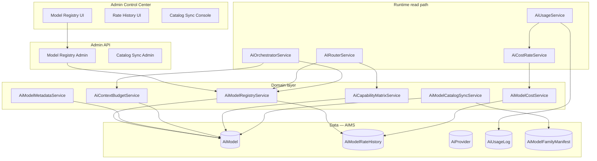

# AI Core Platform — Phase 3 Model Registry

**Project:** Prani Doctor  
**Role:** Principal AI Systems Architect  
**Date:** 2026-05-31  
**Status:** Phase 3.0–3.1 implemented — 2026-05-31  
**Version:** 1.1.0  
**Depends on:**

- `docs/plans/ai-core-platform-phase-1-foundation.md` (implemented)
- `docs/plans/ai-phase-2-provider-management.md` (implemented)
- `docs/reports/ai-foundation-verification.md`
- `docs/reports/ai-provider-security-audit.md`

---

## Implementation progress

| Sub-phase | Scope | Status | Notes |
|-----------|-------|--------|-------|
| **3.0** | Schema migration, `modelFamily`, rate history table | **Done** | `20260607120000_ai_phase3_model_registry` |
| **3.1** | Family manifests seed, registry service, admin list/detail API | **Done** | 7 families, 14 seeded models, grok provider |
| **3.2** | Cost service + rate versioning on usage write | **Partial** | `AiModelCostService` + history; usage snapshot pending |
| **3.3** | Capability matrix + router filtering | **Partial** | `AiCapabilityMatrixService`; orchestrator hook pending |
| **3.4** | Context budget service + pre-flight enforcement | **Pending** | Schema fields ready |
| **3.5** | OpenRouter sync → registry unification | **Pending** | Manifest sync only |
| **3.6** | Admin UI + analytics context report | **Partial** | `ModelPanel` family filter, enable/disable, sync |

### Delivered artifacts

**Schema & migration**

- `AiModelFamily` enum — gpt, gemini, claude, deepseek, qwen, llama, grok
- Extended `AiModel` — economics versioning, lifecycle dates, context metadata
- `AiModelRateHistory` — append-only rate audit trail
- Grok provider seed + 14 built-in model rows (disabled by default)

**Module structure**

```
src/modules/ai/models/
├── ai-model.types.ts
├── ai-model-registry.service.ts
├── ai-model-cost.service.ts
├── ai-capability-matrix.service.ts
└── manifests/builtin-family-manifests.ts
```

**Admin API (legacy compat + BFF proxies)**

| Method | Path |
|--------|------|
| GET | `/api/admin/ai-ops/models` |
| POST | `/api/admin/ai-ops/models` |
| GET | `/api/admin/ai-ops/models/[id]` |
| PUT | `/api/admin/ai-ops/models/[id]` |
| POST | `/api/admin/ai-ops/models/[id]/enable` |
| POST | `/api/admin/ai-ops/models/[id]/disable` |
| POST | `/api/admin/ai-ops/models/[id]/default` |
| PUT | `/api/admin/ai-ops/models/[id]/rates` |
| GET | `/api/admin/ai-ops/models/[id]/rates/history` |
| GET | `/api/admin/ai-ops/models/families` |
| GET | `/api/admin/ai-ops/models/families/[family]` |
| POST | `/api/admin/ai-ops/models/sync/manifests` |

**Remaining (Phase 3.2+)**

- Orchestrator registry-first resolution + `rateVersion` on usage logs
- Context pre-flight enforcement (`AiContextBudgetService`)
- Router capability filtering
- OpenRouter catalog sync unification
- Rate history chart in admin UI

---

## Repositories in scope

| Repo | Role |
|------|------|
| `pranidoctor-backend` | Model registry, cost/context/capability services, orchestrator integration |
| `pranidoctor-web` | AI Control Center — Model Registry admin UI (BFF proxies) |
| `pranidoctor_user` | Consumer only — models selected by routing, not user-configurable |

**Related documents:**

- `docs/plans/AI_CONTROL_CENTER_RECOVERY_MASTER_PLAN.md`
- `docs/plans/ai-core-platform-phase-1-foundation.md` § AIModel

---

## Executive summary

Phase 1 introduced `AiModel` as a **provider-scoped catalog row** with basic economics (`inputCostPerToken`, `outputCostPerToken`), optional `contextWindow`, and a flat `capabilitiesJson` array. Phase 2 secured **who** may call upstream APIs (providers + vault). Phase 3 answers **which model, at what cost, with what limits, and for which tasks**.

**Phase 3 Model Registry** establishes a **canonical, admin-controlled model catalog** that is:

1. **Authoritative for routing** — orchestrator and `AiRoute` chains resolve models from DB first, not hardcoded env defaults.
2. **Rich in metadata** — family, modality, context limits, capability matrix, deprecation lifecycle.
3. **Economics-aware** — versioned cost rates tied to `AiUsageLog.rateVersion` for accurate billing analytics.
4. **Context-safe** — pre-flight token budget checks using registry context windows before provider calls.
5. **Family-complete** — first-class support for **GPT, Gemini, Claude, DeepSeek, Qwen, Llama, Grok** across cloud and gateway providers.

This plan defines architecture and behavior only. **No implementation** is included.

---

## Strategic intent

| Before Phase 3 | After Phase 3 |
|----------------|---------------|
| Model rows seeded ad hoc; env vars override model IDs | Registry is source of truth for model identity + limits + rates |
| `capabilitiesJson` is unstructured string[] | Typed capability matrix with enforcement hooks |
| Cost rates on model row only; no history | Rate versioning + audit on price changes |
| `contextWindow` optional, not enforced | Context tracking service gates prompts and logs overflow risk |
| OpenRouter slugs vs native keys inconsistent | Normalized `modelKey` + `externalModelId` + `modelFamily` taxonomy |
| Qwen / Llama only via marketplace ad hoc | Built-in family manifests + sync jobs |

---

## Design principles

| Principle | Phase 3 interpretation |
|-----------|------------------------|
| **Registry-first** | Runtime never invents a model ID; unknown model → skip hop or rules fallback |
| **Provider binds, family classifies** | `providerId` + `modelKey` is unique; `modelFamily` enables cross-provider analytics |
| **Admin controlled** | Model enable/disable, default selection, and rate edits require `ai.registry.manage` |
| **Immutable usage economics** | Cost snapshot at request time via `rateVersion`; historical logs stay accurate after rate edits |
| **Fail safe on context** | Over-limit prompts truncated or rejected per task policy — never silent provider 400s |
| **Capabilities are contracts** | Router filters hops by required capabilities for `taskType` / feature |
| **Extensible catalog** | New models via manifest seed, OpenRouter sync, or admin CRUD — no orchestrator code change |
| **Soft deprecation** | Deprecated models remain in registry for historical FKs; disabled for new routes |

---

## Current state (Phase 2 baseline)

### What exists

| Area | Artifact | Maturity |
|------|----------|----------|
| Schema | `AiModel` — costs, `contextWindow`, `maxOutputTokens`, `capabilitiesJson`, `modelType`, `source` | Production table |
| Admin CRUD | `AiRegistryAdminService` — list/create/update/toggle models | Basic |
| Cost runtime | `AiCostRateService` — DB-first rates, cache, legacy fallback | Implemented |
| Usage FK | `AiUsageLog.modelId`, `modelKey`, `costUsd`, `rateVersion` (field exists) | Partial population |
| Marketplace | OpenRouter catalog sync, external models, veterinary extensions | Partial overlap with registry |
| UI | `ModelPanel.tsx` — list by provider | Read-heavy |
| Default model | Partial unique index one `isDefault` per provider/scope | Phase 1 migration |

### Gaps Phase 3 must close

| ID | Gap | Impact |
|----|-----|--------|
| G1 | No **model family** taxonomy (GPT, Qwen, …) | Cross-provider reporting broken |
| G2 | **Rate history** absent — editing cost corrupts historical analytics interpretation | Finance inaccuracy |
| G3 | **Context window** not enforced pre-call | Wasted tokens, provider errors |
| G4 | **Capabilities** unstructured — router ignores them | Wrong model for vision/tools tasks |
| G5 | **Qwen** not first-class | Gap vs product model lineup |
| G6 | Dual paths: `AiModel` vs marketplace external rows | Duplicate/conflicting entries |
| G7 | `rateVersion` on usage log not consistently set from model row version | Cost audit drift |
| G8 | No model **lifecycle** (preview, deprecated, retired) | Ops confusion on upstream EOL |

---

## Target architecture



**Boundary rule:** Farmer APIs never expose raw rate tables or full capability internals — only aggregated usage/cost in authorized dashboards.

---

## 1. Model registry

### 1.1 Purpose

The **Model Registry** is the canonical catalog of invokable LLM models scoped to a provider (and optionally tenant/branch). Each row answers:

- What is this model called upstream (`modelKey` / `externalModelId`)?
- Which **family** does it belong to (GPT, Claude, …)?
- What does it cost, what can it do, and how large a context does it accept?
- Is it enabled for new traffic?

### 1.2 Identity model

| Field | Role | Example |
|-------|------|---------|
| `id` | Internal CUID | `clm_…` |
| `scopeKey` | Platform / tenant / branch | `platform` |
| `providerId` | FK to `AiProvider` | OpenAI provider row |
| `modelKey` | **Invocation ID** sent to adapter | `gpt-4o-mini`, `claude-3-5-haiku-20241022`, `openai/gpt-4o-mini` |
| `externalModelId` | Upstream catalog ID if different | OpenRouter slug |
| `modelFamily` | **New** — normalized family enum | `gpt`, `gemini`, `claude`, … |
| `displayName` | Admin UI label | `GPT-4o Mini` |
| `source` | Provenance | `BUILTIN`, `MARKETPLACE`, `SYNC`, `ADMIN` |

**Uniqueness:** retain `(scopeKey, providerId, modelKey)`.

**Normalization rules:**

- `modelKey` is case-sensitive as required by upstream (OpenRouter slugs preserved).
- `modelFamily` is lowercase enum — independent of `providerKey`.
- One logical model may appear **multiple times** (OpenAI native + OpenRouter gateway) with different `providerId` but same `modelFamily`.

### 1.3 Registry lifecycle

```
DISCOVERED → REGISTERED → ENABLED → DEPRECATED → RETIRED → ARCHIVED (soft delete)
```

| State | `enabled` | New routes | Existing FKs | Transitions |
|-------|-----------|------------|--------------|-------------|
| **REGISTERED** | false | No | N/A | Seed/sync/admin create |
| **ENABLED** | true | Yes | Yes | Admin enable + provider enabled |
| **DEPRECATED** | true | No | Yes | Admin or sync flags `deprecatedAt` |
| **RETIRED** | false | No | Yes | Upstream EOL; auto-disable |
| **ARCHIVED** | false | No | Read-only | Soft delete |

**Secure-by-default:** New seeded models ship `enabled=false` until admin enables (mirrors Phase 2 providers).

**Default model:** At most one `isDefault=true` per `(scopeKey, providerId, modelType)` — extend partial unique index from chat-only to per `modelType`.

### 1.4 Resolution algorithm (runtime)

```
resolveModel(scope, providerKey, modelKey | default):
  1. If modelKey provided → lookup (scope cascade: branch → tenant → platform)
  2. Else if route.primaryModelId → load by ID
  3. Else if provider default for modelType → isDefault row
  4. Else env fallback (non-prod only) → register ephemeral warning metric
  5. Validate: enabled, not retired, provider enabled, capabilities ⊇ required
  6. Return AiModelResolution { model, rateVersion, contextBudget, capabilities }
```

### 1.5 Catalog sources

| Source | Mechanism | Priority |
|--------|-----------|----------|
| Built-in family manifests | Idempotent seed migration | Base catalog |
| OpenRouter sync | Existing catalog service → registry upsert | Gateway models |
| Admin CRUD | Control Center | Overrides |
| Self-hosted / vLLM | Marketplace extension | Llama, Qwen local |

**Phase 3 goal:** Single write path into `AiModel`; marketplace external service becomes a **sync adapter**, not a parallel table semantics.

---

## 2. Model metadata

### 2.1 Metadata layers

| Layer | Storage | Mutability | Consumer |
|-------|---------|------------|----------|
| **Core** | `AiModel` columns | Admin + sync | Router, orchestrator |
| **Extended** | `metadataJson` structured schema | Admin + sync | Admin UI, analytics |
| **Computed** | Not stored (or cached) | Derived at read | Dashboards |

### 2.2 Core metadata schema (existing + planned columns)

| Group | Fields | Notes |
|-------|--------|-------|
| Identity | `modelKey`, `externalModelId`, `modelFamily`, `displayName`, `description` | `description` optional new column or in JSON |
| Modality | `modelType` | `chat`, `embedding`, `vision`, `audio`, `multimodal` |
| Category | `modelCategory` | `general_chat`, `reasoning`, `code`, `vision`, `embedding`, `veterinary` |
| Provenance | `source`, `extensionId`, `syncedAt`, `upstreamVersion` | Track catalog freshness |
| Lifecycle | `enabled`, `isDefault`, `deprecatedAt`, `retiredAt`, `version` | Bump `version` on material edits |
| Routing hints | `priority`, `qualityTier`, `latencyTier` | Optional cost/latency optimization (P3.2) |

### 2.3 Extended `metadataJson` contract (planned)

```typescript
type AiModelMetadata = {
  vendor?: string;                    // "OpenAI", "Anthropic", …
  releaseDate?: string;               // ISO date
  trainingCutoff?: string;            // informational
  supportsStreaming?: boolean;
  supportsToolCalling?: boolean;
  supportsJsonMode?: boolean;
  supportsVision?: boolean;
  supportsAudio?: boolean;
  reasoningMode?: 'none' | 'extended' | 'chain_of_thought';
  parametersBillions?: number;        // Llama, Qwen — approximate
  license?: 'commercial' | 'open' | 'research_only';
  tags?: string[];                    // admin labels
  documentationUrl?: string;
  upstreamStatus?: 'active' | 'deprecated' | 'preview';
};
```

Validation: Zod schema at admin API boundary; unknown keys preserved (forward compatible).

### 2.4 Model family manifests

Built-in YAML/TS manifests (design artifact, not code in this plan) seed platform-scope rows per provider:

```
manifests/
  families/
    gpt.manifest.ts
    gemini.manifest.ts
    claude.manifest.ts
    deepseek.manifest.ts
    qwen.manifest.ts
    llama.manifest.ts
    grok.manifest.ts
```

Each manifest entry defines default models per provider adapter with full metadata blocks for seed migration.

---

## 3. Cost tracking metadata

### 3.1 Purpose

Provide **accurate, auditable cost estimation** for every `AiUsageLog` row, with historical integrity when admins or upstream pricing changes.

### 3.2 Economics fields (on `AiModel`)

| Field | Type | Purpose |
|-------|------|---------|
| `inputCostPerToken` | Decimal(16,12) | USD per input token |
| `outputCostPerToken` | Decimal(16,12) | USD per output token |
| `cachedInputCostPerToken` | **New** optional | Prompt cache hits (GPT, Claude) |
| `batchInputCostPerToken` | **New** optional | Batch API discount |
| `batchOutputCostPerToken` | **New** optional | Batch API discount |
| `currency` | **New** default `USD` | Future multi-currency |
| `rateVersion` | **New** int monotonic | Copied to `AiUsageLog.rateVersion` at request time |

### 3.3 Rate history table (planned)

```sql
-- AiModelRateHistory (append-only)
model AiModelRateHistory {
  id                String   @id
  modelId           String
  rateVersion       Int
  inputCostPerToken Decimal
  outputCostPerToken Decimal
  cachedInputCostPerToken Decimal?
  effectiveFrom     DateTime @default(now())
  effectiveTo       DateTime?
  changedByUserId   String?
  changeReason      String?
  source            String   -- 'admin', 'sync', 'import'
  createdAt         DateTime @default(now())
}
```

**Rules:**

- Any change to economics columns increments `AiModel.rateVersion` and appends history row.
- `AiCostRateService` loads active rate by `(modelId, rateVersion)` or latest if version omitted.
- Usage write path **must** snapshot `rateVersion` from resolved model at call start.
- Legacy `ai-usage.cost.ts` fallback allowed only when no DB row — metric `ai.cost.fallback_used`.

### 3.4 Cost estimation formula

```
costUsd =
  inputTokens  * inputRate
  + outputTokens * outputRate
  + cachedInputTokens * cachedInputRate   (if applicable)
  + batchDiscount adjustments             (Phase 3.1 optional)
```

Round to 6 decimal places at log write (match existing `costUsd` precision).

### 3.5 Admin economics operations

| Operation | Capability | Audit |
|-----------|------------|-------|
| View rates + history | `ai.ops.view` | — |
| Update rates | `ai.registry.manage` | `AI_MODEL_RATE_CHANGED` |
| Bulk sync from OpenRouter pricing | `ai.registry.manage` | `AI_MODEL_CATALOG_SYNC` |
| Import CSV rate sheet | `ai.registry.manage` | `AI_MODEL_RATE_IMPORT` |

---

## 4. Context window tracking

### 4.1 Purpose

Prevent avoidable upstream failures and govern prompt assembly using **registry-authoritative token budgets**.

### 4.2 Context fields

| Field | Meaning |
|-------|---------|
| `contextWindow` | Max **input + output** tokens (provider advertised) |
| `maxInputTokens` | **New** optional — input-only cap (some APIs split) |
| `maxOutputTokens` | Max generation tokens (existing) |
| `contextWindowSource` | **New** enum: `ADVERTISED`, `MEASURED`, `ADMIN_OVERRIDE` |
| `contextMeasuredAt` | **New** — last empirical probe timestamp |

### 4.3 Context budget service (planned)

`AiContextBudgetService` responsibilities:

1. **Pre-flight check** before orchestrator call:
   - Estimate prompt tokens (existing tokenizer util or heuristic chars/4).
   - Compare against `contextWindow - reservedOutputTokens`.
2. **Policy actions** (from `AiSettings` `routing.context_policy`):

| Policy | Behavior |
|--------|----------|
| `reject` | Fail fast with `AI_CONTEXT_EXCEEDED` |
| `truncate_oldest` | Drop oldest user/assistant turns |
| `summarize` | Phase 4 — delegate to summarization task |
| `downgrade_model` | Pick failover model with larger window |

3. **Logging:** Write `metadataJson.contextUsage` on `AiUsageLog`:

```json
{
  "estimatedInputTokens": 8120,
  "contextWindow": 128000,
  "reservedOutput": 1024,
  "utilizationPct": 6.3,
  "action": "pass"
}
```

### 4.4 Context drift detection

Periodic job (Phase 3.2):

- Sample successful calls per model.
- If provider returns `context_length_exceeded` despite pre-flight pass → flag model for `contextWindowSource = MEASURED` review.
- Admin dashboard shows models with high overflow error rate.

### 4.5 Family-specific defaults (seed reference)

| Family | Typical context (platform seed) | Notes |
|--------|----------------------------------|-------|
| GPT | 128k (`gpt-4o` class) | Verify per model row |
| Gemini | 1M (`gemini-1.5-pro`) / 128k flash | Wide variance |
| Claude | 200k | Sonnet/Opus class |
| DeepSeek | 64k–128k | Model-dependent |
| Qwen | 32k–128k | Qwen2.5 variants |
| Llama | 8k–128k | Groq vs self-hosted differ |
| Grok | 128k | xAI catalog |

**Rule:** Seed values are **starting points**; sync job refreshes from upstream catalogs where available.

---

## 5. Capability tracking

### 5.1 Purpose

Match **task requirements** to **model abilities** so vision tasks never hit text-only models, tool-calling routes prefer capable models, and embeddings never go through chat endpoints.

### 5.2 Capability taxonomy

Structured enum set (stored in `capabilitiesJson` as typed object — migration from string[]):

| Capability | Key | Description |
|------------|-----|-------------|
| Chat | `chat` | Text completion |
| Vision | `vision` | Image input |
| Embeddings | `embeddings` | Vector output |
| Function calling | `function_calling` | Tools / JSON schema tools |
| JSON mode | `json_mode` | Structured output |
| Streaming | `streaming` | SSE / stream support |
| Reasoning | `reasoning` | Extended thinking models |
| Audio in | `audio_input` | Speech input |
| Audio out | `audio_output` | TTS / speech out |
| PDF | `document_pdf` | Document input |
| Code | `code_optimized` | Code-specialized |

**Required-by-task map** (extends Phase 1 `feature-task-map`):

| taskType | Required capabilities |
|----------|----------------------|
| `chat` | `chat` |
| `vision` | `chat`, `vision` |
| `embedding` | `embeddings` |
| `farm_briefing` | `chat` |
| `triage` | `chat`, `json_mode` (preferred) |
| `tool_agent` | `chat`, `function_calling` |

### 5.3 Capability matrix service (planned)

`AiCapabilityMatrixService`:

```typescript
modelHasCapabilities(model: AiModel, required: AiCapability[]): boolean;
filterModels(models: AiModel[], required: AiCapability[]): AiModel[];
scoreModelFit(model: AiModel, task: TaskProfile): number; // Phase 3.2
```

Router integration:

```
candidateModels = registry.listEnabled(providerId)
candidateModels = capabilityService.filter(candidateModels, taskRequirements)
order by route priority / cost tier / context headroom
```

### 5.4 Capability sync

| Source | Mapping |
|--------|---------|
| OpenRouter catalog | Map `architecture.modality`, pricing tier → capabilities |
| Family manifests | Static capability sets per model entry |
| Admin override | `capabilitiesJson` edit with validation |

**Conflict rule:** Admin explicit deny wins over sync (store `capabilityOverrides` in `metadataJson`).

---

## 6. Model family reference — GPT, Gemini, Claude, DeepSeek, Qwen, Llama, Grok

Phase 3 treats these as **first-class families** (`modelFamily` enum), each mappable to one or more `AiProvider` rows.

### 6.1 Family catalog matrix

| Family | `modelFamily` | Primary providers | Example `modelKey` values | Default modality |
|--------|---------------|-------------------|---------------------------|----------------|
| **GPT** | `gpt` | `openai`, `openrouter`, `azure_openai`* | `gpt-4o`, `gpt-4o-mini`, `gpt-4.1`, `openai/gpt-4o-mini` | chat, vision |
| **Gemini** | `gemini` | `gemini`, `openrouter` | `gemini-1.5-flash`, `gemini-2.0-flash`, `google/gemini-pro` | chat, vision, embeddings |
| **Claude** | `claude` | `anthropic`, `openrouter` | `claude-3-5-sonnet-20241022`, `claude-3-5-haiku-20241022` | chat, vision |
| **DeepSeek** | `deepseek` | `deepseek`, `openrouter` | `deepseek-chat`, `deepseek-reasoner` | chat, reasoning |
| **Qwen** | `qwen` | `openrouter`, `self_hosted`, `dashscope`* | `qwen/qwen-2.5-72b-instruct`, `qwen2.5-7b-instruct` | chat, code |
| **Llama** | `llama` | `groq`, `openrouter`, `self_hosted` | `llama-3.3-70b-versatile`, `meta-llama/llama-3.3-70b` | chat |
| **Grok** | `grok` | `grok`, `openrouter` | `grok-2-1212`, `x-ai/grok-2` | chat, vision |

\*Future provider keys — registry accepts any `AiProvider` with matching adapter.

### 6.2 Seed strategy per family

Each family manifest includes for **platform scope**:

1. Minimum viable models (chat default + optional vision/reasoning variant).
2. Economics placeholders (updated by sync or admin before enable).
3. Context + capability blocks.
4. `enabled: false` until provider + key configured (Phase 2 dependency).

**Suggested seed counts:** 2–4 models per family per native provider; OpenRouter sync adds extended catalog.

### 6.3 Qwen & Llama specifics

| Topic | Design |
|-------|--------|
| Qwen | Add `qwen` to governance scopes; OpenRouter slug primary; self-hosted via `self_hosted` + extension manifest |
| Llama | Groq for hosted inference; self-hosted for on-prem; same `modelFamily=llama`, different `providerId` |
| Licensing | Store in `metadataJson.license`; gate enterprise features in Phase 4 |

### 6.4 Grok vs Groq disambiguation

| Term | Meaning in Prani Doctor |
|------|-------------------------|
| **Grok** | xAI model family (`modelFamily=grok`, provider `grok`) |
| **Groq** | Inference **provider** (LPU hosting) — hosts Llama, not a model family |

Documentation and admin UI must never conflate these.

---

## 7. Service layer design

### 7.1 New / extended services

| Service | Responsibility |
|---------|----------------|
| `AiModelRegistryService` | CRUD, lifecycle, default model, family queries, resolution |
| `AiModelMetadataService` | Validate/read/write `metadataJson`, manifest merge |
| `AiModelCostService` | Rate CRUD, history append, version bump, estimate |
| `AiContextBudgetService` | Pre-flight token checks, policy enforcement |
| `AiCapabilityMatrixService` | Required capability filtering, task fit |
| `AiModelCatalogSyncService` | OpenRouter + manifest upsert orchestration |
| `AiCostRateService` (extend) | Delegate to `AiModelCostService`; cache by `(provider, modelKey, rateVersion)` |

### 7.2 Module layout (target)

```
src/modules/ai/
├── models/
│   ├── manifests/families/       # gpt, gemini, claude, …
│   ├── ai-model-registry.service.ts
│   ├── ai-model-metadata.service.ts
│   ├── ai-model-cost.service.ts
│   ├── ai-context-budget.service.ts
│   ├── ai-capability-matrix.service.ts
│   ├── ai-model-catalog-sync.service.ts
│   ├── ai-model.types.ts
│   └── ai-model-resolution.ts
├── repositories/
│   └── ai-model.repository.ts    # extend existing
└── admin/
    └── ai-model-admin.service.ts   # facade for routes
```

---

## 8. Admin API design

All routes under `/api/admin/ai-ops/models` with BFF parity.

### 8.1 Model endpoints

| Method | Path | Capability | Description |
|--------|------|------------|-------------|
| GET | `/models` | `ai.ops.view` | List with family, capabilities, economics summary |
| GET | `/models/[id]` | `ai.ops.view` | Full metadata + rate history |
| POST | `/models` | `ai.registry.manage` | Create (starts disabled) |
| PUT | `/models/[id]` | `ai.registry.manage` | Update metadata (not rates — separate) |
| POST | `/models/[id]/enable` | `ai.registry.manage` | Enable model |
| POST | `/models/[id]/disable` | `ai.registry.manage` | Disable model |
| POST | `/models/[id]/default` | `ai.registry.manage` | Set default for modelType |
| GET | `/models/families` | `ai.ops.view` | Family catalog summary |
| GET | `/models/families/[family]` | `ai.ops.view` | Models in family across providers |

### 8.2 Economics endpoints

| Method | Path | Capability | Description |
|--------|------|------------|-------------|
| PUT | `/models/[id]/rates` | `ai.registry.manage` | Update rates → bumps version + history |
| GET | `/models/[id]/rates/history` | `ai.ops.view` | Append-only rate history |
| POST | `/models/sync/openrouter` | `ai.registry.manage` | Sync catalog + pricing |
| POST | `/models/sync/manifests` | `ai.registry.manage` | Re-apply built-in family seeds |

### 8.3 Context & capability endpoints

| Method | Path | Capability | Description |
|--------|------|------------|-------------|
| POST | `/models/[id]/probe-context` | `ai.registry.manage` | Optional live context probe |
| GET | `/models/capabilities/matrix` | `ai.ops.view` | Task × model capability grid |
| GET | `/models/context/report` | `ai.analytics.view` | Utilization / overflow stats |

### 8.4 Response DTO (never includes secrets)

```typescript
type AiModelAdminDto = {
  id: string;
  providerId: string;
  providerKey: string;
  modelKey: string;
  modelFamily: AiModelFamily;
  displayName: string;
  modelType: string;
  modelCategory: string;
  enabled: boolean;
  isDefault: boolean;
  lifecycle: 'registered' | 'enabled' | 'deprecated' | 'retired';
  contextWindow: number | null;
  maxOutputTokens: number | null;
  capabilities: AiCapability[];
  economics: {
    inputCostPerToken: number;
    outputCostPerToken: number;
    cachedInputCostPerToken?: number;
    rateVersion: number;
    currency: string;
  };
  metadata: AiModelMetadata;
  source: string;
  version: number;
  updatedAt: string;
};
```

---

## 9. Runtime integration

### 9.1 Orchestrator changes (planned)

1. Resolve model via `AiModelRegistryService.resolve()` before adapter call.
2. Run `AiContextBudgetService.check()` — apply policy.
3. Pass resolved `modelKey` to adapter (not env default).
4. On completion, `AiUsageService` writes `modelId`, `modelKey`, `rateVersion`, `costUsd` from `AiModelCostService`.

### 9.2 Router / route chain

- `providerChainJson` entries reference `modelKey` — validated against registry on route save.
- Invalid modelKey → admin API 400 at route write time.

### 9.3 Failover

- Failover downgrade may select **smaller/cheaper model within same family** or cross-family per `AiFailoverRule.actionConfigJson`.

### 9.4 Settings keys (new)

| Key | Category | Purpose |
|-----|----------|---------|
| `routing.context_policy` | ROUTING | reject / truncate / downgrade |
| `routing.capability_strict` | ROUTING | fail vs warn on missing capabilities |
| `billing.rate_currency` | BUDGET | Display currency |
| `registry.sync.openrouter` | ROUTING | Auto-sync schedule config |

---

## 10. Permissions & audit

### 10.1 Capabilities (extend Phase 2 matrix)

| Capability | SUPER_ADMIN | ADMIN | Use |
|------------|:-----------:|:-----:|-----|
| `ai.ops.view` | ✓ | ✓ | List models, families |
| `ai.registry.manage` | ✓ | ✓ | CRUD, enable, rates, sync |
| `ai.analytics.view` | ✓ | ✓ | Context utilization reports |

No new secret capabilities required.

### 10.2 Audit events (planned additions)

| Action | Trigger |
|--------|---------|
| `AI_MODEL_CREATED` | Model create |
| `AI_MODEL_UPDATED` | Metadata edit |
| `AI_MODEL_ENABLED` / `_DISABLED` | Lifecycle |
| `AI_MODEL_RATE_CHANGED` | Economics update |
| `AI_MODEL_DEFAULT_CHANGED` | Default flag |
| `AI_MODEL_CATALOG_SYNC` | OpenRouter/manifest sync |

Platform audit + optional `AiModelChangeLog` table if JSON diff needed (P3.2).

---

## 11. Database deltas (planned — not implemented)

```sql
-- Enum
CREATE TYPE "AiModelFamily" AS ENUM (
  'gpt', 'gemini', 'claude', 'deepseek', 'qwen', 'llama', 'grok'
);

ALTER TABLE ai_models ADD COLUMN "modelFamily" "AiModelFamily";
ALTER TABLE ai_models ADD COLUMN "rateVersion" INT NOT NULL DEFAULT 1;
ALTER TABLE ai_models ADD COLUMN "cachedInputCostPerToken" DECIMAL(16,12);
ALTER TABLE ai_models ADD COLUMN "currency" VARCHAR(8) NOT NULL DEFAULT 'USD';
ALTER TABLE ai_models ADD COLUMN "maxInputTokens" INT;
ALTER TABLE ai_models ADD COLUMN "contextWindowSource" VARCHAR(32) DEFAULT 'ADVERTISED';
ALTER TABLE ai_models ADD COLUMN "deprecatedAt" TIMESTAMPTZ;
ALTER TABLE ai_models ADD COLUMN "retiredAt" TIMESTAMPTZ;

CREATE TABLE ai_model_rate_history ( ... );
CREATE INDEX ai_models_family_enabled ON ai_models ("modelFamily", "enabled");

-- Partial unique: one default per provider + scope + modelType
CREATE UNIQUE INDEX ai_models_one_default_per_type
  ON ai_models ("scopeKey", "providerId", "modelType")
  WHERE "isDefault" = true AND "deletedAt" IS NULL;
```

Migrate existing `capabilitiesJson` string[] → structured object with backward-compatible reader.

---

## 12. Admin UI (web) — design requirements

| Screen | Requirements |
|--------|--------------|
| **Model list** | Filter by family, provider, capability, enabled; show context + cost summary |
| **Model detail** | Tabs: Metadata, Economics (with history chart), Context, Capabilities |
| **Family view** | Cross-provider comparison for GPT vs Claude vs … |
| **Sync console** | Trigger OpenRouter/manifest sync; diff preview before apply |
| **Route validator** | Warn when route chain references disabled/retired models |

Extend existing `ModelPanel.tsx` — do not create parallel UI.

---

## 13. Implementation roadmap

| Sub-phase | Deliverable | Exit criteria |
|-----------|-------------|---------------|
| **3.0** | Schema migration, `modelFamily`, rate history table | Migration deploys cleanly |
| **3.1** | Family manifests seed (7 families), registry service, admin list/detail API | All families visible disabled in admin |
| **3.2** | Cost service + rate versioning on usage write | `rateVersion` on 95%+ new logs |
| **3.3** | Capability matrix + router filtering | Vision task never selects text-only model in tests |
| **3.4** | Context budget service + pre-flight enforcement | Integration tests for reject/truncate |
| **3.5** | OpenRouter sync → registry unification | No duplicate external-only rows |
| **3.6** | Admin UI + analytics context report | Admin E2E: enable Qwen via OpenRouter |

**Estimated duration:** 5–7 engineering weeks after Phase 2 production stable.

---

## 14. Acceptance criteria

Phase 3 Model Registry is **complete** when:

1. All seven families (`gpt`, `gemini`, `claude`, `deepseek`, `qwen`, `llama`, `grok`) have seeded manifest entries at platform scope.
2. Admin can enable/disable models independently of providers (with provider still required for calls).
3. Rate change creates history row and increments `rateVersion`; usage logs snapshot version.
4. Orchestrator resolves models from registry; env model defaults deprecated in production.
5. Context pre-flight blocks or truncates per policy before provider 400.
6. Capability filter excludes unfit models for `vision` and `embedding` task types in integration tests.
7. OpenRouter sync upserts into `AiModel` without parallel conflicting catalog.
8. Qwen models invokable via OpenRouter path in staging smoke test.
9. Admin UI shows family, context, capabilities, and rate history.
10. Automated test suite green; new module tests ≥ 40 cases for registry/economics/context/capabilities.

---

## 15. Non-goals (Phase 3)

- Fine-tuning or custom model training registry
- Per-tenant model billing/invoicing (Phase 4+)
- Automatic model selection ML optimizer
- Tokenizer-perfect context counting (heuristic acceptable in 3.0)
- Multi-agent model assignment
- Retiring `AiUsageRecord` dual-write (Phase 4 analytics track)
- Doctor LLM / RAG vector store model binding

---

## 16. Risks & mitigations

| Risk | Mitigation |
|------|------------|
| Upstream model renames break `modelKey` | Store `externalModelId`; sync job with alias map |
| Rate sync lags vendor price changes | Admin alerts on sync age; manual rate override |
| Context limits vary by API version | `contextWindowSource` + measured drift job |
| Capability false positives block traffic | `routing.capability_strict=false` warn mode in staging |
| Registry/schema migration on large table | Backfill `modelFamily` via SQL mapping table |
| Qwen licensing in production regions | `metadataJson.license` gate + legal review checklist |

---

## 17. Open questions

| # | Question | Recommendation |
|---|----------|----------------|
| Q1 | Store capabilities as JSON object vs join table? | JSON object in 3.0; normalize in Phase 4 if query-heavy |
| Q2 | Separate `AiModelFamilyManifest` table vs code-only manifests? | Code manifests 3.0; DB table if admin edits family defaults |
| Q3 | Auto-enable models when provider enabled? | No — explicit model enable preserves cost control |
| Q4 | Unified `modelKey` across providers for same logical model? | No — keep per-provider keys; link via `modelFamily` + optional `logicalModelId` in Phase 4 |
| Q5 | Include Groq-hosted Llama under `llama` or separate family? | `llama` family, `groq` provider |

---

## Appendix A — Mapping from existing `AiModel`

| Existing field | Phase 3 treatment |
|----------------|-------------------|
| `inputCostPerToken` / `outputCostPerToken` | Keep; add history table |
| `contextWindow` | Enforce via context service |
| `maxOutputTokens` | Keep; use in budget reservation |
| `capabilitiesJson` | Migrate to structured capability object |
| `modelType` | Align with capability requirements |
| `source` | Keep enum; add `SYNC` usage |
| `extensionId` | Keep for marketplace linkage |
| `metadataJson` | Formalize schema |

---

## Appendix B — Key file index (current)

| Area | Path |
|------|------|
| Schema | `prisma/schema.prisma` — `AiModel` |
| Admin CRUD | `src/modules/ai/admin/ai-registry-admin.service.ts` |
| Cost runtime | `src/modules/ai/usage/ai-cost-rate.service.ts` |
| Repository | `src/modules/ai/repositories/ai-platform.repository.ts` |
| OpenRouter sync | `src/modules/ai/marketplace/openrouter-catalog.service.ts` |
| External models | `src/modules/ai/marketplace/external-model.service.ts` |
| Admin UI | `pranidoctor-web/src/components/admin/ai-ops/ModelPanel.tsx` |
| Phase 2 providers | `docs/plans/ai-phase-2-provider-management.md` |

---

*End of plan — architecture and planning only; no implementation included.*
