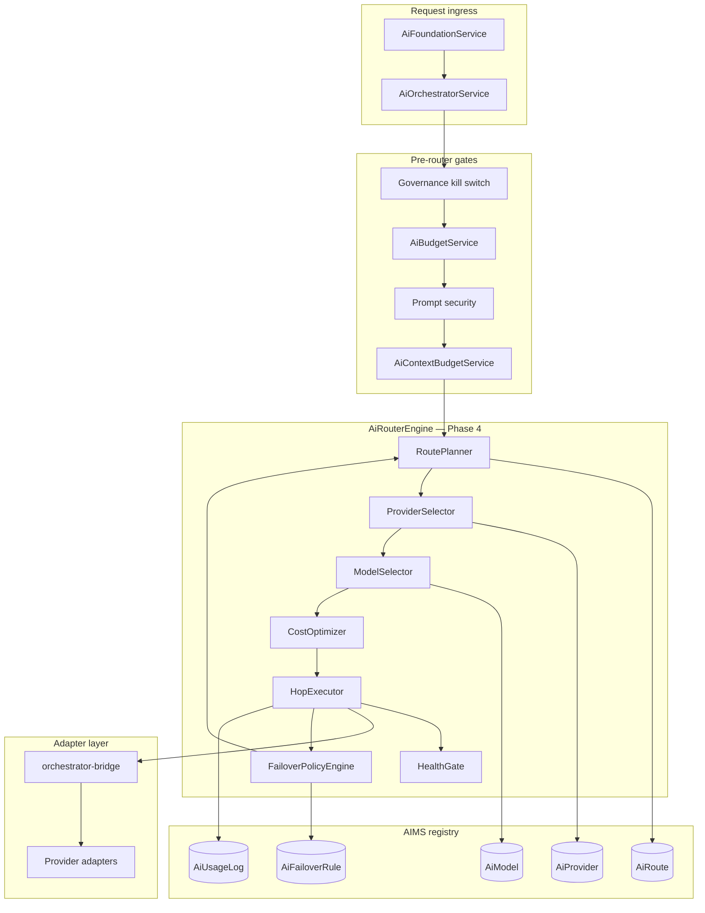
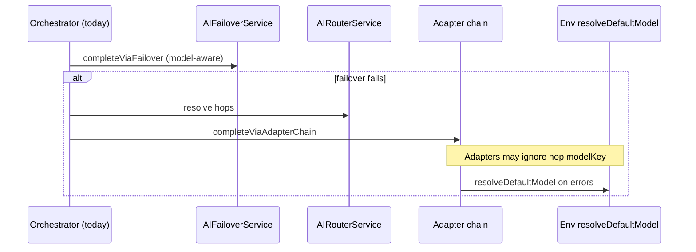
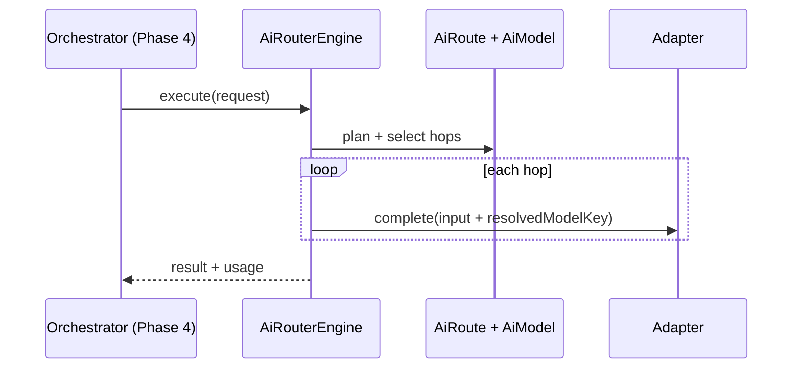

# AI Core Platform — Phase 4 Router Engine

**Project:** Prani Doctor  
**Role:** Principal AI Routing Architect  
**Date:** 2026-05-31  
**Status:** Phase 4.0–4.1 implemented — 2026-05-31  
**Version:** 1.1.0  
**Depends on:**

- `docs/plans/ai-core-platform-phase-1-foundation.md` (implemented)
- `docs/plans/ai-phase-2-provider-management.md` (implemented)
- `docs/plans/ai-phase-3-model-registry.md` (partial — 3.0–3.1 done)
- `docs/reports/ai-foundation-verification.md`
- `docs/reports/ai-provider-security-audit.md`
- `docs/reports/ai-model-registry-verification.md`

---

## Implementation progress

| Sub-phase | Scope | Status | Notes |
|-----------|-------|--------|-------|
| **4.0** | `AiRouterEngine` + adapter `resolvedModelKey` | **Done** | Modular engines + orchestrator integration |
| **4.1** | Default route seed OpenAI→Gemini→OpenRouter | **Done** | Migration `20260608120000_ai_phase4_router_engine` |
| **4.2** | Capability + cost gates in selection | **Partial** | Health/circuit done; pre-hop `maxCostUsd` gate added (verification 2026-05-31) |
| **4.3** | Failover policy unification + 429 coordinator | **Partial** | FallbackEngine + retry; Retry-After wired from error object/message; HTTP header pending |
| **4.4** | Health gate + dynamic demotion | **Partial** | RouterHealthMonitor + circuit breaker |
| **4.5** | Admin route preview + routing dashboard | **Pending** | |
| **4.6** | Remove legacy orchestrator paths | **Partial** | Router primary; adapter chain fallback retained |

### Delivered artifacts

**Module structure**

```
src/modules/ai/router/
├── ai-router-engine.service.ts
├── ai-router-engine.types.ts
├── adapters/
│   ├── provider-adapter.factory.ts
│   └── model-invocation.adapter.ts
└── engines/
    ├── timeout.engine.ts
    ├── retry.engine.ts
    ├── fallback.engine.ts
    ├── health-monitor.service.ts
    └── cost-gate.engine.ts
```

**Integration**

- `AiOrchestratorService` → `getAiRouterEngine().executeCompletion()` (registry model resolution)
- `AIFailoverService` delegates to `AiRouterEngine` (backward compatible)
- `AiCompletionInput.resolvedModelKey` + orchestrator-bridge passes model to providers

**Migration**

- Platform `GENERAL_CHAT` route: OpenAI → Gemini → OpenRouter + failover rules

---

## Repositories in scope

| Repo | Role |
|------|------|
| `pranidoctor-backend` | Router engine, orchestrator integration, health/cost/failover runtime |
| `pranidoctor-web` | AI Control Center — Route designer, failover rules, routing dashboard |
| `pranidoctor_user` | Consumer only — routing transparent via `AiFoundationService` |

**Related documents:**

- `docs/plans/AI_CONTROL_CENTER_RECOVERY_MASTER_PLAN.md`
- `docs/plans/ai-core-platform-phase-1-foundation.md` § AIRoute / AiFailoverRule

---

## Executive summary

Phases 1–3 established **registry** (providers, models, secrets), **catalog metadata** (family, capabilities, economics), and **partial routing** (`AIRouterService`, `AIFailoverService`, `AiRoute.providerChainJson`). Today the orchestrator still maintains **parallel execution paths**: DB failover (model-aware hops) vs legacy adapter chains that call **`resolveDefaultModel()` from env** and hardcoded provider constructors.

**Phase 4 Router Engine** delivers a **single, dynamic, registry-authoritative execution pipeline** that:

1. **Selects providers and models from the database** — no hardcoded model IDs or provider ordering in application code.
2. **Executes ordered failover** with default platform chain **OpenAI → Gemini → OpenRouter → rules-based**.
3. **Optimizes cost** within route budgets and task requirements.
4. **Monitors health** via circuit breakers, probes, and rolling latency/error scores.
5. **Handles retries, timeouts, and rate limits** with explicit, auditable policies.

This plan defines architecture and behavior only. **No implementation** is included.

---

## Strategic intent

| Before Phase 4 | After Phase 4 |
|----------------|---------------|
| Orchestrator tries failover, then falls back to env adapter chain | **One router engine** executes all LLM traffic |
| `resolveDefaultModel()` / `OPENAI_MODEL` env used at runtime | Model resolved from **`AiModel` registry** per hop |
| Provider order from `listEnabled()` priority or legacy array | Order from **`AiRoute.providerChainJson`** + dynamic signals |
| Failover rules partially wired | **Unified policy engine** for retry / next-hop / downgrade |
| Cost estimated post-hoc | **Pre-flight cost budget** + hop selection by economics |
| Rate limits handled ad hoc | **429-aware routing** with Retry-After and cross-provider failover |

---

## Design principles

| Principle | Phase 4 interpretation |
|-----------|------------------------|
| **Registry-first** | Every hop resolves `providerId` + `modelId` + `modelKey` from DB before adapter invocation |
| **No hardcoded model calls** | Adapters receive `modelKey` from router context; env model vars are bootstrap/docs only |
| **Dynamic, admin-controlled** | Chain order, failover rules, timeouts, and cost caps live in `AiRoute` / `AiFailoverRule` |
| **Deterministic defaults, flexible overrides** | Platform seed: OpenAI → Gemini → OpenRouter; tenants may override via scoped routes |
| **Fail safe** | Terminal hop is always `rules-based` when `fallbackToRules=true` |
| **Observable** | Every attempt logged on `AiUsageLog` with `routeId`, `failoverRuleId`, `isFallback`, hop index |
| **Governance before routing** | Kill switch, budget block, and consent gates run **before** router engine |
| **Capability-aware** | Hops filtered by task modality (chat / vision / embedding) via Phase 3 capability matrix |
| **Cost-bounded** | `maxCostUsd` on route + settings budget — router rejects or downgrades over-budget hops |

---

## Current state (Phase 3 baseline)

### What exists

| Area | Artifact | Maturity |
|------|----------|----------|
| Route schema | `AiRoute` — `providerChainJson`, `maxRetries`, `timeoutMs`, `maxCostUsd` | Production table |
| Failover schema | `AiFailoverRule` — triggers + actions | Production table |
| Route resolution | `RouteResolver` — scope cascade, taskType match | Implemented |
| Model selection | `ModelSelector` — chain modelId → default → first enabled | Implemented; no capability filter |
| Router service | `AIRouterService.resolve()` → `ResolvedRoute` with hops | Implemented |
| Failover runtime | `AIFailoverService.execute()` — retries, timeout, circuit breaker | Implemented |
| Health monitor | `AIProviderMonitor` — circuit open/close, success/failure | Implemented |
| Orchestrator | Dual path: failover → adapter chain with env fallbacks | **Fragmented** |
| Usage logging | `AiUsageLog.isFallback`, `fromProviderKey`, `routeId` | Partial population |
| Admin CRUD | Routes + failover rules via `AiRegistryAdminService` | Basic UI |

### Gaps Phase 4 must close

| ID | Gap | Impact |
|----|-----|--------|
| G1 | Orchestrator **adapter chain ignores resolved `modelKey`** | Wrong model invoked; registry unused at runtime |
| G2 | `resolveDefaultModel()` / env vars on failure logging and legacy path | Hardcoded models violate architecture |
| G3 | `completeViaAdapterChain` ≠ `completeViaFailover` behavior | Inconsistent retry/timeout/rate-limit handling |
| G4 | No default **OpenAI → Gemini → OpenRouter** platform route seed | Ops must hand-configure chain |
| G5 | **Capability matrix** not applied in `ModelSelector` / hop filtering | Vision tasks may hit text-only models |
| G6 | **Cost optimization** not in hop selection (only post-hoc estimate) | Budget overruns |
| G7 | **Dynamic routing** — `conditionsJson` unused at runtime | Static chains only |
| G8 | Failover executor passes input without **hop model context** to adapter | Adapter picks env default |
| G9 | Platform **rate limit** (user daily) separate from **provider 429** — not unified in policy | Confusing ops behavior |
| G10 | `rateVersion` not snapshotted from resolved model on usage write | Analytics drift (Phase 3.2 carryover) |

---

## Target architecture



**Boundary rule:** `AiRouterEngine` is the **only** component that chooses provider/model for LLM calls. Orchestrator becomes a thin wrapper: gates → engine → response filter → usage finalize.

---

## 1. Router engine core

### 1.1 `AiRouterEngine` responsibilities

| Phase | Responsibility |
|-------|----------------|
| **Plan** | Resolve `AiRoute` for `(scope, taskType, feature, conditions)` |
| **Select** | Build ordered hop list with provider + model + economics snapshot |
| **Execute** | Run hops with timeout, retry, and failover policy |
| **Record** | Write `AiUsageLog` per attempt; success row includes `modelId`, `rateVersion` |
| **Return** | `RouterExecutionResult` with content, trace, cost, hop metadata |

### 1.2 Request context (planned type)

```typescript
type RouterExecutionRequest = {
  taskType: string;
  feature: string;
  scopeKey: string;
  tenantId?: string | null;
  branchId?: string | null;
  userId?: string | null;
  customerId?: string | null;
  modality: 'chat' | 'vision' | 'embeddings';
  requiredCapabilities: AiCapability[];
  estimatedInputTokens?: number;
  maxOutputTokens?: number;
  locale?: 'bn' | 'en';
  requestId?: string;
  correlationId?: string;
  sessionId?: string;
  // Completion payload passed to adapter
  completionInput: AiCompletionInput;
};
```

### 1.3 Hop resolution output

```typescript
type ResolvedHop = {
  index: number;
  tier: 'primary' | 'secondary' | 'tertiary' | 'gateway' | 'fallback';
  providerId: string;
  providerKey: string;
  modelId: string;
  modelKey: string;
  modelFamily: AiModelFamily | null;
  adapterType: string;
  rateVersion: number;
  estimatedCostUsd?: number;
  contextWindow: number | null;
  timeoutMs: number;          // hop-level budget (derived from route)
  maxRetries: number;         // hop-level override or route default
};
```

### 1.4 Execution flow

```
execute(request):
  1. planRoute(request) → PlannedRoute { hops[], routeId, policies }
  2. for each hop in hops (until success or exhausted):
       a. healthGate.allow(hop.providerKey) → skip if circuit open
       b. capabilityGate(hop.model, requiredCapabilities) → skip if unfit
       c. costGate(hop, route.maxCostUsd, budget) → skip or downgrade
       d. retryLoop(hop):
            - invoke adapter with hop.modelKey (NOT env default)
            - withTimeout(hop.timeoutMs)
            - on error → policyEngine.decide(trigger) → retry | next hop | rules | abort
       e. on success → record usage, return result
  3. if fallbackToRules → rules-based hop
  4. throw RouterExhaustedError
```

### 1.5 Deprecations (Phase 4)

| Removed / deprecated | Replacement |
|---------------------|-------------|
| `orchestrator.legacyProviders` hardcoded array | Registry route hops |
| `resolveDefaultModel()` at runtime | `ResolvedHop.modelKey` |
| `completeViaAdapterChain()` separate path | `AiRouterEngine.execute()` |
| `resolveDbProviderChain()` priority-only ordering | `providerChainJson` on route |
| Env `OPENAI_MODEL` as runtime model | Admin default model per provider in `AiModel` |
| `AI_REGISTRY_ORCHESTRATOR_ENABLED=false` in production | Readiness gate — fail in prod |

---

## 2. Provider selection

### 2.1 Source of truth

Provider order comes from **`AiRoute.providerChainJson`**, not code constants or `AiProvider.priority` alone.

**Default platform chain (seed migration):**

| Order | Provider key | Tier | Role |
|------:|--------------|------|------|
| 0 | `openai` | primary | Native GPT — lowest latency for quality tier |
| 1 | `gemini` | secondary | Google fallback — cost/latency diversity |
| 2 | `openrouter` | gateway | Multi-model gateway — broad model access |
| 3 | `rules-based` | fallback | Deterministic non-LLM fallback |

This satisfies the product requirement **OpenAI → Gemini → OpenRouter fallback** while remaining **fully DB-configurable**.

### 2.2 Provider eligibility filters

Before a hop enters the executable list, **all** must pass:

| Filter | Source | Skip reason |
|--------|--------|-------------|
| Provider `enabled=true` | `AiProvider` | `provider_disabled` |
| Primary vault key active | Phase 2 vault | `provider_unconfigured` |
| Not governance-blocked | `AiGovernanceService` | `governance_blocked` |
| Circuit closed | `AIProviderMonitor` | `circuit_open` |
| Connection test fresh (optional strict mode) | Provider `lastConnectionTestOk` | `stale_connection_test` |
| Adapter registered | `provider-factory` | `adapter_missing` |

### 2.3 Dynamic provider selection

**Static base:** `providerChainJson` order.

**Dynamic adjustments** (within admin-defined bounds):

| Signal | Adjustment | Config key |
|--------|------------|------------|
| `healthScore < 0.5` | Demote hop by N positions or skip | `routing.health_demote_threshold` |
| Rolling p95 latency > SLO | Prefer lower-latency tier hop | `routing.latency_slo_ms` |
| Provider 429 in last 60s | Temporarily skip hop (Redis flag) | automatic |
| Cost tier preference | Prefer `economy` providers when budget tight | `routing.cost_preference` |

**Rule:** Dynamic reordering may **never** promote a hop above `primary` tier without explicit admin policy (`routing.allow_dynamic_promotion`).

### 2.4 Scope resolution

Retain existing cascade: `branch → tenant → platform` via `scopeKeysForResolution()`.

Multiple routes for same `taskType` resolved by `priority ASC`, then `updatedAt DESC`.

---

## 3. Model selection

### 3.1 Registry-first resolution

Extend `ModelSelector` → **`AiModelSelectionService`** (planned):

```
selectModel(hop, request):
  1. If hop.modelId set → load model; validate enabled + capabilities
  2. Else if route.primaryModelId + provider match → use primary
  3. Else provider default for modelType (isDefault=true)
  4. Else best-fit enabled model:
       - filter by requiredCapabilities
       - filter by modality (chat/embedding/vision)
       - prefer same modelFamily as prior hop (failover continuity) optional
       - sort by cost tier / quality tier metadata
  5. Else skip hop (model_not_found)
```

**No env fallback in production.** Non-prod may allow `routing.allow_env_model_fallback=true` with metric `ai.router.env_fallback_used`.

### 3.2 Cross-provider model equivalence (failover)

When failing over OpenAI → Gemini → OpenRouter, model selection uses **capability matching**, not identical model names:

| Primary (OpenAI) | Secondary (Gemini) | Gateway (OpenRouter) |
|------------------|--------------------|----------------------|
| `gpt-4o-mini` | `gemini-1.5-flash` | `openai/gpt-4o-mini` |
| `gpt-4o` | `gemini-2.0-flash` | `openai/gpt-4o` |

Admin configures explicit **`modelId` per chain entry** or **`modelFamily` hint** in `providerChainJson`:

```json
[
  { "order": 0, "providerKey": "openai", "providerId": "…", "modelId": "…" },
  { "order": 1, "providerKey": "gemini", "providerId": "…", "modelFamily": "gemini" },
  { "order": 2, "providerKey": "openrouter", "providerId": "…", "modelFamily": "gpt" }
]
```

### 3.3 Adapter contract change (planned)

```typescript
interface AiCompletionInput {
  // existing fields…
  resolvedModelKey?: string;  // REQUIRED from router — adapter must use this
  resolvedModelId?: string;
  hopIndex?: number;
}
```

Adapters **must not** read `OPENAI_MODEL` when `resolvedModelKey` is present.

---

## 4. Fallback strategy

### 4.1 Tier model

| Tier | Index | Typical provider | Trigger to enter |
|------|------:|------------------|------------------|
| **primary** | 0 | openai | Initial attempt |
| **secondary** | 1 | gemini | Primary failure after retries |
| **gateway** | 2 | openrouter | Secondary failure |
| **fallback** | 3 | rules-based | All LLM hops exhausted or `RULES_ONLY` action |

### 4.2 Failover decision matrix

Integrate `AiFailoverRule` via **`FailoverPolicyEngine`** (extends `failover-rule.resolver`):

| Trigger | Default action | Notes |
|---------|----------------|-------|
| `HTTP_429` / `RATE_LIMIT` | `NEXT_PROVIDER` | Respect Retry-After on same hop once, then advance |
| `HTTP_5XX` | `RETRY_SAME` then `NEXT_PROVIDER` | Max `route.maxRetries` |
| `TIMEOUT` | `NEXT_PROVIDER` | Do not retry long-running hop twice |
| `PROVIDER_DISABLED` | `NEXT_PROVIDER` | Skip immediately |
| `BUDGET_EXCEEDED` | `DOWNGRADE_MODEL` or `NEXT_PROVIDER` | See cost §5 |
| `HEALTH_SCORE_LOW` | `NEXT_PROVIDER` | Pre-hop skip preferred |
| `CONTENT_POLICY` | `ABORT` or `RULES_ONLY` | Feature-dependent |

### 4.3 Same-provider model downgrade

Before cross-provider failover, optional **`DOWNGRADE_MODEL`** within same provider:

```
openai/gpt-4o → openai/gpt-4o-mini (cheaper, same provider)
```

Requires `AiFailoverRule.action=DOWNGRADE_MODEL` + `actionConfigJson.targetModelId`.

### 4.4 Rules-based terminal fallback

When `route.fallbackToRules=true` (default):

- Append virtual hop `{ providerKey: 'rules-based' }` if not in chain.
- Mark `AiUsageLog.isFallback=true`, `fromProviderKey=last_llm_provider`.

### 4.5 Failover continuity

| Field | Purpose |
|-------|---------|
| `AiUsageLog.isFallback` | true when hop index > 0 or rules terminal |
| `AiUsageLog.fromProviderKey` | prior LLM provider |
| `AiUsageLog.failoverRuleId` | rule that caused transition |
| `metadataJson.hopIndex` | 0-based hop |
| `metadataJson.attempts[]` | compact attempt trace |

---

## 5. Cost optimization

### 5.1 Pre-flight estimation

Before executing hop:

```
estimatedCostUsd =
  estimateTokens(input) * inputRate +
  reservedOutput * outputRate
```

Rates from `AiModel` at `rateVersion` (Phase 3).

### 5.2 Route-level budget

| Control | Field / setting | Behavior |
|---------|-----------------|----------|
| Per-request cap | `AiRoute.maxCostUsd` | Reject hop if estimate > cap; try downgrade or next hop |
| Daily/monthly | `AiSettings` `budget.global` | Existing `AiBudgetService` — runs pre-router |
| Emergency bypass | `emergencyBypassBudget` | SUPER_ADMIN only |

### 5.3 Cost optimizer strategies

**`CostOptimizer`** (planned) ranks eligible hops/models:

| Strategy | When | Effect |
|----------|------|--------|
| **cheapest_capable** | `routing.cost_preference=economy` | Min `inputCost+outputCost` among capable models |
| **primary_preferred** | default | Use chain order unless over budget |
| **quality_first** | triage / vet tasks | Prefer quality tier metadata over cost |
| **downgrade_on_429** | rate limited on premium model | Switch to mini/flash variant same family |

### 5.4 Cross-hop cost comparison

When primary fails for cost (`BUDGET_EXCEEDED`):

1. Try **downgrade** within provider.
2. Try **next provider** with cheaper default model (Gemini Flash, OpenRouter slug).
3. Abort with `AI_BUDGET_EXCEEDED` if no hop fits.

### 5.5 Usage write-back

On success:

- `costUsd` = actual tokens × rates at **`model.rateVersion`**
- `AiUsageLog.rateVersion` = `String(model.rateVersion)` (until schema migration to Int)
- `billable=true` when cost > 0 and feature billable

---

## 6. Health monitoring

### 6.1 Signals

| Signal | Source | Update frequency |
|--------|--------|------------------|
| Circuit state | `AIProviderMonitor` / `circuit-breaker.ts` | Per request |
| `AiProvider.healthScore` | DB column | Background job + probe results |
| `lastConnectionTestOk` | Phase 2 provider test | On admin test + scheduled probe |
| Rolling error rate | Redis window per provider | 1-min sliding |
| Rolling p95 latency | Redis window | 1-min sliding |

### 6.2 Health gate (pre-hop)

```
HealthGate.allow(providerKey):
  - circuit open → false
  - healthScore < threshold → false (configurable warn vs fail)
  - stale connection test in strict prod → false
  - else true
```

### 6.3 Background health jobs (Phase 4.2)

| Job | Action |
|-----|--------|
| `ai-health-probe-scheduler` | Re-run connection tests for enabled providers |
| `ai-health-score-recompute` | Decay score from usage log error rates |
| `ai-circuit-half-open-probe` | Single synthetic request when circuit half-open |

### 6.4 Admin visibility

Extend Operations Center:

- Per-provider circuit state, health score trend, last 429 timestamp.
- Route-level success rate by hop index (primary vs fallback ratio).

---

## 7. Retry logic

### 7.1 Retry scopes

| Scope | Config | Default |
|-------|--------|---------|
| **Same hop** | `route.maxRetries` | 2 |
| **Same model after 429** | Once with Retry-After delay | 1 |
| **Cross-hop** | Implicit (failover) | N = chain length |

### 7.2 Retriable errors

From `failover.util.isRetriableError()` — extend:

| Error code | Retriable | Action |
|------------|:---------:|--------|
| `timeout` | Yes | Retry same hop ≤ maxRetries, then next |
| `rate_limit` | Yes (bounded) | Wait Retry-After, retry once, then next hop |
| `provider_5xx` | Yes | Exponential backoff |
| `provider_error` | Maybe | 1 retry if idempotent feature |
| `auth` | No | Skip hop immediately |
| `not_configured` | No | Skip hop |
| `content_policy` | No | Abort or rules |

### 7.3 Backoff

```
delay = min(baseMs * 2^attempt, maxMs) + jitter
```

Defaults: `baseMs=250`, `maxMs=8000`, jitter 0–20%.

**Idempotency:** Retries allowed for read-like tasks; **mutation features** (e.g. structured triage write) use `maxRetries=0` or require idempotency keys.

### 7.4 Retry vs failover precedence

```
on error:
  if retriable AND retriesRemaining > 0 AND policy != NEXT_PROVIDER:
    retry same hop
  else:
    apply AiFailoverRule → next hop / downgrade / rules / abort
```

---

## 8. Timeout handling

### 8.1 Timeout hierarchy

| Level | Source | Default |
|-------|--------|---------|
| **Route** | `AiRoute.timeoutMs` | 30_000 ms |
| **Hop** | `min(route.timeoutMs, providerConfig.maxTimeoutMs)` | derived |
| **Feature override** | `conditionsJson.featureTimeouts` | optional |
| **Streaming** | Separate `streamingTimeoutMs` | 120_000 ms |

### 8.2 Enforcement

Use existing `withTimeout()` wrapper around adapter call:

- Timer starts at hop dispatch.
- On timeout → classify as `TIMEOUT` → failover policy (typically `NEXT_PROVIDER`).
- **Do not** retry same hop on timeout (avoids doubling latency).

### 8.3 Partial streaming responses

For SSE streams:

- First-byte timeout vs total stream timeout.
- Cancel upstream on client disconnect (abort signal propagation).

### 8.4 Timeout budgeting across hops

```
remainingBudgetMs = route.timeoutMs - elapsedExecutionMs
hopTimeoutMs = min(hop.defaultTimeout, remainingBudgetMs)
```

Prevents secondary hops from starting with insufficient time.

---

## 9. Rate limit handling

### 9.1 Two rate-limit layers

| Layer | Mechanism | Response |
|-------|-----------|----------|
| **Platform** | `checkRateLimit` user daily AI quota | `TooManyRequestsError` to client — **no provider call** |
| **Provider** | HTTP 429 from OpenAI/Gemini/OpenRouter | Router failover policy |

### 9.2 Provider 429 handling

```
on HTTP 429:
  1. Parse Retry-After header (seconds) → sleep min(retryAfter, maxRetryAfterMs)
  2. If first 429 on hop → RETRY_SAME once
  3. Else → NEXT_PROVIDER (Gemini, then OpenRouter)
  4. Record provider 429 in Redis `{providerKey}:rate_limited_until`
  5. HealthGate skips hop until window expires
```

### 9.3 OpenRouter-specific

OpenRouter may return 429 when **upstream** is saturated:

- Treat as gateway hop failure → already on last LLM hop before rules.
- Log `metadataJson.openRouterUpstream` if response body indicates sub-provider.

### 9.4 Rate limit observability

| Metric | Purpose |
|--------|---------|
| `ai.router.rate_limit.{provider}` | Counter |
| `ai.router.failover.rate_limit` | Counter |
| Admin alert when primary 429 rate > threshold for 5 min |

### 9.5 Admin configuration

Settings keys (planned):

| Key | Category | Purpose |
|-----|----------|---------|
| `routing.retry_after_cap_ms` | ROUTING | Max wait on 429 |
| `routing.skip_rate_limited_hops` | ROUTING | Auto-skip hops in Redis window |
| `routing.openai_gemini_openrouter_chain` | ROUTING | Enable/disable default chain |

---

## 10. Dynamic routing

### 10.1 Route conditions (`conditionsJson`)

Evaluate at plan time:

```typescript
type RouteConditions = {
  features?: string[];           // match feature allowlist
  locales?: ('bn' | 'en')[];
  tenantTiers?: string[];
  timeWindows?: { start: string; end: string; tz: string }[];
  minHealthScore?: number;
  maxEstimatedCostUsd?: number;
};
```

Multiple routes per `taskType` with different `priority` + conditions → **dynamic** selection without code deploy.

### 10.2 Feature → route mapping

Retain `feature-task-map` for `taskType`; add optional **`routeKey` override** in feature metadata for A/B routes.

### 10.3 Live re-planning (Phase 4.3 — optional)

Mid-execution re-plan **not** in 4.0 scope. Hop list frozen at execute start.

---

## 11. Service layer design

### 11.1 New / refactored modules

```
src/modules/ai/routing/
├── ai-router-engine.service.ts      # Phase 4 orchestration entry
├── route-planner.service.ts         # Route + conditions + chain build
├── provider-selector.service.ts     # Eligibility + dynamic order
├── model-selection.service.ts       # Registry-first (extends ModelSelector)
├── cost-optimizer.service.ts        # Budget + downgrade ranking
├── hop-executor.service.ts          # Timeout + adapter invoke
├── failover-policy-engine.service.ts
├── health-gate.service.ts
├── rate-limit-coordinator.service.ts
├── ai-router-engine.types.ts
└── ai-router-engine.test.ts
```

### 11.2 Consolidation map

| Current | Phase 4 |
|---------|---------|
| `AIRouterService` | Split: `RoutePlanner` + types |
| `AIFailoverService` | Absorbed into `AiRouterEngine` |
| `ModelSelector` | `AiModelSelectionService` |
| `AIProviderMonitor` | Used by `HealthGate` (keep) |
| `AiOrchestratorService.complete()` | Delegates to `AiRouterEngine` |

---

## 12. Database & seed (planned — not implemented)

### 12.1 Default platform route seed

Migration `20260608120000_ai_phase4_router_engine`:

```sql
-- Insert platform route for general chat tasks
-- providerChainJson: openai → gemini → openrouter (resolved providerIds at seed time)
-- fallbackToRules: true, maxRetries: 2, timeoutMs: 30000
```

Seed **failover rules** at platform scope:

| Name | Trigger | Action |
|------|---------|--------|
| Primary 429 → next | `HTTP_429` | `NEXT_PROVIDER` |
| Primary 5xx retry | `HTTP_5XX` | `RETRY_SAME` |
| Timeout → next | `TIMEOUT` | `NEXT_PROVIDER` |
| Budget → downgrade | `BUDGET_EXCEEDED` | `DOWNGRADE_MODEL` |

### 12.2 Schema deltas (optional)

| Change | Purpose |
|--------|---------|
| `AiRoute.routingPolicyJson` | Retry/backoff overrides per route |
| `AiUsageLog.hopIndex` | First-class column (today metadataJson) |
| `AiUsageLog.rateVersion` Int | Align with model economics |

---

## 13. Admin API & UI (design requirements)

### 13.1 Route designer enhancements

| Feature | Requirement |
|---------|-------------|
| Chain builder | Drag-order openai → gemini → openrouter |
| Model picker | Per-hop model from registry |
| Policy panel | Timeouts, retries, max cost |
| Simulator | Dry-run: feature + taskType → resolved hops |
| Validation | Reject disabled/retired models at save time |

### 13.2 New admin endpoints (planned)

| Method | Path | Purpose |
|--------|------|---------|
| POST | `/routes/[id]/preview` | Resolve hops for taskType/feature |
| POST | `/routes/[id]/simulate` | Dry-run without provider call |
| GET | `/routing/dashboard` | Hop success rates, fallback ratio |
| GET | `/routing/health` | Circuit + 429 summary |

---

## 14. Runtime integration

### 14.1 Orchestrator refactor (planned)

```typescript
async complete(input): Promise<AiCompletionOutput> {
  // gates: governance, budget, prompt security, user rate limit
  const result = await getAiRouterEngine().execute(buildRouterRequest(input));
  return filterAndAttachTrace(result);
}
```

Remove: `completeViaAdapterChain`, `resolveEnvFallbackChain` (prod), `legacyProviders`.

### 14.2 Foundation service

No change to farmer API surface — `AiFoundationService.executeTask` continues to call orchestrator.

### 14.3 Break-glass

| Flag | Environment | Behavior |
|------|-------------|----------|
| `AI_REGISTRY_ORCHESTRATOR_ENABLED=false` | dev only | Allow env chain with loud metric |
| `AI_ROUTER_FORCE_RULES=true` | all | Skip LLM hops |

Production readiness gate: **fail** if router bypass enabled.

---

## 15. Implementation roadmap

| Sub-phase | Deliverable | Exit criteria |
|-----------|-------------|---------------|
| **4.0** | `AiRouterEngine` skeleton + adapter `resolvedModelKey` | Integration test: model from DB reaches adapter |
| **4.1** | Default route seed OpenAI→Gemini→OpenRouter + orchestrator single path | Staging chat uses chain; no env model in prod |
| **4.2** | Capability + cost gates in selection | Vision task skips non-vision models |
| **4.3** | Failover policy unification + 429 coordinator | Simulated 429 fails over to Gemini |
| **4.4** | Health gate + dynamic demotion | Circuit open skips provider |
| **4.5** | Admin route preview + routing dashboard | Admin simulates hops |
| **4.6** | Remove legacy orchestrator paths | `resolveDefaultModel` unused in prod paths |

**Estimated duration:** 6–8 engineering weeks after Phase 3.2 complete.

---

## 16. Acceptance criteria

Phase 4 Router Engine is **complete** when:

1. **Zero hardcoded model calls** in production orchestrator path — all models from `AiModel`.
2. Platform default route executes **OpenAI → Gemini → OpenRouter → rules** failover in integration tests.
3. Simulated OpenAI 429 routes to Gemini without manual config change.
4. Simulated OpenAI timeout routes to next hop within `route.timeoutMs` budget.
5. `maxCostUsd` causes downgrade or next hop — never silent over-budget call.
6. Every attempt writes `AiUsageLog` with `routeId`, hop index, `isFallback`, `modelId`, `rateVersion`.
7. Capability filter prevents vision task on text-only model.
8. Admin route preview shows resolved hops for a feature/taskType.
9. Production readiness **fails** if env model fallback enabled.
10. Automated router tests ≥ 50 cases covering retry, timeout, 429, cost, health skip.

---

## 17. Non-goals (Phase 4)

- Multi-region geo-routing
- ML-based model selection optimizer
- Real-time mid-stream hop switching
- Customer self-service route editing
- WASM edge routing
- Automatic OpenRouter model discovery at runtime (Phase 3.5 sync remains separate)

---

## 18. Risks & mitigations

| Risk | Mitigation |
|------|------------|
| Adapter ignores `resolvedModelKey` | Contract test per adapter; fail CI |
| Gemini/OpenRouter model parity poor vs GPT | Admin maps modelFamily per hop; capability matching |
| Retry storms on 5xx | Circuit breaker + maxRetries cap |
| Cost estimate inaccuracy | Conservative token estimate; post-hoc true-up on usage log |
| Route misconfiguration blank chain | Route save validation + readiness gate |
| Latency stacks across hops | Remaining timeout budget per hop |

---

## 19. Open questions

| # | Question | Recommendation |
|---|----------|----------------|
| Q1 | Freeze hop list at start vs re-evaluate health between retries? | Freeze at start for 4.0 |
| Q2 | Store `hopIndex` on `AiUsageLog` as column? | Yes in 4.1 migration |
| Q3 | Anthropic/DeepSeek in default chain? | Not in default; admin adds via chain editor |
| Q4 | Same `modelKey` across hops for analytics continuity? | Use `modelFamily` + `fromProviderKey` for reports |
| Q5 | Idempotent retry for triage writes? | Feature flag per route `idempotentRetries` |

---

## Appendix A — Current vs target call path





---

## Appendix B — Default provider chain JSON (reference)

```json
[
  {
    "order": 0,
    "providerKey": "openai",
    "providerId": "<uuid-openai>",
    "modelId": "<uuid-gpt-4o-mini>",
    "tier": "primary"
  },
  {
    "order": 1,
    "providerKey": "gemini",
    "providerId": "<uuid-gemini>",
    "modelFamily": "gemini",
    "tier": "secondary"
  },
  {
    "order": 2,
    "providerKey": "openrouter",
    "providerId": "<uuid-openrouter>",
    "modelFamily": "gpt",
    "tier": "gateway"
  }
]
```

Provider IDs resolved at seed time from `ai_providers` platform rows.

---

## Appendix C — Key file index (current)

| Area | Path |
|------|------|
| Router | `src/modules/ai/routing/ai-router.service.ts` |
| Model select | `src/modules/ai/routing/model-selector.ts` |
| Route resolve | `src/modules/ai/routing/route-resolver.ts` |
| Failover | `src/modules/ai/failover/ai-failover.service.ts` |
| Health monitor | `src/modules/ai/failover/ai-provider-monitor.ts` |
| Orchestrator | `src/modules/ai/orchestrator/ai-orchestrator.service.ts` |
| Env model (deprecated) | `src/modules/ai/usage/ai-usage.cost.ts` → `resolveDefaultModel` |
| Model registry | `src/modules/ai/models/ai-model-registry.service.ts` |
| Phase 3 plan | `docs/plans/ai-phase-3-model-registry.md` |

---

*End of plan — architecture and planning only; no implementation included.*
