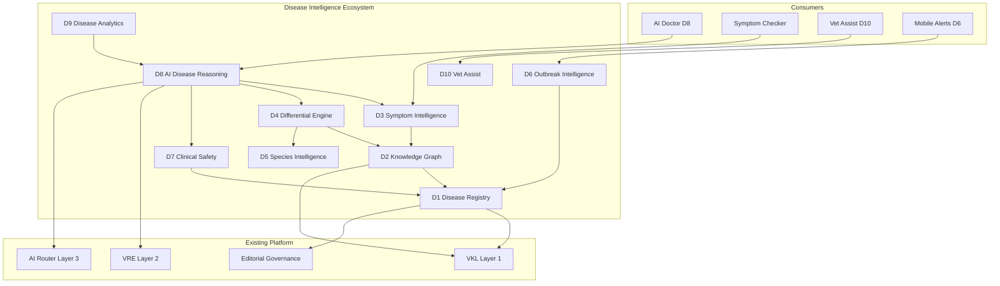
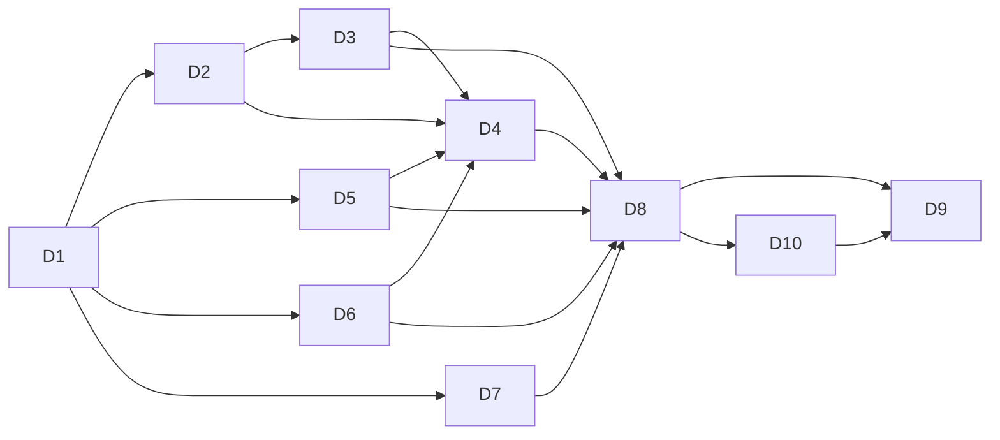

# Disease Intelligence Ecosystem — Master Plan (D1–D10)

**Project:** Prani Doctor  
**Role:** Principal Veterinary Disease Intelligence Architect  
**Date:** 2026-06-01  
**Status:** ✅ **IMPLEMENTED** (D1–D10 backend) — 2026-06-01  
**Version:** 2.0.0  
**Implementation report:** `docs/reports/disease-intelligence-implementation-report.md`  

**Depends on (existing platform):**

| Layer | Document / module | Relevance to Disease Intelligence |
|-------|-------------------|-----------------------------------|
| AI Platform | `docs/plans/ai-core-platform-phase-1-foundation.md` | `AiFoundationService`, usage logging, feature flags |
| Provider / Model | `ai-phase-2-provider-management.md`, `ai-phase-3-model-registry.md` | Provider vault, model catalog |
| AI Router | `ai-phase-4-router-engine.md` | Task routing, failover, cost gates |
| Hardening / Analytics | `ai-phase-5-hardening.md`, `ai-phase-5-usage-analytics.md` | Audit, rate limits, cost dashboards |
| Knowledge (VKL) | `phase-6a-veterinary-knowledge-architecture.md` | Entity model, evidence, domains |
| Ingestion / Governance | `phase-6b*`, `phase-6b4-editorial-governance.md` | Publish gates, vet approval |
| RAG (VRE) | `phase-6c-rag-engine-architecture.md`, `phase-6c13-rag-optimization.md` | Hybrid retrieval, post-LLM validation |
| Corpus | `phase-6e-wave1-mvc-corpus.md`, `phase-6e-knowledge-population.md` | Disease seed targets, grounding KPIs |
| AI Doctor | `phase-6d-ai-doctor.md` | Symptom intake, differential fusion (partial) |
| Feed Intelligence | `feed-intelligence-ecosystem.md` | Reference implementation for D-module pattern |
| Medicine Intelligence | `medicine-intelligence-audit.md` | Commercial + safety layering pattern |
| Prescription Assistant | `phase-6h-ai-prescription-assistant.md` | Treatment-intent handoff, R3 fail-closed |
| Golden Set Eval | `phase-6f-golden-set-evaluation.md` | GSE / VRE eval corpora |

**Sibling products (integration boundaries):**

- **AI Doctor** — farmer-facing clinical decision support (symptom → differential → escalation)
- **AI Prescription Assistant** — pharmacology only; treatment intent routed out of Disease layer
- **AI Feed Advisor** — nutrition domain; no disease diagnosis
- **AI Vaccine Assistant** — schedule domain; outbreak vaccination campaigns cross D6

---

## Repositories in scope

| Repo | Role |
|------|------|
| `pranidoctor-backend` | Disease Intelligence modules D1–D10, APIs, persistence, orchestration |
| `pranidoctor-web` | Disease Control Center (registry, graph editor, outbreak console, analytics) |
| `pranidoctor_user` | Farmer mobile — AI Doctor, symptom checker, outbreak alerts |
| Doctor app (future) | Vet Assist Layer (D10) — case review, differential validation |

---

## Executive summary

Prani Doctor today has **fragmented disease capabilities**: a legacy symptom graph (`AiSymptomNode`, `AiSymptomDiseaseLink` → `AiKnowledgeEntry`), AI Doctor engines for intake/differential/emergency (6D.1), VKL `DISEASE` domain entities in Wave 1 MVC corpus, and a minimal `RegionalOutbreakSignal` table. There is **no unified Disease Registry**, **no first-class disease knowledge graph**, **no enterprise differential engine**, and **no disease-specific analytics plane**.

The **Disease Intelligence Ecosystem (DIE)** defines ten modules (D1–D10) that elevate disease from “RAG content type” to a **governed clinical intelligence platform**—the disease analogue of Feed Intelligence (F1–F6) and Medicine Intelligence (M1–M7).

### Non-negotiable architecture constraint

> **Every clinical disease claim exposed to farmers or paravets MUST traverse VKL → VRE → AI Router in order. Deterministic engines (graph, rules, safety) run before and after LLM; LLM never replaces grounded differentials for high-risk claim classes.**

```
┌─────────────────────────────────────────────────────────────────────────────┐
│  D8 AI Disease Reasoning Layer (orchestration — AI Doctor, Vet Assist)       │
├─────────────────────────────────────────────────────────────────────────────┤
│  D4 Differential Engine │ D3 Symptom Intel │ D7 Clinical Safety │ D5 Species │
├─────────────────────────────────────────────────────────────────────────────┤
│  D2 Disease Knowledge Graph │ D1 Disease Registry │ D6 Outbreak Intelligence │
├─────────────────────────────────────────────────────────────────────────────┤
│  Layer 1 — VKL (DISEASE, CLINICAL_PROTOCOL, EMERGENCY) + D1 canonical IDs     │
│  Layer 2 — VRE (`disease-v1`, `differential-v1`, `outbreak-v1` profiles)     │
│  Layer 3 — AI Router (taskType: DISEASE_ANALYSIS, EMERGENCY_CONSULTATION)    │
├─────────────────────────────────────────────────────────────────────────────┤
│  D9 Disease Analytics │ D10 Vet Assist Layer                                  │
└─────────────────────────────────────────────────────────────────────────────┘
```

### Current vs target state

| Capability | Today | Target (DIE) |
|------------|-------|--------------|
| Canonical disease IDs | Slugs in VKL + `AiKnowledgeEntry` | **D1 Registry** with ICD-like vet codes, BN/EN labels, species matrix |
| Disease ↔ symptom ↔ protocol graph | `AiSymptomDiseaseLink` + VKL links | **D2** typed graph with evidence-weighted edges |
| Symptom intake | AI Doctor `symptom-intake.engine` | **D3** unified taxonomy, colloquial BN, completeness scoring |
| Differential diagnosis | Graph + VRE fusion (6D.1d) | **D4** Bayesian + graph priors + RAG fusion with explainability |
| Species / breed / stage | Profile filters in retrieval | **D5** structured prevalence and risk modifiers |
| Outbreak awareness | `RegionalOutbreakSignal` (admin) | **D6** signals, geo aggregation, alert subscriptions |
| Clinical safety | Emergency engine + post-LLM | **D7** unified policy engine (zoonotic, notifiable, Px block) |
| Disease reasoning UX | AI Doctor orchestrator | **D8** profiles per persona (farmer / paravet / vet) |
| Disease metrics | Usage logs only | **D9** case funnel, differential accuracy, corpus gaps |
| Vet workflow | Escalation records | **D10** case review, differential sign-off, KB gap tickets |

---

## Implementation status (2026-06-01)

| Phase | Scope | Status |
|-------|-------|--------|
| DIE-0 | Audit + schema design | ✅ Done |
| DIE-1 | D1 Disease Registry | ✅ Done |
| DIE-2 | D2 Graph + D3 Symptom | ✅ Done |
| DIE-3 | D5 Species + D4 Differential | ✅ Done |
| DIE-4 | D7 Safety + D8 Reasoning | ✅ Done |
| DIE-5 | D6 Outbreak + D9 Analytics | ✅ Done |
| DIE-6 | D10 Vet Assist + tests | ✅ Done (API); web console pending |

### Delivered artifacts

- **Migration:** `prisma/migrations/20260622120000_disease_intelligence_ecosystem/`
- **Module:** `src/modules/ai/disease-intelligence/` (registry, graph, symptom, differential, species, outbreak, safety, reasoning, analytics, vet-assist)
- **VRE profiles:** `disease-v1`, `differential-v1`, `outbreak-v1` in `retrieval-profile.registry.ts`
- **AI Doctor integration:** `DiseaseReasoningOrchestratorService` wraps doctor APIs; DIE differential fusion in `ai-doctor-orchestrator.service.ts`
- **Routes:** `/api/ai/disease/*`, `/api/admin/disease/*`, `/api/vet/disease/*`
- **Tests:** `disease-intelligence.test.ts` + AI Doctor regression (29 passed)

### Safety guarantees (enforced)

- `ClinicalSafetyEngine` blocks treatment/prescription intent, autonomous diagnosis language, autonomous treatment plans
- No autonomous diagnosis or prescription — educational differentials with citations only
- VKL → VRE (`differential-v1`) → Router unchanged for AI Doctor analyze path

### Production audit (2026-06-01)

- **Report:** `docs/audits/disease-intelligence-production-audit.md`
- **Score:** 68/100 — **Beta ready, not GA**
- **Fixes in audit:** Vet API authentication + IDOR guard; DIE TypeScript `exactOptionalPropertyTypes` fixes

### Pending (non-backend)

- Disease Control Center web UI (`disease-admin-control-center.md`)
- GSE corpus `disease-differential-g1-v1`
- Production corpus Wave 2 (≥120 ACTIVE diseases)
- AiAuditService integration; editorial governance for registry/graph publish

---

## Platform context (as-built baseline)

### Existing artifacts to extend (not replace)

| Artifact | Location | DIE relationship |
|----------|----------|-------------------|
| `VkKnowledgeEntity` (`domain = DISEASE`) | `prisma/schema.prisma` | D1 registry **publishes into** VKL; D2 graph edges reference `entityId` |
| `AiSymptomNode`, `AiSymptomDiseaseLink` | Schema + `symptom-checker.service.ts` | Migrated into D3/D2; links gain `diseaseRegistryId` |
| `AiSymptomCheckSession` | Schema | Superseded by `DiCaseSession` (D8) with backward-compatible read |
| AI Doctor engines | `src/modules/ai/ai-doctor/` | Become consumers of D3–D5, D7, D8 |
| `RegionalOutbreakSignal` | Schema | Evolved into D6 `DiOutbreakSignal` + aggregation |
| VRE profiles | `knowledge-retrieval/` | Add `disease-v1`, `differential-v1`, `outbreak-v1` |
| Wave 1 disease corpus | `scripts/knowledge/wave1/` | Primary seed for D1/D2 |
| GSE eval | `eval/corpora/ai-doctor-g1-v1.json` | Extended for D4/D8 regression |

### Reference implementation patterns

| Pattern | Source | Apply to DIE |
|---------|--------|--------------|
| VKL domain module + governance service | Feed Intelligence F1 | `disease-knowledge/` + `DiseaseKnowledgeGovernanceService` |
| VRE orchestrator + standalone fallback | Feed Advisor VRE | `DiseaseReasoningVreOrchestrator` (D8) |
| Commercial ranking with safety caps | Medicine M5/M6 | N/A for disease (no sponsor ranking); **D7 safety overrides always win** |
| 10-factor explainability | Medicine M5 | D4 differential `reasonCodes[]` |
| Admin Control Center APIs | `feed-admin-control-center.md` | `disease-admin-control-center` (web plan, out of scope here) |

---

## DIE module map



---

# D1 — Disease Registry

## Purpose

Canonical, versioned **master record** for every livestock disease in Prani Doctor—stable IDs, taxonomic classification, species applicability, notifiable/zoonotic flags, and linkage to VKL published versions.

## Architecture

```
┌──────────────────────────────────────────────────────────────┐
│  DiseaseRegistryService (CRUD + search + resolve)             │
│  DiseaseRegistryRepository                                    │
│  DiseaseAliasResolver (BN colloquial, scientific, legacy slug)│
├──────────────────────────────────────────────────────────────┤
│  di_disease_registry (canonical)                              │
│  di_disease_aliases                                           │
│  di_disease_species_matrix                                    │
│  ──1:1──► vk_knowledge_entity (domain=DISEASE, entitySlug)    │
└──────────────────────────────────────────────────────────────┘
```

**Design rules:**

- Registry ID (`di_dis_*`) is immutable; display names version separately.
- Every registry row **must** bind to exactly one `VkKnowledgeEntity` before `ACTIVE`.
- Legacy `AiKnowledgeEntry` disease rows map via `legacyKnowledgeEntryId` during migration.

## Database design

### Enums

```sql
-- Planned migration namespace: 20260622120000_disease_intelligence_d1

CREATE TYPE "DiDiseaseStatus" AS ENUM (
  'DRAFT', 'ACTIVE', 'DEPRECATED', 'MERGED'
);

CREATE TYPE "DiDiseaseCategory" AS ENUM (
  'INFECTIOUS', 'PARASITIC', 'METABOLIC', 'NUTRITIONAL', 'TOXIC',
  'TRAUMA', 'REPRODUCTIVE', 'GENETIC', 'NEOPLASTIC', 'IDIOPATHIC', 'OTHER'
);

CREATE TYPE "DiNotifiableClass" AS ENUM (
  'NONE', 'BD_NOTIFIABLE', 'OIE_LISTED', 'ZOONOTIC'
);
```

### Core tables

| Table | Purpose | Key fields |
|-------|---------|------------|
| `di_disease_registry` | Canonical disease | `id`, `code` (unique), `slug`, `category`, `notifiableClass`, `zoonoticRisk`, `status`, `vkEntityId`, `defaultEvidenceLevel`, `clinicalRiskTier` |
| `di_disease_aliases` | Search / BN colloquial | `registryId`, `locale`, `alias`, `aliasType` (COMMON, SCIENTIFIC, LEGACY) |
| `di_disease_species_matrix` | Applicability | `registryId`, `species`, `prevalenceBand`, `endemicBd`, `ageMinMonths`, `ageMaxMonths` |
| `di_disease_version_pointer` | Published snapshot | `registryId`, `vkPublishedVersionId`, `effectiveFrom`, `supersededAt` |

### Indexes

- `di_disease_registry(code)`, `(slug)`, `(status, category)`
- `di_disease_aliases(alias)` GIN/trigram for BN fuzzy search
- `di_disease_species_matrix(registryId, species)` unique

## APIs

### Mobile / public (read)

| Method | Path | Description |
|--------|------|-------------|
| GET | `/api/disease/registry` | Paginated search (`q`, `species`, `category`) |
| GET | `/api/disease/registry/:code` | Disease card (BN/EN, species, citations summary) |
| GET | `/api/disease/registry/:code/aliases` | Alias list for NLU |

### Admin

| Method | Path | Capability |
|--------|------|------------|
| POST | `/api/admin/disease/registry` | Create draft registry + VKL draft entity |
| PATCH | `/api/admin/disease/registry/:id` | Update metadata (not code) |
| POST | `/api/admin/disease/registry/:id/merge` | Merge duplicate → `MERGED` |
| POST | `/api/admin/disease/registry/:id/bind-vkl` | Link / rebind VKL entity |
| GET | `/api/admin/disease/registry/audit` | Registry change audit |

## Services

| Service | Responsibility |
|---------|----------------|
| `DiseaseRegistryService` | CRUD, status transitions, alias management |
| `DiseaseRegistryRepository` | Prisma access, search queries |
| `DiseaseAliasResolver` | Resolve user text → `registryId` (used by D3, D8) |
| `DiseaseRegistryAuditService` | Append-only audit events |

## AI integration

- **No direct LLM** in D1.
- Registry metadata injected into VRE `sessionContext.diseaseRegistry` for disambiguation.
- Router `taskType` unchanged; D1 enriches retrieval filters.

## Knowledge integration

- **Source of truth for IDs** consumed by D2 graph nodes (`nodeRef = registryId`).
- VKL publish pipeline: registry `ACTIVE` requires VKL version `Published` + CCE chunk gate passed.
- Wave 1 corpus import: `scripts/knowledge/disease/` seeds `di_disease_registry` + VKL in one transaction.

## Analytics

- Registry coverage KPIs: diseases per species, % with published VKL, alias density.
- Exposed via D9 dashboards.

## Governance

- **Draft → Review → Vet Review → Approval → Published** (6B.4) for linked VKL content.
- Registry metadata changes (notifiable class, zoonotic) require **vet approval** always.
- Merge operations require dual-vet sign-off for `ACTIVE` diseases.

## Security

- Admin APIs: `disease.registry.write`, `disease.registry.merge` scopes.
- Public APIs: published `ACTIVE` only; no draft leakage.
- PII: registry contains no farmer data.

## Risks

| Risk | Mitigation |
|------|------------|
| Duplicate diseases (slug drift) | Merge workflow + alias table |
| Registry/VKL desync | DB constraint: `ACTIVE` ⇒ `vkEntityId` NOT NULL + published version |
| Legacy symptom links break | Migration maps `knowledgeEntryId` → `registryId` |

## Dependencies

- VKL foundation (6B.1), editorial governance (6B.4)
- Wave 1 / 6E corpus for initial population
- Blocks: D2, D4, D6, D7 (all need canonical IDs)

---

# D2 — Disease Knowledge Graph

## Purpose

Queryable **clinical relationship graph**: disease ↔ symptom ↔ protocol ↔ medicine (read-only) ↔ vaccine ↔ feed contraindication ↔ differential competitor edges.

## Architecture

```
┌─────────────────────────────────────────────────────────────┐
│  DiseaseGraphService                                         │
│  GraphTraversalEngine (bounded depth, species filter)        │
│  GraphSyncService (VKL link → di_graph_edge)                 │
├─────────────────────────────────────────────────────────────┤
│  di_graph_node (registryId | symptomId | protocolEntityId) │
│  di_graph_edge (typed, weighted, evidenceId)                 │
│  di_graph_edge_evidence (provenance)                         │
└─────────────────────────────────────────────────────────────┘
```

**Edge types (normative):**

| Edge type | From → To | Use |
|-----------|-----------|-----|
| `HAS_SYMPTOM` | Disease → Symptom | D3, D4 priors |
| `SUGGESTS_PROTOCOL` | Disease → Clinical protocol | Workup guidance |
| `DIFFERENTIAL_OF` | Disease ↔ Disease | D4 ranking |
| `CONTRAINDICATES_MEDICINE` | Disease → Medicine generic | D7, Prescription handoff |
| `REQUIRES_VACCINE` | Disease → Vaccine schedule | D6 campaigns |
| `COMORBID_WITH` | Disease ↔ Disease | Risk stacking |
| `ESCALATES_TO_EMERGENCY` | Disease → Emergency SOP | D7 red flags |

## Database design

| Table | Purpose |
|-------|---------|
| `di_graph_node` | Typed node (`nodeKind`, `refId`, `labelBn`, `labelEn`) |
| `di_graph_edge` | `fromNodeId`, `toNodeId`, `edgeType`, `weight`, `species[]`, `evidenceLevel`, `status` |
| `di_graph_edge_evidence` | `edgeId`, `sourceId`, `spanLocator`, `confidence` |
| `di_graph_snapshot` | Materialized export for analytics (optional, D9) |

**Migration from legacy:**

- `AiSymptomDiseaseLink` → `HAS_SYMPTOM` edges with `weight = edgeWeight`.
- `VkKnowledgeLink` (if present) synced on publish webhook.

## APIs

| Method | Path | Description |
|--------|------|-------------|
| GET | `/api/disease/graph/neighbors` | `nodeRef`, `edgeTypes[]`, `species`, `depth≤2` |
| GET | `/api/disease/graph/path` | Shortest path between two nodes (admin/debug) |
| POST | `/api/admin/disease/graph/edges` | Create draft edge |
| POST | `/api/admin/disease/graph/edges/:id/publish` | Publish after governance |
| DELETE | `/api/admin/disease/graph/edges/:id` | Soft-deprecate |

## Services

- `DiseaseGraphService` — CRUD edges, neighbor queries
- `GraphTraversalEngine` — BFS with species filter, max 500 edges/query
- `GraphSyncService` — VKL publish hook → upsert edges from structured fields
- `GraphValidationService` — orphan detection, cycle check on `DIFFERENTIAL_OF`

## AI integration

- Graph priors passed to D4 as `GraphPriorBundle` (no LLM).
- VRE chunk ranking boost when `entitySlug` matches high-weight neighbors.
- Optional: graph embedding index (Phase D2.2 — defer to 6E.2 vector expansion).

## Knowledge integration

- Edges require `evidenceLevel ≥ L2` for `CONTRAINDICATES_MEDICINE` and `ESCALATES_TO_EMERGENCY`.
- Sync from VKL `structuredFieldsJson` on Disease entities (symptom lists, differentials).

## Analytics

- Edge density per disease, orphan symptom nodes, stale edge age — D9.

## Governance

- Graph edge publish follows VKL version binding (edge locked to `vkVersionId`).
- Vet approval for `CONTRAINDICATES_MEDICINE` and notifiable disease edges.

## Security

- Public API: published edges only; weights visible to vets in D10, simplified for farmers.
- Admin graph editor: separate RBAC from registry.

## Risks

| Risk | Mitigation |
|------|------------|
| Graph explosion / slow traversal | Depth limits, materialized snapshots for hot paths |
| Contradictory edges | `GraphValidationService` + conflict queue |
| Stale sync from VKL | Publish webhook + nightly reconcile job |

## Dependencies

- **D1** (disease nodes), **D3** (symptom nodes)
- VKL links, Medicine graph (`VkMedicineKnowledgeGraphEdge`) for medicine edges
- Blocks: D4, D7

---

# D3 — Symptom Intelligence

## Purpose

Unified **symptom taxonomy**, farmer-friendly BN colloquial mapping, intake completeness, and red-flag detection—shared by symptom checker, AI Doctor, and D4.

## Architecture

```
┌──────────────────────────────────────────────────────────────┐
│  SymptomTaxonomyService                                       │
│  SymptomIntakeEngine (extends ai-doctor symptom-intake)       │
│  ColloquialBnExpansionService (reuse VRE 6C.13)               │
│  SymptomCompletenessScorer                                    │
│  RedFlagDetector (feeds D7)                                   │
├──────────────────────────────────────────────────────────────┤
│  di_symptom_taxonomy (extends AiSymptomNode)                  │
│  di_symptom_colloquial                                        │
│  di_symptom_body_system                                       │
│  di_intake_template (species-specific question flows)        │
└──────────────────────────────────────────────────────────────┘
```

## Database design

| Table | Purpose |
|-------|---------|
| `di_symptom_taxonomy` | Canonical symptom; migrates `AiSymptomNode.id` |
| `di_symptom_colloquial` | BN/EN farmer phrases → `symptomCode` |
| `di_symptom_body_system` | Body system hierarchy |
| `di_intake_template` | JSON schema per species for wizard steps |
| `di_symptom_observation` | Optional: structured observation catalog (severity, duration) |

**Migration:** `AiSymptomNode` rows copied; `code` preserved; `diseaseLinks` rebuilt via D2.

## APIs

| Method | Path | Description |
|--------|------|-------------|
| GET | `/api/disease/symptoms` | Taxonomy tree (`species`, `bodySystem`) |
| GET | `/api/disease/symptoms/search` | Typeahead (BN/EN/colloquial) |
| POST | `/api/disease/symptoms/resolve` | Free text → coded symptoms |
| POST | `/api/disease/intake/validate` | Completeness + missing questions |
| POST | `/api/admin/disease/symptoms` | Admin CRUD |

## Services

- `SymptomTaxonomyService`
- `SymptomIntakeEngine` (refactor from `ai-doctor/engines/symptom-intake.engine.ts`)
- `SymptomCompletenessScorer`
- `ColloquialBnExpansionService` (delegate to VRE expansion module)

## AI integration

- NLU: optional lightweight classifier (`taskType: GENERAL_CHAT`, feature `symptom_resolve`) for ambiguous text—**fail-closed to clarification questions** if confidence < 0.6.
- No symptom → disease diagnosis via LLM alone.

## Knowledge integration

- Symptoms are graph nodes (D2 `HAS_SYMPTOM` inverse).
- Intake templates reference VKL `CLINICAL_PROTOCOL` for “what to observe next”.

## Analytics

- Symptom frequency, unresolved colloquial phrases (corpus gap tickets), intake drop-off — D9.

## Governance

- Symptom taxonomy changes: editorial review; red-flag symptom changes: vet review.

## Security

- Rate-limit `/resolve` to prevent scraping.
- No storage of raw voice/audio in D3 (future adjunct in D8).

## Risks

| Risk | Mitigation |
|------|------------|
| BN colloquial ambiguity | Top-k clarification UX |
| Taxonomy drift vs AI Doctor | Single engine ownership in D3 |

## Dependencies

- D2 for disease links
- VRE BN expansion (6C.13)
- Blocks: D4, D8

---

# D4 — Differential Diagnosis Engine

## Purpose

**Ranked, explainable differential list** combining graph priors, species prevalence (D5), case context, and VRE retrieval—never definitive diagnosis language.

## Architecture

```
┌───────────────────────────────────────────────────────────────┐
│  DifferentialDiagnosisEngine                                     │
│    ├── GraphPriorCalculator (D2 weights)                       │
│    ├── PrevalenceModifier (D5)                                 │
│    ├── RetrievalFusionAdapter (VRE pack → candidate boost)     │
│    ├── BayesianFusionLayer (log-odds combine)                  │
│    └── ExplainabilityAssembler (reasonCodes, citations)        │
├───────────────────────────────────────────────────────────────┤
│  Input: DiCaseContext (symptoms, species, age, geo, outbreak)  │
│  Output: DifferentialBundle (ranked[], confidence, citations)  │
└───────────────────────────────────────────────────────────────┘
```

**Fusion formula (conceptual):**

```
score(d) = w_g * graphPrior(d) + w_p * prevalencePrior(d) + w_r * retrievalScore(d) + w_o * outbreakBoost(d)
```

Weights calibrated per species via D9 offline eval; default `w_g=0.35, w_r=0.40, w_p=0.15, w_o=0.10`.

## Database design

| Table | Purpose |
|-------|---------|
| `di_differential_run` | Audit each computation (`caseId`, inputs hash, output JSON) |
| `di_differential_candidate` | Per-run disease scores |
| `di_differential_model_version` | Config snapshot for reproducibility |

No long-term PII in candidates—reference `caseId` only.

## APIs

| Method | Path | Description |
|--------|------|-------------|
| POST | `/api/disease/differential/compute` | Internal/service (D8 calls) |
| GET | `/api/disease/differential/runs/:runId` | Audit replay (admin/vet) |

## Services

- `DifferentialDiagnosisEngine` (evolve `differential-diagnosis.engine.ts`)
- `GraphPriorCalculator`
- `RetrievalFusionAdapter`
- `DifferentialExplainabilityAssembler`

## AI integration

- **LLM optional** for narrative explanation only after deterministic ranking fixed.
- Router: `taskType: DISEASE_ANALYSIS`, profile `differential-v1`.
- LLM blocked if top-3 average confidence < 0.35 or VRE `BLOCK`.

## Knowledge integration

- Every candidate requires ≥1 citation from VRE pack OR graph edge with `evidenceLevel ≥ L2`.
- Candidates without citations excluded from farmer-facing output (vet console may show “low evidence”).

## Analytics

- Precision@k vs vet-confirmed diagnosis (D10 feedback), score calibration — D9.

## Governance

- Model weight changes require signed config version in `di_differential_model_version`.
- A/B tests gated behind feature flag `disease.differential.experiment.*`.

## Security

- Farmer API returns max 5 differentials; paravet 8; vet 15.
- Treatment recommendations stripped (handoff to Prescription Assistant).

## Risks

| Risk | Mitigation |
|------|------------|
| Overconfident wrong differential | Confidence caps + mandatory disclaimer |
| Graph bias | Prevalence and retrieval fusion + eval gates |
| “Diagnosis” language in LLM | Post-LLM sanitizer (existing 6C.13) |

## Dependencies

- D1, D2, D3, D5, VRE, D7
- AI Doctor D8 orchestrator

---

# D5 — Species Intelligence

## Purpose

Structured **species, breed, age-stage, and production context** modifiers for disease prevalence, symptom relevance, and differential priors.

## Architecture

```
┌─────────────────────────────────────────────────────────────┐
│  SpeciesIntelligenceService                                  │
│  BreedProfileResolver (links to livestock registry)          │
│  ProductionStageInference                                    │
│  PrevalenceTableRepository                                   │
├─────────────────────────────────────────────────────────────┤
│  di_species_profile                                          │
│  di_breed_modifier                                             │
│  di_prevalence_table (disease × species × region × season)   │
└─────────────────────────────────────────────────────────────┘
```

## Database design

| Table | Purpose |
|-------|---------|
| `di_species_profile` | Baseline physiology flags per `LivestockSpecies` |
| `di_breed_modifier` | Breed category → symptom/disease weight deltas |
| `di_prevalence_table` | `registryId`, `species`, `divisionId?`, `season?`, `prevalenceBand` |
| `di_age_stage_rule` | Age buckets → symptom/differential adjustments |

Integrates with existing `LivestockSpecies` enum and animal registration weight system (migration `20260610120000`).

## APIs

| Method | Path | Description |
|--------|------|-------------|
| GET | `/api/disease/species/:species/profile` | Profile + active prevalence bands |
| POST | `/api/disease/species/context/evaluate` | Given livestock context → modifiers |

## Services

- `SpeciesIntelligenceService`
- `PrevalenceTableRepository`
- `ProductionStageInference` (reuse feed `ProductionStage` where applicable)

## AI integration

- Modifiers injected as structured JSON in VRE `sessionContext` (no LLM).

## Knowledge integration

- Prevalence tables sourced from BD epidemiology sources (VKL evidence records).
- Seasonal adjustments aligned with D6 outbreak seasons.

## Analytics

- Prevalence table coverage by division — D9.

## Governance

- Prevalence data changes: editorial + epidemiologist review; notifiable diseases: vet approval.

## Security

- Aggregated prevalence only in public APIs; no farm-identifiable data.

## Risks

| Risk | Mitigation |
|------|------------|
| Stale prevalence | `effectiveTo` on table rows + D6 signals override |
| Wrong species on case | Livestock profile binding in D8 session |

## Dependencies

- D1, livestock profile APIs
- Blocks: D4

---

# D6 — Outbreak Intelligence

## Purpose

**Geographic disease signals**, trend detection, farmer alerts, and differential outbreak boosts—evolving `RegionalOutbreakSignal` into a governed intelligence module.

## Architecture

```
┌──────────────────────────────────────────────────────────────┐
│  OutbreakSignalService (ingest admin + syndromic aggregates)    │
│  OutbreakAggregationEngine (division/district rollups)          │
│  OutbreakAlertDispatcher (push/SMS/in-app)                      │
│  OutbreakBoostCalculator (feeds D4)                             │
├──────────────────────────────────────────────────────────────┤
│  di_outbreak_signal (replaces RegionalOutbreakSignal)           │
│  di_outbreak_aggregate                                          │
│  di_outbreak_subscription                                       │
│  di_outbreak_alert_log                                          │
└──────────────────────────────────────────────────────────────┘
```

## Database design

| Table | Purpose |
|-------|---------|
| `di_outbreak_signal` | Raw signal: `registryId`, geo, `riskIndex`, `source`, `confidence` |
| `di_outbreak_aggregate` | Daily rollup per disease × geo |
| `di_outbreak_subscription` | Farmer opt-in: species, geo, channels |
| `di_outbreak_alert_log` | Delivery audit |

**Migration:** Copy `RegionalOutbreakSignal` → `di_outbreak_signal`; deprecate old table after dual-write.

## APIs

| Method | Path | Description |
|--------|------|-------------|
| GET | `/api/disease/outbreak/map` | Public heatmap (aggregated, no PII) |
| GET | `/api/disease/outbreak/alerts` | User's active alerts |
| POST | `/api/disease/outbreak/subscribe` | Subscription management |
| POST | `/api/admin/disease/outbreak/signals` | Ingest official / lab signal |
| PATCH | `/api/admin/disease/outbreak/signals/:id` | Correct / retract |

## Services

- `OutbreakSignalService`
- `OutbreakAggregationEngine`
- `OutbreakAlertDispatcher`
- `OutbreakBoostCalculator`

## AI integration

- VRE profile `outbreak-v1` for educational outbreak summaries—**BLOCK** treatment advice.
- Optional syndromic clustering (batch job, not real-time LLM).

## Knowledge integration

- Signals must reference D1 `registryId`; link to VKL emergency protocols when `riskIndex ≥ threshold`.

## Analytics

- Alert CTR, subscription growth, signal latency — D9.

## Governance

- Official signals (DLS, DAHS) require `sourceAttributionId`.
- Retraction workflow with push notification to subscribed users.

## Security

- Aggregated map only (k-anonymity threshold ≥ 5 farms per cell).
- Admin ingest RBAC: `disease.outbreak.write`.

## Risks

| Risk | Mitigation |
|------|------------|
| False alarm panic | Conservative thresholds + vet-reviewed official tier |
| Re-identification from map | Minimum aggregation cell size |

## Dependencies

- D1, geo reference data (divisions/districts)
- Notification infrastructure
- Feeds D4 outbreak boost

---

# D7 — Clinical Safety Engine

## Purpose

**Unified clinical policy enforcement** across disease flows: zoonotic warnings, notifiable disease reporting prompts, prescription intent blocking, emergency escalation, and post-LLM claim validation.

## Architecture

```
┌──────────────────────────────────────────────────────────────┐
│  ClinicalSafetyEngine (orchestration)                         │
│  PolicyRuleEvaluator (deterministic rules)                    │
│  ZoonoticNotifiableHandler                                    │
│  PrescriptionIntentGate (→ Prescription Assistant)            │
│  EmergencyEscalationGate (→ Emergency Assistant)              │
│  PostLlmClinicalValidator (extends 6C.13)                     │
├──────────────────────────────────────────────────────────────┤
│  di_safety_policy (versioned JSON rules)                      │
│  di_safety_evaluation_log                                     │
└──────────────────────────────────────────────────────────────┘
```

**Policy tiers:**

| Tier | Examples | Action |
|------|----------|--------|
| R1 Informational | Educational disease info | Proceed with disclaimer |
| R2 Clinical support | Differential list | Proceed if grounded |
| R3 Action clinical | Treatment, dose | **BLOCK** → Prescription / vet |
| R4 Emergency | Red flags, collapse | **BLOCK LLM** → Emergency SOP |

## Database design

| Table | Purpose |
|-------|---------|
| `di_safety_policy` | `version`, `rulesJson`, `effectiveFrom`, `approvedByVetId` |
| `di_safety_evaluation_log` | Per-turn evaluation result |
| `di_notifiable_report_prompt` | Audit when user acknowledged reporting duty |

## APIs

| Method | Path | Description |
|--------|------|-------------|
| POST | `/api/disease/safety/evaluate` | Internal (D8); returns `SafetyDecision` |
| GET | `/api/admin/disease/safety/policies` | Policy versions |
| POST | `/api/admin/disease/safety/policies` | Draft new policy (vet approval) |

## Services

- `ClinicalSafetyEngine`
- `PolicyRuleEvaluator`
- `PostLlmClinicalValidator`
- Integrations: `emergency-detection.engine.ts`, Prescription PX gates

## AI integration

- Runs **before** router (pre-LLM) and **after** router (post-LLM).
- Can force `routingDecision.action = BLOCK`.

## Knowledge integration

- Rules reference D1 flags (`notifiableClass`, `zoonoticRisk`) and D2 `ESCALATES_TO_EMERGENCY` edges.

## Analytics

- Block rate by reason code, false positive vet overrides — D9.

## Governance

- Policy changes: dual-vet approval + compliance sign-off.
- Quarterly policy review SLA.

## Security

- Safety logs may contain case IDs—encrypt at rest, tenant-scoped.

## Risks

| Risk | Mitigation |
|------|------------|
| Policy bypass via raw API | All D8 paths mandatory invoke D7 |
| Over-blocking farmer UX | Tiered messages + escalation options |

## Dependencies

- D1, D2, D3 red flags, Prescription/Emergency assistants
- Blocks: safe D8 release

---

# D8 — AI Disease Reasoning Layer

## Purpose

**Orchestration product layer** binding D1–D7 + VKL → VRE → Router for all disease-facing experiences (AI Doctor primary, symptom checker, future chat intents).

## Architecture

```
┌───────────────────────────────────────────────────────────────┐
│  DiseaseReasoningOrchestratorService                           │
│  DiseaseReasoningVreOrchestrator (primary)                     │
│  DiseaseReasoningFallbackOrchestrator (degraded)               │
│  DiCaseSessionEngine (case state machine)                      │
├───────────────────────────────────────────────────────────────┤
│  di_case_session                                               │
│  di_case_turn                                                  │
│  di_case_escalation (extends AiEscalationRecord pattern)       │
└───────────────────────────────────────────────────────────────┘
```

**Turn pipeline (normative):**

1. Load `DiCaseSession` + livestock context  
2. D7 pre-LLM safety  
3. D3 intake / symptom update  
4. D6 outbreak context inject  
5. D4 differential compute  
6. VRE retrieve (`disease-v1`)  
7. D7 routing permission  
8. AI Router (if PROCEED)  
9. D7 post-LLM validation  
10. Persist turn + D9 analytics event  

## Database design

| Table | Purpose |
|-------|---------|
| `di_case_session` | Case lifecycle (replaces/supersedes `AiSymptomCheckSession` + `AiAssistantMemory` CASE_CONTEXT) |
| `di_case_turn` | Per-turn I/O, pack IDs, routing decision |
| `di_case_escalation` | Vet escalation binding |
| `di_case_attachment` | Optional photo adjunct metadata |

## APIs

| Method | Path | Description |
|--------|------|-------------|
| POST | `/api/ai/doctor/cases` | Create case (existing path — delegate to D8) |
| POST | `/api/ai/doctor/cases/:id/intake` | Symptom intake |
| POST | `/api/ai/doctor/cases/:id/analyze` | Full pipeline |
| POST | `/api/ai/doctor/cases/:id/escalate` | Escalation |
| GET | `/api/ai/doctor/cases/:id` | Case replay |
| POST | `/api/disease/symptom-check` | Legacy symptom checker → D8 thin wrapper |

## Services

- `DiseaseReasoningOrchestratorService` (evolve `ai-doctor-orchestrator.service.ts`)
- `DiseaseReasoningVreOrchestrator`
- `DiCaseSessionEngine`
- `DiEscalationEngine`

## AI integration

| Profile | taskType | Use |
|---------|----------|-----|
| `disease-v1` | `DISEASE_ANALYSIS` | Education + case narrative |
| `differential-v1` | `DISEASE_ANALYSIS` | Citation-heavy differential explanation |
| `emergency-v1` | `EMERGENCY_CONSULTATION` | Red-flag handoff |

Feature keys: `ai_doctor`, `disease_reasoning` (new governance scope—extend `AI_GOVERNANCE_FEATURES` in implementation phase).

## Knowledge integration

- Mandatory `KnowledgeContextPack` on every analyze turn.
- `corpusUnavailable` → degraded template (Wave 1 MVC gate).

## Analytics

- Full funnel via D9: intake → differential → LLM → escalation.

## Governance

- Case retention policy: 24 months farmer cases, 7 years audit for escalations.
- LLM model changes tracked in `AiUsageRecord` + case turn.

## Security

- Farmer vs paravet vs vet **persona gates** on response shape.
- Tenant isolation on all case tables.

## Risks

| Risk | Mitigation |
|------|------------|
| Dual orchestrators (AI Doctor vs D8) | Single D8 ownership; AI Doctor module thin |
| Session fragmentation | Migrate `AiAssistantMemory` to `di_case_session` |

## Dependencies

- D1–D7, VRE, Router, AI Doctor mobile (6D.1f)
- Blocks: D9, D10

---

# D9 — Disease Analytics

## Purpose

**Operational and clinical quality analytics** for registry coverage, differential quality, safety blocks, outbreak efficacy, and corpus gaps.

## Architecture

```
┌──────────────────────────────────────────────────────────────┐
│  DiseaseAnalyticsIngestService (events from D1-D8)            │
│  DiseaseMetricsAggregator (daily rollups)                     │
│  DiseaseGapAnalysisService (VKL ticket recommendations)       │
│  Admin analytics API                                          │
├──────────────────────────────────────────────────────────────┤
│  di_analytics_event (raw)                                     │
│  di_analytics_daily (rollup)                                  │
│  di_corpus_gap_ticket                                         │
└──────────────────────────────────────────────────────────────┘
```

## Database design

| Table | Purpose |
|-------|---------|
| `di_analytics_event` | `eventType`, `caseId?`, `registryId?`, `metadataJson`, `ts` |
| `di_analytics_daily` | Dimension keys + counts/scores |
| `di_corpus_gap_ticket` | Unresolved colloquial / low-recall queries |

## APIs

| Method | Path | Description |
|--------|------|-------------|
| GET | `/api/admin/disease/analytics/overview` | KPI dashboard |
| GET | `/api/admin/disease/analytics/differential-quality` | Precision@k, calibration |
| GET | `/api/admin/disease/analytics/safety` | Block rates |
| GET | `/api/admin/disease/analytics/corpus-gaps` | Gap tickets |
| GET | `/api/admin/disease/analytics/outbreak` | D6 metrics |

## Services

- `DiseaseAnalyticsIngestService`
- `DiseaseMetricsAggregator` (cron)
- `DiseaseGapAnalysisService`

## AI integration

- Batch eval jobs: extend `gse-eval`, `ai-doctor-eval.runner` with DIE metrics.
- No real-time LLM in D9.

## Knowledge integration

- Gap tickets link to VKL change requests (6B.4).

## Analytics

(Self-describing.) Key metrics:

| Metric | Target (production) |
|--------|---------------------|
| Registry ACTIVE count (cattle+goat+poultry) | ≥ 120 diseases |
| Differential citation coverage | 100% farmer-facing |
| GSE grounding (AI Doctor) | ≥ 90 |
| Safety block false positive (vet override) | < 10% |
| Outbreak alert CTR | ≥ 15% |
| Case escalation rate | 8–25% (by design) |

## Governance

- Analytics access: `disease.analytics.read` (admin, epidemiologist).
- No farmer PII in rollups.

## Security

- Aggregate-only dashboards; case drill-down requires `disease.case.read` + tenant scope.

## Risks

| Risk | Mitigation |
|------|------------|
| Event volume | Sample + daily rollup |
| Misinterpretation of escalation as failure | Product education in dashboards |

## Dependencies

- D1–D8 event emission
- Existing `AiUsageRecord`, GSE infrastructure

---

# D10 — Vet Assist Layer

## Purpose

**Licensed veterinarian workflow**: review AI Doctor cases, validate or override differentials, sign escalation resolutions, and file knowledge gap tickets—not autonomous diagnosis.

## Architecture

```
┌──────────────────────────────────────────────────────────────┐
│  VetAssistOrchestratorService                                 │
│  CaseReviewQueueService                                       │
│  DifferentialValidationService (vet sign-off)                 │
│  VetKnowledgeGapTicketService                                 │
├──────────────────────────────────────────────────────────────┤
│  di_vet_case_review                                           │
│  di_vet_differential_override                                   │
│  di_vet_sign_off                                                │
└──────────────────────────────────────────────────────────────┘
```

## Database design

| Table | Purpose |
|-------|---------|
| `di_vet_case_review` | `caseId`, `vetId`, `status`, `notes` |
| `di_vet_differential_override` | Vet-ranked list vs AI list |
| `di_vet_sign_off` | Legal attestation record |
| `di_vet_gap_ticket` | Link to VKL change request |

## APIs

| Method | Path | Description |
|--------|------|-------------|
| GET | `/api/vet/disease/queue` | Pending reviews |
| GET | `/api/vet/disease/cases/:id` | Full case + AI artifacts |
| POST | `/api/vet/disease/cases/:id/validate` | Submit differential validation |
| POST | `/api/vet/disease/cases/:id/sign-off` | Close case |
| POST | `/api/vet/disease/gap-tickets` | KB gap from case |

## Services

- `VetAssistOrchestratorService`
- `CaseReviewQueueService`
- `DifferentialValidationService`

## AI integration

- Vet-facing narrative may use Router with `taskType: DISEASE_ANALYSIS`, mode `VET_ASSIST`—higher token budget, still post-LLM validated.
- **No autonomous treatment plans** without explicit vet auth mode.

## Knowledge integration

- Overrides feed D9 calibration and optional D4 weight tuning (human-in-the-loop).

## Analytics

- Vet turnaround time, override rate, gap ticket resolution — D9.

## Governance

- Only `LICENSED_VET` role; audit all sign-offs.
- Overrides do not auto-publish to VKL—separate editorial path.

## Security

- Strict vet–tenant assignment; PHI handling per healthcare policy.
- Case export watermarked.

## Risks

| Risk | Mitigation |
|------|------------|
| Liability on vet sign-off | Clear UI attestation + scope limits |
| Low vet adoption | Queue SLA + mobile web console |

## Dependencies

- D8 cases, D4 runs, pranidoctor-web vet console (UI phase)
- Escalation inbox from 6D

---

## Cross-cutting: VRE retrieval profiles

| Profile ID | Domains | minConfidence | failClosed | Primary consumer |
|------------|---------|---------------|------------|------------------|
| `disease-v1` | DISEASE, CLINICAL_PROTOCOL | 0.55 | false (education) | D8 |
| `differential-v1` | DISEASE, CLINICAL_PROTOCOL | 0.60 | **true** | D4, D8 |
| `outbreak-v1` | DISEASE, EMERGENCY | 0.50 | false | D6, D8 |
| `ai-doctor-v1` (existing) | DISEASE, CLINICAL_PROTOCOL, EMERGENCY, MEDICINE | 0.55 | medical: true | D8 (alias) |

**Implementation note:** `differential-v1` becomes the strict profile for ranked lists; `ai-doctor-v1` remains for backward compatibility during migration.

---

## Cross-cutting: Module dependency graph



---

## Implementation phases

### Phase DIE-0 — Foundation & audit (2 weeks)

- As-built audit: symptom graph, AI Doctor engines, VKL DISEASE entities, outbreak table.
- Canonical ID strategy and legacy mapping spec.
- Feature flags: `disease.intelligence.enabled` (default false).
- **Deliverable:** `docs/audits/disease-intelligence-baseline-audit.md` (separate doc).

### Phase DIE-1 — D1 Disease Registry + governance hooks (3 weeks)

- Schema migration D1 tables.
- `DiseaseRegistryService` + admin APIs.
- Wave 1 disease import binds registry ↔ VKL.
- **Exit:** ≥ 80 ACTIVE registry rows with published VKL.

### Phase DIE-2 — D2 Graph + D3 Symptom (4 weeks)

- Migrate `AiSymptomNode` → `di_symptom_taxonomy`.
- Graph edge migration + `GraphSyncService` on VKL publish.
- Colloquial BN tables + search API.
- **Exit:** ≥ 200 published graph edges; symptom search p95 < 150ms.

### Phase DIE-3 — D5 Species + D4 Differential (4 weeks)

- Prevalence tables (BD divisions).
- `DifferentialDiagnosisEngine` v2 with explainability.
- Wire AI Doctor to D4 (feature flag).
- **Exit:** GSE differential precision@4 ≥ 0.70 on `ai-doctor-g1-v1`.

### Phase DIE-4 — D7 Safety + D8 Orchestration (3 weeks)

- Unified `ClinicalSafetyEngine`; deprecate duplicate checks.
- `di_case_session` migration from `AiAssistantMemory`.
- `DiseaseReasoningVreOrchestrator` primary path.
- **Exit:** 6D verification safety ≥ 91; zero LLM on BLOCK paths (automated test).

### Phase DIE-5 — D6 Outbreak + D9 Analytics (3 weeks)

- Outbreak migration + alert dispatcher.
- Analytics ingest + admin dashboard APIs.
- **Exit:** end-to-end outbreak alert test; daily rollups running.

### Phase DIE-6 — D10 Vet Assist + hardening (4 weeks)

- Vet queue APIs + web console (coordination with web repo).
- Golden-set expansion: `disease-differential-g1-v1` corpus.
- Load test + production readiness review.
- **Exit:** GSE grounding ≥ 90; production readiness ≥ 80.

**Total estimated duration:** 23 weeks (parallel work possible on D9 ingest after DIE-4).

---

## Migration strategy

### Principles

1. **No big-bang cutover** — dual-write, feature flags, read fallback.
2. **Immutable published VKL** — registry points to versions, not in-place edits.
3. **Backward compatible APIs** — `/api/ai/doctor/*` unchanged; internal delegation to D8.

### Stage M1 — Schema additive (DIE-1)

- Add `di_*` tables; no drops.
- `RegionalOutbreakSignal` dual-write to `di_outbreak_signal`.

### Stage M2 — Data backfill (DIE-2)

```text
AiSymptomNode           → di_symptom_taxonomy
AiSymptomDiseaseLink    → di_graph_edge (HAS_SYMPTOM)
AiKnowledgeEntry (DISEASE) → di_disease_registry + vk bind
RegionalOutbreakSignal  → di_outbreak_signal
```

Backfill script: `scripts/knowledge/disease/migrate-legacy-disease-graph.ts` (planned).

### Stage M3 — Read path switch (DIE-3)

- Symptom checker reads D3; fallback to legacy on flag.
- Differential uses D4 when `disease.differential.v2=true`.

### Stage M4 — Write path switch (DIE-4)

- New cases write only `di_case_session`.
- Read `AiAssistantMemory` for historical cases (read-only).

### Stage M5 — Deprecation (DIE-6+)

- Mark `AiSymptomCheckSession` read-only archive.
- Remove legacy graph write paths after 90-day metrics stable.

### Rollback

- Feature flags per phase; registry/graph migrations are additive—rollback = disable flags, retain new tables.

---

## Testing strategy

### Unit tests

- Each engine: graph traversal, fusion math, safety rules, outbreak boost.
- Target: ≥ 80% branch coverage on `disease-intelligence/` module.

### Integration tests

- VKL publish → graph sync → differential compute pipeline.
- VRE profile returns cited pack for fixture cases.
- AI Doctor analyze turn with mocked router.

### Contract tests

- OpenAPI snapshots for all `/api/disease/*` and admin routes.
- Mobile client contract tests (pranidoctor_user) against stub server.

### Safety tests

- Red-flag → LLM skip (assert `AiUsageRecord` absent).
- Prescription intent → BLOCK + handoff payload.
- Zoonotic / notifiable prompts fire on fixture diseases.

### Evaluation (golden set)

| Corpus | Purpose | Gate |
|--------|---------|------|
| `ai-doctor-g1-v1` (existing) | End-to-end AI Doctor | Grounding ≥ 90, Safety ≥ 90 |
| `disease-differential-g1-v1` (new) | D4 ranking | precision@4 ≥ 0.70 |
| `disease-safety-g1-v1` (new) | D7 blocks | 100% BLOCK on labeled queries |
| `farmer-bn-g1-v1` (existing) | BN colloquial | Recall ≥ 0.65 on symptom resolve |

Commands (planned): `npm run gse:disease`, `npm run die:eval`.

### Performance tests

- Differential compute p95 < 800ms (graph + VRE, no LLM).
- Full analyze turn p95 < 4s (with LLM).
- Graph neighbor query p95 < 100ms.

### Chaos / resilience

- VRE timeout → fallback orchestrator template.
- Router all providers down → degraded mode message.

---

## Production rollout strategy

### Environment progression

| Stage | Audience | Flags | Success criteria |
|-------|----------|-------|------------------|
| Dev | Engineers | all on | CI green |
| Staging | Internal QA + 5 vets | `disease.intelligence.enabled` | GSE gates pass |
| Beta | 100–200 farmers | per-feature flags | CSAT ≥ 4.0, escalation 8–25% |
| GA | All users | default on | SLO met 30 days |

### SLOs (GA)

| SLO | Target |
|-----|--------|
| Analyze API availability | 99.5% |
| Safety BLOCK accuracy (labeled set) | 100% |
| P0 incident (wrong autonomous treatment) | 0 |
| Corpus grounding | ≥ 90 GSE |

### Monitoring & alerts

- Dashboards: D9 admin overview + Datadog/custom metrics on `di_analytics_event`.
- Alerts: spike in `SAFETY_BLOCK`, VRE `corpusUnavailable` rate > 5%, differential zero-citation rate > 1%.

### Rollout checklist

- [ ] Migrations applied `prisma migrate deploy`
- [ ] Wave 2 disease corpus published (≥ 120 ACTIVE)
- [ ] Feature flags documented in runbook
- [ ] Vet queue staffed for beta escalations
- [ ] Legal review: disclaimers + notifiable disease copy (BN/EN)
- [ ] Rollback drill completed

### Communication

- Farmer: in-app “AI suggests possible causes, not a diagnosis.”
- Vet: training on D10 validation console.
- Ops: outbreak ingest SOP from DLS/DAHS.

---

## Security & compliance summary

| Area | Requirement |
|------|-------------|
| RBAC | Granular scopes per module (`disease.registry.*`, `disease.outbreak.*`, `disease.case.*`) |
| Audit | All admin mutations + case turns + safety evaluations logged |
| Data residency | Case data in primary DB region; no cross-border LLM without policy |
| LLM data | Minimize PHI in prompts; livestock IDs pseudonymous in logs |
| Regulatory | BD notifiable disease prompts; no autonomous reporting claims |
| Medico-legal | Disclaimers on every D8 response; vet sign-off for D10 |

---

## Risk register (program level)

| ID | Risk | Impact | Likelihood | Mitigation |
|----|------|--------|------------|------------|
| R1 | Insufficient disease corpus | High | Medium | Wave 2 population; gap tickets |
| R2 | Wrong differential confidence | High | Medium | D4 eval + vet overrides |
| R3 | Legacy graph migration errors | Medium | Medium | Dual-run validation scripts |
| R4 | Outbreak false alarms | Medium | Low | Official-source tier + thresholds |
| R5 | Scope creep into prescription | High | Medium | D7 PX gate; Prescription handoff |
| R6 | Vet console delay blocks D10 | Medium | Medium | API-first; web console parallel |

---

## Appendix A — Planned backend module layout

```text
src/modules/ai/disease-intelligence/
├── registry/           # D1
├── graph/              # D2
├── symptom/            # D3
├── differential/       # D4
├── species/            # D5
├── outbreak/           # D6
├── safety/             # D7
├── reasoning/          # D8
├── analytics/          # D9
├── vet-assist/         # D10
├── disease-intelligence.module.ts
└── disease-intelligence.constants.ts
```

## Appendix B — Relationship to AI Doctor (6D)

| 6D component | DIE owner |
|--------------|-----------|
| `symptom-intake.engine` | D3 |
| `differential-diagnosis.engine` | D4 |
| `emergency-detection.engine` | D7 (policy subset) |
| `ai-doctor-orchestrator` | D8 |
| `confidence.engine` | D8 + D4 |

AI Doctor module becomes a **thin feature facade** over D8 for API stability.

## Appendix C — Corpus targets (Wave 2)

| Domain | Min ACTIVE registry | Min chunks | Min HAS_SYMPTOM edges |
|--------|---------------------|------------|------------------------|
| Cattle diseases | 45 | 180 | 135 |
| Goat diseases | 30 | 120 | 90 |
| Poultry diseases | 25 | 100 | 75 |
| Emergency crossover | 20 | 80 | — |
| **Total** | **120** | **480** | **300** |

---

## Document control

| Version | Date | Author | Changes |
|---------|------|--------|---------|
| 1.0.0 | 2026-06-01 | Principal Veterinary Disease Intelligence Architect | Initial master plan D1–D10 |

**Next steps (implementation — out of scope for this document):**

1. Approve DIE-0 audit charter.  
2. Prioritize DIE-1 vs Wave 2 corpus funding.  
3. Create `docs/plans/disease-admin-control-center.md` (web UI companion).  
4. Extend `AI_GOVERNANCE_FEATURES` design for `disease_reasoning` kill switch.

---

*End of Disease Intelligence Ecosystem Master Plan.*
