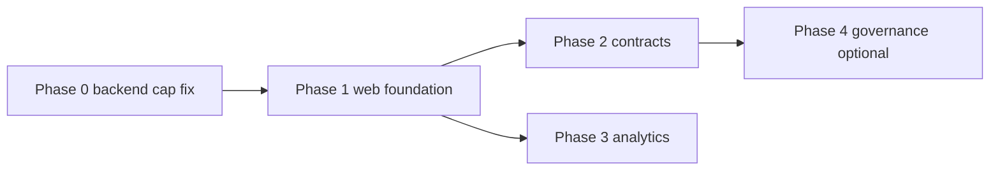

# Medicine Intelligence Admin Control Center — Master Implementation Plan

**Project:** Prani Doctor  
**Product:** Medicine Intelligence Admin Control Center (MICC)  
**Role:** Principal Platform Architect  
**Date:** 2026-06-01  
**Status:** Planning only — **not implemented**  
**Audit:** `docs/audits/medicine-admin-integration-audit.md`  
**Runtime reference:** `docs/plans/medicine-intelligence-audit.md` (M1–M7 services)  
**UI pattern reference:** Feed Intelligence (`/admin/ai-ops/feed-intelligence/*`, `feed-intelligence-guard.ts`)

---

## 1. Mission & success criteria

### Mission

Deliver a dedicated **Medicine Intelligence Admin Control Center** so that **every Medicine Commercial Intelligence capability (M1–M7)** is **creatable, reviewable, configurable, observable, and auditable** from the Admin Panel — without shell access, raw SQL, or one-off API clients.

### Explicit non-goals

- Replacing **farm inventory medicine** (`/api/mobile/inventory/medicine`) or **billing medicine lines**  
- Rewriting ranking, conflict resolution, or prescription clinical engines  
- Farmer/mobile prescription UX (runtime APIs remain `/api/ai/prescription/*`)  
- Merging with **Feed Intelligence** or **Disease Intelligence** admin products  

### Success criteria (definition of “complete”)

| # | Criterion |
|---|-----------|
| 1 | Companies, generics, and brands manageable via admin UI (list, detail, create, edit) |
| 2 | Company verification workflow operable from admin (verify / unverify) |
| 3 | Commercial contracts full lifecycle in UI (draft, activate, pause, brand boosts, audit trail) |
| 4 | Generic↔brand mapping visible; sync from VKL runnable with confirmation + result summary |
| 5 | Recommendation preview console for support (existing `recommendations/preview` API) |
| 6 | Medicine analytics dashboards: summary, recommendations, contracts, per-sponsor |
| 7 | `ai.medicine.*` capabilities enforced on every MICC route (backend matrix + web `permissions-core`) |
| 8 | BFF proxies for all `/api/admin/ai-ops/medicine/*` routes used by UI |
| 9 | Backend fix: `ai.medicine.company.manage` in `AiAdminCapability` and `ROLE_MATRIX` |
| 10 | Nav entry under AI Center; labels distinct from “Prescriptions” clinical module |

---

## 2. Current state (from audit)

| Layer | Status |
|-------|--------|
| `src/modules/ai/medicine/` | ✅ Complete domain implementation |
| 24 legacy routes `src/legacy/web/routes/admin/ai-ops/medicine/` | ✅ Present |
| `pranidoctor-web` pages / proxies / nav | ❌ Absent |
| Web `ai.medicine.*` | ❌ Absent |
| `ai.medicine.company.manage` in matrix | ❌ Missing (routes 403) |

**Conclusion driving this plan:** `MEDICINE ADMIN PARTIAL` → MICC required for `MEDICINE ADMIN COMPLETE`.

---

## 3. Architecture (target)

### 3.1 Web (`pranidoctor-web`)

| Artifact | Path (proposed) |
|----------|-----------------|
| Hub page | `src/app/admin/(dashboard)/ai-ops/medicine-intelligence/page.tsx` |
| Companies | `.../medicine-intelligence/companies/page.tsx`, `[id]/edit`, `new` |
| Generics | `.../generics/*` |
| Brands | `.../brands/*` |
| Contracts | `.../contracts/*`, `[id]/brands`, audit tab |
| Mappings | `.../mappings/page.tsx` |
| Analytics | `.../analytics/page.tsx` (tabs: summary, recommendations, contracts) |
| Ops / preview | `.../recommendations/preview/page.tsx` |
| Shell + sub-nav | `src/components/admin/medicine-intelligence/MedicineIntelligenceShell.tsx`, `options.ts` |
| Types | `src/types/medicine-intelligence-admin.ts` |
| Guard | `src/lib/admin-auth/medicine-intelligence-guard.ts` |
| BFF proxies | `src/app/api/admin/ai-ops/medicine/**/route.ts` (mirror backend tree) |

**Route prefix:** `/admin/ai-ops/medicine-intelligence` (avoid collision with future `/admin/prescriptions` clinical module).

### 3.2 Navigation

Add under **AI Center** (`admin-nav.tsx`), adjacent to Feed Intelligence:

```text
/admin/ai-ops/medicine-intelligence
  capability: ai.medicine.knowledge.read
  label: Medicine Intelligence — BD registry, contracts & analytics
```

Sub-nav sections (shell): Overview | Companies | Generics | Brands | Contracts | Mappings | Analytics | Preview

### 3.3 Backend (minimal changes)

| Change | File |
|--------|------|
| Add `ai.medicine.company.manage` to type + matrix | `src/modules/ai/admin/ai-permissions.ts` |
| Optional: `GET contracts/:id` approve route if product needs explicit approve | `contracts/[id]/approve/route.ts` |
| Optional: OpenAPI fragment | `docs/api/medicine-admin-api.md` |

**No rewrite** of `MedicineAdminService` — UI calls existing routes.

### 3.4 Permissions model

| Capability | Typical use |
|------------|-------------|
| `ai.medicine.knowledge.read` | List/search generics, brands, mappings |
| `ai.medicine.knowledge.write` | Create/update generics, brands, mapping sync |
| `ai.medicine.company.manage` | Company CRUD + verify |
| `ai.medicine.contracts.read` | List/view contracts, audit |
| `ai.medicine.contracts.write` | Create/update, activate, pause, brand boosts |
| `ai.medicine.recommendations.view` | Preview console |
| `ai.medicine.analytics.view` | Analytics dashboards |

**Web:** Mirror all keys in `permissions-core.ts` with BN labels; map SUPER_ADMIN / ADMIN / SUPPORT (SUPPORT: read + analytics only).

---

## 4. API surface to proxy (complete list)

Base: `/api/admin/ai-ops/medicine`

| Group | Methods | Backend path |
|-------|---------|--------------|
| Overview | GET | `stats`, `search` |
| Companies | GET, POST | `companies` |
| Companies | GET, PUT | `companies/:id` |
| Companies | POST, DELETE | `companies/:id/verify` |
| Generics | GET, POST | `generics` |
| Generics | GET, PUT | `generics/:id` |
| Brands | GET, POST | `brands` |
| Brands | GET, PUT | `brands/:id` |
| Mappings | GET | `mappings` |
| Mappings | POST | `mappings/sync` |
| Contracts | GET, POST | `contracts` |
| Contracts | GET, PUT | `contracts/:id` |
| Contracts | POST | `contracts/:id/activate`, `pause` |
| Contracts | GET | `contracts/:id/audit` |
| Contract brands | GET, POST | `contracts/:id/brands` |
| Contract brands | DELETE | `contracts/:id/brands/:brandId` |
| Analytics | GET | `analytics/summary`, `recommendations`, `contracts`, `contracts/:id`, `sponsor/:companyId` |
| Preview | POST | `recommendations/preview` |

**Proxy pattern:** Copy `src/app/api/admin/ai-ops/feed/ingredients/route.ts` → `proxyRouteToBackend` with medicine path.

---

## 5. Phased delivery

### Phase 0 — Unblock backend (0.5 day)

- [ ] Add `ai.medicine.company.manage` to `AiAdminCapability` and `ROLE_MATRIX` (SUPER_ADMIN, ADMIN)  
- [ ] Verify all 24 routes return 200 for seeded ADMIN actor (smoke script or `verify-ai-admin-endpoints.mjs` extension)  
- [ ] Document API in `docs/api/medicine-admin-api.md`  

### Phase 1 — Web foundation (2–3 days)

- [ ] `permissions-core.ts` — all `ai.medicine.*` capabilities  
- [ ] `medicine-intelligence-guard.ts` — `ensureMedicineIntelligenceAccess(cap)`  
- [ ] BFF proxy tree for Phase 1 routes (stats, search, companies, generics, brands)  
- [ ] `MedicineIntelligenceShell` + hub page + nav entry  
- [ ] Companies list + editor (verify actions)  
- [ ] Generics list + editor  
- [ ] Brands list + editor  

### Phase 2 — Commercial ops (2 days)

- [ ] Contracts list + detail + create/edit  
- [ ] Activate / pause actions + audit timeline component  
- [ ] Contract brand boosts sub-UI  
- [ ] Mappings page + sync button with job result  

### Phase 3 — Analytics & support (1–2 days)

- [ ] Analytics hub with tabs wired to 5 analytics endpoints  
- [ ] Sponsor drill-down from company row  
- [ ] Recommendation preview form (species, generic slug, context JSON)  

### Phase 4 — Governance & graph (optional, 2–3 days)

- [ ] Read-only commercial bias / safety config display (until config APIs exist)  
- [ ] Link-out or embedded panel for UVKG medicine sync status (internal-ops token — **super-admin only**, not general ADMIN)  
- [ ] Optional editorial workflow for generics (only if product mandates vet review before publish)  

---

## 6. UI specifications (by screen)

### 6.1 Hub (`/medicine-intelligence`)

- Cards: stats from `GET .../stats` (companies, generics, brands, active contracts)  
- Quick search → `GET .../search?q=`  
- Links to each section; capability-gated buttons  

### 6.2 Companies

- Table: name (BN/EN), status, verified, license, regions  
- Actions: edit, verify/unverify (requires `company.manage`)  
- Form: registry fields from `createCompanySchema` / admin schemas  

### 6.3 Generics / Brands

- Tables with filters (status, search, company for brands)  
- Detail: therapeutic class, knowledge entry link, pricing (brands), availability enum  
- Warn when `knowledgeEntryId` null — link to AI knowledge import doc  

### 6.4 Contracts

- Table: type, status, company, budget, date range  
- Detail tabs: General | Brand boosts | Audit  
- State badges: DRAFT, ACTIVE, PAUSED  
- Actions: Activate, Pause (confirm dialogs)  

### 6.5 Analytics

- Summary KPIs → recommendations time series → contract table → sponsor report selector  

### 6.6 Preview

- JSON context editor + species + generic slug → ranked results + reason codes + sponsor flags  

---

## 7. Testing & verification

| Check | Method |
|-------|--------|
| Proxy parity | Each UI action hits web `api/admin/ai-ops/medicine/*` → backend 2xx |
| Permission denial | SUPPORT cannot POST company; read-only sees disabled buttons |
| Company manage fix | POST company as ADMIN returns 201 after Phase 0 |
| E2E smoke | Create generic → brand → contract → activate → preview recommendation |
| Regression | Feed Intelligence and Phase 4 feed-ecosystem unchanged |

---

## 8. Risks & mitigations

| Risk | Mitigation |
|------|------------|
| Label clash with `/admin/prescriptions` | Use “Medicine Intelligence” / “Commercial registry” in nav |
| Internal UVKG routes exposed to wrong role | Keep UVKG sync out of MICC Phase 1; super-admin tooling only |
| Direct CRUD without editorial audit | Surface `MedicineContractAudit` in UI; defer VKL-style workflow to Phase 4 |
| Large JSON preview payloads | Paginate preview results; cap context size client-side |

---

## 9. Dependencies & ordering



**Blocker for GA:** Phase 0 + Phase 1 + Phase 2 minimum (registry + contracts).

---

## 10. Definition of done (maps to audit conclusion)

When Phases 0–3 ship:

| Audit item | Target status |
|------------|---------------|
| M1 registry admin | **Admin Integrated** |
| M2–M4 commercial admin | **Admin Integrated** |
| M5 preview | **Admin Integrated** |
| M6–M7 runtime | Remains mobile/API (**Backend Only** for panel) |
| Analytics | **Admin Integrated** |
| RAG / router / UVKG sync | **Partial** or **Backend Only** until Phase 4 |
| Web permissions | **Admin Integrated** |

**Final platform label:** `MEDICINE ADMIN COMPLETE` (for commercial intelligence ops scope defined in §1).

---

## 11. Effort estimate

| Phase | Effort |
|-------|--------|
| 0 | 0.5 day |
| 1 | 2–3 days |
| 2 | 2 days |
| 3 | 1–2 days |
| 4 (optional) | 2–3 days |
| **Total (MVP 0–3)** | **~6–8 days** |

---

**Plan authored:** 2026-06-01  
**Do not implement in this document** — execution tracked separately after product sign-off.
