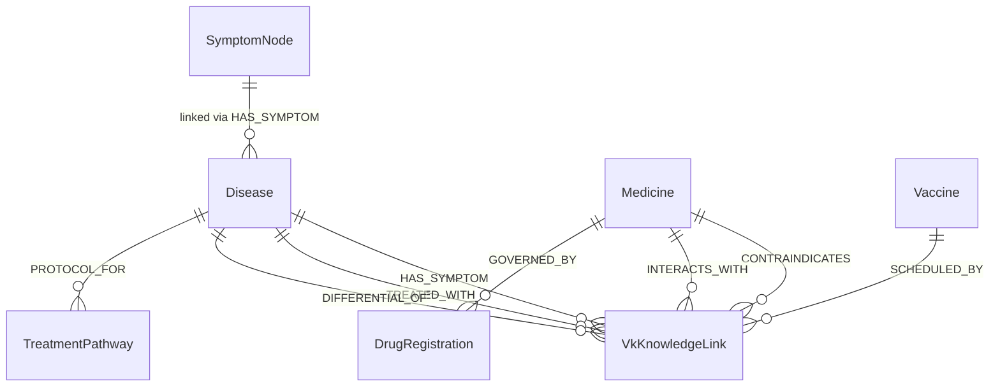

# Phase 6A — Veterinary Knowledge Architecture

**Project:** Prani Doctor  
**Role:** Principal Veterinary AI Architect  
**Date:** 2026-05-31  
**Status:** Architecture & planning only — no implementation  
**Version:** 1.0.0  
**Depends on:**

- `docs/plans/ai-core-platform-phase-1-foundation.md` (implemented)
- `docs/plans/ai-phase-4-router-engine.md` (partial — 4.0–4.1 implemented)
- `docs/plans/ai-phase-5-hardening.md` (partial)
- `docs/ai/AI_ECOSYSTEM_MASTER_PLAN.md`
- `docs/reports/AI_SYSTEM_CURRENT_STATUS_REPORT.md`

---

## Repositories in scope

| Repo | Role |
|------|------|
| `pranidoctor-backend` | Canonical knowledge layer, retrieval APIs, editorial services, embedding pipeline hooks |
| `pranidoctor-web` | Knowledge Control Center (editorial UI, review queues, attribution, confidence dashboards) |
| `pranidoctor_user` | Consumer — knowledge search, AI Doctor, Feed Advisor (via backend APIs only) |

**Naming disambiguation:**

| Term | Meaning |
|------|---------|
| **Veterinary Knowledge Layer (VKL)** | Subject of this plan — curated, versioned, attributable clinical & farm knowledge |
| **AIMS** | AI Management System — providers, models, routes, prompts (Phases 1–5) |
| **RAG Engine** | Future Phase 6B — vector retrieval, chunking, re-ranking (consumes VKL; not built here) |
| **AI Technician** | Human artificial-insemination field staff — separate marketplace domain |

---

## Executive summary

Prani Doctor today operates a **keyword-based knowledge CMS** (`AiKnowledgeEntry`, six content types, bilingual BN/EN bodies, draft → published workflow) consumed by `AiKnowledgeService.retrieveForRag()` as a **pre-LLM context injection** in chat v2. Symptom checking uses a **separate graph** (`AiSymptomNode`, `AiSymptomDiseaseLink`). Feed intelligence, breed metadata, reproduction protocols, regulatory constraints, and clinical SOPs live in **domain tables and hardcoded rules** without a unified knowledge contract.

**Phase 6A** defines the **Veterinary Knowledge Layer (VKL)** — a domain-aware, evidence-graded, editorially governed knowledge platform that:

1. Unifies ten veterinary knowledge domains under one **entity–relationship–versioning model**.
2. Extends (not replaces) `AiKnowledgeEntry` into a **typed knowledge graph** with provenance and confidence.
3. Exposes a **Retrieval Contract** consumable by the existing AI Router (context enrichment), future RAG Engine (chunk sources), AI Doctor (differential + protocol grounding), AI Prescription Assistant (drug interaction + withdrawal rules), and AI Feed Advisor (ration + nutrition constraints).
4. Implements **human veterinary review** as a first-class workflow with Bangladesh regulatory alignment.
5. Supports **Bangla-first, English-secondary** content with locale-aware retrieval.

This document is **architecture only**. No schema migrations, services, or UI are specified as deliverables.

---

## Strategic intent

| Today (Phase 5 baseline) | After Phase 6A (target architecture) |
|--------------------------|-------------------------------------|
| Flat `AiKnowledgeEntry` rows with `metadataJson` | Typed **knowledge entities** per domain with structured fields |
| Keyword `searchText` + `ILIKE` | **Hybrid search** — lexical + (future) semantic, domain filters, evidence gates |
| RAG = top-N keyword excerpts concatenated | **Retrieval profiles** per `taskType` with ranked, attributed chunks |
| Publish = single admin action | **Editorial → peer review → vet approval → publish** with audit trail |
| No source attribution or evidence grading | **Source registry**, evidence levels, confidence scores on every fact |
| Symptom graph isolated from knowledge CMS | **Cross-domain links** — symptom ↔ disease ↔ medicine ↔ protocol |
| Feed / breed / regulatory knowledge scattered | **Domain modules** under one VKL namespace and API surface |

---

## Design principles

| Principle | Phase 6A interpretation |
|-----------|-------------------------|
| **Clinical safety first** | Published knowledge used for prescription, emergency, or dosage guidance requires **VET_APPROVED** status and evidence ≥ Level 2 |
| **Registry-first AI** | Knowledge retrieval is invoked **before** router execution; retrieval metadata flows to `AiUsageLog` |
| **Provenance always** | No anonymous facts — every entity version carries `sourceAttributions[]` |
| **Locale parity, Bangla primary** | BN is canonical for farmer-facing retrieval; EN required for doctor/research parity |
| **Immutable published versions** | Edits create new version rows; published versions are never overwritten |
| **Graph over silos** | Relationships are queryable edges, not duplicated prose |
| **Task-aware retrieval** | `DISEASE_ANALYSIS`, `PRESCRIPTION_ANALYSIS`, `FEED_FORMULATION`, `EMERGENCY_CONSULTATION` each get distinct retrieval profiles |
| **Regulatory overlay** | Bangladesh-specific rules are a **scoped knowledge overlay**, not mixed into global defaults |
| **Human-in-the-loop** | AI may suggest drafts; only credentialed vets approve clinical action knowledge |
| **RAG-ready by design** | Stable `entityId` + `versionId` + chunk boundaries defined now; embeddings deferred to Phase 6B |

---

## Current state (as-built baseline)

### Existing knowledge artifacts

| Artifact | Location | Maturity |
|----------|----------|----------|
| `AiKnowledgeEntry` | `prisma/schema.prisma` | Production — 6 content types, BN/EN, species array, status enum |
| `AiKnowledgeService` | `src/modules/ai/knowledge/` | Keyword search + `retrieveForRag()` (excerpt concat) |
| `AiSymptomNode` / `AiSymptomDiseaseLink` | Schema + symptom-checker | Production rules graph |
| Admin knowledge CMS | `/api/admin/ai-ops/knowledge` | Basic CRUD + publish |
| Mobile knowledge API | `GET /api/ai/knowledge/search`, `/:slug` | Published entries only |
| Chat v2 enrichment | `AiAssistantService.chat()` | Pre-router RAG string injection |
| Prompt versioning | `AiPrompt` + `AiPromptManagementService` | **Pattern to mirror** for knowledge versioning |

### Existing AI Router integration points

```
Mobile / Doctor Client
        │
        ▼
Feature Service (chat, triage, feed, prescription, …)
        │
        ├──► VKL Retrieval Service  ◄── Phase 6A (new contract)
        │         │
        │         └──► ranked KnowledgeContextPack
        │
        ▼
AiFoundationService.executePromptTask()
        │
        ▼
AiOrchestratorService → AiRouterEngine (taskType, route, model hops)
        │
        ▼
AiUsageLog (+ retrievalMetadataJson)
```

**Task types already defined** (`ai-task.types.ts`):

| Task type | Future primary consumer |
|-----------|-------------------------|
| `GENERAL_CHAT` | Farmer chat, AI Doctor (general) |
| `DISEASE_ANALYSIS` | Symptom checker enrichment, AI Doctor differentials |
| `PRESCRIPTION_ANALYSIS` | AI Prescription Assistant |
| `FEED_FORMULATION` | AI Feed Advisor |
| `EMERGENCY_CONSULTATION` | Emergency triage, red-flag protocols |
| `IMAGE_ANALYSIS` | Visual diagnosis assist (reference images/links) |
| `DOCUMENT_ANALYSIS` | Lab report interpretation grounding |

**Feature → taskType map** (`feature-task-map.ts`) will gain entries: `ai_doctor`, `prescription_assistant`, `feed_advisor`, `knowledge_search`.

### Gaps Phase 6A must address (architecture)

| ID | Gap | Risk |
|----|-----|------|
| G1 | Only 6 content types; missing breed, reproduction, protocol, regulatory | Incomplete grounding for future products |
| G2 | No structured fields (dose, withdrawal, contraindication) | Prescription / feed errors |
| G3 | No evidence or confidence model | Cannot gate high-risk retrieval |
| G4 | No source attribution | Regulatory & medico-legal exposure |
| G5 | No version history table (in-place `version` increment) | Audit failure |
| G6 | Symptom graph not linked to structured disease entities | Fragmented disease knowledge |
| G7 | Keyword-only retrieval | Poor recall for Bangla colloquial terms |
| G8 | No vet credentialing on approval | Clinical liability |
| G9 | No locale-specific ranking | Suboptimal BN farmer UX |
| G10 | No retrieval observability on usage logs | Cannot tune RAG quality |

---

## Target architecture overview

```
┌─────────────────────────────────────────────────────────────────────────────────────┐
│                     VETERINARY KNOWLEDGE LAYER (VKL)                                 │
├─────────────────────────────────────────────────────────────────────────────────────┤
│                                                                                      │
│  ┌──────────────┐  ┌──────────────┐  ┌──────────────┐  ┌──────────────────────┐  │
│  │   Editorial  │  │    Review    │  │   Approval   │  │   Source Registry    │  │
│  │   Workflow   │─►│   Workflow   │─►│   Workflow   │  │   & Evidence Catalog │  │
│  └──────────────┘  └──────────────┘  └──────────────┘  └──────────────────────┘  │
│         │                  │                  │                      │              │
│         └──────────────────┴──────────────────┴──────────────────────┘              │
│                                    │                                                 │
│                                    ▼                                                 │
│  ┌─────────────────────────────────────────────────────────────────────────────┐   │
│  │                    KNOWLEDGE DOMAIN MODULES (10)                             │   │
│  │  Disease │ Medicine │ Vaccine │ Feed │ Breed │ Reproduction │ Emergency │    │   │
│  │  Clinical Protocol │ Regulatory (BD) │ Farm Management                       │   │
│  └─────────────────────────────────────────────────────────────────────────────┘   │
│                                    │                                                 │
│         ┌──────────────────────────┼──────────────────────────┐                     │
│         ▼                          ▼                          ▼                     │
│  ┌─────────────┐           ┌─────────────┐           ┌─────────────────┐           │
│  │  Knowledge  │           │  Confidence │           │  Version Store  │           │
│  │    Graph    │           │   & Evidence│           │  (immutable)    │           │
│  └─────────────┘           └─────────────┘           └─────────────────┘           │
│         │                          │                          │                     │
│         └──────────────────────────┴──────────────────────────┘                     │
│                                    │                                                 │
│                                    ▼                                                 │
│  ┌─────────────────────────────────────────────────────────────────────────────┐   │
│  │                    RETRIEVAL & SEARCH PLANE                                  │   │
│  │  Lexical Index │ Domain Filters │ Locale Ranker │ Retrieval Profiles        │   │
│  │  (Phase 6A)    │                │               │ per taskType               │   │
│  │  ─ ─ ─ ─ ─ ─ ─ ─ ─ ─ ─ ─ ─ ─ ─ ─ ─ ─ ─ ─ ─ ─ ─ ─ ─ ─ ─ ─ ─ ─ ─ ─ ─ ─   │   │
│  │  Vector Index + Re-ranker + Chunk Store          (Phase 6B — RAG Engine)   │   │
│  └─────────────────────────────────────────────────────────────────────────────┘   │
│                                    │                                                 │
└────────────────────────────────────┼─────────────────────────────────────────────────┘
                                     │
         ┌───────────────────────────┼───────────────────────────┐
         ▼                           ▼                           ▼
  AiRouterEngine              Future RAG Engine           Direct API (mobile/doctor)
  (context enrichment)        (embedding retrieval)       (knowledge search/browse)
```

### Layer placement in backend module map

```
src/modules/ai/
├── knowledge/                    # EXTEND — facade + legacy compat
├── knowledge-core/               # NEW — entity graph, versioning (Phase 6B+ impl)
│   ├── domains/                  # 10 domain schemas & validators
│   ├── editorial/                # workflow state machine
│   ├── review/                   # vet review queue
│   ├── sources/                  # attribution registry
│   ├── confidence/               # scoring engine
│   └── graph/                    # relationship repository
├── knowledge-retrieval/          # NEW — search + retrieval profiles
│   ├── lexical/
│   ├── profiles/                 # taskType → retrieval config
│   └── packs/                    # KnowledgeContextPack builder
└── (existing router, orchestrator, prompts, governance)
```

Admin UI extends `/admin/ai-ops/knowledge` into **Knowledge Control Center** with domain tabs, review queues, and source management.

---

## Core knowledge model

### Universal entity envelope

Every knowledge artifact — regardless of domain — conforms to a **Knowledge Entity Envelope**:

| Field group | Fields | Purpose |
|-------------|--------|---------|
| Identity | `entityId` (stable UUID), `domain`, `entityType`, `slug` | Cross-version identity |
| Version | `versionId`, `versionNumber`, `supersedesVersionId` | Immutable version chain |
| Lifecycle | `status`, `publishedAt`, `deprecatedAt`, `deprecationReason` | Editorial state |
| Locale | `titleBn`, `titleEn`, `summaryBn`, `summaryEn`, `bodyBn`, `bodyEn` | Display + chunk source |
| Scope | `species[]`, `audience`, `regionScope` (`GLOBAL` \| `BD` \| `DISTRICT:{code}`) | Retrieval filters |
| Quality | `evidenceLevel`, `confidenceScore`, `clinicalRiskTier` | Retrieval gating |
| Provenance | `sourceAttributions[]`, `lastReviewedAt`, `nextReviewDueAt` | Audit & refresh |
| Graph | `outboundLinks[]`, `inboundLinkCount` | Relationship navigation |
| Search | `searchText`, `keywordsBn[]`, `keywordsEn[]`, `colloquialBn[]` | Lexical retrieval |
| RAG | `chunkPolicyId`, `embeddingStatus` | Phase 6B handoff |
| Audit | `createdById`, `updatedById`, `approvedByVetId`, `reviewNotes` | Workflow trail |

**Backward compatibility:** Existing `AiKnowledgeEntry.id` becomes `entityId`; current rows migrate as `versionNumber = 1` with `domain` inferred from `contentType`.

### Knowledge entity types by domain

| Domain | Entity types (`entityType`) | Primary structured payload |
|--------|----------------------------|----------------------------|
| **Disease** | `Disease`, `Syndrome`, `Differential`, `Pathogen` | ICD-like code, signs, progression, zoonotic flag |
| **Medicine** | `Drug`, `Formulation`, `ActiveIngredient`, `WithdrawalRule` | Dose ranges, routes, contraindications, BD availability |
| **Vaccine** | `Vaccine`, `VaccinationSchedule`, `ColdChainRule` | Antigen, schedule, booster interval, storage |
| **Feed & Nutrition** | `FeedIngredient`, `RationTemplate`, `NutrientRequirement`, `ToxicFeedAlert` | DM%, CP%, NDF, species-stage matrix |
| **Breed** | `Breed`, `BreedStandard`, `PerformanceBenchmark` | Origin, weight ranges, climate adaptability |
| **Reproduction** | `BreedingProtocol`, `EstrusSign`, `PregnancyStage`, `ParturitionGuide` | Cycle days, AI timing, dystocia signs |
| **Emergency** | `EmergencyCondition`, `FirstAidStep`, `TriageRule`, `ReferralTrigger` | Red flags, time-to-vet, farmer actions |
| **Clinical Protocol** | `SOP`, `DiagnosticWorkup`, `TreatmentPathway`, `BiosecurityMeasure` | Steps, prerequisites, success criteria |
| **Regulatory (BD)** | `DrugRegistration`, `BannedSubstance`, `ImportRule`, `SlaughterWithdrawal` | DGD/DoF references, effective dates |
| **Farm Management** | `HousingStandard`, `HerdHealthProgram`, `RecordKeepingTemplate`, `SeasonalCalendar` | KPIs, checklist, species-farm-type matrix |

Structured payloads live in **`structuredJson`** validated by per-domain JSON Schema (not free-form `metadataJson`).

### Knowledge relationships

Relationships are **typed directed edges** stored in `VkKnowledgeLink`:

| Edge type | From → To | Semantics |
|-----------|-----------|-----------|
| `HAS_SYMPTOM` | Disease → SymptomNode | Extends existing symptom graph |
| `DIFFERENTIAL_OF` | Disease → Disease | DDx ranking with `weight` |
| `TREATED_WITH` | Disease → Medicine | Line of therapy; `lineOrder`, `evidenceLevel` |
| `PREVENTED_BY` | Disease → Vaccine | Prevention mapping |
| `CONTRAINDICATES` | Medicine → Disease/Condition | Safety block |
| `INTERACTS_WITH` | Medicine → Medicine | Interaction severity |
| `REQUIRES_WITHDRAWAL` | Medicine → WithdrawalRule | Meat/milk withhold |
| `SCHEDULED_BY` | Vaccine → VaccinationSchedule | Species-age matrix |
| `NUTRIENT_FOR` | NutrientRequirement → Species/Stage | Feed advisor grounding |
| `CONTAINS` | RationTemplate → FeedIngredient | Formulation graph |
| `BREED_OF` | Breed → Species | Taxonomy |
| `GOVERNED_BY` | Medicine/Vaccine → DrugRegistration | BD regulatory link |
| `PROTOCOL_FOR` | TreatmentPathway → Disease | Clinical SOP binding |
| `ESCALATES_TO` | TriageRule → EmergencyCondition | Emergency routing |
| `APPLIES_TO` | FarmManagement entity → Species/FarmType | Scoping |

Edge metadata: `weight` (0–1), `evidenceLevel`, `confidenceScore`, `sourceAttributionId`, `effectiveFrom`, `effectiveTo`.



---

## Domain specifications

### 1. Disease Knowledge Base

**Purpose:** Ground AI Doctor differentials, symptom checker enrichment, and farmer education.

| Entity | Key structured fields |
|--------|----------------------|
| `Disease` | `diseaseCode`, `causalAgents[]`, `transmissionMode`, `zoonotic`, `endemicBd`, `mortalityRisk`, `incubationDays` |
| `Syndrome` | `constituentDiseases[]`, `presentationPattern` |
| `Differential` | `rankingCriteria`, `distinguishingFeatures` |

**Relationships:** `HAS_SYMPTOM`, `DIFFERENTIAL_OF`, `TREATED_WITH`, `PREVENTED_BY`, `PROTOCOL_FOR`.

**Retrieval profile (`DISEASE_ANALYSIS`):** Prioritize published diseases with matching species + symptom overlap; include top 3 differentials with evidence ≥ L2; exclude deprecated.

**Audience:** `FARMER` (simplified BN summaries), `DOCTOR` (full structured), `BOTH` (shared core).

---

### 2. Medicine Knowledge Base

**Purpose:** Ground AI Prescription Assistant — dosing, interactions, withdrawal, BD formulary alignment.

| Entity | Key structured fields |
|--------|----------------------|
| `Drug` | `genericName`, `brandNamesBd[]`, `drugClass`, `prescriptionRequired`, `speciesDoseMatrix[]`, `routes[]`, `contraindications[]` |
| `Formulation` | `strength`, `unit`, `form` (injectable, oral, topical) |
| `WithdrawalRule` | `species`, `productType` (milk/meat/egg), `withdrawalDays`, `regulatoryBasis` |

**Clinical risk tier:** `HIGH` for all dosage-bearing entities — requires **VET_APPROVED** + evidence ≥ L2 before use in `PRESCRIPTION_ANALYSIS` retrieval.

**Relationships:** `TREATED_WITH` (inverse), `CONTRAINDICATES`, `INTERACTS_WITH`, `REQUIRES_WITHDRAWAL`, `GOVERNED_BY`.

---

### 3. Vaccine Knowledge Base

**Purpose:** Smart recommendations, herd health programs, farmer scheduling.

| Entity | Key structured fields |
|--------|----------------------|
| `Vaccine` | `antigen`, `manufacturer`, `valency`, `storageTempC`, `doseMl`, `route` |
| `VaccinationSchedule` | `species`, `ageWindow`, `boosterIntervalDays`, `seasonalNotes` |
| `ColdChainRule` | `maxExposureMinutes`, `transportGuidance` |

**Relationships:** `PREVENTED_BY` (inverse), `SCHEDULED_BY`, `GOVERNED_BY`.

**Integration:** Links to existing `SmartRecommendationType.VACCINE` via stable `entityId` references.

---

### 4. Feed & Nutrition Knowledge Base

**Purpose:** Ground AI Feed Advisor and ration formulation (`FEED_FORMULATION` task type).

| Entity | Key structured fields |
|--------|----------------------|
| `FeedIngredient` | `ingredientCode`, `dmPercent`, `cpPercent`, `tdnPercent`, `ndfPercent`, `adfPercent`, `costTierBd`, `availabilitySeason` |
| `NutrientRequirement` | `species`, `productionStage`, `dmIntakeKg`, `cpPercentMin`, `energyMcal` |
| `RationTemplate` | `targetProduction`, `ingredients[]` with `% as-fed`, `costEstimateBdt` |
| `ToxicFeedAlert` | `substance`, `threshold`, `clinicalSigns`, `immediateAction` |

**Relationships:** `NUTRIENT_FOR`, `CONTAINS`, `APPLIES_TO`.

**Integration:** Aligns with `tape-formula-registry`, mobile feed catalog, and `FEED_FORMULATION` router routes. Retrieval must include **nutrient constraints** as structured JSON in `KnowledgeContextPack.structuredFacts[]`, not prose-only.

---

### 5. Breed Knowledge Base

**Purpose:** Context for weight estimation, performance expectations, breeding advice.

| Entity | Key structured fields |
|--------|----------------------|
| `Breed` | `breedCode`, `species`, `originRegion`, `purpose` (dairy/meat/dual), `heatTolerance` |
| `BreedStandard` | `adultWeightKgRange`, `heightCmRange`, `colorPattern` |
| `PerformanceBenchmark` | `metric` (milk yield, ADG), `typicalRange`, `ageStage` |

**Relationships:** `BREED_OF`, links to `NutrientRequirement` and `BreedingProtocol` via `APPLIES_TO`.

---

### 6. Reproduction Knowledge Base

**Purpose:** AI breeding guidance, pregnancy monitoring, AI Technician handoff boundaries.

| Entity | Key structured fields |
|--------|----------------------|
| `BreedingProtocol` | `species`, `method` (natural/AI), `optimalTiming`, `semenHandling` |
| `EstrusSign` | `signsBn[]`, `signsEn[]`, `detectionDifficulty` |
| `PregnancyStage` | `stage`, `dayRange`, `expectedSigns`, `nutritionAdjustments` |
| `ParturitionGuide` | `prepartum`, `during`, `postpartum`, `dystociaCriteria` |

**Boundary:** Marketplace AI Technician bookings remain transactional; VKL supplies **knowledge only**, not service matching.

---

### 7. Emergency Care Knowledge Base

**Purpose:** `EMERGENCY_CONSULTATION` task grounding, triage escalation, red-flag detection.

| Entity | Key structured fields |
|--------|----------------------|
| `EmergencyCondition` | `onsetSpeed`, `farmerActionWindow`, `vetRequiredWithinHours`, `homeStabilizationAllowed` |
| `FirstAidStep` | `stepOrder`, `instructionBn`, `instructionEn`, `cautionFlags[]` |
| `TriageRule` | `symptomPattern`, `riskScore`, `bucket` (maps to `AiRiskBucket`) |
| `ReferralTrigger` | `condition`, `escalationChannel` |

**Retrieval profile:** Highest priority; evidence gate relaxed for **established emergency SOPs** (L1 acceptable if source = national extension bulletin + vet reviewed). Always attach `clinicalRiskTier: CRITICAL`.

**Integration:** Extends `AiSymptomNode.redFlag` and triage pipeline in `ai-veterinary-core`.

---

### 8. Clinical Protocol Knowledge Base

**Purpose:** Doctor-facing SOPs, diagnostic workups, biosecurity — AI Doctor professional mode.

| Entity | Key structured fields |
|--------|----------------------|
| `SOP` | `procedureCode`, `steps[]`, `ppeRequired`, `durationMinutes` |
| `DiagnosticWorkup` | `presentingComplaint`, `testsOrdered[]`, `interpretationNotes` |
| `TreatmentPathway` | `firstLine`, `secondLine`, `failureCriteria`, `followUpDays` |
| `BiosecurityMeasure` | `diseaseTarget`, `measureType`, `complianceChecklist[]` |

**Audience:** Primarily `DOCTOR`; farmer-facing excerpts require explicit `farmerSafeSummaryBn/En` field.

---

### 9. Regulatory Knowledge Base (Bangladesh)

**Purpose:** Legal constraints on prescriptions, imports, banned antibiotics, slaughter withdrawal.

| Entity | Key structured fields |
|--------|----------------------|
| `DrugRegistration` | `registrationNo`, `authority` (DGD/DoF), `status`, `validUntil` |
| `BannedSubstance` | `substance`, `banScope`, `effectiveDate`, `rationale` |
| `ImportRule` | `productCategory`, `permitRequired`, `quarantineDays` |
| `SlaughterWithdrawal` | `compound`, `species`, `tissue`, `minDays`, `legalReference` |

**Region scope:** Default `BD`; retrieval for `PRESCRIPTION_ANALYSIS` **must** inject active regulatory facts when `regionScope=BD`.

**Temporal validity:** Regulatory entities use `effectiveFrom` / `effectiveTo` on both entity and link — retrieval filters by `asOfDate` (default: today).

---

### 10. Livestock Farm Management Knowledge Base

**Purpose:** Farm briefing, seasonal calendars, record templates, herd health programs.

| Entity | Key structured fields |
|--------|----------------------|
| `HousingStandard` | `species`, `spaceSqMPerHead`, `ventilation`, `flooringType` |
| `HerdHealthProgram` | `programName`, `activities[]` with frequency, `targetDiseases[]` |
| `RecordKeepingTemplate` | `fields[]`, `frequency`, `regulatoryRequired` |
| `SeasonalCalendar` | `region`, `month`, `activities[]`, `climateNotes` |

**Integration:** `AiAssistantService.farmBriefing()` and `farmQuery()` consume `SeasonalCalendar` + `HerdHealthProgram` via retrieval profile `GENERAL_CHAT` with `domainFilter: FARM_MGMT`.

---

## Versioning strategy

Mirror the **prompt versioning pattern** (`AiPrompt`: `scopeKey` + `promptKey` + `version` unique, immutable published versions):

### Version model

| Concept | Rule |
|---------|------|
| **Stable identity** | `entityId` + `slug` never change after creation |
| **Immutable versions** | Each `versionId` is a frozen snapshot; edits create `versionNumber + 1` in `DRAFT` |
| **Published pointer** | `VkKnowledgeEntity.currentPublishedVersionId` for fast retrieval |
| **Draft pointer** | `VkKnowledgeEntity.currentDraftVersionId` (at most one active draft) |
| **Supersession chain** | `supersedesVersionId` links version history |
| **Deprecation** | Deprecate version, not delete; `status = DEPRECATED` with reason |
| **Emergency rollback** | Repoint `currentPublishedVersionId` to prior version (admin + vet co-sign) |

### Version diff & audit

- Store `changeSummary`, `changedFields[]`, `diffJson` on each new version.
- Emit `VkKnowledgeAuditEvent`: `DRAFT_CREATED`, `SUBMITTED`, `REVIEWED`, `APPROVED`, `PUBLISHED`, `DEPRECATED`, `ROLLBACK`.

### Compatibility with legacy `AiKnowledgeEntry.version`

Migration maps `version` int → `versionNumber`; subsequent edits use new `VkKnowledgeVersion` rows while keeping `AiKnowledgeEntry` as a **compatibility view** until Phase 6C cutover.

---

## Editorial workflow

```
┌─────────┐    submit     ┌──────────────┐    accept      ┌─────────┐
│  DRAFT  │──────────────►│   EDITORIAL  │───────────────►│ IN_REVIEW│
└─────────┘               │   REVIEW     │                └────┬────┘
     ▲                      └──────────────┘                     │
     │                            │ reject                       │ approve
     │                            ▼                              ▼
     └──────────────────────  CHANGES_REQUESTED          ┌───────────────┐
                                                         │ VET_APPROVAL  │
                                                         └───────┬───────┘
                                                                 │
                    ┌────────────────────────────────────────────┤
                    ▼                                            ▼
              ┌───────────┐                              ┌────────────┐
              │ PUBLISHED │                              │  REJECTED  │
              └───────────┘                              └────────────┘
                    │
                    ▼ (superseded)
              ┌────────────┐
              │ DEPRECATED │
              └────────────┘
```

### Roles

| Role | Capabilities |
|------|--------------|
| **Content Editor** | Create/edit drafts, manage BN/EN text, suggest links |
| **Domain Lead** | Editorial review, schema validation, assign reviewers |
| **Veterinarian Reviewer** | Clinical accuracy review, evidence assessment |
| **Chief Veterinary Officer (CVQ)** | Final approval on `clinicalRiskTier: HIGH` entities |
| **Regulatory Editor** | BD regulatory domain publish authority |
| **Super Admin** | Rollback, emergency unpublish |

### State rules

| Transition | Guard |
|------------|-------|
| DRAFT → IN_REVIEW | Required fields complete per domain JSON Schema; ≥1 source attribution |
| IN_REVIEW → VET_APPROVAL | Domain lead sign-off |
| VET_APPROVAL → PUBLISHED | Licensed vet approval; evidence level set |
| Any → DEPRECATED | Superseding version published OR regulatory expiry |
| PUBLISHED → DRAFT (new version) | Fork only — never mutate published row |

---

## Review workflow

**Peer review** (IN_REVIEW stage):

| Step | Actor | Output |
|------|-------|--------|
| Schema validation | Automated | Pass/fail + field errors |
| Clinical completeness | Domain Lead | Checklist per entity type |
| Language review | BN/EN reviewers | Farmer readability (BN), clinical precision (EN) |
| Link integrity | Automated | Orphan edge detection |
| Duplicate detection | Automated | Semantic + code match against published corpus |

**Review artifact:** `VkKnowledgeReview` — reviewerId, stage, decision (`APPROVE` \| `REQUEST_CHANGES` \| `REJECT`), comments, checklistJson, completedAt.

**SLA targets (operational):**

| clinicalRiskTier | Target review time |
|------------------|-------------------|
| CRITICAL (emergency) | 24 hours |
| HIGH (medicine, prescription) | 72 hours |
| MEDIUM | 7 days |
| LOW (farm mgmt tips) | 14 days |

---

## Approval workflow

**Veterinary approval** (VET_APPROVAL stage) — required when:

- Entity type ∈ {`Drug`, `Formulation`, `WithdrawalRule`, `TreatmentPathway`, `EmergencyCondition`, `TriageRule`}
- OR `clinicalRiskTier` ∈ {`HIGH`, `CRITICAL`}
- OR edge type ∈ {`TREATED_WITH`, `CONTRAINDICATES`, `INTERACTS_WITH`} with `weight > 0.7`

### Vet credential model

| Field | Requirement |
|-------|-------------|
| `vetLicenseNo` | BVC registered number |
| `licenseVerifiedAt` | Admin verification timestamp |
| `specializations[]` | e.g. large animal, poultry |
| `approvalScope` | Domain allow-list |

**Dual approval:** Regulatory entities (`DrugRegistration`, `BannedSubstance`) require **Regulatory Editor + Vet Reviewer**.

**Approval artifact:** `VkKnowledgeApproval` — approverVetId, licenseNo snapshot, digital sign-off hash, approvedAt, validUntil (triggers re-review).

---

## Source attribution

### Source registry (`VkKnowledgeSource`)

| Field | Description |
|-------|-------------|
| `sourceId` | Stable ID |
| `sourceType` | `PEER_REVIEWED`, `GOVT_EXTENSION`, `TEXTBOOK`, `MANUFACTURER_LABEL`, `FIELD_TRIAL`, `EXPERT_CONSENSUS`, `INTERNAL_SOP` |
| `citationBn`, `citationEn` | Human-readable citation |
| `url`, `isbn`, `documentRef` | Locator |
| `publisher`, `publishYear` | Bibliographic |
| `jurisdiction` | `BD`, `IN`, `GLOBAL`, etc. |
| `trustTier` | 1 (highest) – 4 (lowest) |

### Entity attribution

Each version carries `sourceAttributions[]`:

```json
{
  "sourceId": "uuid",
  "pageRef": "p. 142",
  "quotedFrom": false,
  "contributionWeight": 0.8,
  "accessedAt": "2026-05-31"
}
```

**Rules:**

- Minimum **one** source with `trustTier ≤ 2` for clinical HIGH/CRITICAL entities.
- Manufacturer labels alone insufficient for off-label species — requires vet approval note.
- Government BD bulletins (`GOVT_EXTENSION`) auto-trustTier 2 for farm management; still require vet review for medicine.

**UI surfacing:** Mobile and doctor clients display **“Sources”** expandable section on knowledge detail pages; AI responses include compressed attribution in `KnowledgeContextPack.citationBlock` for LLM to reference.

---

## Knowledge confidence scoring

Confidence is a **0.0–1.0 composite score** computed at publish time and stored on each version. Used for retrieval ranking and gating.

### Formula (conceptual)

```
confidenceScore = clamp(
  0.35 * evidenceLevelScore
+ 0.25 * sourceTrustScore
+ 0.20 * recencyScore
+ 0.10 * reviewCompletenessScore
+ 0.10 * graphConnectivityScore,
  0, 1)
```

| Component | Derivation |
|-----------|------------|
| `evidenceLevelScore` | L1=0.4, L2=0.7, L3=0.85, L4=0.95, L5=1.0 |
| `sourceTrustScore` | Weighted avg of attribution `trustTier` |
| `recencyScore` | Decay from `lastReviewedAt` (half-life 18 months) |
| `reviewCompletenessScore` | Checklist completion % |
| `graphConnectivityScore` | Valid inbound/outbound links for entity type |

### Retrieval gates

| taskType | Minimum confidence | Minimum evidence |
|----------|-------------------|------------------|
| `PRESCRIPTION_ANALYSIS` | 0.75 | L2 |
| `EMERGENCY_CONSULTATION` | 0.60 | L1 (SOP) or L2 (dosage) |
| `DISEASE_ANALYSIS` | 0.55 | L2 |
| `FEED_FORMULATION` | 0.65 | L2 |
| `GENERAL_CHAT` | 0.40 | L1 |

Below threshold: entity excluded from LLM context; may still appear in direct browse/search with **low-confidence badge**.

---

## Evidence levels

Adapted GRADE-inspired scale for field veterinary context:

| Level | Label | Definition | Example sources |
|-------|-------|------------|-----------------|
| **L1** | Expert consensus | Accepted field practice, extension manuals | DLS bulletins, BVC workshops |
| **L2** | Field validation | Documented field trials, observational studies | BAU research, NGO field data |
| **L3** | Controlled studies | RCT or controlled trials in target species | Published veterinary journals |
| **L4** | Systematic review | Meta-analysis or official guidelines | OIE, FAO guidelines |
| **L5** | Regulatory primary | Statutory text, registered label | DGD registration dossier |

**Display:** BN labels for farmers (e.g. “প্রমাণ: মাঠ পর্যায়ে যাচাইকৃত”); EN clinical labels for doctors.

---

## Search architecture

### Phase 6A — Lexical + structured search

```
Query (BN/EN, optional species, domain, audience)
        │
        ▼
┌───────────────────┐
│ Query Normalizer  │  script detect, colloquial → canonical map
└─────────┬─────────┘
          ▼
┌───────────────────┐
│ Structured Filter │  domain, species, status=PUBLISHED, regionScope,
│                   │  evidenceLevel ≥ profile.min, confidence ≥ profile.min
└─────────┬─────────┘
          ▼
┌───────────────────┐
│ Lexical Ranker    │  PostgreSQL tsvector (BN + EN weighted)
│                   │  + trigram on colloquialBn
│                   │  + keyword exact boost
└─────────┬─────────┘
          ▼
┌───────────────────┐
│ Graph Expander    │  optional 1-hop related entities (same domain)
└─────────┬─────────┘
          ▼
   Ranked SearchResults[]
```

**Index strategy:**

| Index | Fields | Notes |
|-------|--------|-------|
| `tsvector_bn` | `titleBn`, `summaryBn`, `bodyBn`, `keywordsBn`, `colloquialBn` | Bangla config |
| `tsvector_en` | `titleEn`, `summaryEn`, `bodyEn`, `keywordsEn` | English config |
| B-tree | `domain`, `entityType`, `status`, `species[]` | Filter columns |
| GIN | `structuredJson` paths (selected) | e.g. `drugClass`, `diseaseCode` |

**Public API (conceptual):**

- `GET /api/ai/knowledge/search` — extend with `domain`, `entityType`, `minEvidence`, `minConfidence`
- `GET /api/ai/knowledge/entities/:slug` — version-aware detail + sources
- `GET /api/admin/ai-ops/knowledge/review-queue` — editorial

### Phase 6B — Semantic layer (future, planned interface)

- Embedding index keyed by `versionId` + `chunkIndex`
- Hybrid fusion: `score = 0.55 * semantic + 0.45 * lexical`
- Re-ranker with cross-encoder (optional, cost-gated via router)

Phase 6A **defines** `VkKnowledgeChunk` boundaries and `chunkPolicyId` so 6B does not require content restructuring.

---

## Retrieval architecture

### KnowledgeContextPack

Standard output consumed by orchestrator, RAG engine, and feature services:

```typescript
type KnowledgeContextPack = {
  packId: string;
  taskType: AiDbTaskType;
  locale: 'bn' | 'en';
  query: string;
  retrievedAt: string;
  retrievalProfileId: string;
  entities: RetrievedEntity[];
  structuredFacts: StructuredFact[];  // dosage, withdrawal, nutrient — machine-readable
  citationBlock: string;              // compressed for LLM system context
  graphHints: GraphHint[];            // related entity slugs for follow-up
  filtersApplied: RetrievalFilters;
  confidenceSummary: { min: number; max: number; avg: number };
  excludedCount: number;              // below threshold
};

type RetrievedEntity = {
  entityId: string;
  versionId: string;
  domain: string;
  entityType: string;
  slug: string;
  title: string;
  excerpt: string;
  evidenceLevel: string;
  confidenceScore: number;
  rank: number;
  sources: SourceCitation[];
};
```

### Retrieval profiles

| profileId | taskType | domainPriority[] | maxEntities | expandGraph |
|-----------|----------|-------------------|-------------|-------------|
| `farmer-chat-v1` | GENERAL_CHAT | FARM_MGMT, DISEASE, EMERGENCY | 4 | false |
| `ai-doctor-v1` | DISEASE_ANALYSIS | DISEASE, CLINICAL_PROTOCOL, MEDICINE | 8 | true |
| `prescription-v1` | PRESCRIPTION_ANALYSIS | MEDICINE, REGULATORY_BD | 6 | true (interactions) |
| `feed-advisor-v1` | FEED_FORMULATION | FEED, BREED | 6 | true |
| `emergency-v1` | EMERGENCY_CONSULTATION | EMERGENCY, DISEASE | 5 | false |
| `symptom-enrich-v1` | DISEASE_ANALYSIS | DISEASE | 5 | symptom-linked |

Profiles are **admin-configurable JSON** stored alongside `AiRoute` scope (platform default, tenant override future).

### Retrieval execution flow

```
1. Resolve profile from taskType + feature + audience
2. Apply governance (knowledge kill switch per domain — future)
3. Execute search with profile filters
4. Apply confidence/evidence gates
5. Expand graph (if enabled, depth=1)
6. Build structuredFacts from structuredJson (medicine doses, withdrawal, nutrients)
7. Render citationBlock (locale-aware, token budget capped)
8. Attach pack metadata to AiUsageLog.retrievalMetadataJson
9. Return pack to caller (orchestrator injects before LLM call)
```

**Token budget:** Default 1,200 tokens for `citationBlock`; `PRESCRIPTION_ANALYSIS` may increase to 2,000 via route settings.

---

## RAG compatibility

Phase 6A defines the **contract**; Phase 6B implements embeddings.

| Concern | Phase 6A decision |
|---------|-------------------|
| Chunk identity | `{versionId}:{chunkIndex}` stable IDs |
| Chunk boundaries | Domain `chunkPolicyId` — e.g. `MEDICINE_BY_SECTION`, `DISEASE_BY_HEADING`, `PROTOCOL_BY_STEP` |
| Chunk metadata | `domain`, `entityType`, `species`, `evidenceLevel`, `confidenceScore`, `locale`, `clinicalRiskTier` |
| Embedding model route | `taskType: DOCUMENT_ANALYSIS` or dedicated `EMBEDDING` modality (Phase 3 capability extension) |
| Sync trigger | On `PUBLISHED` event → queue `ai:embedding` job (BullMQ, already scaffolded) |
| Deprecation | Tombstone chunks; exclude from retrieval index |
| Hybrid retrieval | Profile flag `semanticEnabled` (default false in 6A, true in 6B) |

**Legacy compat:** `AiKnowledgeService.retrieveForRag()` becomes a thin wrapper calling `KnowledgeRetrievalService.buildPack()` with profile `farmer-chat-v1`.

---

## Multi-language support

| Aspect | Policy |
|--------|--------|
| **Canonical authoring** | Both BN and EN required before IN_REVIEW |
| **Farmer retrieval default** | `locale=bn`; fall back to EN excerpt if BN missing (blocked at review) |
| **Doctor retrieval** | Prefer EN for clinical precision; BN parallel for local communication |
| **Colloquial Bangla** | `colloquialBn[]` on entities — “খামারে যা বলে”, mapped to canonical terms |
| **Search** | Query language auto-detect; search both indexes; boost matching locale |
| **Structured facts** | Locale-independent numeric fields (dose mg/kg, withdrawal days) |
| **RTL** | Not applicable |
| **Future locale** | Schema reserves `locale` on chunks; third languages via extension |

**Translation workflow:** EN draft may precede BN; publish blocked until BN review sign-off for farmer-visible entities.

---

## Human veterinary review model

```
┌─────────────────────────────────────────────────────────────────┐
│              HUMAN VET REVIEW MODEL                              │
├─────────────────────────────────────────────────────────────────┤
│                                                                  │
│  ┌─────────────┐     ┌──────────────┐     ┌─────────────────┐  │
│  │ AI-assisted │     │   Human Vet  │     │  Continuous QA  │  │
│  │ draft gen   │────►│   Reviewer   │────►│  (scheduled)    │  │
│  │ (optional)  │     │   queue      │     │  re-review      │  │
│  └─────────────┘     └──────────────┘     └─────────────────┘  │
│         │                    │                      │            │
│         │                    ▼                      ▼            │
│         │            Approval recorded      Expiry → re-queue   │
│         │            on version             Low user feedback   │
│         ▼                                                        │
│  AI NEVER auto-publishes clinical HIGH/CRITICAL content         │
│                                                                  │
└─────────────────────────────────────────────────────────────────┘
```

### Review queue mechanics

- Vets see filtered queue by `specializations` + `domain`.
- Side-by-side BN/EN with structured field validation highlights.
- One-click link to related entities (interactions, contraindications).
- **Conflict detection:** If new `INTERACTS_WITH` contradicts published edge, flag for CVQ.

### Post-publish monitoring

| Signal | Action |
|--------|--------|
| `nextReviewDueAt` elapsed | Auto-transition to `REVIEW_DUE` (still published, flagged) |
| High escalation rate linked to entity | Queue priority review |
| Regulatory `effectiveTo` passed | Auto-deprecate |
| Farmer feedback “incorrect” (future) | Triage to domain lead |

### AI-assisted authoring (guardrails)

- LLM may propose drafts from source PDFs — output always `DRAFT` + `AI_GENERATED` flag.
- AI-generated drafts **cannot** enter VET_APPROVAL without human editor review.
- Prompt for draft generation routes through `DOCUMENT_ANALYSIS` task with no patient data.

---

## Integration contracts

### AI Router (Phase 4)

| Integration point | Behavior |
|-------------------|----------|
| Pre-router hook | `KnowledgeRetrievalService.retrieve(taskType, query, context)` |
| Context injection | `citationBlock` appended to enriched user message or system prompt slot |
| Token accounting | Retrieval tokens estimated; counted separately on `AiUsageLog` |
| Route selection | Unchanged — retrieval does not select model |
| Failover | If retrieval fails, log warning + proceed with disclaimer boost (fail-open for chat, **fail-closed** for prescription) |
| Kill switch | New governance scope `knowledge.{domain}` (future Phase 6C) |

### Future RAG Engine (Phase 6B)

| Contract | Detail |
|----------|--------|
| Input | `versionId[]` or search query + profile |
| Output | Ranked chunks with scores |
| Storage | `VkEmbeddingChunk` (extends master plan `AiEmbeddingChunk`) |
| Re-embedding | On `chunkPolicyId` change only |

### Future AI Doctor

| Capability | VKL supply |
|------------|------------|
| Differential diagnosis | Disease entities + `DIFFERENTIAL_OF` edges + symptom links |
| Treatment options | `TreatmentPathway`, `TREATED_WITH` with evidence |
| Workup suggestions | `DiagnosticWorkup` entities |
| Escalation | `ReferralTrigger`, emergency entities |
| taskType | `DISEASE_ANALYSIS`, `EMERGENCY_CONSULTATION` |

### Future AI Prescription Assistant

| Capability | VKL supply |
|------------|------------|
| Dose validation | `Drug.speciesDoseMatrix` structured facts |
| Interaction check | `INTERACTS_WITH` graph traversal |
| Contraindication | `CONTRAINDICATES` edges |
| Withdrawal | `WithdrawalRule` + `SlaughterWithdrawal` |
| Legal | `DrugRegistration`, `BannedSubstance` for BD |
| taskType | `PRESCRIPTION_ANALYSIS` — **fail-closed** without sufficient retrieval |

### Future AI Feed Advisor

| Capability | VKL supply |
|------------|------------|
| Nutrient targets | `NutrientRequirement` by species/stage |
| Ingredient catalog | `FeedIngredient` with composition |
| Ration templates | `RationTemplate` as starting points |
| Safety | `ToxicFeedAlert` |
| taskType | `FEED_FORMULATION` |

---

## Admin & API surface (conceptual)

### Admin (web BFF → backend)

| Area | Routes |
|------|--------|
| Entity CRUD | `/api/admin/ai-ops/knowledge/entities` |
| Version history | `/api/admin/ai-ops/knowledge/entities/:id/versions` |
| Workflow | `.../submit`, `.../review`, `.../approve`, `.../publish`, `.../deprecate` |
| Sources | `/api/admin/ai-ops/knowledge/sources` |
| Review queue | `/api/admin/ai-ops/knowledge/review-queue` |
| Graph | `/api/admin/ai-ops/knowledge/links` |
| Retrieval profiles | `/api/admin/ai-ops/knowledge/retrieval-profiles` |
| Analytics | `/api/admin/ai-ops/knowledge/analytics` (coverage, stale reviews) |

### Mobile / doctor (read-only published)

Existing routes extended; no editorial exposure.

---

## Security, compliance & governance

| Control | Implementation concept |
|---------|------------------------|
| AuthZ | Editorial roles distinct from `SUPER_ADMIN`; vet role linked to license |
| Audit | All workflow transitions → `VkKnowledgeAuditEvent` + `AiPlatformAuditService` |
| PII | Knowledge layer contains **no farmer/animal PII** |
| Compliance | Align with `ai-compliance.types.ts` — feature `knowledge` risk level MEDIUM default |
| Disclaimers | Retrieved clinical content triggers advisory disclaimer; prescription adds regulatory disclaimer |
| Data residency | Knowledge DB stays in primary PostgreSQL region |
| Export | Published corpus export for offline extension worker (future) |

---

## Migration & phasing (architecture roadmap)

| Sub-phase | Scope | Dependency |
|-----------|-------|------------|
| **6A.0** | Universal envelope schema design + domain JSON Schemas | This document |
| **6A.1** | Extend content types; migrate `AiKnowledgeEntry` → envelope | Phase 5 GA |
| **6A.2** | Source registry + evidence/confidence model | 6A.1 |
| **6A.3** | Editorial/review/approval workflows + vet credentials | 6A.2 |
| **6A.4** | Knowledge graph links + symptom integration | 6A.1 |
| **6A.5** | Lexical search upgrade + retrieval profiles | 6A.2 |
| **6A.6** | Router integration + usage log metadata | Phase 4 router |
| **6B.0** | Chunk store + embedding pipeline + hybrid search | 6A.5 |
| **6B.1** | RAG Engine + re-ranker | 6B.0 |
| **6C.0** | AI Doctor / Prescription / Feed Advisor feature binding | 6B.1 |

**No implementation in Phase 6A document scope.**

---

## Success metrics

| Metric | Target |
|--------|--------|
| Published entity coverage | ≥80% of top-50 farmer query intents (baseline taxonomy TBD) |
| Clinical entity vet approval rate | 100% for HIGH/CRITICAL |
| Median review SLA | Within tier targets |
| Retrieval precision@4 (manual eval) | ≥0.70 lexical (6A); ≥0.85 hybrid (6B) |
| Prescription retrieval fail-closed rate | 100% when confidence below gate |
| Source attribution completeness | 100% published clinical entities |
| Stale review backlog | <5% of published corpus past `nextReviewDueAt` |

---

## Appendix A — Domain × content type migration map

| New domain | Legacy `AiKnowledgeContentType` |
|------------|--------------------------------|
| DISEASE | `DISEASE` |
| MEDICINE | `MEDICINE` |
| VACCINE | `VACCINE` |
| FEED | `FEED` |
| FARM_MGMT | `FARM_MGMT` |
| EMERGENCY | `EMERGENCY` |
| BREED | *(new)* |
| REPRODUCTION | *(new)* |
| CLINICAL_PROTOCOL | *(new)* |
| REGULATORY_BD | *(new)* |

---

## Appendix B — Retrieval profile default configuration (JSON sketch)

```json
{
  "profileId": "prescription-v1",
  "taskType": "PRESCRIPTION_ANALYSIS",
  "domainPriority": ["MEDICINE", "REGULATORY_BD"],
  "maxEntities": 6,
  "minConfidence": 0.75,
  "minEvidenceLevel": "L2",
  "expandGraph": true,
  "graphEdgeTypes": ["INTERACTS_WITH", "CONTRAINDICATES", "REQUIRES_WITHDRAWAL", "GOVERNED_BY"],
  "tokenBudget": 2000,
  "failClosed": true,
  "localePreference": ["en", "bn"]
}
```

---

## Appendix C — Evidence level × clinical risk matrix

| clinicalRiskTier | Allowed evidence for publish | Vet approval |
|------------------|------------------------------|--------------|
| LOW | L1+ | Editor + domain lead |
| MEDIUM | L1+ | Domain lead + vet reviewer |
| HIGH | L2+ | Licensed vet + CVQ for new molecules |
| CRITICAL | L2+ (L1 for established emergency SOP only) | Licensed vet + dual sign-off |

---

## Appendix D — Glossary

| Term | Definition |
|------|------------|
| VKL | Veterinary Knowledge Layer |
| KnowledgeContextPack | Standard retrieval output for AI consumption |
| Entity envelope | Universal wrapper for all domain entities |
| Fail-closed retrieval | Block LLM call when grounding insufficient (prescription) |
| Chunk policy | Rules for splitting entity body into RAG segments |

---

**Document owner:** Principal Veterinary AI Architect  
**Next review:** Upon Phase 6A.0 schema sign-off or Phase 4 router GA, whichever is later
