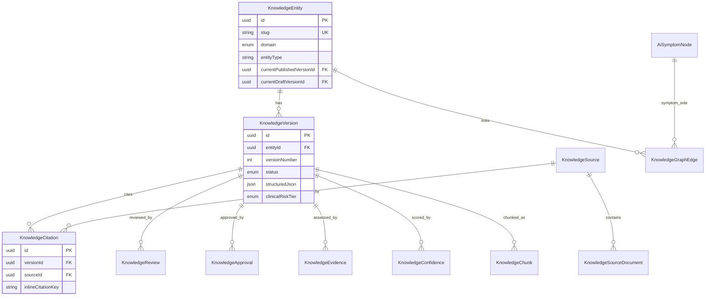

# Phase 6B.1 — Veterinary Knowledge Foundation Architecture

**Project:** Prani Doctor  
**Role:** Principal Veterinary Knowledge Platform Architect  
**Date:** 2026-05-31  
**Status:** Phase 6B.1.0–6B.1.3 implemented (backend) — 2026-05-31  
**Version:** 1.0.0  
**Depends on:**

- `docs/plans/phase-6a-veterinary-knowledge-architecture.md` (VKL domain model, retrieval contract, evidence framework)
- `docs/plans/phase-6b-knowledge-ingestion-architecture.md` (KIS pipeline — partial implementation on legacy entry model)
- `docs/plans/phase-6c-rag-architecture.md` (RAG engine — implemented; consumes `knowledgeEntryId` + `entryVersion`)
- `docs/plans/phase-6d-veterinary-ai-assistant.md` (AI Doctor and assistants — RAG-gated)
- `docs/plans/ai-phase-4-router-engine.md` (AiRouterEngine)
- `docs/plans/ai-phase-5-hardening.md` (governance, audit, analytics)

---

## Phase numbering disambiguation

| Document | Meaning |
|----------|---------|
| **Phase 6B** (`phase-6b-knowledge-ingestion-architecture.md`) | Knowledge **Ingestion System (KIS)** — import adapters, normalization, chunk staging |
| **Phase 6B.1** (this document) | Veterinary Knowledge **Foundation (VKF)** — canonical persistence model for sources, versions, citations, evidence, confidence, review, and approval |
| **Phase 6C** | RAG Engine — hybrid retrieval over published chunks |
| **Phase 6D** | Product assistants — consume `KnowledgeContextPack` |

Phase 6B.1 does **not** replace KIS. It defines the **structural substrate** KIS, RAG, and AI Doctor must converge on. Today’s KIS writes to `AiKnowledgeEntry` (monolithic row + integer `version`). Phase 6B.1 specifies the **target foundation** that eliminates that coupling.

---

## Repositories in scope

| Repo | Role |
|------|------|
| `pranidoctor-backend` | Prisma schema, foundation services, repositories, audit, workflow state machines |
| `pranidoctor-web` | Knowledge Control Center — version history, citation editor, review/approval queues, evidence dashboards |
| `pranidoctor_user` | Read-only published knowledge via mobile APIs (no foundation exposure) |

---

## Executive summary

Prani Doctor has a **working but transitional** knowledge stack: `AiKnowledgeEntry` holds content, workflow status, provisional/final evidence, confidence, and an integer `version` on a **single mutable row**. Ingestion (Phase 6B), RAG (Phase 6C), and veterinary assistants (Phase 6D) all depend on this row model. Symptom checking uses a **parallel graph** (`AiSymptomNode` → `AiSymptomDiseaseLink` → `knowledgeEntryId`) without version awareness. Editorial and vet workflows exist (`AiKnowledgeReview`, `AiKnowledgeApproval`) but are **entry-scoped**, not **version-scoped**, breaking immutability guarantees from Phase 6A.

**Phase 6B.1 — Veterinary Knowledge Foundation (VKF)** defines seven first-class platform concepts:

| Concept | Purpose |
|---------|---------|
| **KnowledgeSource** | Canonical catalog of upstream authority (textbook, bulletin, label, SOP) with license, trust tier, and document lineage |
| **KnowledgeVersion** | Immutable content snapshot bound to stable entity identity — sole unit of publish, deprecate, embed, and retrieve |
| **KnowledgeCitation** | Locator-preserving link from version (or chunk) to source span — auditable provenance |
| **KnowledgeReview** | Editorial peer-review artifact tied to a **specific version** |
| **KnowledgeApproval** | Licensed veterinary sign-off tied to a **specific version** |
| **KnowledgeEvidence** | Formal evidence assessment (GRADE-inspired level + rationale) per version |
| **KnowledgeConfidence** | Computed composite score with component breakdown and publish-time snapshot |

Together with a root **KnowledgeEntity** aggregate (stable `entityId`, slug, domain, published/draft pointers), VKF becomes the **single source of truth** for:

- Human editorial and vet lifecycles  
- RAG chunk identity `{versionId}:{chunkIndex}`  
- AI Doctor / Prescription / Emergency retrieval gates  
- Analytics on coverage, staleness, and clinical risk  
- Governance kill switches per knowledge domain  

This document specifies **Prisma schema changes (conceptual)**, **service and repository architecture**, **permissions**, **audit events**, and **three lifecycles** (editorial, vet approval, publish). **Backend implementation for 6B.1.0–6B.1.3 is complete** in `src/modules/ai/knowledge-foundation/`; evidence/confidence models and KIS dual-write remain future work (6B.1.4+).

---

## Strategic intent

| Today (as-built on `AiKnowledgeEntry`) | After VKF (target) |
|----------------------------------------|-------------------|
| One row mutated through workflow states | **Entity + immutable versions**; status lives on version |
| `version` integer incremented in place | **Version chain** with `supersedesVersionId` |
| Single `sourceId` on entry | **Many citations** per version with locators |
| Evidence/confidence as nullable columns | **KnowledgeEvidence** + **KnowledgeConfidence** records with audit history |
| Reviews/approvals reference entry id | Reviews/approvals reference **version id** |
| Symptom links point at entry, ignore version | Links target **entity id**; retrieval resolves **current published version** |
| RAG embeds on `knowledgeEntryId` + `entryVersion` int | RAG embeds on **`versionId` + chunkIndex** (stable UUID) |
| No foundation-level analytics | Domain coverage, stale approval, citation completeness dashboards |

---

## Design principles

| Principle | VKF interpretation |
|-----------|-------------------|
| **Version is the unit of truth** | Publish, deprecate, embed, cite, and approve **versions** — never mutate published content |
| **Source before fact** | No citation without registered `KnowledgeSource`; no publish without ≥1 citation meeting trust rules |
| **Evidence is explicit** | Evidence level is an assessed artifact, not an inferred column |
| **Confidence is reproducible** | Store inputs + formula version + component scores; recompute only on defined triggers |
| **Clinical immutability** | HIGH/CRITICAL published versions cannot be edited — only superseded |
| **Graph stability** | Symptom and domain graph edges bind to **entityId**; version resolution at read time |
| **RAG-ready identity** | Chunk primary key includes `versionId`; embedding tombstone on deprecate |
| **AI Doctor alignment** | Structured facts extracted from version `structuredJson` feed `KnowledgeContextPack.structuredFacts[]` |
| **Fail-closed by profile** | Foundation exposes `meetsRetrievalGate()` used by RAG confidence router — no LLM-only clinical path |
| **Bangladesh overlay** | Regulatory sources carry `jurisdiction=BD` and temporal validity independent of global sources |
| **Separation of concerns** | KIS **writes drafts**; VKF **owns lifecycle**; RAG **reads published versions only** |

---

## As-built analysis

### 1. `AiKnowledgeEntry` (current knowledge row)

**Location:** `prisma/schema.prisma` — `AiKnowledgeEntry`

| Strength | Limitation |
|----------|------------|
| Six content types, BN/EN bodies, species, audience | No separate entity vs version; edits conflate identity |
| Status enum matches Phase 6A workflow states | Status on row — published content can be structurally overwritten |
| `evidenceLevel`, `confidenceScore`, provisional variants | Single current values; no history of assessment |
| `sourceId` FK to `AiKnowledgeSource` | One source per entry; insufficient for multi-source clinical entities |
| `chunkPolicyId`, `embeddingStatus` | Chunks keyed by `knowledgeEntryId`; version drift risk |
| `metadataJson` | Unvalidated bag; not domain schema |

**Impact on RAG (Phase 6C):** `AiKnowledgeEmbeddingChunk` uses `(knowledgeEntryId, chunkIndex, entryVersion)` where `entryVersion` is copied from entry int at embed time. Semantic search **skips stale embeddings** when `entryVersion !== knowledgeEntry.version`, but there is no immutable version row to audit.

**Impact on AI Doctor (Phase 6D):** Assistants retrieve by published entry status and profile gates. Lack of version-scoped structured facts limits prescription fail-closed quality.

---

### 2. Symptom graph

**Location:** `AiSymptomNode`, `AiSymptomDiseaseLink`

| Strength | Limitation |
|----------|------------|
| Production triage rules with `redFlag`, species, body system | Links use `knowledgeEntryId` (row id), not entity/version |
| Used by `SymptomCheckerService` for differentials | Ignores version — assumes current published row |
| Weighted edges (`edgeWeight`) | No evidence or confidence on edges |

**VKF alignment:** Introduce `KnowledgeGraphEdge` (Phase 6A `VkKnowledgeLink` concept) with `fromEntityId`, `toEntityId`, `edgeType`, metadata. Migrate `AiSymptomDiseaseLink` to `HAS_SYMPTOM` edges from disease **entity** to symptom node. Symptom nodes remain taxonomy; disease side uses VKF entity id.

---

### 3. AI Router (`AiRouterEngine`)

**Location:** `src/modules/ai/router/`, orchestrator bridge

| Integration today | VKF requirement |
|-------------------|-----------------|
| Router selects model by `taskType`, route, failover | Unchanged — router does not select knowledge |
| `executeEmbedding()` for RAG vectors | Embed input text hash tied to **`versionId`** |
| Usage logged on `AiUsageLog` | Extend `retrievalMetadataJson` with `versionIds[]`, `packId`, `foundationSchemaVersion` |
| `DOCUMENT_ANALYSIS` for ingestion LLM | Ingestion extracts cite `KnowledgeCitation` drafts |

Router **must not** be invoked for clinical assistant responses until RAG pack built from **published versions** (Phase 6D pattern — preserve in foundation contract).

---

### 4. AI Analytics

**Location:** `src/modules/ai/analytics/`, usage services

| Today | VKF extension |
|-------|-------------|
| Token/cost/provider/feature dashboards | **Knowledge analytics** slice |
| Feature keys include assistant features | Track retrieval hit rate per domain, BLOCK rate vs version confidence |
| No knowledge coverage metrics | Published entity counts by domain, species, evidence level |
| No editorial SLA metrics | Review queue age by `clinicalRiskTier`, approval expiry backlog |

**Analytics events (conceptual):** `KNOWLEDGE_VERSION_PUBLISHED`, `KNOWLEDGE_RETRIEVAL_PACK`, `KNOWLEDGE_RETRIEVAL_BLOCKED`, `KNOWLEDGE_REVIEW_COMPLETED`, `KNOWLEDGE_APPROVAL_EXPIRED`.

---

### 5. AI Governance

**Location:** `src/modules/ai/governance/ai-governance.scopes.ts`

| Today | VKF extension |
|-------|-------------|
| Kill switch on features (`CHAT`, `FARM_BRIEFING`, …) and providers | Add **`knowledge.{domain}`** scopes (Phase 6A) |
| No domain-level knowledge embargo | Emergency unpublish / regulatory hold per domain |
| Admin capabilities via `ai-permissions.ts` | New capabilities under `ai.knowledge.*` (see Permissions) |

Governance check order for assistants: **domain kill switch** → **RAG retrieve** → **confidence router** → **router LLM**.

---

### 6. Editorial workflows (as-built)

**Location:** `src/modules/ai/knowledge-ingestion/workflow/`

| Service | Behavior | Gap |
|---------|----------|-----|
| `KnowledgeEditorialWorkflowService` | DRAFT → IN_REVIEW; editorial queue | Mutates entry row status |
| `KnowledgeVetApprovalWorkflowService` | IN_REVIEW → VET_APPROVAL → approved | Approval not bound to frozen snapshot |
| `KnowledgePublishWorkflowService` | Promotes STAGING → PUBLISHED chunks; schedules embed | Publish increments `version` on same row |

Workflows are **operationally correct** but **architecturally coupled** to mutable entries. VKF relocates state transitions to **version records** while keeping service names and queue UX stable.

---

## Target foundation overview

```
┌─────────────────────────────────────────────────────────────────────────────────────┐
│                 VETERINARY KNOWLEDGE FOUNDATION (VKF)                                │
├─────────────────────────────────────────────────────────────────────────────────────┤
│                                                                                      │
│  ┌─────────────────┐         ┌──────────────────────────────────────────────┐   │
│  │ KnowledgeSource │◄────────│ KnowledgeCitation (version/chunk → source span)│   │
│  │ + documents     │         └──────────────────────────────────────────────┘   │
│  │ + license       │                          ▲                                   │
│  └────────┬────────┘                          │                                   │
│           │                                   │                                   │
│           ▼                                   │                                   │
│  ┌─────────────────┐    1:N    ┌──────────────┴───────────┐                      │
│  │ KnowledgeEntity │──────────►│ KnowledgeVersion          │                      │
│  │ (stable identity)│           │ immutable snapshot        │                      │
│  └────────┬────────┘           │ BN/EN, structuredJson,    │                      │
│           │                    │ status, chunkPolicy       │                      │
│           │                    └───────┬───────────────────┘                      │
│           │            ┌───────────────┼───────────────┐                          │
│           │            ▼               ▼               ▼                          │
│           │   KnowledgeReview  KnowledgeApproval  KnowledgeEvidence               │
│           │            │               │               │                          │
│           │            └───────────────┴───────────────┘                          │
│           │                            │                                          │
│           │                            ▼                                          │
│           │                   KnowledgeConfidence                                 │
│           │                   (computed snapshot)                                 │
│           │                            │                                          │
│           ▼                            ▼                                          │
│  ┌─────────────────┐         ┌─────────────────┐    ┌─────────────────────┐     │
│  │ KnowledgeGraph  │         │ Published chunks │───►│ RAG Embedding Index │     │
│  │ Edge (entity)   │         │ (by versionId)   │    │ (Phase 6C)          │     │
│  └─────────────────┘         └─────────────────┘    └─────────────────────┘     │
│                                                                                      │
└─────────────────────────────────────────────────────────────────────────────────────┘
         ▲                              │
         │ KIS import                   │ read published
         │                              ▼
  knowledge-ingestion/          knowledge-retrieval/ → AiRouterEngine → AI Doctor
```

---

## Core concepts (detailed)

### KnowledgeEntity (root aggregate — supporting type)

Not one of the seven named concepts but **required** to anchor versions.

| Field | Type | Notes |
|-------|------|-------|
| `id` | UUID | Stable `entityId` — never changes |
| `domain` | enum | Maps Phase 6A domains; legacy `contentType` maps here |
| `entityType` | string | e.g. `Disease`, `Drug`, `VaccinationSchedule` |
| `slug` | string unique | URL-safe; stable |
| `currentPublishedVersionId` | UUID? | Fast retrieval pointer |
| `currentDraftVersionId` | UUID? | At most one active draft |
| `createdAt`, `createdById` | | Audit |

**Rule:** External APIs and graph edges reference **entity id**. Content always read through **published version id**.

---

### 1. KnowledgeSource

**Purpose:** Register every upstream authority before content or citations exist.

**Extends:** `AiKnowledgeSource`, `AiKnowledgeSourceDocument`, `AiKnowledgeSourceLicense` (already in schema).

| Field group | Fields |
|-------------|--------|
| Identity | `id`, `sourceKey` (unique), `sourceClass`, `sourceType` |
| Bibliographic | `titleBn`, `titleEn`, `publisher`, `publishYear`, `edition` |
| Trust | `trustTier` (1–4), `defaultEvidenceLevel`, `jurisdiction` |
| Scope | `allowedDomains[]`, `status` (ACTIVE/DEPRECATED/RETIRED) |
| License | `licenseId` → allows AI extraction, farmer distribution, verbatim quote |
| Operations | `refreshPolicyDays`, `metadataJson` |

**Documents (`KnowledgeSourceDocument`):** Immutable artifact rows — `storageUri`, `checksumSha256`, `documentVersion`, `mediaType`, `parseProfileId`.

**Rules:**

- Ingestion (KIS) **must not** create citations pointing to unregistered sources.
- `trustTier ≤ 2` required for at least one citation on HIGH/CRITICAL versions.
- Manufacturer label alone insufficient for off-label species without vet approval note on version.

---

### 2. KnowledgeVersion

**Purpose:** Immutable snapshot — the only publishable, embeddable, retrievable content unit.

| Field group | Fields |
|-------------|--------|
| Identity | `id` (versionId), `entityId`, `versionNumber` (monotonic per entity) |
| Chain | `supersedesVersionId`, `changeSummary`, `changedFields[]`, `diffJson` |
| Lifecycle | `status` (see lifecycle enums), `publishedAt`, `deprecatedAt`, `deprecationReason` |
| Locale content | `titleBn`, `titleEn`, `summaryBn`, `summaryEn`, `bodyBn`, `bodyEn` |
| Scope | `species[]`, `audience`, `regionScope` |
| Structure | `structuredJson` (domain-validated), `keywordsBn[]`, `keywordsEn[]`, `colloquialBn[]` |
| Search | `searchText` (generated) |
| Chunk/RAG | `chunkPolicyId`, `embeddingStatus` |
| Pointers | `importRunId`, `aiGeneratedDraft` (bool) |
| Audit | `createdById`, `submittedAt`, `publishedById` |

**Immutability rule:** Once `status = PUBLISHED`, row is **read-only**. New edits create `versionNumber + 1` in `DRAFT`.

**Legacy mapping:** `AiKnowledgeEntry.id` → `entityId`; first migration creates `versionId` v1 from current row snapshot.

---

### 3. KnowledgeCitation

**Purpose:** Locator-preserving provenance from version (or chunk) to source span.

| Field | Type | Notes |
|-------|------|-------|
| `id` | UUID | |
| `versionId` | UUID | Required |
| `chunkId` | UUID? | Optional — chunk-level citation |
| `sourceId` | UUID | → KnowledgeSource |
| `documentId` | UUID? | → KnowledgeSourceDocument |
| `pageRef`, `sectionRef`, `tableRef`, `rowRef` | string? | Locators |
| `spanRefsJson` | JSON | Character offsets / bounding boxes from extractors |
| `contributionWeight` | float 0–1 | Multi-source blending |
| `quotedFrom` | bool | Verbatim vs paraphrase |
| `inlineCitationKey` | string | e.g. `[dls-manual|p.42]` for RAG |
| `humanCitationBn`, `humanCitationEn` | text | Rendered for UI |
| `accessedAt` | datetime | |

**Rules:**

- Minimum **one** citation per version entering `IN_REVIEW`.
- Prescription-related versions require citation to `MEDICINE_REFERENCE` or `GOVT_LIVESTOCK` class with locator.
- `KnowledgeCitation` is the join table KIS populates during import; editorial UI may amend locators, not invent sources.

**Replaces:** Ad hoc `citationJson` on chunks as **authoritative** — chunk may cache denormalized copy for RAG speed.

---

### 4. KnowledgeReview

**Purpose:** Editorial peer-review record for a **specific version**.

| Field | Type | Notes |
|-------|------|-------|
| `id` | UUID | |
| `versionId` | UUID | **Not** entity id |
| `stage` | enum | `EDITORIAL`, `LANGUAGE_BN`, `LANGUAGE_EN`, `DOMAIN_LEAD` |
| `decision` | enum | `APPROVE`, `REQUEST_CHANGES`, `REJECT` |
| `reviewerId` | string | Staff user |
| `checklistJson` | JSON | Domain-specific completeness |
| `comments` | text | |
| `queueSource` | enum | `MANUAL`, `IMPORT`, `AI_DRAFT`, `SCHEDULED_REReview` |
| `importRunId` | UUID? | Lineage |
| `startedAt`, `completedAt` | datetime | SLA tracking |

**Rules:**

- Open review is unique per `(versionId, stage)` at a time.
- `REQUEST_CHANGES` → version stays linked to entity draft; entity `currentDraftVersionId` unchanged.
- `REJECT` → version terminal `REJECTED`; entity may fork new draft from last published.

**Extends:** `AiKnowledgeReview` — migrate FK from `knowledgeEntryId` to `versionId`.

---

### 5. KnowledgeApproval

**Purpose:** Licensed veterinary sign-off for clinical versions.

| Field | Type | Notes |
|-------|------|-------|
| `id` | UUID | |
| `versionId` | UUID | |
| `approverVetId` | string | Linked to vet credential profile |
| `vetLicenseNo` | string | Snapshot at approval time |
| `approvalScope` | string[] | Domains authorized |
| `signOffHash` | string | Tamper-evident digest of version content + evidence |
| `approvedAt` | datetime | |
| `validUntil` | datetime? | Triggers scheduled re-review |
| `dualApprovalRequired` | bool | Regulatory entities |
| `coApproverVetId` | string? | CVQ / regulatory editor path |
| `notes` | text | |

**Required when:**

- `clinicalRiskTier` ∈ {HIGH, CRITICAL}
- Entity types: Drug, Formulation, WithdrawalRule, TreatmentPathway, EmergencyCondition, TriageRule
- Regulatory domain entities (dual approval)

**Extends:** `AiKnowledgeApproval` — migrate to `versionId`.

---

### 6. KnowledgeEvidence

**Purpose:** Formal evidence assessment — not a inferred default.

| Field | Type | Notes |
|-------|------|-------|
| `id` | UUID | |
| `versionId` | UUID | |
| `evidenceLevel` | enum | L1–L5 (Phase 6A scale) |
| `assessmentMethod` | enum | `SOURCE_DEFAULT`, `EDITORIAL`, `VET_REVIEW`, `SYSTEM_PROVISIONAL` |
| `rationaleBn`, `rationaleEn` | text | Human-readable justification |
| `assessedById` | string? | Null for provisional ingest |
| `assessedAt` | datetime | |
| `supersedesEvidenceId` | UUID? | History chain |
| `gradeFactorsJson` | JSON | Optional GRADE-style factors |

**Lifecycle:**

| Stage | `assessmentMethod` | Level source |
|-------|-------------------|--------------|
| Ingest | `SYSTEM_PROVISIONAL` | Capped by source default + extract quality |
| Editorial approve | `EDITORIAL` | Domain lead may upgrade/downgrade with rationale |
| Vet approve | `VET_REVIEW` | Final clinical evidence level |
| Publish | Latest non-provisional record is **authoritative** |

**Replaces:** Direct use of `AiKnowledgeEntry.evidenceLevel` / `provisionalEvidenceLevel` columns — those become denormalized caches of latest assessment.

---

### 7. KnowledgeConfidence

**Purpose:** Reproducible composite score for retrieval gating and ranking.

| Field | Type | Notes |
|-------|------|-------|
| `id` | UUID | |
| `versionId` | UUID | |
| `score` | float 0–1 | Final composite |
| `formulaVersion` | string | e.g. `confidence-v2` |
| `componentsJson` | JSON | `{ evidence, trust, recency, review, graph }` |
| `provisional` | bool | True until publish |
| `computedAt` | datetime | |
| `computedBy` | enum | `SYSTEM`, `PUBLISH_JOB`, `MANUAL_RECOMPUTE` |
| `meetsProfileGatesJson` | JSON | Cached results per retrieval profile |

**Formula (aligned with as-built `confidence.engine.ts` and Phase 6A):**

```
score = clamp(
  0.35 * evidenceLevelScore
+ 0.25 * sourceTrustScore      // from citations
+ 0.20 * recencyScore
+ 0.10 * reviewCompletenessScore
+ 0.10 * graphConnectivityScore,
  0, 1)

provisional cap = 0.65 during ingest / pre-vet
```

**Rules:**

- New `KnowledgeConfidence` row on every recomputation — **append-only history**.
- Publish writes final non-provisional snapshot; RAG gates read this row.
- `meetsRetrievalGate()` in retrieval layer consumes published confidence + evidence.

---

## Conceptual ER diagram



---

## Prisma schema changes (conceptual)

**No migration in this phase.** Below is the target model set. Prefix **`Vk`** (Veterinary Knowledge) distinguishes foundation tables from legacy during dual-write period.

### New enums

```prisma
enum VkKnowledgeDomain {
  DISEASE
  MEDICINE
  VACCINE
  FEED
  BREED
  REPRODUCTION
  EMERGENCY
  CLINICAL_PROTOCOL
  REGULATORY_BD
  FARM_MGMT
}

enum VkVersionStatus {
  DRAFT
  IN_REVIEW
  VET_APPROVAL
  CHANGES_REQUESTED
  PUBLISHED
  DEPRECATED
  REJECTED
}

enum VkReviewStage {
  EDITORIAL
  LANGUAGE_BN
  LANGUAGE_EN
  DOMAIN_LEAD
}

enum VkEvidenceAssessmentMethod {
  SOURCE_DEFAULT
  SYSTEM_PROVISIONAL
  EDITORIAL
  VET_REVIEW
}

enum VkConfidenceComputedBy {
  SYSTEM
  PUBLISH_JOB
  MANUAL_RECOMPUTE
}
```

Reuse existing where identical: `AiKnowledgeEvidenceLevel`, `AiKnowledgeClinicalRiskTier`, `AiKnowledgeReviewDecision`, `AiKnowledgeAudience`, `LivestockSpecies`, `AiKnowledgeCatalogSourceType`, `AiKnowledgeSourceStatus`, `AiKnowledgeEmbeddingStatus`, `AiKnowledgeChunkStage`.

### New models (foundation)

```prisma
model VkKnowledgeEntity {
  id                         String   @id @default(cuid())
  domain                     VkKnowledgeDomain
  entityType                 String   @db.VarChar(64)
  slug                       String   @unique @db.VarChar(128)
  currentPublishedVersionId  String?  @unique
  currentDraftVersionId      String?  @unique
  legacyEntryId              String?  @unique  // maps AiKnowledgeEntry.id during migration
  createdById                String?
  createdAt                  DateTime @default(now())
  updatedAt                  DateTime @updatedAt

  versions                   VkKnowledgeVersion[] @relation("EntityVersions")
  publishedVersion           VkKnowledgeVersion?  @relation("PublishedPointer", fields: [currentPublishedVersionId], references: [id])
  draftVersion               VkKnowledgeVersion?  @relation("DraftPointer", fields: [currentDraftVersionId], references: [id])
  outboundEdges              VkKnowledgeGraphEdge[] @relation("EdgeFrom")
  inboundEdges               VkKnowledgeGraphEdge[] @relation("EdgeTo")

  @@index([domain, entityType])
}

model VkKnowledgeVersion {
  id                   String   @id @default(cuid())
  entityId             String
  versionNumber        Int
  supersedesVersionId  String?
  status               VkVersionStatus @default(DRAFT)
  titleBn              String
  titleEn              String
  summaryBn            String?  @db.Text
  summaryEn            String?  @db.Text
  bodyBn               String   @db.Text
  bodyEn               String   @db.Text
  species              LivestockSpecies[]
  audience             AiKnowledgeAudience @default(FARMER)
  regionScope          String   @default("BD") @db.VarChar(16)
  structuredJson       Json?
  keywordsBn           String[]
  keywordsEn           String[]
  colloquialBn         String[]
  searchText           String?  @db.Text
  chunkPolicyId        String?  @db.VarChar(64)
  clinicalRiskTier     AiKnowledgeClinicalRiskTier @default(LOW)
  embeddingStatus      AiKnowledgeEmbeddingStatus @default(NOT_APPLICABLE)
  changeSummary        String?  @db.Text
  changedFields        String[]
  diffJson             Json?
  aiGeneratedDraft     Boolean  @default(false)
  importRunId          String?
  publishedAt          DateTime?
  deprecatedAt         DateTime?
  deprecationReason    String?  @db.Text
  createdById          String?
  publishedById        String?
  submittedAt          DateTime?
  createdAt            DateTime @default(now())
  updatedAt            DateTime @updatedAt

  entity               VkKnowledgeEntity @relation("EntityVersions", fields: [entityId], references: [id], onDelete: Cascade)
  supersedes           VkKnowledgeVersion? @relation("VersionChain", fields: [supersedesVersionId], references: [id])
  supersededBy         VkKnowledgeVersion[] @relation("VersionChain")
  citations            VkKnowledgeCitation[]
  reviews              VkKnowledgeReview[]
  approvals            VkKnowledgeApproval[]
  evidenceRecords      VkKnowledgeEvidence[]
  confidenceRecords    VkKnowledgeConfidence[]
  chunks               VkKnowledgeChunk[]

  @@unique([entityId, versionNumber])
  @@index([entityId, status])
  @@index([status, clinicalRiskTier])
  @@index([publishedAt])
}

model VkKnowledgeCitation {
  id                 String   @id @default(cuid())
  versionId          String
  chunkId            String?
  sourceId           String
  documentId         String?
  pageRef            String?  @db.VarChar(64)
  sectionRef         String?  @db.VarChar(128)
  tableRef           String?  @db.VarChar(64)
  rowRef             String?  @db.VarChar(64)
  spanRefsJson       Json?
  contributionWeight Float    @default(1)
  quotedFrom         Boolean  @default(false)
  inlineCitationKey  String   @db.VarChar(128)
  humanCitationBn    String?  @db.Text
  humanCitationEn    String?  @db.Text
  accessedAt         DateTime @default(now())
  createdAt          DateTime @default(now())

  version            VkKnowledgeVersion @relation(fields: [versionId], references: [id], onDelete: Cascade)
  source             AiKnowledgeSource  @relation(fields: [sourceId], references: [id])
  document           AiKnowledgeSourceDocument? @relation(fields: [documentId], references: [id])
  chunk              VkKnowledgeChunk?  @relation(fields: [chunkId], references: [id])

  @@index([versionId])
  @@index([sourceId])
}

model VkKnowledgeReview {
  id           String   @id @default(cuid())
  versionId    String
  stage        VkReviewStage
  decision     AiKnowledgeReviewDecision?
  reviewerId   String?
  checklistJson Json?
  comments     String?  @db.Text
  queueSource  String   @default("MANUAL") @db.VarChar(32)
  importRunId  String?
  startedAt    DateTime @default(now())
  completedAt  DateTime?

  version      VkKnowledgeVersion @relation(fields: [versionId], references: [id], onDelete: Cascade)

  @@index([versionId, stage])
  @@index([stage, completedAt])
}

model VkKnowledgeApproval {
  id                  String   @id @default(cuid())
  versionId           String
  approverVetId       String
  vetLicenseNo        String?  @db.VarChar(64)
  approvalScope       String[]
  signOffHash         String?  @db.VarChar(128)
  approvedAt          DateTime @default(now())
  validUntil          DateTime?
  dualApprovalRequired Boolean @default(false)
  coApproverVetId     String?
  notes               String?  @db.Text

  version             VkKnowledgeVersion @relation(fields: [versionId], references: [id], onDelete: Cascade)

  @@index([versionId, approvedAt])
  @@index([approverVetId])
}

model VkKnowledgeEvidence {
  id                  String   @id @default(cuid())
  versionId           String
  evidenceLevel       AiKnowledgeEvidenceLevel
  assessmentMethod    VkEvidenceAssessmentMethod
  rationaleBn         String?  @db.Text
  rationaleEn         String?  @db.Text
  assessedById        String?
  assessedAt          DateTime @default(now())
  supersedesEvidenceId String?
  gradeFactorsJson    Json?

  version             VkKnowledgeVersion @relation(fields: [versionId], references: [id], onDelete: Cascade)

  @@index([versionId, assessedAt])
}

model VkKnowledgeConfidence {
  id                   String   @id @default(cuid())
  versionId            String
  score                Float
  formulaVersion       String   @db.VarChar(16)
  componentsJson       Json
  provisional          Boolean  @default(true)
  computedAt           DateTime @default(now())
  computedBy           VkConfidenceComputedBy
  meetsProfileGatesJson Json?

  version              VkKnowledgeVersion @relation(fields: [versionId], references: [id], onDelete: Cascade)

  @@index([versionId, computedAt])
}

model VkKnowledgeChunk {
  id            String   @id @default(cuid())
  versionId     String
  chunkIndex    Int
  chunkPolicyId String   @db.VarChar(64)
  stage         AiKnowledgeChunkStage @default(STAGING)
  contentBn     String   @db.Text
  contentEn     String   @db.Text
  tokenEstimate Int      @default(0)
  headingPath   String?  @db.VarChar(256)
  metadataJson  Json?
  createdAt     DateTime @default(now())
  updatedAt     DateTime @updatedAt

  version       VkKnowledgeVersion @relation(fields: [versionId], references: [id], onDelete: Cascade)
  citations     VkKnowledgeCitation[]

  @@unique([versionId, chunkIndex, stage])
}

model VkKnowledgeGraphEdge {
  id              String   @id @default(cuid())
  fromEntityId    String
  toEntityId      String
  edgeType        String   @db.VarChar(64)
  weight          Float    @default(0.5)
  evidenceLevel   AiKnowledgeEvidenceLevel?
  confidenceScore Float?
  sourceCitationId String?
  effectiveFrom   DateTime?
  effectiveTo     DateTime?
  metadataJson    Json?
  createdAt       DateTime @default(now())

  fromEntity      VkKnowledgeEntity @relation("EdgeFrom", fields: [fromEntityId], references: [id])
  toEntity        VkKnowledgeEntity @relation("EdgeTo", fields: [toEntityId], references: [id])

  @@index([fromEntityId, edgeType])
  @@index([toEntityId, edgeType])
}

model VkKnowledgeAuditEvent {
  id          String   @id @default(cuid())
  entityId    String?
  versionId   String?
  eventType   String   @db.VarChar(64)
  actorId     String?
  actorRole   String?  @db.VarChar(32)
  detailJson  Json?
  createdAt   DateTime @default(now())

  @@index([entityId, createdAt])
  @@index([versionId, createdAt])
  @@index([eventType, createdAt])
}
```

### Legacy compatibility strategy

| Legacy | VKF | Transition |
|--------|-----|------------|
| `AiKnowledgeEntry` | `VkKnowledgeEntity` + latest `VkKnowledgeVersion` | Dual-write adapter in `knowledge-foundation/` facade |
| `AiKnowledgeChunk.knowledgeEntryId` | `VkKnowledgeChunk.versionId` | Publish promotes staging chunks on version |
| `AiKnowledgeEmbeddingChunk` | Add `versionId` FK; deprecate entry+copy int | Re-embed on version publish |
| `AiSymptomDiseaseLink.knowledgeEntryId` | `VkKnowledgeGraphEdge` (`HAS_SYMPTOM`) | Migration script maps entry → entity |
| `AiKnowledgeReview.knowledgeEntryId` | `VkKnowledgeReview.versionId` | Point at draft version |
| `AiKnowledgeApproval.knowledgeEntryId` | `VkKnowledgeApproval.versionId` | Point at approved version |

**Read path during transition:** `AiKnowledgeService` resolves published content via foundation facade — prefer VKF if `legacyEntryId` mapped, else legacy row.

---

## Service architecture

### Module placement

```
src/modules/ai/knowledge-foundation/
├── index.ts
├── knowledge-foundation.types.ts
├── entity/
│   ├── knowledge-entity.service.ts       # CRUD identity, slug, pointers
│   └── knowledge-entity.repository.ts
├── version/
│   ├── knowledge-version.service.ts      # fork, diff, immutability guards
│   └── knowledge-version.repository.ts
├── source/
│   ├── knowledge-source.service.ts       # wraps + extends source registry
│   └── knowledge-source.repository.ts
├── citation/
│   ├── knowledge-citation.service.ts     # render inline + human citations
│   └── knowledge-citation.repository.ts
├── evidence/
│   ├── knowledge-evidence.service.ts     # assess, supersede chain
│   └── knowledge-evidence.repository.ts
├── confidence/
│   ├── knowledge-confidence.service.ts   # compute, history, gate cache
│   └── knowledge-confidence.repository.ts
├── workflow/
│   ├── editorial-lifecycle.service.ts    # state machine
│   ├── vet-approval-lifecycle.service.ts
│   └── publish-lifecycle.service.ts
├── review/
│   ├── knowledge-review.service.ts
│   └── knowledge-review.repository.ts
├── approval/
│   ├── knowledge-approval.service.ts
│   └── knowledge-approval.repository.ts
├── graph/
│   ├── knowledge-graph.service.ts        # edges, symptom integration
│   └── knowledge-graph.repository.ts
├── audit/
│   └── knowledge-audit.service.ts
├── facade/
│   └── knowledge-foundation.facade.ts      # legacy AiKnowledgeEntry compat
└── permissions/
    └── knowledge-foundation.permissions.ts
```

### Service responsibilities

| Service | Responsibility | Upstream callers | Downstream deps |
|---------|----------------|------------------|-----------------|
| `KnowledgeEntityService` | Create entity, assign slug, manage draft/published pointers | Admin API, KIS | Entity repository |
| `KnowledgeVersionService` | Fork draft from published, validate immutability, build diff | Editorial UI, KIS | Version, citation repos |
| `KnowledgeSourceService` | Source CRUD, document registration, license check | KIS registry, Admin | Prisma source tables |
| `KnowledgeCitationService` | Attach/update citations, render citation blocks | KIS, chunk pipeline, RAG pack builder | Citation repo |
| `KnowledgeEvidenceService` | Record assessments, finalize at vet approval | Editorial, vet workflows | Evidence repo |
| `KnowledgeConfidenceService` | Compute score, append history, cache profile gates | Publish job, ingest scoring | Confidence repo, evidence |
| `KnowledgeReviewService` | Queue, complete reviews | Editorial workflow | Review repo, audit |
| `KnowledgeApprovalService` | Vet queue, sign-off hash, validity | Vet workflow | Approval repo, audit |
| `EditorialLifecycleService` | DRAFT→IN_REVIEW→CHANGES_REQUESTED transitions | Admin API | Review, version services |
| `VetApprovalLifecycleService` | IN_REVIEW→VET_APPROVAL→ready-to-publish | Admin API | Approval, evidence services |
| `PublishLifecycleService` | Publish version, repoint entity, promote chunks, emit embed event | Admin API | Version, confidence, chunk, audit |
| `KnowledgeGraphService` | Graph edges, symptom link resolution | Symptom checker, RAG expander | Graph repo |
| `KnowledgeAuditService` | Append-only audit events | All workflow services | Audit repo |
| `KnowledgeFoundationFacade` | Unified read API for `AiKnowledgeService`, retrieval | knowledge/, retrieval/ | All read services |

### Interaction with existing modules

```
KIS (knowledge-ingestion/)
  └── creates/updates VkKnowledgeVersion (DRAFT) + citations + provisional evidence/confidence

VKF (knowledge-foundation/)
  └── owns lifecycles through PUBLISHED

knowledge-retrieval/
  └── reads published versions + chunks + confidence gates only

knowledge/ (legacy facade)
  └── delegates to KnowledgeFoundationFacade

veterinary-assistants/
  └── unchanged — consumes KnowledgeContextPack from retrieval
```

---

## Repository architecture

Repositories are **thin Prisma adapters** — no business rules. Services enforce invariants.

| Repository | Primary operations |
|------------|-------------------|
| `KnowledgeEntityRepository` | `findBySlug`, `findByLegacyEntryId`, `updatePointers`, `create` |
| `KnowledgeVersionRepository` | `findPublishedForEntity`, `findDraftForEntity`, `createVersion`, `lockPublished` |
| `KnowledgeCitationRepository` | `listByVersion`, `replaceForVersion` (draft only), `findByChunk` |
| `KnowledgeReviewRepository` | `openReview`, `completeReview`, `listQueue` |
| `KnowledgeApprovalRepository` | `recordApproval`, `findValidForVersion`, `listExpiring` |
| `KnowledgeEvidenceRepository` | `appendAssessment`, `findLatest` |
| `KnowledgeConfidenceRepository` | `appendSnapshot`, `findLatestPublished` |
| `KnowledgeGraphRepository` | `edgesFrom`, `edgesTo`, `upsertEdge` |
| `KnowledgeAuditRepository` | `append`, `listForEntity`, `listForVersion` |

**Transaction boundaries:**

| Operation | Transaction scope |
|-----------|-------------------|
| Fork new draft | Entity pointer + new version row + copy citations |
| Complete vet approval | Approval row + evidence finalize + version status |
| Publish | Version status + entity pointer + chunk promote + confidence finalize + audit + outbox embed event |
| Deprecate | Version status + embedding tombstone + audit |

**Outbox event (conceptual):** `VkKnowledgeOutbox` or reuse BullMQ job enqueue in same transaction as publish — `ai:knowledge:embed`, `ai:knowledge:reindex`.

---

## Permissions

Extend `AiAdminCapability` and web `permissions-core` with knowledge foundation capabilities.

### Capability keys

| Capability | Description |
|------------|-------------|
| `ai.knowledge.view` | Read entities, versions, queues |
| `ai.knowledge.edit` | Create/edit drafts, citations (non-clinical) |
| `ai.knowledge.review` | Complete editorial reviews |
| `ai.knowledge.approve` | Veterinary approval sign-off |
| `ai.knowledge.publish` | Publish approved versions |
| `ai.knowledge.deprecate` | Deprecate / emergency unpublish |
| `ai.knowledge.sources.manage` | Source registry + documents |
| `ai.knowledge.graph.manage` | Graph edges, symptom linking |
| `ai.knowledge.audit.export` | Export audit trail |

### Role matrix

| Role | Capabilities |
|------|--------------|
| **Content Editor** | `view`, `edit` |
| **Domain Lead** | `view`, `edit`, `review` |
| **Veterinarian Reviewer** | `view`, `review`, `approve` (scoped by `approvalScope`) |
| **Regulatory Editor** | `view`, `edit`, `review`, `publish` (REGULATORY_BD domain only) |
| **Chief Veterinary Officer** | All except `sources.manage` unless also admin |
| **SUPER_ADMIN** | All + `deprecate`, `audit.export` |
| **Mobile customer** | None — published read APIs only |
| **Internal AI ops** | `view`, `audit.export` — no edit |

### Vet credential gate

| Check | Enforcement point |
|-------|-------------------|
| `vetLicenseNo` present and verified | `KnowledgeApprovalService.recordApproval` |
| `approvalScope` contains version domain | Before approval |
| Dual approval for regulatory | `PublishLifecycleService` when `dualApprovalRequired` |

### Object-level rules

| Rule | Enforcement |
|------|-------------|
| Cannot edit published version content | `KnowledgeVersionService` |
| Cannot publish without required approvals | `PublishLifecycleService` |
| Cannot approve own editorial submission | Review/approval separation |
| AI-generated draft requires human editor before vet queue | `EditorialLifecycleService` |

---

## Audit events

All events append to `VkKnowledgeAuditEvent` **and** mirror summary to `AiPlatformAuditService` / `AuditService` for platform-wide search.

### Event catalog

| Event type | Trigger | `detailJson` (minimum) |
|------------|---------|-------------------------|
| `ENTITY_CREATED` | New entity | `domain`, `entityType`, `slug` |
| `VERSION_FORKED` | Draft from published | `fromVersionId`, `toVersionId`, `versionNumber` |
| `VERSION_SUBMITTED` | DRAFT → IN_REVIEW | `submittedById` |
| `REVIEW_OPENED` | Review queue entry | `stage`, `queueSource` |
| `REVIEW_COMPLETED` | Editorial decision | `decision`, `reviewerId`, `stage` |
| `EVIDENCE_ASSESSED` | New evidence record | `evidenceLevel`, `method` |
| `CONFIDENCE_COMPUTED` | Score snapshot | `score`, `provisional`, `formulaVersion` |
| `APPROVAL_RECORDED` | Vet sign-off | `approverVetId`, `validUntil` |
| `VERSION_PUBLISHED` | Publish | `publishedById`, `chunkCount`, `confidenceScore` |
| `VERSION_DEPRECATED` | Supersede or regulatory expiry | `reason`, `supersededByVersionId` |
| `CITATION_ADDED` / `CITATION_REMOVED` | Citation edits | `citationId`, `sourceId` |
| `GRAPH_EDGE_UPSERTED` | Link change | `edgeType`, `fromEntityId`, `toEntityId` |
| `EMERGENCY_UNPUBLISH` | Super admin hold | `reason`, `actorId` |
| `RETRIEVAL_GATE_FAILED` | Analytics hook | `versionId`, `profileId`, `reason` |

**Correlation:** Include `importRunId`, `requestId`, `traceId` when invoked from API/worker context.

---

## Editorial lifecycle

### States (on `VkKnowledgeVersion.status`)

```
DRAFT ──submit──► IN_REVIEW ──approve──► VET_APPROVAL (if required)
  ▲                    │                        │
  │                    │ request changes        │ vet approve
  │                    ▼                        ▼
  └── CHANGES_REQUESTED              ready for publish (still VET_APPROVAL or IN_REVIEW cleared)
                                              │
                                              ▼ publish
                                         PUBLISHED ──supersede──► DEPRECATED
                                              │
                                         reject path
                                              ▼
                                          REJECTED (terminal)
```

### Transition table

| From | To | Actor | Guards |
|------|-----|-------|--------|
| `DRAFT` | `IN_REVIEW` | Editor | Required fields complete; domain JSON Schema valid; ≥1 citation; BN+EN for farmer audience |
| `IN_REVIEW` | `CHANGES_REQUESTED` | Reviewer | `KnowledgeReview.decision = REQUEST_CHANGES` |
| `CHANGES_REQUESTED` | `IN_REVIEW` | Editor | Resubmit after edits (same version id if draft-only edits allowed, else fork policy) |
| `IN_REVIEW` | `VET_APPROVAL` | Domain Lead | Editorial `APPROVE`; clinical risk requires vet path |
| `IN_REVIEW` | `PUBLISHED` | Publisher | **Only** if `clinicalRiskTier = LOW` and domain = FARM_MGMT expedited path |
| `VET_APPROVAL` | `PUBLISHED` | Publisher | Valid `KnowledgeApproval`; final evidence; non-provisional confidence |
| `VET_APPROVAL` | `REJECTED` | Vet | `REJECT` decision |
| `PUBLISHED` | `DEPRECATED` | Admin | Superseding version published OR regulatory expiry OR emergency unpublish |
| `PUBLISHED` | new `DRAFT` | Editor | Fork only — creates new version row |

### Automated gates (pre-submit)

| Gate | Engine |
|------|--------|
| Domain JSON Schema | Per-domain validator registry (Phase 6A) |
| Citation completeness | `KnowledgeCitationService` |
| Duplicate slug/entity | Entity repository |
| Orphan link detection | `KnowledgeGraphService` |
| Duplicate corpus fuzzy match | KIS dedup keys + foundation lookup |

### SLA (operational targets)

| `clinicalRiskTier` | Max queue time (IN_REVIEW + VET_APPROVAL) |
|--------------------|---------------------------------------------|
| CRITICAL | 24 h |
| HIGH | 72 h |
| MEDIUM | 7 d |
| LOW | 14 d |

---

## Vet approval lifecycle

### When vet approval is mandatory

| Condition | |
|-----------|--|
| `clinicalRiskTier` ∈ {HIGH, CRITICAL} | Always |
| Entity type ∈ medicine/emergency/protocol critical set | Always |
| Regulatory domain (`REGULATORY_BD`) | Dual approval |
| Edge types with clinical action weight > 0.7 | Linked version review |

### Vet queue flow

```
1. Version enters VET_APPROVAL (editorial APPROVE recorded)
2. KnowledgeReviewService routes to vet queue filtered by:
   - approver.approvalScope ∩ version.domain
   - species specialization (future)
3. Vet reviewer opens side-by-side BN/EN + structuredJson + citations
4. Vet records:
   - KnowledgeReview (stage=VET) decision
   - KnowledgeEvidence (method=VET_REVIEW, level)
   - KnowledgeApproval (license snapshot, signOffHash, validUntil)
5. KnowledgeConfidenceService recomputes (non-provisional)
6. Version eligible for PublishLifecycleService
```

### Sign-off hash

```
signOffHash = SHA-256(
  versionId
  + bodyBn + bodyEn
  + structuredJson canonical
  + evidenceLevel
  + sorted citation ids + locators
)
```

Tamper detection: republish blocked if content changed after approval without re-approval.

### Re-review triggers

| Signal | Action |
|--------|--------|
| `validUntil` elapsed | Flag `REVIEW_DUE`; remain published with banner |
| Source document deprecated | Queue versions citing that source |
| High assistant BLOCK rate linked to entity | Priority vet review |
| Farmer feedback “incorrect” (future) | Triage queue |

---

## Publish lifecycle

### Publish prerequisites (checklist)

| # | Check |
|---|-------|
| 1 | Version status = `VET_APPROVAL` (or expedited LOW farm path from `IN_REVIEW`) |
| 2 | Latest `KnowledgeApproval` valid when required |
| 3 | Latest `KnowledgeEvidence` not provisional |
| 4 | Latest `KnowledgeConfidence` ≥ profile minimum for domain (optional warning) |
| 5 | STAGING chunks exist for version |
| 6 | All chunks have ≥1 citation or version-level citation covers chunk |
| 7 | Domain governance kill switch off |

### Publish steps (atomic transaction)

```
1. Lock version row (optimistic concurrency)
2. Set status = PUBLISHED, publishedAt, publishedById
3. Deprecate prior published version on same entity (if any)
4. Update entity.currentPublishedVersionId = this versionId
5. Clear entity.currentDraftVersionId if this was the draft
6. Promote VkKnowledgeChunk STAGING → PUBLISHED for versionId
7. Tombstone prior version embedding chunks (active = false)
8. Finalize KnowledgeConfidence (provisional = false)
9. Emit VkKnowledgeAuditEvent VERSION_PUBLISHED
10. Enqueue embed job: ai:knowledge:embed { versionId }
11. Emit outbox for analytics rollup
```

### Post-publish consumers

| Consumer | Behavior |
|----------|----------|
| **RAG embedding pipeline** | Embed all PUBLISHED chunks for `versionId` |
| **knowledge-retrieval** | Index lexical search on `searchText`; semantic on embeddings |
| **Symptom checker** | Resolve disease entity → current published version for titles |
| **AI Doctor / assistants** | Retrieval profiles filter `status=PUBLISHED` via entity pointer |
| **Mobile knowledge API** | Serve published version content + citation list |
| **Smart recommendations** | Reference stable `entityId` |

### Deprecation

| Trigger | Action |
|---------|--------|
| New version published | Old version → DEPRECATED, `supersededBy` link |
| Regulatory `effectiveTo` | Auto-deprecate on scheduled job |
| Emergency unpublish | DEPRECATED + governance flag; embeddings deactivated immediately |

---

## Integration contracts

### RAG Engine (Phase 6C)

| Contract element | VKF binding |
|------------------|-------------|
| Chunk identity | `{versionId}:{chunkIndex}` |
| Embedding row FK | `versionId` replaces `knowledgeEntryId` + int version |
| Retrieval filter | Join entity → published version only |
| `KnowledgeContextPack` | `RetrievedChunk.knowledgeEntryId` → deprecated; add `versionId`, keep `entityId` for compat |
| Structured facts | Parsed from `VkKnowledgeVersion.structuredJson` |
| Confidence router | Reads `KnowledgeConfidence` latest non-provisional |
| Citation block | Built from `KnowledgeCitation` + chunk cache |

### AI Doctor & assistants (Phase 6D)

| Requirement | VKF supply |
|-------------|------------|
| Disease differentials | Entity graph + symptom `HAS_SYMPTOM` edges |
| Grounded responses | Published version chunks + citations only |
| Prescription fail-closed | Structured facts + confidence ≥ 0.75 + evidence ≥ L2 |
| Emergency escalation | Emergency domain versions + zero-chunk block |
| Audit | `packId` logs include `versionIds[]` |

### AI Router

| Point | Behavior |
|-------|----------|
| Pre-router | Retrieval completes before `executePromptTask` |
| Embedding route | `executeEmbedding` hashes `versionId` chunk text |
| Usage log | `retrievalMetadataJson.foundationVersion`, `versionIds`, `confidenceSummary` |

### AI Analytics

| Metric | Source |
|--------|--------|
| Published corpus by domain | `VkKnowledgeEntity` + published version |
| Stale approvals | `KnowledgeApproval.validUntil` |
| Citation completeness | Versions missing citations / publish blocked count |
| Retrieval BLOCK rate by domain | Usage logs + analytics worker |
| Embed lag | `embeddingStatus` on version vs `publishedAt` |

### AI Governance

| Scope | Example |
|-------|---------|
| `knowledge.MEDICINE` | Kill switch stops prescription retrieval |
| `knowledge.EMERGENCY` | Force escalation templates only |
| Platform | Coexists with feature kill switches |

---

## Migration & phasing (implementation roadmap — conceptual)

| Sub-phase | Scope | Dependency | Status |
|-----------|-------|------------|--------|
| **6B.1.0** | Prisma models + repositories (read-only) | This document sign-off | **Done** — migration `20260613120000_ai_phase6b1_knowledge_foundation`; repos in `knowledge-foundation/repositories/` |
| **6B.1.1** | Entity + version fork/publish services | 6B.1.0 | **Done** — `KnowledgeFoundationService` create/fork/publish; BN-first + EN validation |
| **6B.1.2** | Citation + evidence + confidence services | 6B.1.1 | **Partial** — citations CRUD + publish gate; `VkKnowledgeEvidence` / `VkKnowledgeConfidence` deferred |
| **6B.1.3** | Workflow lifecycles + audit | 6B.1.2 | **Done** — editorial/vet queues, reviews, approvals, `VkKnowledgeAuditEvent`, admin routes under `/foundation/*` |
| **6B.1.4** | Foundation facade + dual-write from KIS | Phase 6B KIS | Pending |
| **6B.1.5** | Retrieval migration to `versionId` | Phase 6C | Pending |
| **6B.1.6** | Symptom graph edge migration | 6B.1.4 | Pending |
| **6B.1.7** | Legacy `AiKnowledgeEntry` read-only deprecation | 6B.1.5 | Pending |

### Implementation inventory (backend)

| Artifact | Location |
|----------|----------|
| Prisma models | `VkKnowledgeEntity`, `VkKnowledgeVersion`, `VkKnowledgeCitation`, `VkKnowledgeReview`, `VkKnowledgeApproval`, `VkKnowledgeAuditEvent` |
| KnowledgeSource | Wraps existing `AiKnowledgeSource` via `KnowledgeSourceRepository` |
| Service | `src/modules/ai/knowledge-foundation/knowledge-foundation.service.ts` |
| Controller + routes | `knowledge-foundation.controller.ts`, `knowledge-foundation.routes.ts` |
| RBAC | `permissions/knowledge-foundation.permissions.ts` — `ai.knowledge.*` |
| Tests | `knowledge-foundation.test.ts`, `knowledge-foundation.service.test.ts` |
| Verification | `npm run typecheck:ai` (0 errors); `npx vitest run src/modules/ai` |

---

## Success metrics

| Metric | Target |
|--------|--------|
| Published versions with ≥1 citation | 100% |
| HIGH/CRITICAL with vet approval | 100% |
| Immutable published version violations | 0 |
| RAG embed lag after publish (p95) | < 15 minutes |
| Retrieval gate accuracy (manual audit) | ≥ 95% |
| Dual-write consistency (migration period) | 99.9% |
| Audit event completeness for workflow transitions | 100% |

---

## Appendix A — Domain JSON Schema registry (reference)

Structured payloads validate against per-domain schemas before `IN_REVIEW`. Stored in `VkKnowledgeVersion.structuredJson`.

| Domain | Required structured keys (minimum) |
|--------|-----------------------------------|
| MEDICINE | `genericName`, `speciesDoseMatrix[]` OR `contraindications[]` |
| DISEASE | `signs[]`, `species[]` |
| VACCINE | `antigen`, `schedule[]` |
| FEED | `nutrients{}` OR `ingredients[]` |
| EMERGENCY | `redFlags[]`, `farmerActions[]` |
| REGULATORY_BD | `legalReference`, `effectiveFrom` |

Full schemas defined in Phase 6A domain specifications.

---

## Appendix B — Citation trust rules matrix

| Version risk | Min citations | Min trust tier | Locator required |
|--------------|---------------|----------------|------------------|
| LOW | 1 | 3 | No |
| MEDIUM | 1 | 2 | Section preferred |
| HIGH | 2 | 2 | Page/section |
| CRITICAL | 2 | 2 | Page/section + SOP step |

---

## Appendix C — Confidence component weights (formula v2)

| Component | Weight | Source |
|-----------|--------|--------|
| Evidence level | 0.35 | `KnowledgeEvidence` |
| Source trust | 0.25 | Citations → `KnowledgeSource.trustTier` |
| Recency | 0.20 | Approval / review dates |
| Review completeness | 0.10 | Review checklist |
| Graph connectivity | 0.10 | Valid edges for entity type |

Provisional ingest cap: **0.65** (matches as-built `PROVISIONAL_CONFIDENCE_CAP`).

---

## Appendix D — Glossary

| Term | Definition |
|------|------------|
| **VKF** | Veterinary Knowledge Foundation — persistence and lifecycle layer |
| **Version** | Immutable content snapshot; unit of publish and embed |
| **Entity** | Stable identity across versions |
| **Citation** | Provenance link with locators |
| **KnowledgeContextPack** | RAG output consumed by assistants |
| **Dual-write** | Migration period writing both legacy entry and VKF version |

---

**Document owner:** Principal Veterinary Knowledge Platform Architect  
**Next review:** Phase 6B.1.4 dual-write design (KIS → VKF) or web Knowledge Control Center UI
