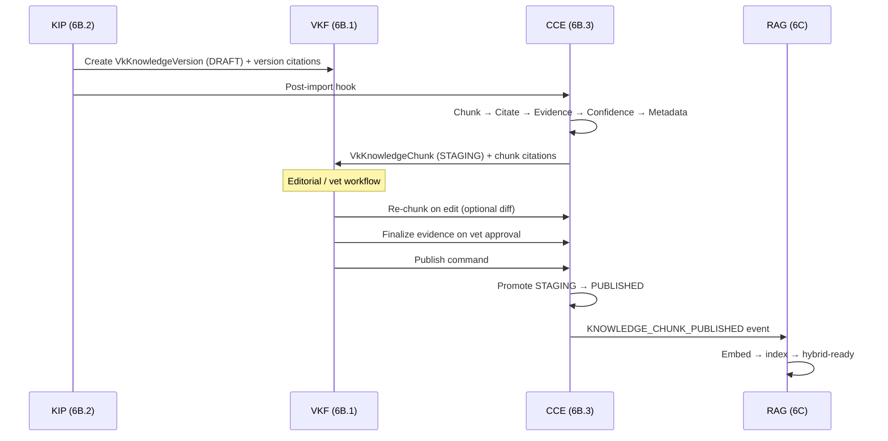

# Phase 6B.3 — Chunking & Citation Engine Architecture

**Project:** Prani Doctor  
**Role:** Principal RAG Data Architect  
**Date:** 2026-05-31  
**Status:** Phase 6B.3.0–6B.3.6 implemented (backend engines) — 2026-05-31  
**Version:** 1.0.0  
**Depends on:**

- `docs/plans/phase-6a-veterinary-knowledge-architecture.md` (VKL domain model, retrieval profiles, `KnowledgeContextPack`)
- `docs/plans/phase-6b1-knowledge-foundation.md` (VKF — `VkKnowledgeVersion`, `VkKnowledgeCitation`, deferred evidence/confidence/chunk models)
- `docs/plans/phase-6b2-knowledge-import-pipeline.md` (KIP — normalized drafts, span refs, version creation)
- `docs/plans/phase-6b-knowledge-ingestion-architecture.md` (legacy KIS chunk policies — reference implementation patterns)
- `docs/plans/phase-6c-rag-architecture.md` (embedding index, hybrid search, context packs)
- `docs/reports/phase-6b1-knowledge-foundation-verification.md`
- `docs/reports/phase-6b2-import-pipeline-verification.md`
- `docs/reports/phase-6b-knowledge-verification.md` (legacy chunk/citation gaps)

---

## Phase numbering disambiguation

| Document | Meaning |
|----------|---------|
| **Phase 6B** (legacy) | KIS — row import, `AiKnowledgeEntry`, `AiKnowledgeChunk` on entry id |
| **Phase 6B.1** | VKF — version-scoped persistence, workflow, audit |
| **Phase 6B.2** | KIP — multi-queue import → `VkKnowledgeVersion` drafts + version-level citations |
| **Phase 6B.3** (this document) | **Chunking & Citation Engine (CCE)** — span-aware chunks, citations, evidence, confidence, RAG metadata on **`VkKnowledgeChunk`** |
| **Phase 6C** | RAG Engine — embeds **published** chunks, hybrid retrieval, grounding |

Phase 6B.3 **does not replace** Phase 6C. It defines the **data preparation layer** that produces retrieval-ready segment boundaries and attribution **before** embedding. Phase 6C consumes CCE output; it does not decide chunk boundaries at embed time.

---

## Repositories in scope

| Repo | Role |
|------|------|
| `pranidoctor-backend` | CCE services, chunk/citation/evidence/confidence pipelines, publish promotion, 6C handoff events |
| `pranidoctor-web` | Chunk preview, citation locator editor, evidence/confidence dashboards, re-chunk controls |
| `pranidoctor_user` | No direct access — consumes published content via grounded assistants only |

---

## Executive summary

Phase 6B.1 established **immutable version-scoped knowledge** and Phase 6B.2 defines **how drafts enter VKF** with version-level citations. Neither phase fully specifies how published knowledge is **segmented, attributed, scored, and indexed for retrieval**.

The **Chunking & Citation Engine (CCE)** closes that gap. It transforms an approved `VkKnowledgeVersion` body (BN + EN, optional `structuredJson`, import span refs) into:

1. **Retrieval segments** — stable `VkKnowledgeChunk` rows keyed by `{versionId, chunkIndex, stage}`
2. **Locator-preserving citations** — version-level and chunk-level `VkKnowledgeCitation` with span aggregation
3. **Evidence assessments** — `VkKnowledgeEvidence` per version (GRADE-inspired), inherited by chunks
4. **Confidence snapshots** — `VkKnowledgeConfidence` with reproducible formula; denormalized to chunk filter fields
5. **RAG metadata envelopes** — `metadataJson` on each chunk for lexical filters, vector sidecars, and hybrid fusion

**Design constraint:** Every CCE artifact must be consumable by Phase 6C without schema restructuring — embeddings, PostgreSQL tsvector, structured JSON filters, and `KnowledgeContextPack` assembly.

**This document is architecture only.** No code, migrations, workers, or UI are in scope.

---

## Strategic intent

| Today (post–6B.2 baseline) | After Phase 6B.3 (target) |
|--------------------------|---------------------------|
| Version body is monolithic text | **Domain-aware chunks** with stable indices |
| One version-level citation copied to all legacy chunks | **Span-mapped chunk citations** with locators |
| Evidence/confidence columns on legacy entries | **Version-scoped evidence + confidence history** |
| Chunk metadata ad hoc at embed time | **Pre-computed metadata envelope** at chunk creation |
| `{entryId}:{chunkIndex}` embedding keys | **`{versionId}:{chunkIndex}`** immutable retrieval identity |
| RAG cites whole entry, not specific page | **Chunk-grounded citations** in context packs |

---

## Design principles

| Principle | CCE interpretation |
|-----------|-------------------|
| **Chunk once, embed many** | Boundaries computed at ingest/review; embedding model changes do not re-chunk |
| **Citation follows span** | Every chunk covers ≥1 traceable `SourceSpanRef`; no orphan segments |
| **Version is authoritative** | Evidence and confidence attach to version; chunks inherit with optional structured overlays |
| **Staging before publish** | `STAGING` chunks editable during review; `PUBLISHED` chunks immutable |
| **BN-first, EN-parallel** | Both locales stored per chunk; retrieval locale selects primary excerpt |
| **Structured facts stay structured** | Dose tables, withdrawal days, nutrient matrices live in `structuredOverlay` — not only prose |
| **Fail-closed clinical** | HIGH/CRITICAL chunks without locators or evidence → block publish |
| **RAG contract stability** | Chunk identity, metadata keys, and citation token format are versioned contracts |

---

## System context

```
┌─────────────────────────────────────────────────────────────────────────────┐
│                         UPSTREAM (6B.1 + 6B.2)                              │
│  VkKnowledgeEntity ← VkKnowledgeVersion (DRAFT) ← KIP import / editorial    │
│       │                      │                                              │
│       │                      └── VkKnowledgeCitation (version-level)        │
└───────┼──────────────────────┼──────────────────────────────────────────────┘
        │                      │
        ▼                      ▼
┌─────────────────────────────────────────────────────────────────────────────┐
│              PHASE 6B.3 — CHUNKING & CITATION ENGINE (CCE)                  │
│                                                                             │
│  ┌──────────────┐   ┌──────────────┐   ┌──────────────┐   ┌─────────────┐  │
│  │   CHUNK      │ → │   CITATE     │ → │  EVIDENCE    │ → │ CONFIDENCE  │  │
│  │   Engine     │   │   Engine     │   │  Assigner    │   │  Assigner   │  │
│  └──────────────┘   └──────────────┘   └──────────────┘   └─────────────┘  │
│         │                  │                  │                  │          │
│         └──────────────────┴──────────────────┴──────────────────┘          │
│                                    │                                        │
│                                    ▼                                        │
│                         ┌─────────────────────┐                             │
│                         │  METADATA Enricher  │                             │
│                         └──────────┬──────────┘                             │
│                                    │                                        │
│                         VkKnowledgeChunk (STAGING)                          │
│                         + chunk-level VkKnowledgeCitation                   │
│                         + metadataJson (RAG envelope)                       │
└────────────────────────────────────┼────────────────────────────────────────┘
                                     │ publish event
                                     ▼
┌─────────────────────────────────────────────────────────────────────────────┐
│                         DOWNSTREAM (Phase 6C)                               │
│  STAGING → PUBLISHED promotion → Embedding pipeline → Hybrid search →       │
│  KnowledgeContextPack → LLM grounding                                       │
└─────────────────────────────────────────────────────────────────────────────┘
```

---

## Module architecture (conceptual)

```
src/modules/ai/knowledge-chunking/          # Phase 6B.3 target module (not implemented)
├── index.ts
├── knowledge-chunking.types.ts
├── policies/
│   ├── chunk-policy.registry.ts            # chunkPolicyId → executor
│   └── executors/                          # domain-specific boundary logic
├── chunking/
│   ├── chunk-engine.service.ts             # version body → STAGING chunks
│   └── chunk-diff.service.ts               # incremental re-chunk on edit
├── citation/
│   ├── citation-engine.service.ts          # span aggregation + render
│   └── inline-citation.renderer.ts         # L2 tokens for RAG
├── evidence/
│   ├── evidence-assignment.service.ts      # provisional + final assessments
│   └── evidence-inheritance.rules.ts       # chunk ← version propagation
├── confidence/
│   ├── confidence-assignment.service.ts    # formula v2, append-only history
│   └── confidence-gate.evaluator.ts        # profile min thresholds
├── metadata/
│   └── chunk-metadata.enricher.ts          # RAG envelope builder
├── lifecycle/
│   └── chunk-publish.promoter.ts           # STAGING → PUBLISHED on version publish
└── integration/
    ├── kip-post-import.hook.ts             # trigger after KIP version create
    └── rag-handoff.events.ts               # emit embed-ready payload for 6C
```

**Integration points:**

| Hook | Trigger | Action |
|------|---------|--------|
| KIP post-version | Import creates/updates draft | Initial chunk + provisional evidence/confidence |
| Editorial save | Draft body/`structuredJson` edit | Incremental re-chunk affected sections |
| Submit for review | `DRAFT → IN_REVIEW` | Validate chunk/citation completeness |
| Vet approval | Approval recorded | Finalize evidence; recompute confidence |
| Publish | `→ PUBLISHED` | Promote chunks; emit `KNOWLEDGE_CHUNK_PUBLISHED` for 6C |

---

## 1. Chunking strategy

### 1.1 Purpose

Split version content into **retrieval-optimal segments** that:

- Respect clinical and regulatory semantic boundaries (dose ≠ indication ≠ withdrawal)
- Target **256–512 tokens** per segment (embedding-model friendly)
- Preserve **stable `chunkIndex`** across re-embeds within the same version
- Never split structured tables mid-row or emergency steps mid-instruction

### 1.2 Chunk identity contract

| Field | Rule |
|-------|------|
| **Primary key** | `VkKnowledgeChunk.id` (cuid) |
| **Retrieval key** | `{versionId}:{chunkIndex}` — stable for RAG, logs, eval |
| **Stage dimension** | `STAGING` (mutable) / `PUBLISHED` (immutable) |
| **Unique constraint** | `(versionId, chunkIndex, stage)` |
| **Policy reference** | `chunkPolicyId` on version (default from source family profile) |

Phase 6C embedding keys **must** use `versionId + chunkIndex` — not legacy `knowledgeEntryId`.

### 1.3 Chunk policy registry

Policies are **admin-curated**, referenced by `chunkPolicyId` on `VkKnowledgeVersion` and source family profiles (6B.2).

| chunkPolicyId | Domain / entityType | Boundary rules | Target tokens | Overlap |
|---------------|---------------------|----------------|---------------|---------|
| `DISEASE_BY_HEADING` | DISEASE | H2/H3: signs, diagnosis, treatment, prevention | 300–450 | 50-token adjacent |
| `MEDICINE_BY_SECTION` | MEDICINE | Indications, dose, contraindications, withdrawal — **separate chunks** | 200–350 | None |
| `PROTOCOL_BY_STEP` | CLINICAL_PROTOCOL | One chunk per numbered step | 150–300 | None |
| `EMERGENCY_BY_ACTION` | EMERGENCY | Condition summary + each first-aid action | 150–250 | None |
| `VACCINE_BY_SCHEDULE_ROW` | VACCINE | One chunk per species-age schedule row + header context | 100–200 | None |
| `FEED_BY_NUTRIENT_BLOCK` | FEED | Ingredient profile or nutrient block | 200–400 | None |
| `FARM_MGMT_BY_SECTION` | FARM_MGMT | Section/checklist integrity preserved | 350–500 | 50-token adjacent |
| `REGULATORY_BY_RECORD` | REGULATORY_BD | One chunk per registration/legal record | 100–180 | None |
| `GENERIC_BY_PARAGRAPH` | Fallback | Paragraph boundaries with max token cap | 300–450 | 25-token adjacent |
| `STRUCTURED_BY_KEY` | Any with `structuredJson` | One chunk per top-level structured key | varies | None |

**Policy selection precedence:**

1. Version explicit `chunkPolicyId` (editorial override)
2. Entity type default from domain schema (6A)
3. Source family profile default (6B.2 `SourceFamilyProfile.defaultChunkPolicyId`)
4. `GENERIC_BY_PARAGRAPH` fallback

### 1.4 Chunking algorithm (conceptual)

```
INPUT:  VkKnowledgeVersion (bodyBn, bodyEn, structuredJson, domain, entityType)
        SourceSpanRef[] from import provenance
        chunkPolicyId

1. RESOLVE policy executor for chunkPolicyId
2. PARSE body into structural nodes (headings, paragraphs, lists, tables)
   - Prefer markdown/HTML AST from import adapter when available
   - Fall back to heuristic heading detection (BN + EN aligned)
3. PARTITION nodes per policy rules
   - Emit candidate segments with char offsets in BN and EN bodies
4. BIND spans: map each segment to covering SourceSpanRef[] (page, section, row)
5. EMIT VkKnowledgeChunk (STAGING):
   - chunkIndex monotonic 0..N-1
   - contentBn, contentEn (segment text)
   - headingPath (e.g. "Chapter 4 > Mastitis > Treatment")
   - tokenEstimate (tiktoken-class estimator, BN weighted 1.1×)
   - structuredOverlay (JSON slice if segment maps to structured key)
6. VALIDATE: no empty chunks; no table row splits; token count within policy bounds
7. DIFF (on re-chunk): compare chunkIndex content hashes; preserve indices where possible
```

### 1.5 Overlap policy

| Policy class | Overlap | Rationale |
|--------------|---------|-----------|
| Narrative (`DISEASE_BY_HEADING`, `FARM_MGMT_BY_SECTION`) | 50 tokens | Context continuity for lexical search |
| Clinical structured (`MEDICINE_BY_SECTION`, `PROTOCOL_BY_STEP`) | **None** | Prevent dose/step ambiguity in retrieval |
| Emergency (`EMERGENCY_BY_ACTION`) | **None** | Safety-critical — one action per chunk |
| Regulatory rows | **None** | Legal record integrity |

Overlap text is **duplicate in content fields** but carries distinct `chunkIndex` and span refs — embeddings include overlap only once per index (no double-count in fusion).

### 1.6 Re-chunk triggers

| Event | Scope | Action |
|-------|-------|--------|
| KIP creates draft version | Full version | Initial STAGING chunk set |
| Editorial body edit | Affected sections only | `ChunkDiffService` patch indices |
| `chunkPolicyId` change | Full version | Replace all STAGING chunks; new indices |
| `structuredJson` schema change | Structured keys only | Re-run `STRUCTURED_BY_KEY` partition |
| Publish | All STAGING | Promote to PUBLISHED (copy, not move) |
| Version fork from published | New version | Copy chunk policy; re-chunk from new body |
| Version deprecated | Published chunks | Tombstone in 6C index; retain DB history |

### 1.7 Chunk record schema (target)

Aligns with Phase 6B.1 `VkKnowledgeChunk` — extended fields in **metadataJson** (§5).

| Field | Type | Purpose |
|-------|------|---------|
| `id` | cuid | Primary key |
| `versionId` | FK | Parent immutable version unit |
| `chunkIndex` | int | Stable retrieval order |
| `chunkPolicyId` | string | Policy applied |
| `stage` | enum | `STAGING` / `PUBLISHED` |
| `contentBn`, `contentEn` | text | Locale segment text |
| `tokenEstimate` | int | Pre-embed budget control |
| `headingPath` | string? | Section breadcrumb for embedding prefix |
| `metadataJson` | JSON | RAG envelope (§5) |
| `createdAt`, `updatedAt` | datetime | Audit |

**Not stored on chunk (inherited at query time from version/entity):** `domain`, `entityType`, `slug`, `species[]`, `clinicalRiskTier`, `audience`, `regionScope` — denormalized into `metadataJson` at enrich time for filter performance.

---

## 2. Citation strategy

### 2.1 Purpose

Ensure every retrieved segment is **groundable** — the LLM and end user can trace prose back to an registered authority with locators sufficient for clinical and legal defensibility.

### 2.2 Citation layers

| Layer | ID | Consumer | Format | Authority |
|-------|-----|----------|--------|-----------|
| **L0 — Span ref** | Internal | Import lineage, diff, audit | `documentId:page:section:charStart-charEnd` | `spanRefsJson` on citation |
| **L1 — Human citation** | UI | Admin, mobile detail, PDF export | APA-like BN/EN | `humanCitationBn`, `humanCitationEn` |
| **L2 — Inline chunk token** | RAG / LLM | System context, chat grounding | `[sourceKey\|p.142\|§treatment]` | `inlineCitationKey` |
| **L3 — Pack attribution** | RAG pack | `KnowledgeContextPack.citationBlock` | Structured list with weights | Aggregated from L1/L2 |

**Authority rule:** `VkKnowledgeCitation` is **source of truth**. Chunk `metadataJson.citationCache` is a denormalized read optimization — never edited independently.

### 2.3 Citation scope: version vs chunk

| Scope | When | FK |
|-------|------|-----|
| **Version-level** | Primary source for entire article; minimum for `IN_REVIEW` | `chunkId = null` |
| **Chunk-level** | Segment covers distinct span subset (required for multi-page imports) | `chunkId` set |

**Publish gate (extends 6B.1 Appendix B):**

| Version risk | Version citations | Chunk citations |
|--------------|-------------------|-----------------|
| LOW | ≥1 | Optional (inherit version) |
| MEDIUM | ≥1 with section locator | Recommended per chunk |
| HIGH / CRITICAL | ≥2, trust tier ≤2 | **Required** per chunk with page/section |

Legacy gap (6B verification G3): *same citation copied to all chunks* — **resolved** by CCE span aggregation.

### 2.4 Locator model (`SourceSpanRef`)

```typescript
type SourceSpanRef = {
  documentId?: string;
  page?: number;
  pageEnd?: number;
  sectionId?: string;
  paragraphIndex?: number;
  tableId?: string;
  rowIndex?: number;
  columnMap?: Record<string, string>;   // CSV imports
  charStart?: number;
  charEnd?: number;
  quoteHash?: string;                   // sha256 of source excerpt
  extractorVersion?: string;
};
```

Stored in `VkKnowledgeCitation.spanRefsJson` as an array. Chunk engine **aggregates** all spans whose char range intersects chunk boundaries.

### 2.5 Citation engine pipeline

```
INPUT:  STAGING chunks[] with char ranges
        Version-level VkKnowledgeCitation[] (from KIP / editorial)
        AiKnowledgeSource + document metadata

FOR EACH chunk:
  1. COLLECT intersecting SourceSpanRef[] from import provenance
  2. MERGE with version-level citations (split by span coverage)
  3. COMPUTE contributionWeight per source (normalized to 1.0 per chunk)
  4. RENDER humanCitationBn/En via attributionTemplate + locators
  5. GENERATE inlineCitationKey: [{sourceKey}|p.{page}|§{sectionId}]
  6. UPSERT VkKnowledgeCitation (chunkId set) — draft only
  7. CACHE L2 token in metadataJson.citationCache

ON PUBLISH:
  - Citations become immutable (6B.1 rule)
  - Validate HIGH/CRITICAL locator completeness
```

### 2.6 Citation rules by source class

| Source class | Required locators | Verbatim limit | Inline token example |
|--------------|-------------------|----------------|----------------------|
| VETERINARY_BOOK | Page + section | ≤90 words/chunk without rights flag | `[bdvet-pharma\|p.142]` |
| CLINICAL_GUIDELINE | Document + section code | Summary paraphrase default | `[dls-protocol\|§4.2]` |
| GOVT_LIVESTOCK_MANUAL | Doc ref + checklist id | Full checklist if `GOVT_OPEN` license | `[dls-bulletin-2024\|§vaccine-sched]` |
| MEDICINE_REFERENCE | Reg no or page + table | Legal text verbatim allowed | `[dgda-reg\|row:1247]` |
| FEED_REFERENCE | Table row + column map | Nutrient values verbatim | `[feed-table\|row:maize]` |
| CSV / structured | Row index + slug | N/A | `[feed-ref-csv\|row:42]` |

### 2.7 Multi-source blending

When a chunk draws from multiple sources (e.g. textbook + govt addendum):

```json
{
  "citations": [
    { "sourceId": "...", "contributionWeight": 0.7, "inlineCitationKey": "[...]" },
    { "sourceId": "...", "contributionWeight": 0.3, "inlineCitationKey": "[...]" }
  ],
  "primaryInlineToken": "[bdvet-pharma|p.142]"
}
```

RAG pack builder uses **primary** for inline token; secondary listed in `sourceAttributions[]`.

---

## 3. Evidence assignment

### 3.1 Purpose

Make evidence quality an **explicit, assessed artifact** — not an inferred column. Evidence drives confidence computation and retrieval profile gates (6A min evidence filters).

### 3.2 Model: `VkKnowledgeEvidence`

| Field | Purpose |
|-------|---------|
| `versionId` | Scope — evidence applies to entire version |
| `evidenceLevel` | `AiKnowledgeEvidenceLevel` enum (HIGH, MODERATE, LOW, EXPERT_OPINION, …) |
| `assessmentMethod` | `INGEST_HEURISTIC`, `EDITORIAL_REVIEW`, `VET_REVIEW`, `SYSTEMATIC_REVIEW` |
| `rationaleBn`, `rationaleEn` | Human-readable justification |
| `assessorId` | Staff / vet user |
| `provisional` | `true` until vet approval on HIGH/CRITICAL |
| `supersedesEvidenceId` | Append-only history chain |

**Chunk inheritance:** Chunks do **not** store independent evidence rows by default. `metadataJson.evidenceLevel` is a **denormalized copy** of the latest non-superseded assessment for the parent version at chunk creation/enrich time.

**Exception:** `structuredOverlay` chunks containing trial citations or study references may attach `metadataJson.localEvidenceRefs[]` pointing to external PMIDs — future `VkKnowledgeEvidence` extension (6B.3.4+).

### 3.3 Assignment triggers

| Trigger | Method | Level source | Provisional |
|---------|--------|--------------|-------------|
| KIP import complete | `INGEST_HEURISTIC` | Source `defaultEvidenceLevel` capped by trust tier | `true` |
| Editorial review complete | `EDITORIAL_REVIEW` | Reviewer selection + checklist | `true` if HIGH/CRITICAL |
| Vet approval recorded | `VET_REVIEW` | Vet assessor — authoritative | `false` |
| Scheduled re-review | `EDITORIAL_REVIEW` | Re-assessment on stale approval | `false` after vet if required |

### 3.4 Ingest heuristic rules (provisional)

| Signal | Level cap |
|--------|-----------|
| Source trust tier 1 (govt/regulatory) | Up to HIGH |
| Source trust tier 2 (association guideline) | Up to MODERATE |
| Source trust tier 3 (textbook) | Up to MODERATE |
| Source trust tier 4 (community/unverified) | LOW — blocks publish without upgrade |
| AI-generated draft flag on version | Max LOW until human review |
| Missing page locator on HIGH/CRITICAL | Force provisional; block publish |

### 3.5 Evidence ↔ publish gate

Publish lifecycle (6B.1) requires:

1. Latest `VkKnowledgeEvidence` with `provisional = false` for HIGH/CRITICAL domains
2. Evidence level ≥ domain profile minimum (6A retrieval profiles)
3. Rationale present in at least one locale for vet-reviewed records

---

## 4. Confidence assignment

### 4.1 Purpose

Produce a **reproducible, auditable** composite score per version that retrieval uses for ranking bias, filtering, and fail-closed medical gates (6C confidence router).

### 4.2 Model: `VkKnowledgeConfidence`

| Field | Purpose |
|-------|---------|
| `versionId` | Scope |
| `score` | 0.0–1.0 composite |
| `formulaVersion` | e.g. `v2` — immutable formula reference |
| `componentsJson` | Breakdown for audit and UI |
| `provisional` | `true` until vet finalization |
| `computedBy` | `INGEST_PIPELINE`, `REVIEW_WORKFLOW`, `PUBLISH_JOB`, `ADMIN_RECOMPUTE` |
| `meetsProfileGatesJson` | Cached pass/fail per retrieval profile |

### 4.3 Formula v2 (from 6B.1 Appendix C)

```
confidenceScore =
    0.35 × evidenceLevelScore
  + 0.25 × sourceTrustScore      // weighted avg of chunk citation trust tiers
  + 0.20 × recencyScore          // approval/review freshness
  + 0.10 × reviewCompleteness    // checklist completion ratio
  + 0.10 × graphConnectivity     // valid VkKnowledgeGraphEdge density
```

| Component | Score mapping |
|-----------|---------------|
| `evidenceLevelScore` | HIGH=1.0, MODERATE=0.75, LOW=0.5, EXPERT_OPINION=0.4 |
| `sourceTrustScore` | `1 - (avgTrustTier - 1) / 3` across chunk citations |
| `recencyScore` | Linear decay; 1.0 at approval, 0.5 at 24 months |
| `reviewCompleteness` | Checklist items passed / total |
| `graphConnectivity` | Min 1.0 if required edges present for entityType |

**Provisional cap:** `min(computed, 0.65)` while `provisional = true` — matches legacy `PROVISIONAL_CONFIDENCE_CAP`.

### 4.4 Computation triggers

| Event | Action |
|-------|--------|
| Chunk + citation engine complete (import) | Initial provisional snapshot |
| Evidence assessment appended | Recompute |
| Review checklist updated | Recompute reviewCompleteness |
| Vet approval | Finalize — remove provisional cap |
| Publish | Append final snapshot; cache `meetsProfileGatesJson` |
| Graph edge added/removed | Recompute connectivity component |

### 4.5 Chunk-level confidence

Chunks **inherit** version confidence. Optional adjustments in `metadataJson`:

| Field | Use |
|-------|-----|
| `confidenceScore` | Copy of version score at enrich time |
| `confidenceAdjusted` | Rare — penalty if chunk missing dedicated citation (MEDIUM+) |
| `retrievalBoost` | Profile-specific rank multiplier (default 1.0) |

6C hybrid fusion uses chunk `confidenceScore` as a **rank feature**, not a filter override, unless profile specifies `minConfidencePerChunk`.

---

## 5. Metadata assignment

### 5.1 Purpose

Attach a **RAG-ready metadata envelope** to each chunk so Phase 6C can filter, embed, and pack without joining six tables at query time.

### 5.2 `metadataJson` schema (contract v1)

```typescript
type ChunkMetadataEnvelopeV1 = {
  schemaVersion: '1.0';

  // Identity (denormalized for filters)
  entityId: string;
  versionId: string;
  chunkIndex: number;
  slug: string;
  domain: string;
  entityType: string;

  // Locale
  primaryLocale: 'bn' | 'en';
  localeFlags: string[];              // e.g. ['BN_COMPLETE', 'EN_COMPLETE']

  // Clinical / audience filters
  species: string[];
  audience: 'FARMER' | 'DOCTOR' | 'BOTH';
  regionScope: string;
  clinicalRiskTier: string;

  // Scoring (denormalized)
  evidenceLevel: string;
  confidenceScore: number;
  provisional: boolean;

  // Chunk structure
  chunkPolicyId: string;
  headingPath?: string;
  structuredOverlayKeys?: string[];   // e.g. ['speciesDoseMatrix', 'withdrawalDays']
  contentHash: string;                // sha256(contentBn + contentEn)

  // Citation cache (denormalized — authoritative in VkKnowledgeCitation)
  citationCache: {
    primaryInlineToken: string;
    humanCitationBn: string;
    humanCitationEn: string;
    sourceKeys: string[];
    trustTierMin: number;
  };

  // Span coverage
  sourceSpanSummary: {
    pageRange?: string;               // "142-143"
    sectionIds?: string[];
    documentIds?: string[];
  };

  // RAG / embedding hints
  embed: {
    textTemplateVersion: '1.0';
    prefixTags: string[];             // domain, species, risk — mirrors 6C template
    excludeFromEmbedding: boolean;    // true for boilerplate-only chunks
  };

  // Retrieval tuning
  retrieval: {
    lexicalBoost: number;             // default 1.0
    semanticBoost: number;
    structuredFactKeys?: string[];    // keys to lift into KnowledgeContextPack.structuredFacts
  };

  // Lineage
  importRunId?: string;
  computedAt: string;                 // ISO timestamp of enrich pass
};
```

### 5.3 Structured fact extraction

For chunks with `structuredOverlay`, the enricher maps domain-specific keys into **retrieval-ready facts** (consumed by 6C context builder):

| Domain | structuredOverlay key | Pack fact type |
|--------|----------------------|----------------|
| MEDICINE | `speciesDoseMatrix` | `DosageFact` |
| MEDICINE | `withdrawalDays` | `WithdrawalFact` |
| VACCINE | `scheduleRows` | `VaccineScheduleFact` |
| FEED | `nutrientProfile` | `NutrientFact` |
| REGULATORY_BD | `registrationNo` | `RegulatoryFact` |

Facts are **locale-independent numerics** — included in pack regardless of query locale.

### 5.4 Metadata refresh rules

| Event | Metadata action |
|-------|-----------------|
| Chunk content change | Recompute `contentHash`, `tokenEstimate`, citation cache |
| Evidence/confidence update | Refresh scoring fields on all STAGING chunks for version |
| Publish | Freeze metadata on PUBLISHED copy; STAGING retained for audit |
| 6C embed job | Read `embed.prefixTags` + content for embedding text template |

---

## 6. RAG compatibility matrix

Phase 6B.3 output must satisfy Phase 6C inputs without transformation layers.

### 6.1 Embeddings

| 6C requirement | 6B.3 provision |
|----------------|----------------|
| Stable embed key | `{versionId}:{chunkIndex}` |
| Text template | `metadataJson.embed.prefixTags` + headingPath + contentBn + contentEn |
| Stage gate | Only `PUBLISHED` chunks emitted to embed queue |
| Content change detection | `metadataJson.contentHash` — skip re-embed if unchanged |
| Tombstone on deprecate | Publish promoter emits deprecate event; vectors marked inactive |

**Handoff event:** `KNOWLEDGE_CHUNK_PUBLISHED` payload:

```json
{
  "versionId": "...",
  "entityId": "...",
  "chunks": [
    {
      "chunkIndex": 0,
      "contentBn": "...",
      "contentEn": "...",
      "metadata": { /* ChunkMetadataEnvelopeV1 */ }
    }
  ]
}
```

### 6.2 Vector search

| Concern | 6B.3 decision |
|---------|---------------|
| Filter predicates | `domain`, `species`, `clinicalRiskTier`, `evidenceLevel`, `confidenceScore` in metadata sidecar |
| Model-scoped indexes | Store `embeddingModelId` in 6C table — metadata schema version independent |
| BN recall | Both locales in embed text; `primaryLocale` hint for ranker |

### 6.3 Hybrid search

| Signal | Source |
|--------|--------|
| Lexical | PostgreSQL tsvector on `contentBn` + `contentEn` (6C indexes chunk text) |
| Semantic | Vector similarity on published embeddings |
| Structured | JSON path filters on `structuredOverlay` / pack facts |
| Fusion weights | Profile-level (6C); chunk `retrieval.lexicalBoost` / `semanticBoost` as rank features |
| Evidence/confidence bias | Multiply fused score by `confidenceScore`; exclude below profile minimum |

### 6.4 RAG engine / KnowledgeContextPack

| Pack field | 6B.3 source |
|------------|-------------|
| `RetrievedEntity.versionId` | Chunk `versionId` |
| `RetrievedEntity.excerpt` | Locale-selected chunk content |
| `RetrievedEntity.evidenceLevel` | `metadataJson.evidenceLevel` |
| `RetrievedEntity.confidenceScore` | `metadataJson.confidenceScore` |
| `RetrievedEntity.sources` | `citationCache` + full `VkKnowledgeCitation` lookup |
| `structuredFacts[]` | Extracted from `structuredOverlay` via enricher |
| `citationBlock` | L2 inline tokens assembled from chunk citation cache |
| `excludedCount` | Chunks below confidence/evidence gate |

**Legacy migration:** `RetrievedEntity` fields currently keyed on `knowledgeEntryId` — 6C adapter reads VKF chunks when `versionId` present, else legacy fallback during dual-write window.

---

## 7. Lifecycle integration

### 7.1 End-to-end flow



### 7.2 Publish promotion semantics

| Step | Action |
|------|--------|
| 1 | Validate all publish gates (citations, evidence, chunks) |
| 2 | Copy STAGING → PUBLISHED rows (new ids; same chunkIndex) |
| 3 | Copy chunk-level citations to immutable state |
| 4 | Finalize confidence (`provisional = false`) |
| 5 | Emit embed handoff for each PUBLISHED chunk |
| 6 | Deprecate prior published version chunks (tombstone event to 6C) |
| 7 | Audit: `CHUNK_PUBLISHED`, `CHUNK_DEPRECATED` |

**Immutability:** PUBLISHED chunks are never updated — new version fork required.

### 7.3 Queue design (conceptual)

| Queue | Purpose |
|-------|---------|
| `knowledge:chunk` | Async chunk + cite + enrich for large documents |
| `knowledge:evidence` | Deferred heuristic assessment |
| `knowledge:confidence` | Recompute snapshots |
| `ai:knowledge:embed` | Existing 6C queue — triggered after promotion |

Sync path (CSV pilot): CCE runs inline in publish workflow for versions under chunk count threshold (e.g. ≤50).

---

## 8. Legacy migration

| Legacy (KIS) | Target (CCE / VKF) | Migration |
|--------------|-------------------|-----------|
| `AiKnowledgeChunk.knowledgeEntryId` | `VkKnowledgeChunk.versionId` | Map entry → latest published version |
| Shared citation on all chunks | Per-chunk span citations | Re-run citation engine with import spans |
| `citationJson` on chunk | `VkKnowledgeCitation` | One-time import script |
| `AiKnowledgeEntry.evidenceLevel` column | `VkKnowledgeEvidence` | Snapshot → append assessment row |
| `AiKnowledgeEntry.confidenceScore` | `VkKnowledgeConfidence` | Snapshot → append confidence row |
| `AiKnowledgeEmbeddingChunk` entry key | `versionId + chunkIndex` | Re-embed sweep (6C.8) |

**Dual-write period:** KIS continues writing legacy chunks; CCE writes VKF chunks in parallel. Read path prefers VKF when entity has published version mapping.

---

## 9. Observability & audit

### 9.1 Metrics

| Metric | Description |
|--------|-------------|
| `kip_chunks_created_total` | STAGING chunks per import run |
| `cce_rechunk_duration_ms` | Re-chunk latency |
| `cce_citation_coverage_ratio` | Chunks with dedicated citations / total |
| `cce_publish_gate_failures` | Blocked publishes by gate type |
| `cce_confidence_provisional_ratio` | Draft versions below 0.65 cap |
| `cce_metadata_schema_version` | Envelope version drift |

### 9.2 Audit events (VKF audit stream)

| Event | Trigger |
|-------|---------|
| `CHUNK_SET_CREATED` | Initial chunking |
| `CHUNK_SET_REBUILT` | Re-chunk / policy change |
| `CHUNK_CITATION_ATTACHED` | Chunk-level citation upsert |
| `EVIDENCE_ASSESSED` | New evidence row |
| `CONFIDENCE_COMPUTED` | New confidence snapshot |
| `CHUNK_PUBLISHED` | Promotion on publish |
| `CHUNK_DEPRECATED` | Superseded version |

---

## 10. Admin & web surfaces (future)

| Surface | Capability |
|---------|------------|
| **Chunk Preview** | Side-by-side BN/EN segments with heading path |
| **Citation Locator Editor** | Adjust span refs on draft chunks |
| **Evidence Panel** | View/override provisional assessments |
| **Confidence Breakdown** | Component chart + formula version |
| **Re-chunk Control** | Policy override with diff preview |
| **RAG Readiness Badge** | Publish gate checklist per version |

Routes under `/admin/ai-ops/knowledge/chunks/*` (web BFF) — not implemented in 6B.3.

---

## 11. Sub-phase roadmap

| Sub-phase | Scope | Depends on | Status |
|-----------|-------|------------|--------|
| **6B.3.0** | Chunk policy registry + executors | 6B.1 schema | **Done** — `policies/chunk-policy.registry.ts` |
| **6B.3.1** | Chunk engine (STAGING creation, diff) | 6B.3.0 | **Done** — `chunking/chunk-engine.service.ts` |
| **6B.3.2** | Citation engine (span-aware, per-chunk) | 6B.3.1, 6B.2 spans | **Done** — `citation/citation-engine.service.ts` |
| **6B.3.3** | Evidence assignment service | 6B.1 evidence model | **Done** — `evidence/evidence-assignment.service.ts`, `VkKnowledgeEvidence` |
| **6B.3.4** | Confidence assignment service | 6B.3.3 | **Done** — `confidence/confidence-assignment.service.ts`, `VkKnowledgeConfidence` |
| **6B.3.5** | Metadata enricher + envelope v1 | 6B.3.2–6B.3.4 | **Done** — `metadata/chunk-metadata.enricher.ts` |
| **6B.3.6** | Publish promoter + 6C handoff events | 6B.3.5, 6C embed | **Done** — orchestrator `promotePublishedChunks`, `buildRagHandoffPayload`; KIP + VKF publish hooks |
| **6B.3.7** | Legacy KIS → VKF chunk migration | 6B.3.6 | Pending |
| **6B.3.8** | Web Chunk & Citation Control UI | 6B.3.6 | Pending |

### Delivered artifacts

**Migration:** `20260615120000_ai_phase6b3_chunking_citation_engine`

**Module:** `src/modules/ai/knowledge-chunking/`

**Integration:**

- `VersionEngineService` → `processVersion` after KIP version create
- `KnowledgeFoundationService.publishVersion` → chunk promote before PUBLISHED
- Registered in `AiModule` / `AiAdminModule`

**Verification:** `docs/reports/phase-6b3-chunking-verification.md` — **PASS WITH CONDITIONS** (4.0/5); audit fixes applied 2026-05-31. `npm run typecheck:ai` — 0 errors; `npx vitest run src/modules/ai` — 330 tests passed.

---

## 12. Success criteria

| Criterion | Target |
|-----------|--------|
| Published versions have ≥1 STAGING→PUBLISHED chunk set | 100% |
| HIGH/CRITICAL chunks with dedicated locators | 100% |
| Chunk retrieval key uses `versionId` | 100% |
| Confidence formula reproducible from stored components | 100% |
| 6C embed handoff without schema migration | Verified in integration test |
| Legacy dual-read fallback during migration | Zero farmer-facing regression |

---

## Appendix A — Embedding text template (6C handoff)

Aligns with Phase 6C § Embedding text template — owned by CCE as **canonical input contract**:

```
[domain={domain}] [entityType={entityType}] [species={species}] [risk={clinicalRiskTier}]
[evidence={evidenceLevel}] [confidence={confidenceScore}]
{headingPath optional}
---
{contentBn}
---
{contentEn}
[cite={primaryInlineToken}]
```

Token budget for embed input: **max 8192 chars** — truncate EN first if overflow (BN priority).

---

## Appendix B — Publish gate checklist (CCE)

| # | Gate | Block level |
|---|------|-------------|
| 1 | ≥1 STAGING chunk exists | Error |
| 2 | No empty content chunks | Error |
| 3 | Version-level citation meets trust rules (6B.1 Appendix B) | Error |
| 4 | Chunk citation coverage meets risk tier | Error (HIGH/CRITICAL) |
| 5 | Latest evidence non-provisional (HIGH/CRITICAL) | Error |
| 6 | Confidence ≥ profile minimum (warning if below) | Warning / Error per profile |
| 7 | `metadataJson.schemaVersion` current | Error |
| 8 | Token estimates within policy bounds | Warning |

---

## Appendix C — Glossary

| Term | Definition |
|------|------------|
| **CCE** | Chunking & Citation Engine — Phase 6B.3 subsystem |
| **Chunk policy** | Named rules for segment boundaries (`chunkPolicyId`) |
| **STAGING chunk** | Mutable pre-publish segment |
| **PUBLISHED chunk** | Immutable retrieval segment |
| **Span ref** | Source document locator with optional char offsets |
| **Metadata envelope** | `metadataJson` RAG filter/embed sidecar on chunk |
| **Provisional score** | Confidence capped at 0.65 until vet finalization |
| **Handoff event** | `KNOWLEDGE_CHUNK_PUBLISHED` — triggers 6C embedding |

---

**Document owner:** Principal RAG Data Architect  
**Next review:** Phase 6B.3.0 implementation kickoff or 6C VKF embedding key migration  
**Related:** `docs/plans/phase-6c-rag-architecture.md`, `docs/plans/phase-6b1-knowledge-foundation.md`
