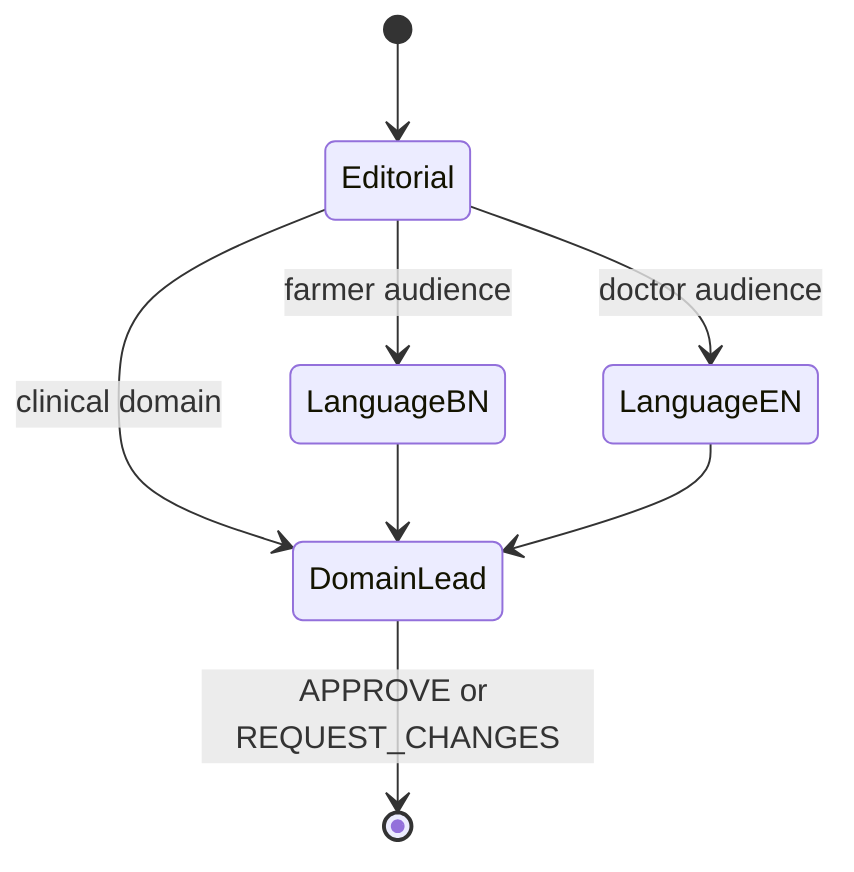

# Phase 6B.4 — Editorial Governance Architecture

**Project:** Prani Doctor  
**Role:** Principal Veterinary Governance Architect  
**Date:** 2026-05-31  
**Status:** Implemented (6B.4.0–6B.4.5 core workflows) — web UI pending  
**Version:** 1.1.0  
**Depends on:**

- `docs/plans/phase-6a-veterinary-knowledge-architecture.md` (VKL domain model, evidence framework, retrieval profiles)
- `docs/plans/phase-6b1-knowledge-foundation.md` (VKF — version lifecycle, review, approval, audit)
- `docs/plans/phase-6b2-knowledge-import-pipeline.md` (KIP — import routing to editorial/vet queues)
- `docs/plans/phase-6b3-chunking-citation-engine.md` (CCE — chunk/citation/evidence gates at publish)
- `docs/plans/phase-6c-rag-architecture.md` (RAG — published-only retrieval, confidence routing)
- `docs/plans/ai-phase-5-hardening.md` (platform governance, audit, analytics)
- `docs/reports/phase-6b1-knowledge-foundation-verification.md`
- `docs/reports/phase-6b3-chunking-verification.md`

---

## Phase numbering disambiguation

| Document | Meaning |
|----------|---------|
| **Phase 6B** (legacy) | KIS — entry-scoped editorial/vet workflows on `AiKnowledgeEntry` |
| **Phase 6B.1** | VKF — version-scoped persistence, basic lifecycle services |
| **Phase 6B.2** | KIP — ingestion routing to editorial or vet queue |
| **Phase 6B.3** | CCE — chunk, citation, evidence, confidence at version scope |
| **Phase 6B.4** (this document) | **Editorial Governance (EG)** — unified workflow orchestration, roles, policies, conflict resolution |
| **Phase 6C** | RAG — consumes **Published** versions only |

Phase 6B.4 **does not replace** VKF models or services from 6B.1. It defines the **governance layer** — business stages, role contracts, policy engines, and operational rules that orchestrate existing VKF transitions, CCE publish gates, and KIP routing into a coherent editorial operating model.

**Implementation:** `src/modules/ai/knowledge-governance/` — orchestrator, stage resolver, change requests, conflict resolution, expiration policy, governance audit. Wired via `KnowledgeFoundationController` workflow endpoints.

---

## Repositories in scope

| Repo | Role |
|------|------|
| `pranidoctor-backend` | Governance orchestrator, policy engine, queue routing, conflict resolution, expiration scheduler, audit |
| `pranidoctor-web` | Editorial Control Center — queues, review panels, change-request UI, vet approval console, SLA dashboards |
| `pranidoctor_user` | Read-only published knowledge; no governance exposure |

---

## Executive summary

Prani Doctor’s veterinary knowledge platform has **fragmented workflow semantics**: KIS uses entry-scoped status columns, VKF uses seven technical version statuses (`DRAFT` … `REJECTED`), KIP routes imports to queues, and CCE enforces publish gates — but there is no **single governance vocabulary** for editorial staff, veterinarians, and compliance auditors.

**Phase 6B.4 — Editorial Governance (EG)** defines a six-stage business lifecycle:

| Stage | Purpose |
|-------|---------|
| **Draft** | Authoring, import triage, citation editing, chunk preview |
| **Review** | Editorial peer review, locale QA, domain completeness |
| **Vet Review** | Licensed clinical assessment for HIGH/CRITICAL content |
| **Approval** | Signed-off, publish-ready snapshot (vet or expedited editorial) |
| **Published** | Immutable corpus visible to RAG and mobile |
| **Archived** | Deprecated, rejected, or regulatory-superseded content |

EG specifies:

1. **Reviewer roles** — editorial, domain, locale, regulatory  
2. **Vet approver roles** — scoped by domain, species, license  
3. **Conflict resolution** — reviewer disagreement, concurrent edit, import vs editorial override  
4. **Change requests** — structured return-to-author loop with checklist enforcement  
5. **Re-review policy** — triggers, grace periods, published-content banners  
6. **Expiration policy** — approval validity, regulatory sunset, mandatory refresh  

No imported or AI-generated content auto-publishes. Governance terminates at **Approval**; only an authorized **Publisher** action moves content to **Published**.

---

## Strategic intent

| Today (post–6B.3 baseline) | After Phase 6B.4 (target) |
|----------------------------|---------------------------|
| Technical statuses (`IN_REVIEW`, `VET_APPROVAL`) exposed to operators | **Business stages** with clear SLA and queue semantics |
| SUPER_ADMIN performs vet actions | **Dedicated vet reviewer role** with license scope |
| Change requests implicit in review comments | **Structured change-request artifacts** with required fix checklist |
| Approval expiry column exists but no scheduler | **Expiration policy engine** with re-review queues |
| Reviewer conflict = manual coordination | **Conflict resolution protocol** with escalation paths |
| KIP routes imports; editorial picks up ad hoc | **Unified intake → governance stage** mapping |

---

## Design principles

| Principle | EG interpretation |
|-----------|-------------------|
| **Version is the workflow unit** | All stages apply to `VkKnowledgeVersion`, not entity slug alone |
| **Fail-closed clinical** | HIGH/CRITICAL cannot skip Vet Review; no publish without Approval |
| **Separation of duties** | Author ≠ reviewer ≠ approver ≠ publisher (configurable per domain) |
| **Immutable after Published** | Edits require fork → new Draft cycle |
| **BN-first governance** | Locale review gates block farmer-facing publish if BN incomplete |
| **Audit everything** | Every stage transition, conflict decision, and policy override is logged |
| **Policy over ad hoc** | Expiration, re-review, and SLA rules are data-driven, admin-configurable |
| **Graceful degradation** | Expired approval keeps content published with retrieval banner until re-reviewed |

---

## Governance stage model

### Business stages (operator-facing)

```
┌────────┐    submit     ┌────────┐   editorial OK    ┌─────────────┐
│ DRAFT  │──────────────►│ REVIEW │──────────────────►│ VET REVIEW  │ (if required)
└────────┘               └────────┘                   └──────┬──────┘
     ▲                        │                              │
     │ change request         │ expedited LOW                │ vet assess
     │                        ▼                              ▼
     │                   ┌──────────┐                  ┌───────────┐
     └───────────────────│ (return) │                  │ APPROVAL  │
                         └──────────┘                  └─────┬─────┘
                                                             │ publish
                                                             ▼
                                                       ┌───────────┐
                                                       │ PUBLISHED │
                                                       └─────┬─────┘
                                                             │ supersede / reject / expiry
                                                             ▼
                                                       ┌───────────┐
                                                       │ ARCHIVED  │
                                                       └───────────┘
```

### Mapping to VKF technical state

| Governance stage | `VkVersionStatus` | Active `VkReviewStage` | Other signals |
|------------------|-------------------|------------------------|---------------|
| **Draft** | `DRAFT`, `CHANGES_REQUESTED` | — | Editable; CCE STAGING chunks mutable |
| **Review** | `IN_REVIEW` | `EDITORIAL`, `LANGUAGE_BN`, `LANGUAGE_EN`, `DOMAIN_LEAD` | Open `VkKnowledgeReview` rows |
| **Vet Review** | `VET_APPROVAL` | `VET` (open, no valid approval) | Provisional evidence/confidence |
| **Approval** | `VET_APPROVAL` or `IN_REVIEW`* | `VET` closed APPROVE | Valid `VkKnowledgeApproval` **or** editorial expedite record |
| **Published** | `PUBLISHED` | — | CCE PUBLISHED chunks; RAG indexed |
| **Archived** | `DEPRECATED`, `REJECTED` | — | Embeddings tombstoned; not in retrieval default |

\* *Expedited path:* `clinicalRiskTier = LOW` + domain `FARM_MGMT` or `FEED` may reach **Approval** from **Review** without **Vet Review** via Domain Lead sign-off (no vet license required).

### Stage entry/exit invariants

| Stage | Entry requires | Exit requires |
|-------|----------------|---------------|
| Draft | Entity exists; version editable | Submit gates pass (§7) |
| Review | Submit accepted; ≥1 citation | Editorial APPROVE or REQUEST_CHANGES |
| Vet Review | HIGH/CRITICAL editorial APPROVE | Vet review opened |
| Approval | Vet APPROVE + `KnowledgeApproval` **or** expedited editorial approval | Publisher invokes publish |
| Published | All publish gates (6B.1 + 6B.3) | Supersede, reject (pre-publish only), or archive job |
| Archived | Deprecation reason recorded | Terminal — no exit except audit export |

---

## Editorial workflow (detailed)

### 1. Draft

**Actors:** Content Editor, Import Pipeline (system), Domain Lead (override)

| Activity | Description |
|----------|-------------|
| Authoring | Edit BN/EN body, structuredJson, citations on draft version |
| Import triage | KIP creates draft + routes to editorial queue (`queueSource=INGESTION`) |
| Chunk preview | CCE `processVersion` produces STAGING chunks (6B.3) |
| Self-check | Editor runs validation preview (schema, citations, locale flags) |

**Automated gates before leaving Draft:**

| Gate | Engine |
|------|--------|
| Required fields (title BN+EN, body EN) | VKF validation |
| ≥1 version-level citation | `KnowledgeCitationService` |
| Domain JSON Schema | Per-domain validator (6A) |
| Citation trust rules (Appendix B, 6B.1) | `evaluateCitationTrustRules()` |
| Chunk set exists | CCE orchestrator |
| BN completeness for `audience=FARMER` | Locale flags — block submit if `BN_PENDING` |

**Transitions:**

| Action | Target stage |
|--------|--------------|
| Submit for review | Review |
| Discard draft | Archived (`REJECTED`) — admin only |
| Fork from published | New Draft (new version number) |

---

### 2. Review

**Actors:** Editorial Reviewer, Domain Lead, Language Reviewer (BN/EN)

**Sub-stages (parallel where independent):**



| Sub-stage | `VkReviewStage` | Focus |
|-----------|-----------------|-------|
| Editorial | `EDITORIAL` | Completeness, citation quality, structure |
| Language BN | `LANGUAGE_BN` | BN accuracy, colloquial terms, farmer readability |
| Language EN | `LANGUAGE_EN` | Clinical precision for doctor audience |
| Domain Lead | `DOMAIN_LEAD` | Domain schema, risk tier confirmation, routing to vet |

**Queue sources:**

| Source | Priority boost |
|--------|----------------|
| `MANUAL` | Normal |
| `INGESTION` | +1 if import quarantine cleared |
| `AI_DRAFT` | Requires editorial before vet — never auto-advance |
| `SCHEDULED_REREVIEW` | +2 — expiration-driven |

**SLA targets (max time in Review + Vet Review + Approval):**

| `clinicalRiskTier` | Target |
|--------------------|--------|
| CRITICAL | 24 h |
| HIGH | 72 h |
| MEDIUM | 7 d |
| LOW | 14 d |

**Transitions:**

| Decision | Target |
|----------|--------|
| APPROVE + requires vet | Vet Review |
| APPROVE + expedited eligible | Approval |
| REQUEST_CHANGES | Draft (status `CHANGES_REQUESTED`) |
| REJECT | Archived (`REJECTED`) |

---

### 3. Vet Review

**Actors:** Veterinarian Reviewer (licensed)

**Mandatory when:**

| Condition | |
|-----------|--|
| `clinicalRiskTier` ∈ {HIGH, CRITICAL} | Always |
| Domain ∈ {MEDICINE, EMERGENCY, CLINICAL_PROTOCOL, REGULATORY_BD} | Always |
| Entity type ∈ medicine/emergency critical set | Always |
| KIP routed to vet queue | Default for configured source families |

**Vet reviewer workspace:**

- Side-by-side BN/EN content + `structuredJson`
- CCE chunk list with per-chunk citations and locators
- Evidence assessment form (provisional → finalize on approve)
- Prior published version diff (if supersede)
- Sign-off hash preview

**Transitions:**

| Decision | Target |
|----------|--------|
| APPROVE | Approval (creates `VkKnowledgeApproval`, finalizes evidence via CCE) |
| REQUEST_CHANGES | Draft (`CHANGES_REQUESTED`) — returns to editor, not editorial re-queue only |
| REJECT | Archived (`REJECTED`) |

**Separation of duties:**

| Rule | Enforcement |
|------|-------------|
| Vet cannot approve own editorial submission | Different `actorId` on editorial vs vet reviews |
| Vet license must match `approvalScope` ∩ version.domain | `KnowledgeApprovalService` |
| Dual approval for `REGULATORY_BD` | `dualApprovalRequired` + `coApproverVetId` |

---

### 4. Approval

**Actors:** System (state), Publisher (human action trigger)

**Definition:** Version has a **valid, non-expired approval snapshot** and passes all pre-publish gates. Content is **frozen** — sign-off hash computed; further edits invalidate approval (`SIGNOFF_STALE`).

| Approval type | Record | Vet Review required? |
|---------------|--------|---------------------|
| Veterinary | `VkKnowledgeApproval` + finalized evidence | Yes |
| Editorial expedited | `VkKnowledgeReview` DOMAIN_LEAD APPROVE + audit event | No (LOW risk only) |
| Dual regulatory | Two `VkKnowledgeApproval` rows or co-sign | Yes × 2 |

**Pre-publish checklist (orchestrated):**

| # | Gate | Source |
|---|------|--------|
| 1 | Valid approval or expedited path | EG policy engine |
| 2 | Sign-off hash matches current content | VKF publish service |
| 3 | Non-provisional evidence (HIGH/CRITICAL) | CCE / `VkKnowledgeEvidence` |
| 4 | Chunk citations complete (HIGH/CRITICAL) | CCE publish promoter |
| 5 | Confidence ≥ profile minimum (warning/block) | CCE confidence |
| 6 | Citation trust rules | VKF Appendix B |
| 7 | No open conflict record | EG conflict service |

**Transition:** Publisher action → **Published**

---

### 5. Published

**Actors:** Publisher (initial), System (supersede), Admin (emergency)

| Property | Rule |
|----------|------|
| Immutability | No body/citation edits — fork only |
| Retrieval | RAG + mobile read APIs include by default |
| Chunks | CCE PUBLISHED copies; embeddings active |
| Entity pointer | `currentPublishedVersionId` updated atomically |
| Prior published | Auto-**Archived** (`DEPRECATED`) on supersede |

**Allowed actions while Published:**

| Action | Actor | Result |
|--------|-------|--------|
| Fork new draft | Editor | New Draft version on same entity |
| Emergency unpublish | SUPER_ADMIN | Archived + retrieval kill switch |
| Schedule re-review | System | Queue item at `validUntil` |
| Supersede | Publisher (via new version publish) | Old → Archived |

---

### 6. Archived

**Actors:** System, Admin, Reviewer (reject path)

| Archive reason | `VkVersionStatus` | Retrieval |
|----------------|-------------------|-----------|
| Superseded by newer publish | `DEPRECATED` | Excluded default; historical audit |
| Editorial/vet reject | `REJECTED` | Never published — excluded |
| Regulatory sunset | `DEPRECATED` | Excluded + banner if grace period |
| Emergency unpublish | `DEPRECATED` | Immediate exclusion + tombstone embeddings |

**Archived content:**

- Retained for audit, diff, and legal hold
- Not embedded or returned in `KnowledgeContextPack` default profiles
- May be restored only by SUPER_ADMIN fork-from-archived (exception path — audit mandatory)

---

## Reviewer roles

### Role catalog

| Role ID | Display name | Primary stages | Capabilities |
|---------|--------------|----------------|--------------|
| `CONTENT_EDITOR` | Content Editor | Draft | `ai.knowledge.view`, `ai.knowledge.edit` |
| `EDITORIAL_REVIEWER` | Editorial Reviewer | Review | `view`, `edit`, `review` (EDITORIAL stage) |
| `LANGUAGE_REVIEWER_BN` | Bangla Language Reviewer | Review | `view`, `review` (LANGUAGE_BN) |
| `LANGUAGE_REVIEWER_EN` | English Language Reviewer | Review | `view`, `review` (LANGUAGE_EN) |
| `DOMAIN_LEAD` | Domain Lead | Review → Approval (expedited) | `view`, `edit`, `review` (DOMAIN_LEAD) |
| `REGULATORY_EDITOR` | Regulatory Editor | Review, Approval | `view`, `edit`, `review`, `publish` (REGULATORY_BD only) |
| `VET_REVIEWER` | Veterinarian Reviewer | Vet Review → Approval | `view`, `review`, `approve` |
| `PUBLISHER` | Knowledge Publisher | Approval → Published | `view`, `publish` |
| `GOVERNANCE_ADMIN` | Governance Admin | All | `deprecate`, `audit.export`, policy override |
| `SUPER_ADMIN` | Platform Super Admin | All | All capabilities + emergency unpublish |

### Scope dimensions

| Dimension | Example constraint |
|-----------|---------------------|
| **Domain** | `DOMAIN_LEAD` scoped to `FEED` only |
| **Species** | Vet reviewer cattle specialization (future) |
| **Jurisdiction** | Regulatory editor BD-only |
| **Risk tier ceiling** | Editorial reviewer cannot approve HIGH alone |
| **Queue** | Ingestion triage team sees `queueSource=INGESTION` first |

### Assignment rules

| Rule | Description |
|------|-------------|
| Default assignee | Round-robin within scoped role pool |
| Self-assignment | Allowed for Review and Vet Review queues |
| Escalation | SLA breach → notify Domain Lead → Chief Veterinary Officer |
| Import routing | KIP `ApprovalRoutingService` pre-assigns queue; EG claims on first human touch |

---

## Vet approver roles

### Veterinarian credential model

| Field | Purpose |
|-------|---------|
| `approverVetId` | Platform user linked to vet profile |
| `vetLicenseNo` | Snapshot at approval time |
| `approvalScope` | Domains authorized (e.g. `MEDICINE`, `DISEASE`) |
| `validUntil` | Approval expiry — triggers re-review |
| `signOffHash` | Tamper-evident content digest |
| `dualApprovalRequired` | Regulatory dual-sign flag |
| `coApproverVetId` | Second vet for dual path |

### Vet role tiers

| Tier | Scope | Can approve |
|------|-------|-------------|
| **VET_REVIEWER** | Scoped domains, single species optional | HIGH/CRITICAL within scope |
| **SENIOR_VET_REVIEWER** | All clinical domains | All clinical except dual-regulatory alone |
| **CHIEF_VETERINARY_OFFICER** | Platform-wide | All including dual-regulatory co-sign |
| **CONSULTING_VET** (external) | Time-limited project scope | Assigned versions only — no queue claim |

### Vet approver invariants

| Invariant | Rationale |
|-----------|-----------|
| License verified before first approval | Legal defensibility |
| Cannot approve version they authored (editorial) | Separation of duties |
| `signOffHash` mismatch blocks publish | Prevents post-approval tampering |
| Expired `validUntil` blocks **new** publish; existing Published enters re-review | Graceful degradation |
| Vet rejection is terminal for that version | Author must fork new draft |

---

## Conflict resolution

### Conflict types

| Type | Scenario | Default resolution |
|------|----------|-------------------|
| **C1 — Reviewer disagreement** | Editorial APPROVE vs REQUEST_CHANGES split | Domain Lead adjudicates; third review if needed |
| **C2 — Vet vs editorial** | Editor wants expedite; Domain Lead flagged HIGH | Vet path mandatory — no override except SUPER_ADMIN audit |
| **C3 — Concurrent edit** | Two editors save same draft | Optimistic lock on `updatedAt`; loser merges or forks |
| **C4 — Import vs editorial** | KIP content conflicts with published dose | Quarantine wins — editor must resolve before submit |
| **C5 — Dual vet split** | Dual regulatory: one approve, one reject | Escalate to Chief Veterinary Officer |
| **C6 — Policy override** | Admin publishes despite failed confidence gate | Allowed only with `GOVERNANCE_OVERRIDE` audit + reason code |

### Conflict record (conceptual)

```typescript
type GovernanceConflict = {
  id: string;
  versionId: string;
  conflictType: 'C1' | 'C2' | 'C3' | 'C4' | 'C5' | 'C6';
  status: 'OPEN' | 'ESCALATED' | 'RESOLVED' | 'OVERRIDDEN';
  openedById: string;
  assignedToId?: string;
  resolution?: {
    decision: 'UPHOLD_VET' | 'RETURN_DRAFT' | 'FORK' | 'QUARANTINE' | 'OVERRIDE';
    rationale: string;
    resolvedById: string;
    resolvedAt: string;
  };
};
```

### Escalation ladder

```
Reviewer disagreement (C1)
  → Domain Lead (4 h SLA)
    → Chief Veterinary Officer (24 h)
      → Governance Admin committee (72 h)

Vet / regulatory split (C5)
  → Chief Veterinary Officer (immediate)
    → External consulting vet (optional)
```

### Blocking rules

| Open conflict | Blocks |
|---------------|--------|
| C1 unresolved | Advance past Review |
| C4 unresolved | Submit from Draft |
| C5 unresolved | Approval |
| C6 without audit | Publish |

---

## Change requests

### Change request artifact

When reviewer returns `REQUEST_CHANGES`, EG creates a **structured change request** (not free-text only):

```typescript
type ChangeRequest = {
  id: string;
  versionId: string;
  reviewId: string;
  stage: VkReviewStage;
  requestedById: string;
  requestedAt: string;
  summaryBn: string;
  summaryEn: string;
  checklist: Array<{
    code: string;           // e.g. 'CITATION_LOCATOR', 'DOSE_VERIFY', 'BN_LOCALE'
    description: string;
    required: boolean;
    resolved: boolean;
    resolvedAt?: string;
  }>;
  severity: 'MINOR' | 'MAJOR' | 'BLOCKING';
  dueAt?: string;           // SLA for resubmit
};
```

### Severity behavior

| Severity | Version handling | Resubmit path |
|----------|------------------|---------------|
| **MINOR** | Same version id; edit in place | Editor fixes → resubmit → Review (expedited sub-stages) |
| **MAJOR** | Same version id; CCE re-chunk | Full Review sub-stages |
| **BLOCKING** | Recommend fork if structural | Domain Lead decides fork vs in-place |

### Change request → Draft transition

1. Version status → `CHANGES_REQUESTED` (maps to **Draft** stage)
2. Open reviews marked completed with `REQUEST_CHANGES`
3. Editor receives checklist notification
4. Editor addresses items; marks checklist resolved in UI
5. Resubmit validates all **required** checklist items resolved
6. Audit: `CHANGE_REQUEST_OPENED`, `CHANGE_REQUEST_RESOLVED`, `VERSION_RESUBMITTED`

### Vet change requests

Vet `REQUEST_CHANGES` from **Vet Review** returns to **Draft** (not merely Review) because clinical corrections may require re-chunk and re-evidence.

---

## Re-review policy

### Triggers

| Trigger | Scope | Default action |
|---------|-------|----------------|
| **R1 — Approval expiry** | `VkKnowledgeApproval.validUntil` elapsed | Published stays live; `REVIEW_DUE` flag; queue `SCHEDULED_REREVIEW` |
| **R2 — Source document deprecated** | Versions citing deprecated source | Priority Review queue |
| **R3 — Sign-off stale** | Content edited after approval | Block publish; require re-approval |
| **R4 — Regulatory amendment** | Domain `REGULATORY_BD` policy change | Bulk queue all affected Published |
| **R5 — Retrieval quality** | High BLOCK rate on entity (6C analytics) | Priority Vet Review |
| **R6 — Periodic calendar** | Domain policy (e.g. vaccine schedules annual) | Scheduled queue |
| **R7 — Farmer feedback** | Confirmed incorrect report (future) | Triage → Vet Review |

### Re-review grace periods

| Trigger | Published content behavior | Retrieval banner |
|---------|--------------------------|----------------|
| R1 (expiry) | Remains published 90 days default | "Under veterinary re-review" after day 0; optional downgrade confidence |
| R2 (source) | Published until replacement version ready | Citation source warning |
| R4 (regulatory) | Configurable hard block after 30 days | "Regulatory update pending" |
| R5 (quality) | No automatic unpublish | Internal only until vet completes |

### Re-review workflow

```
Published + trigger fired
  → Create VkKnowledgeReview (queueSource=SCHEDULED_REREVIEW)
  → Optionally fork new Draft from Published for edits
  → Vet/Editorial review on fork OR in-place assessment
  → New Approval record supersedes prior
  → Publish supersedes old Published → old Archived
```

**In-place re-approval (no content change):** Vet confirms content still valid → new `VkKnowledgeApproval` with extended `validUntil` only.

---

## Expiration policy

### Policy domains

| Policy | Field / mechanism | Default |
|--------|-------------------|---------|
| **Approval validity** | `VkKnowledgeApproval.validUntil` | 24 months clinical; 12 months regulatory |
| **Review SLA** | Queue age vs tier | See § Review SLA table |
| **Published regulatory sunset** | `structuredJson.effectiveTo` or source license expiry | Domain-specific |
| **Evidence freshness** | Confidence recency component decay | Recompute at 18-month half-life |
| **Draft staleness** | Draft untouched 90 days | Auto-archive candidate (notify editor) |
| **License linkage** | `AiKnowledgeSource.license.expiryDate` | Block new imports; trigger R2 on Published |

### Expiration policy registry (admin-configurable)

```typescript
type ExpirationPolicy = {
  policyKey: string;
  domain?: VkKnowledgeDomain;
  clinicalRiskTier?: AiKnowledgeClinicalRiskTier;
  approvalValidityMonths: number;
  rerreviewGraceDays: number;
  draftStaleDays: number;
  hardBlockRetrievalAfterExpiry: boolean;
};
```

**Example policies:**

| policyKey | Domain | approvalValidityMonths | hardBlock |
|-----------|--------|------------------------|-----------|
| `clinical-default` | MEDICINE, DISEASE, EMERGENCY | 24 | false |
| `regulatory-bd` | REGULATORY_BD | 12 | true |
| `farm-low` | FARM_MGMT, FEED (LOW) | 36 | false |
| `vaccine-schedule` | VACCINE | 12 | false |

### Expiration scheduler (conceptual)

| Job | Cadence | Action |
|-----|---------|--------|
| `eg:approval-expiry-scan` | Daily | Flag R1; enqueue re-review |
| `eg:draft-stale-scan` | Weekly | Notify + optional archive |
| `eg:license-expiry-scan` | Daily | Block imports; R2 queue |
| `eg:sla-breach-scan` | Hourly | Escalate conflicts |

---

## Module architecture (conceptual)

```
src/modules/ai/knowledge-governance/          # Phase 6B.4 target (not implemented)
├── index.ts
├── knowledge-governance.types.ts
├── stages/
│   └── governance-stage.resolver.ts          # business stage ↔ VkVersionStatus
├── workflow/
│   ├── editorial-workflow.orchestrator.ts    # stage transitions
│   └── change-request.service.ts
├── roles/
│   ├── reviewer-role.registry.ts
│   └── vet-approver.registry.ts
├── policy/
│   ├── expiration-policy.registry.ts
│   └── rereview-policy.engine.ts
├── conflict/
│   └── conflict-resolution.service.ts
├── queues/
│   └── governance-queue.service.ts           # unified editorial + vet + rerreview
└── audit/
    └── governance-audit.service.ts
```

**Integration points (existing modules):**

| Module | EG usage |
|--------|----------|
| `knowledge-foundation/` | Version status transitions, review, approval, publish |
| `knowledge-chunking/` | Pre-publish gates, evidence finalize on vet approve |
| `knowledge-import/` | Intake routing, importRunId lineage |
| `knowledge-retrieval/` | Published-only filter; re-review confidence downgrade |

---

## Audit events (EG extensions)

| Event | Trigger |
|-------|---------|
| `GOVERNANCE_STAGE_CHANGED` | Business stage transition |
| `CHANGE_REQUEST_OPENED` | REQUEST_CHANGES with checklist |
| `CHANGE_REQUEST_RESOLVED` | All required items closed |
| `CONFLICT_OPENED` / `CONFLICT_RESOLVED` | Conflict lifecycle |
| `APPROVAL_EXPIRED` | validUntil passed |
| `REREVIEW_TRIGGERED` | R1–R7 signal |
| `GOVERNANCE_OVERRIDE` | C6 admin override with reason |
| `SLA_BREACH_ESCALATED` | Queue age exceeded |

All events append to `VkKnowledgeAuditEvent` with `detailJson.governanceStage` and correlate `importRunId` when present.

---

## Web surfaces (future — 6B.4 UI)

| Surface | Users | Features |
|---------|-------|----------|
| **Editorial Inbox** | Editors, reviewers | Draft + Review queues, change requests |
| **Vet Clinical Queue** | Vet reviewers | Vet Review workspace, sign-off |
| **Approval Console** | Publishers | Approval → Published checklist |
| **Governance Dashboard** | Admins | SLA, expiry backlog, conflict board |
| **Policy Admin** | Governance admin | Expiration/re-review policy editor |

---

## Sub-phase roadmap

| Sub-phase | Scope | Depends on | Status |
|-----------|-------|------------|--------|
| **6B.4.0** | Governance stage model + resolver | 6B.1 | **Done** |
| **6B.4.1** | Reviewer role registry + RBAC extension | 6B.4.0 | **Done** (vet-path policy + scope checks) |
| **6B.4.2** | Change request artifact + resubmit gates | 6B.4.1 | **Done** |
| **6B.4.3** | Conflict resolution service | 6B.4.2 | **Done** |
| **6B.4.4** | Expiration + re-review scheduler | 6B.4.1 | **Partial** (policy registry + `validUntil`; scheduler jobs pending — see verification report) |
| **6B.4.5** | Unified governance queues | 6B.4.2–6B.4.4 | **Done** (review/vet/approval queues via orchestrator) |
| **6B.4.6** | Editorial Control Center (web) | 6B.4.5 | Pending |
| **6B.4.7** | Governance analytics + SLA dashboards | 6B.4.5 | Pending |

---

## Implementation summary (2026-05-31)

| Component | Path | Notes |
|-----------|------|-------|
| Orchestrator | `knowledge-governance-orchestrator.service.ts` | Editorial, review, vet, publish, archive workflows |
| Stage resolver | `stages/governance-stage.resolver.ts` | Draft → Review → Vet Review → Approval → Published → Archived |
| Change requests | `change-request/change-request.service.ts` + `VkKnowledgeChangeRequest` | Checklist artifacts, resubmit gates |
| Conflicts | `conflict/conflict-resolution.service.ts` + `VkGovernanceConflict` | Open conflict blocks progression |
| Expiration | `policy/expiration-policy.registry.ts` | Approval `validUntil` computed on vet sign-off |
| Vet path | `policy/vet-path.policy.ts` | HIGH/CRITICAL + clinical domains; expedited LOW farm/feed |
| Audit | `audit/governance-audit.service.ts` | All transitions include `governanceStage` in `detailJson` |
| Migration | `20260616120000_ai_phase6b4_editorial_governance` | Change request + conflict tables |
| API routes | `knowledge-foundation.routes.ts` | `/submit`, `/reviews/complete`, `/approvals`, `/publish`, `/archive`, `/governance-stage`, `/approval-queue` |
| Tests | `knowledge-governance.test.ts` | 14 unit tests; **343** total AI module tests passing |
| Verification | `docs/reports/phase-6b4-governance-verification.md` | **PASS WITH CONDITIONS** (4.1/5) |

---

| Criterion | Target |
|-----------|--------|
| Every version mappable to exactly one governance stage | 100% |
| HIGH/CRITICAL never publish without Vet Review + Approval | Enforced |
| Change requests produce resolvable checklists | 100% of REQUEST_CHANGES |
| Approval expiry generates re-review within 24 h | Automated |
| Conflict blocks publish when open | Enforced |
| All stage transitions audited | 100% |

---

## Appendix A — Expedited publish path (LOW risk)

| Condition | Path |
|-----------|------|
| `clinicalRiskTier = LOW` | Review → Approval (editorial) → Published |
| Domain ∈ {FARM_MGMT, FEED} | Domain Lead APPROVE sufficient |
| KIP auto-submit enabled | Only routes to Review, never skips to Published |
| Vet Review | **Skipped** |
| `VkKnowledgeApproval` | Optional — editorial audit event sufficient |

---

## Appendix B — Sign-off hash (unchanged from 6B.1)

```
signOffHash = SHA-256(
  versionId
  + bodyBn + bodyEn
  + structuredJson canonical
  + evidenceLevel
  + sorted citation ids + locators
)
```

Publish rejects with `SIGNOFF_STALE` if content changed after approval.

---

## Appendix C — Glossary

| Term | Definition |
|------|------------|
| **EG** | Editorial Governance — Phase 6B.4 subsystem |
| **Governance stage** | Operator-facing lifecycle (Draft … Archived) |
| **Technical status** | `VkVersionStatus` enum on version row |
| **Change request** | Structured return-to-author artifact with checklist |
| **Approval** | Valid sign-off snapshot — not yet Published |
| **Re-review** | Re-assessment of Published content without automatic unpublish |
| **Archived** | Terminal non-retrieval state (deprecated or rejected) |

---

**Document owner:** Principal Veterinary Governance Architect  
**Next review:** Phase 6B.4.0 implementation kickoff or web Editorial Control Center design  
**Related:** `docs/plans/phase-6b1-knowledge-foundation.md`, `docs/plans/phase-6b2-knowledge-import-pipeline.md`, `docs/reports/phase-6b1-knowledge-foundation-verification.md`
