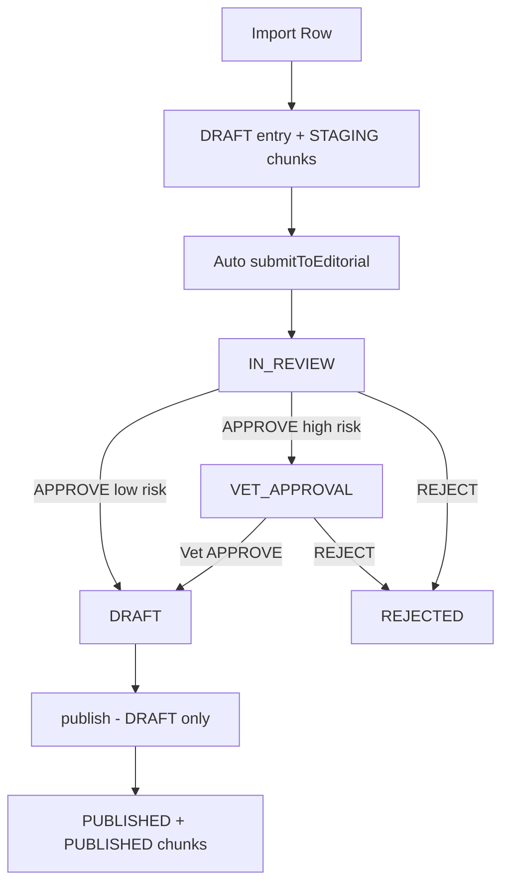

# Phase 6B — Knowledge Ingestion System Verification Report

**Project:** Prani Doctor  
**Role:** Principal Veterinary Knowledge QA Auditor  
**Date:** 2026-05-31  
**Scope:** `src/modules/ai/knowledge-ingestion/`, Prisma schema `20260611120000_ai_phase6b_knowledge_ingestion`, admin routes, `AiKnowledgeService` RAG integration  
**Reference plan:** `docs/plans/phase-6b-knowledge-ingestion-architecture.md`  
**Reference architecture:** `docs/plans/phase-6a-veterinary-knowledge-architecture.md`

---

## Executive summary

| Metric | Result |
|--------|--------|
| **Overall verdict** | **PASS WITH CONDITIONS** |
| **Readiness for controlled pilot ingest** | **Yes** — CSV/JSON row import with editorial + vet gates |
| **Readiness for production bulk ingest** | **No** — pending 6B.8 adapters, immutable version history, per-span citations |
| **TypeScript (`npm run typecheck:ai`)** | **0 errors** |
| **Unit tests (`npx vitest run src/modules/ai`)** | **272 passed** (38 files) |
| **Ingestion module tests** | **14 passed** (2 files) |

The Knowledge Ingestion System (KIS) implements the Phase 6B architecture for row-based import through editorial and veterinary approval to publish, with BN-first bilingual chunking, provisional evidence/confidence scoring, and RAG-ready published chunks. Core governance controls are enforced in code. Several Phase 6A/6B follow-ups remain (PDF workers, immutable version snapshots, per-chunk span locators).

---

## Methodology

1. **Static code audit** — traced data flow from `KnowledgeImportPipelineService.runImport` through workflows to `KnowledgePublishWorkflowService.publish` and `AiKnowledgeService.retrieveForRag`.
2. **Schema validation** — confirmed Prisma models, enums, indexes, and foreign keys for sources, import runs, chunks, reviews, and approvals.
3. **Unit test execution** — engines (normalization, evidence, confidence, chunking, citation), verification helpers, full AI module suite.
4. **Workflow gate analysis** — verified status transitions cannot bypass vet approval or attribution requirements.
5. **Safe remediation** — applied non-breaking fixes during audit (see § Remediation applied).

---

## Validation matrix

| Domain | Status | Score | Evidence |
|--------|--------|-------|----------|
| Source attribution | **PASS** | 4/5 | `buildSourceAttribution`, `metadataJson.sourceAttributions`, license templates via `toCitationSourceContext` |
| Evidence assignment | **PASS** | 4/5 | `assignProvisionalEvidenceLevel`, `finalizeEvidenceLevel`, source-class ceilings |
| Confidence scoring | **PASS** | 4/5 | Provisional cap 0.65; finalized score on vet approve + publish fallback |
| Editorial workflow | **PASS** | 4/5 | `IN_REVIEW` queue, decisions, stale review supersession |
| Vet approval workflow | **PASS** | 4/5 | `VET_APPROVAL` queue, `AiKnowledgeApproval` sign-off record |
| Versioning | **PARTIAL** | 2/5 | Integer `version` increment on re-import only; no immutable history table |
| Citation integrity | **PASS WITH GAPS** | 3/5 | Entry-level + shared chunk citation; inline RAG tokens; no per-span page refs on chunks |
| Chunk integrity | **PASS** | 4/5 | BN-first heading split, policy resolution, STAGING→PUBLISHED promotion, unique index |

**Weighted overall:** **3.6 / 5** — suitable for pilot; not yet audit-grade for regulatory primary-source bulk ingest.

---

## 1. Source attribution

### Expected (Phase 6B)

Every ingested row linked to a registered `AiKnowledgeSource`; human-readable BN/EN citations; metadata preserves `sourceId`, optional `documentId`, `importRunId`, and span refs when supplied.

### Observed

| Check | Result |
|-------|--------|
| Import sets `sourceId` on entry | ✅ |
| `metadataJson.sourceAttributions[]` populated at import | ✅ |
| License-aware human citation (`attributionTemplateBn/En`) | ✅ via `toCitationSourceContext` + `renderHumanCitation` |
| Publish gate requires attribution when `sourceId` set | ✅ `hasRequiredSourceAttribution` |
| Multi-source blend attribution | ⚠️ Single-source only in current import path |

### Key implementation

```107:127:src/modules/ai/knowledge-ingestion/pipeline/import-pipeline.service.ts
        const attribution = buildSourceAttribution({
          sourceId: source.id,
          ...(input.documentId ? { documentId: input.documentId } : {}),
          importRunId: run.id,
          ...(row.sourceSpanRefs?.length ? { spanRefs: row.sourceSpanRefs } : {}),
        });

        const citationContext = toCitationSourceContext(source);
        const citationBn = renderHumanCitation(citationContext, 'bn');
        const citationEn = renderHumanCitation(citationContext, 'en');
        const inline = renderInlineRagCitation(source.sourceKey);

        const metadataJson = {
          origin: 'INGESTION',
          importRunId: run.id,
          adapterId: input.adapterId,
          sourceAttributions: [attribution],
          // ...
        };
```

**Finding:** Attribution model is sound for single-source CSV ingest. Multi-source entries and document-level page locators in human citations are not yet wired from `spanRefs`.

---

## 2. Evidence assignment

### Expected

Provisional evidence at ingest from source class + content type; floor raised for HIGH/CRITICAL clinical risk on finalize; reviewer override supported.

### Observed

| Check | Result |
|-------|--------|
| Source class defaults and ceilings | ✅ `SOURCE_CLASS_DEFAULT`, `SOURCE_CLASS_CEILING` |
| Medicine content capped appropriately at provisional | ✅ L3→L2 adjustment |
| Registration field can elevate to L5 | ✅ |
| Editorial finalize respects risk floor (≥ L2 for HIGH/CRITICAL) | ✅ |
| Vet can pass `evidenceLevel` override | ✅ |
| BN evidence labels | ✅ (L4 label corrected during audit) |

**Verdict:** **PASS** — aligns with Phase 6A evidence ladder for pilot content types.

---

## 3. Confidence scoring

### Expected

Provisional scores capped below publish threshold; finalized scores incorporate trust tier, review completeness, recency after vet approval.

### Observed

| Check | Result |
|-------|--------|
| `PROVISIONAL_CONFIDENCE_CAP = 0.65` enforced | ✅ |
| Provisional formula uses evidence + trust + extract + dedup | ✅ |
| Finalized formula uses evidence + trust + recency + review + graph | ✅ |
| `meetsRetrievalGate` helper for RAG filtering | ✅ (not yet enforced in `retrieveForRag`) |
| Publish backfills confidence if missing | ✅ |

**Gap:** `retrieveForRag` does not filter by `confidenceScore` or `evidenceLevel` — published content only. Acceptable for pilot; recommend gate in Phase 6C.

---

## 4. Editorial workflow

### Expected

Import auto-submits to editorial; reviewers APPROVE / REQUEST_CHANGES / REJECT; high-risk routes to vet queue.

### Observed

```
DRAFT | CHANGES_REQUESTED
    → submitToEditorial → IN_REVIEW
    → APPROVE → DRAFT (low risk) | VET_APPROVAL (high/medicine/emergency)
    → REQUEST_CHANGES → CHANGES_REQUESTED
    → REJECT → REJECTED
```

| Check | Result |
|-------|--------|
| Auto-submit after import | ✅ |
| Open review superseded on re-submit | ✅ (audit fix) |
| Risk-based vet routing | ✅ MEDICINE, EMERGENCY, HIGH, CRITICAL |
| Admin route `POST .../review` | ✅ |
| Review queue listing | ✅ |

**Verdict:** **PASS**

---

## 5. Vet approval workflow

### Expected

Vet queue for high-risk content; approval creates immutable approval record; reject/changes paths respected; publish blocked without vet for gated content types.

### Observed

| Check | Result |
|-------|--------|
| `openVetQueue` on editorial approve (needsVet) | ✅ |
| `AiKnowledgeApproval` with `signOffHash`, `validUntil` | ✅ |
| Sets `approvedByVetId`, `evidenceLevel`, `confidenceScore` | ✅ |
| Publish requires `approvedByVetId` when needsVet | ✅ |
| Default validity 180 days | ✅ |

```34:45:src/modules/ai/knowledge-ingestion/workflow/publish-workflow.service.ts
    const needsVet =
      entry.clinicalRiskTier === 'HIGH' ||
      entry.clinicalRiskTier === 'CRITICAL' ||
      entry.contentType === 'MEDICINE' ||
      entry.contentType === 'EMERGENCY';

    if (needsVet && !entry.approvedByVetId) {
      throw new KnowledgeEntryWorkflowError(
        'VET_APPROVAL_REQUIRED',
        'Veterinary approval required before publish',
      );
    }
```

**Verdict:** **PASS** — publish bypass from `IN_REVIEW` / `VET_APPROVAL` blocked (audit fix).

---

## 6. Versioning

### Expected (Phase 6A)

Immutable version snapshots (`VkKnowledgeVersion` or equivalent) with diff and rollback.

### Observed

| Check | Result |
|-------|--------|
| `version Int @default(1)` on `AiKnowledgeEntry` | ✅ |
| Increment on re-import update (`version: { increment: 1 }`) | ✅ |
| Immutable version history table | ❌ Not implemented |
| Published corpus protected from overwrite | ✅ skips when status `PUBLISHED` |
| `stats.merged` counter | ❌ Never incremented (dedup merge not implemented) |

**Verdict:** **PARTIAL** — operational version counter only; not audit-grade rollback.

---

## 7. Citation integrity

### Expected

Machine-readable inline citations for RAG; human-readable BN/EN blocks; locator preservation where available.

### Observed

| Check | Result |
|-------|--------|
| Inline RAG token `[sourceKey\|pageRef]` | ✅ |
| `citationJson` on chunks (`inline`, `sourceId`, span fields) | ✅ |
| Entry-level `citationBlockBn/En` in metadata | ✅ |
| License template substitution | ✅ |
| Per-chunk distinct page/section citation | ❌ Same citation copied to all chunks |
| `spanRefs` from import row stored in attribution | ✅ in metadata; not propagated to chunk `citationJson` |

**Verdict:** **PASS WITH GAPS** — sufficient for slug-level RAG pilot; insufficient for page-level regulatory audit.

---

## 8. Chunk integrity

### Expected

BN-first bilingual chunks; content-type policies; STAGING during review; PUBLISHED on publish; stable indices.

### Observed

| Check | Result |
|-------|--------|
| Heading-based split (`##`) BN + EN aligned | ✅ |
| Policy map (DISEASE, MEDICINE, EMERGENCY, etc.) | ✅ |
| STAGING replaced on re-import | ✅ |
| PUBLISHED recreated from STAGING on publish | ✅ |
| Auto-materialize STAGING from body if empty at publish | ✅ |
| Unique `(knowledgeEntryId, chunkIndex, stage)` | ✅ |
| Token estimate | ✅ |
| `retrieveForRag` uses PUBLISHED chunks + inline citation | ✅ |

**Verdict:** **PASS**

---

## Workflow integrity (end-to-end)



**Critical gates verified:**

| Gate | Enforced |
|------|----------|
| Publish only from `DRAFT` | ✅ |
| Vet approval for MEDICINE / EMERGENCY / HIGH / CRITICAL | ✅ |
| Source attribution when `sourceId` present | ✅ |
| License blocks extraction | ✅ `allowsAiExtraction` |
| Skip overwrite of published entries | ✅ |

---

## Admin API coverage

| Route | Purpose | Verified |
|-------|---------|----------|
| `GET/POST .../knowledge/sources` | Source registry CRUD | ✅ |
| `GET/POST .../knowledge/imports` | Trigger import / list runs | ✅ |
| `GET .../knowledge/review-queue` | Editorial queue | ✅ |
| `GET .../knowledge/vet-queue` | Vet queue | ✅ |
| `POST .../knowledge/[id]/review` | Complete editorial review | ✅ |
| `POST .../knowledge/[id]/vet-approve` | Complete vet approval | ✅ |
| `POST .../knowledge/[id]/publish` | Publish workflow | ✅ |

---

## Test evidence

| Suite | Result |
|-------|--------|
| `knowledge-ingestion.test.ts` | 10 tests — normalizer, evidence, confidence, chunks, citations, risk |
| `knowledge-ingestion.verification.test.ts` | 4 tests — attribution util, publish service presence |
| Full `src/modules/ai` | 272 tests passed |

**Recommended follow-up tests (not blocking pilot):**

- Integration tests with mocked Prisma for publish gate failures (`INVALID_STATUS`, `VET_APPROVAL_REQUIRED`, `ATTRIBUTION_REQUIRED`)
- Import quarantine error capture assertion
- Chunk promotion STAGING→PUBLISHED count parity

---

## Remediation applied (this audit)

| Issue | Severity | Fix |
|-------|----------|-----|
| Publish allowed bypass of review statuses | **High** | `KnowledgePublishWorkflowService` — DRAFT-only publish |
| No vet gate at publish | **High** | `needsVet` + `approvedByVetId` check |
| Missing attribution gate at publish | **Medium** | `hasRequiredSourceAttribution` |
| Stale open editorial reviews on re-submit | **Medium** | `updateMany` supersede before new review |
| L4 BN evidence label typo | **Low** | `পদ্ধতিগত পর্যালোচনা` |
| `exactOptionalPropertyTypes` TS errors | **Low** | Conditional spreads in `attribution.util`, publish chunk build |
| Silent import quarantine | **Medium** | `quarantineErrors[]` + `errorSummary` on import run |
| Shared citation helper | **Low** | `citation/attribution.util.ts` extracted |

---

## Open gaps (not auto-fixed)

| ID | Gap | Risk | Target phase |
|----|-----|------|--------------|
| G1 | No PDF/HTML adapters or BullMQ workers | Cannot ingest primary PDF sources | 6B.8 |
| G2 | No immutable `VkKnowledgeVersion` history | Weak audit trail on edits | 6A backlog |
| G3 | Per-chunk span/page citations | RAG cites whole entry not specific page | 6B.8 / 6C |
| G4 | `stats.merged` unused; no merge proposal flow | Duplicate drafts possible across slugs | 6B.8 |
| G5 | `retrieveForRag` ignores confidence/evidence gates | Low-quality published rows retrievable | 6C |
| G6 | Embedding index on publish (`PENDING` only) | No vector retrieval yet | 6C.0 |
| G7 | `prisma migrate deploy` required in each environment | Schema drift if migration not applied | Ops |

---

## Pilot ingest checklist

Before first production pilot batch:

- [ ] Run migration `20260611120000_ai_phase6b_knowledge_ingestion`
- [ ] Register sources with licenses and attribution templates
- [ ] Use `csv-generic-v1` adapter with validated slugs and BN/EN bodies
- [ ] Route MEDICINE and EMERGENCY through vet queue
- [ ] Verify import run `statsJson` and `errorSummary` after batch
- [ ] Publish only after editorial (+ vet where required)
- [ ] Spot-check RAG output via `retrieveForRag` for inline citations

---

## Sign-off

| Role | Assessment |
|------|------------|
| **QA Auditor** | Core ingestion governance **PASS WITH CONDITIONS** |
| **Blockers for pilot** | None (code-level) |
| **Blockers for production scale** | G1, G2, G3, G6 |

**Next recommended action:** Execute a 10–20 row pilot import against a registered DLS/government source; manually verify review queues, vet sign-off, publish promotion, and RAG citation output before enabling farmer-facing retrieval on ingested content.

---

*Report generated: 2026-05-31 — Phase 6B Knowledge Ingestion QA Audit*
