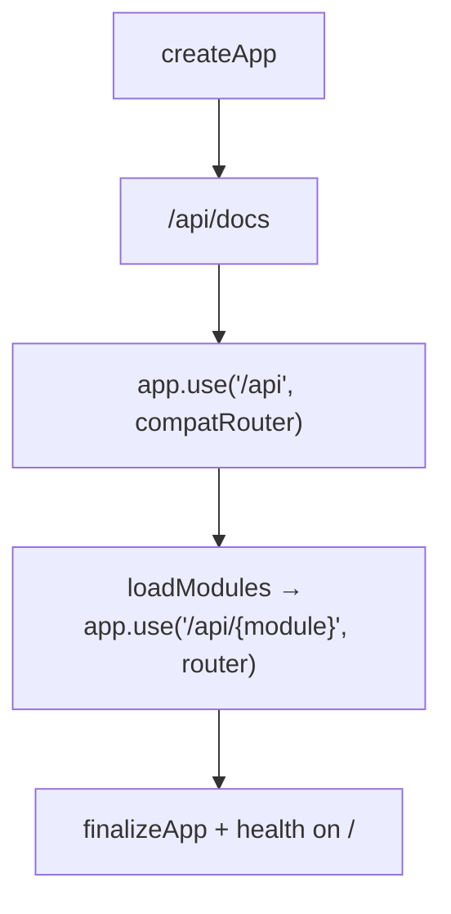

# API Route Registration Audit

**Project:** `pranidoctor-backend`  
**Generated:** 2026-06-03  
**Audit script:** `node scripts/audit-route-registration.mjs`

---

## Executive summary

Startup logs report **2718** “Compat web API routes registered”. That number is **not** 2718 unique HTTP endpoints. It is the count of **Express route registrations** produced by registering **six HTTP methods for every legacy `route.ts` file**, whether or not that method is implemented.

| Metric | Count |
|--------|------:|
| Legacy `route.ts` files | 453 |
| Compat **registered slots** (6 × files) | **2718** |
| Compat **implemented** handlers (exported methods) | **546** |
| Compat **phantom** slots (405 at runtime) | **2172** (~80%) |
| Unique compat URL paths | 453 |
| Duplicate compat path → file mappings | **0** |
| Modular `*.routes.ts` handlers (static scan) | ~230 |
| Infra routes (health, metrics, docs) | 16 |
| **Estimated real API endpoints** (compat + modular + infra) | **~790** |

The inflation is almost entirely from **legacy compatibility registration** in `registerLegacyWebRoutes`, not from duplicate mounts or duplicate path keys in the file tree.

---

## 1. Why 2718 routes are registered

### Root cause

```152:189:src/modules/compat-web/route-registry.ts
export async function registerLegacyWebRoutes(router: Router): Promise<number> {
  const files = walkRouteFiles(ROUTES_ROOT).sort((a, b) => {
    const depth = (p: string) => fileToExpressPath(p).split('/').filter(Boolean).length;
    return depth(b) - depth(a);
  });
  let count = 0;

  for (const file of files) {
    const expressPath = fileToExpressPath(file);
    for (const method of METHODS) {
      const wrapped = lazyLegacyHandler(file, method);
      // ... router.get/post/put/patch/delete/options ...
      count += 1;
    }
  }

  return count;
}
```

`METHODS` is fixed to `GET`, `POST`, `PUT`, `PATCH`, `DELETE`, `OPTIONS` for **every** file under `src/legacy/web/routes/**/route.ts`.

### Formula

```
2718 = 453 legacy route.ts files × 6 HTTP methods
```

This matches the value logged in `createCompatWebRouter`:

```45:46:src/modules/compat-web/compat-web.routes.ts
  registered = await registerLegacyWebRoutes(router);
  getLogger().info({ msg: 'Compat web API routes registered', count: registered });
```

### Phantom behavior

Unimplemented methods still get an Express layer. `lazyLegacyHandler` returns **405** when the module loads but the export is missing:

```144:147:src/modules/compat-web/route-registry.ts
    if (!handler) {
      return new Response(null, { status: 405 });
    }
    return handler(webReq, context);
```

### Phantom slots by method (unimplemented exports)

| Method | Phantom registrations |
|--------|----------------------:|
| OPTIONS | 453 (none of 453 files export OPTIONS) |
| DELETE | 433 |
| PATCH | 413 |
| PUT | 422 |
| POST | 282 |
| GET | 169 |

**OPTIONS alone accounts for 453 phantom slots** (one per file).

### Historical note

An older startup report documented **1944** compat registrations (`docs/reports/BACKEND_STARTUP_FIX_REPORT.md`). That corresponds to **324 × 6**, indicating the legacy tree has grown by **~129 `route.ts` files** since then (now 453).

---

## 2. Duplicate routes

### 2.1 Duplicate Express path keys (compat file tree)

**None.** Each of the 453 `route.ts` files maps to exactly one Express path via `fileToExpressPath`. No two files resolve to the same path string.

Example mapping: `mobile/me/route.ts` → `/mobile/me` → mounted as `/api/mobile/me`.

### 2.2 Duplicate method + path within compat layer

The audit registers every method on every path for collision detection. **No** case exists where two different legacy files produce the same `METHOD /api/...` key in the compat layer alone.

### 2.3 Cross-layer overlap (compat vs modular)

Static scan found **one** path that appears in both compat (all six methods registered) and a modular router file:

| Route | Compat | Modular |
|-------|--------|---------|
| `POST /api/notifications/read-all` | Registered (phantom POST — legacy file exports **PATCH** only) | `notifications.routes.ts` |

**Runtime default:** the notifications module is **not mounted**. `filterFoundationModules` removes stub modules unless `FOUNDATION_MOUNT_STUB_MODULES=true`:

```1:24:src/shared/config/foundation-modules.config.ts
/**
 * Controls which foundation HTTP modules are mounted.
 * Stub modules (animals, clinics, notifications) are off by default to avoid
 * 500s and route shadowing of legacy `/api/notifications/*`.
 */
export const STUB_FOUNDATION_MODULE_NAMES = ['animals', 'clinics', 'notifications'] as const;
```

So in production-like defaults, only compat serves `/api/notifications/*`. The modular `POST /read-all` is dead code unless the env flag is enabled — at which point compat still wins for matching requests because it mounts **first** (see §3).

Legacy handler for read-all:

```5:6:src/legacy/web/routes/notifications/read-all/route.ts
export async function PATCH(request: Request) {
```

Clients must use **PATCH** on `/api/notifications/read-all` today, not POST.

### 2.4 Intentional parallel surfaces (not Express duplicates)

Several domains expose **similar behavior under different URL prefixes** (by design, not registration bugs):

| Area | Paths | Notes |
|------|-------|-------|
| Locations | `/api/locations/*` vs `/api/mobile/locations/*` | 7 public + 6 mobile mirror routes |
| Notifications | `/api/notifications/*` vs `/api/mobile/notifications/*` | Shared service layer, different guards |
| Legal / settings | `/api/admin/settings/*`, `/api/mobile/legal/*`, `/api/doctor/legal/*` | Role-specific entry points |

These increase **unique path count** but are not duplicate registrations on the same path.

---

## 3. Duplicate mounts

### Mount order (`server.ts`)



```204:218:src/server.ts
    const compatRouter = await createCompatWebRouter();
    app.use('/api', compatRouter);
    // ...
    const modules = createAllModules();
    await loadModules(app, modules, { apiPrefix: '/api' });
```

### Findings

| Check | Result |
|-------|--------|
| Compat mounted more than once | **No** — single `app.use('/api', compatRouter)` |
| Same module prefix mounted twice | **No** — `module-loader` uses one `app.use` per module name |
| `compat-web` module double-mount | **No** — `createCompatWebRouter` is only used from `server.ts`; `compat-web.routes.ts` under `src/modules/compat-web/` is not in `createAllModules()` |
| Compat + modular path shadowing | **Possible** when stub modules enabled; compat always registered **before** modules, so compat handles conflicts first |

### Modules with route files vs mounted at runtime

The audit script finds **17** module names that contain `*.routes.ts`. `createAllModules()` registers more definitions (e.g. `feed-consumption`, `feed-recommendation`) that may not expose HTTP routers yet.

**Filtered by default (not mounted):** `animals`, `clinics`, `notifications`.

**Typically mounted (15 modules):** `auth`, `identity`, `area-engine`, `treatment-workflow`, `voice-assistant`, `offline-architecture` (sync/offline), `users`, `doctors`, `leads`, `ai`, `ai-veterinary-core`, `media`, `livestock`, plus any non-stub additions from `filterFoundationModules`.

---

## 4. Legacy compatibility route inflation

### 4.1 Scale by prefix

| Prefix | Unique paths | Registered slots (×6) | Share of 2718 |
|--------|-------------:|----------------------:|:-------------:|
| `admin` | 242 | 1452 | 53% |
| `mobile` | 178 | 1068 | 39% |
| `doctor` | 17 | 102 | 4% |
| `locations` | 7 | 42 | 2% |
| `technician` | 5 | 30 | 1% |
| `notifications` | 3 | 18 | &lt;1% |
| `health` | 1 | 6 | &lt;1% |

### 4.2 Largest inflation pocket: `admin/ai-ops`

- **116** `route.ts` files under `src/legacy/web/routes/admin/ai-ops/`
- **696** registered Express slots (116 × 6) from this subtree alone (**26%** of 2718)
- Mirrors Next.js App Router admin BFF; most admin AI operations remain legacy compat rather than modular `ai` routes

Other large `admin` areas: doctors, ai-technicians, feed ecosystem, launch/GA, prescriptions, locations tooling.

### 4.3 What is “unnecessary” vs required

| Category | Verdict |
|----------|---------|
| **2172 phantom method registrations** | Unnecessary for routing correctness; inflate startup log count and Express `router.stack` size |
| **453 OPTIONS registrations** | Unnecessary unless CORS preflight is handled here (typically app-level CORS middleware suffices) |
| **Legacy tree as a whole** | Still **required** for current admin/mobile/doctor clients until BFF migration completes |
| **Stub modular duplicates** | Intentionally **disabled** (`notifications`, `animals`, `clinics`) to avoid shadowing legacy |

### 4.4 Modular surface (non-inflated)

~230 handlers across 21 `*.routes.ts` files (including nested `ai/*` routers). The `ai` module alone contributes a large share of modular endpoints without multiplying by six.

---

## 5. Total unique routes (definitions)

Use these definitions when comparing metrics:

1. **Registered slots (what logs “2718”)** — every `router.METHOD(path)` call in compat registration = **2718**.
2. **Unique compat URL paths** — **453** (path only, ignoring method).
3. **Implemented compat endpoints** — **546** distinct `METHOD + path` pairs with an exported handler.
4. **Best estimate of real HTTP API surface today** — **546** (compat) + **~200–230** (mounted modular; fewer if stub modules off) + **16** (infra) ≈ **770–790** endpoints.

---

## 6. Optimization recommendations

### P0 — Quick win: register only exported methods

Before the loop in `registerLegacyWebRoutes`, read each `route.ts` (or cache at startup) and call `router.get` / `router.post` / … **only** for exported functions.

**Expected impact:** compat registrations drop from **2718** to **~546** (~80% reduction) with no client change for correctly implemented routes.

```typescript
// Sketch — align registration with exports
const exports = await detectExportedMethods(file);
for (const method of exports) {
  registerMethod(router, method, expressPath, wrapped);
}
```

### P1 — Stop counting phantoms in ops metrics

- Log **two** numbers at startup: `compatPaths: 453`, `compatHandlers: 546`, `compatRegisteredLayers: 546` (after P0).
- Update `getCompatRouteCount()` / metrics to report implemented handlers, not `files × 6`.

### P2 — OPTIONS policy

- Remove per-route OPTIONS registration unless a specific legacy handler exports OPTIONS.
- Rely on global CORS middleware for preflight.

### P3 — Reduce legacy surface over time

Priority migration candidates (high slot count, modular partial exists):

1. **`admin/ai-ops`** — 116 files; consolidate into `src/modules/ai` admin routers.
2. **`mobile/notifications`** — align with modular notifications when stub mount is enabled; standardize on PATCH vs POST for `read-all`.
3. **Locations mirrors** — optional unified `/api/locations` with scope query vs duplicate trees.

### P4 — Stub module policy

Keep `FOUNDATION_MOUNT_STUB_MODULES` **false** in dev/prod until legacy routes are removed. If enabled, resolve `POST /api/notifications/read-all` collision explicitly (remove compat phantom POST or delete duplicate modular route).

### P5 — Feature flag for compat (long term)

For environments where modular coverage is complete:

```env
COMPAT_WEB_ROUTES_ENABLED=false
```

Mount only modular routers to eliminate legacy stack entirely.

### P6 — Re-run audit in CI

```bash
node scripts/audit-route-registration.mjs
```

Fail CI if:

- `compatRegisteredSlots` grows without new `route.ts` files (regression to blind ×6 registration after P0 fix).
- `duplicateCompatPathMappings > 0`.
- New `crossLayerCollisions` appear when stub modules are enabled.

---

## 7. Touch points (for implementation)

| File | Role |
|------|------|
| `src/modules/compat-web/route-registry.ts` | Legacy discovery, ×6 registration, 405 phantoms |
| `src/modules/compat-web/compat-web.routes.ts` | Compat router factory, startup count log |
| `src/server.ts` | Mount order: `/api` compat then modules |
| `src/shared/config/foundation-modules.config.ts` | Stub module filtering |
| `src/shared/module/module-loader.ts` | `/api/{moduleName}` mounts |
| `src/modules/index.ts` | Module registry |
| `scripts/audit-route-registration.mjs` | Repeatable audit |

---

## Appendix: audit command output (summary)

```json
{
  "legacyRouteFiles": 453,
  "compatRegisteredSlots": 2718,
  "compatImplementedHandlers": 546,
  "compatPhantomSlots": 2172,
  "uniqueCompatPaths": 453,
  "duplicateCompatPathMappings": 0,
  "crossLayerCollisions": ["POST /api/notifications/read-all"]
}
```
